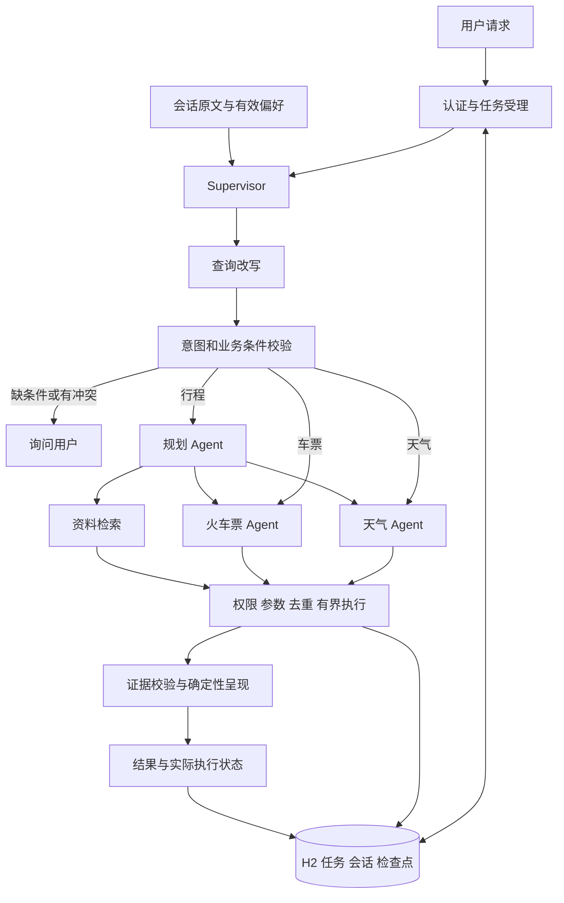
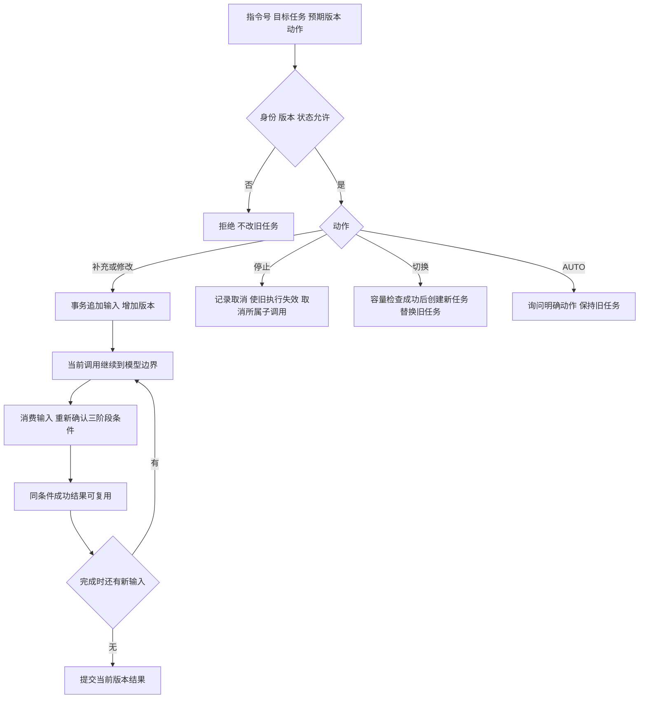
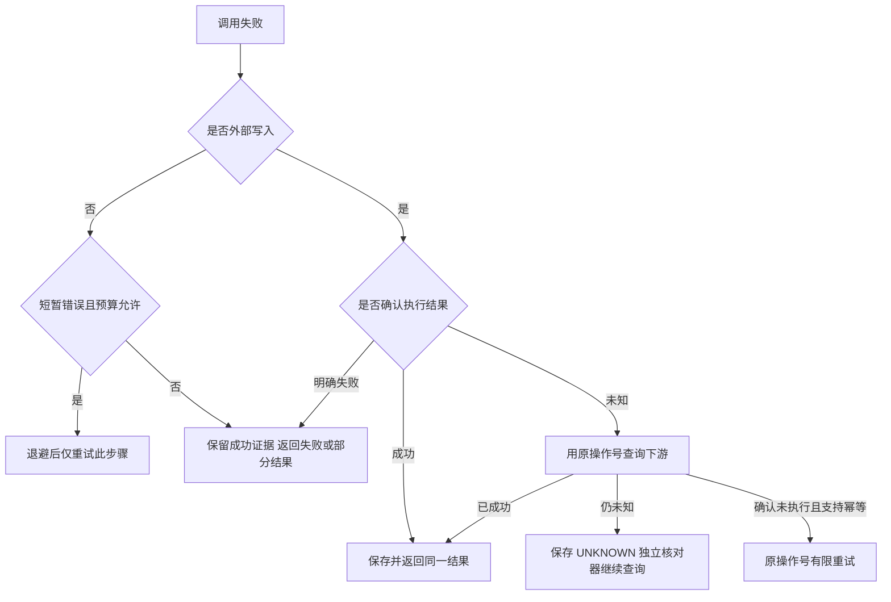
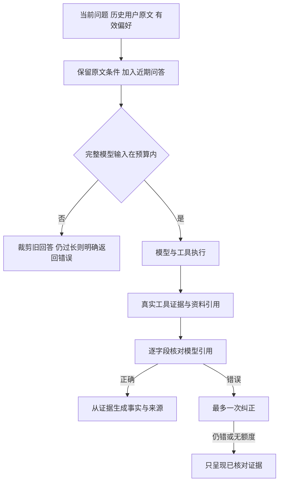

# Supervisor 全包实现说明

2026-10-28。已按本次批准方案复核原有 16 个类，修改核心运行逻辑并补齐运行管理。具体测试结果见[实施记录](实施记录.md)，逐类处理和固定版本源码链接见[源码参考与适配边界](源码参考与适配边界.md)。

## 先理解整体

主流程仍然只有三步：**查询改写 → 意图识别 → 调用子 Agent**。天气和火车票分别查询；行程规划复用两个查询 Agent，并检索本地出行资料。Spring Boot 提供接口，任务管理器负责执行生命周期。



选择多 Agent 是为了限制各角色可用工具、复用查询能力、隔离局部上下文。简单天气问题直接交给天气 Agent，只有复合行程才协调多个角色。代价是模型调用更多；它不会天然比单 Agent 更聪明。

## 16 个问题，逐项对应

| # | 问题 | 已实现的处理 | 主要代码 |
|---|---|---|---|
| 1 | 子 Agent 执行挂了 | 错误转成明确结果；保存已有成功证据，返回部分结果。进程重启恢复有效任务，重用完成检查点 | ChildAgentDispatcher、TaskService |
| 2 | 执行中来了新指令 | 补充、修改排队，下一次模型调用前消费，沿用任务号和预算；停止、切换才取消旧执行。完成前再次检查输入版本 | TaskService、RunContext、Supervisor |
| 3 | 时间和调用上限 | 保存绝对截止时间；模型调用前原子预留任务、步骤和全局额度。父子、重试、恢复共享 | RunControl、TaskService |
| 4 | 工具幂等 | 读工具按参数与数据版本合并和回放；写操作用稳定操作号、参数摘要和数据库唯一约束 | ToolExecutor、SideEffectLedger |
| 5 | 为什么多 Agent | 角色分工、工具隔离、查询能力复用；三阶段调度由程序控制 | TravelAgentFactory、Supervisor |
| 6 | 上下文传递与防重 | 服务端传可信任务上下文和结构化条件，子 Agent 返回事实；相同查询合并订阅，成功结果持久化后复用 | ChildAgentDispatcher、RunContext |
| 7 | 多轮与长期记忆 | 服务端隔离会话历史；保留用户原文条件和近期回答。长期偏好由显式接口确认，支持版本、删除和过期 | ConversationService、ContextBuilder |
| 8 | 召回对但回答错 | 让模型给出事实引用，逐字段核对实际证据，最多再纠正一次；最终事实从证据呈现，规则引用原文 | KnowledgeService、AnswerVerifier |
| 9 | 上下文太长 | 计算包含工具定义的完整请求，优先裁剪旧回答；当前问题和用户原文条件过长时明确失败，绝不悄悄截断 | ContextBuilder、RunContext |
| 10 | 单工具失败 | 成功证据独立保留；部分失败返回 PARTIAL，不把整条链重跑 | TravelTools、RunContext |
| 11 | 哪些失败可重试 | 临时连接故障、短暂限流及可恢复服务端错误有限重试；权限、参数、业务拒绝、配额耗尽不原样重试 | ToolExecutor、ModelHttpTransport |
| 12 | 重试避免外部副作用 | 外部结果未知先查状态；只有确认未执行且下游支持幂等，才用原操作号再提交。定时核对器只查状态 | SideEffectLedger、SideEffectReconciler |
| 13 | 工具选错、参数格式错 | 角色工具白名单、SDK 结构校验、错误回传与持久纠错计数；达到上限停止 | ToolGuard、TravelAgentFactory |
| 14 | 格式对但含义错 | 对照原始用户条件检查城市、路线、日期、天数；否定冲突或 Demo 无法表达的限定要求澄清 | BusinessConditions、TravelTools |
| 15 | 调用不存在的工具 | 注册表拒绝，不尝试反射或自动编造工具；错误回到模型并计入纠错上限 | ToolGuard、AgentScope Toolkit |
| 16 | 调用无权限工具 | 服务端认证、按角色暴露工具、执行时再次检查；缓存、历史回答和任务结果回放也重新检查权限 | AccessPolicy、TaskService、RunContext |

## 新指令到底怎么处理



补充/修改不会自动刷新 60 秒或 16 次预算，也不会立即杀掉正在执行的工具。队列最多 32 条，待消费文本合计最多 2000 字符，超出在受理前拒绝。任务最终提交使用“受理版本＝消费版本”检查，避免最后一条指令被旧结果覆盖。

HTTP 连接断开只停止等待，后台已受理任务仍继续。停止要调用指令接口。已取消的本地订阅不能证明远程服务已经停止，更不能撤销已经发生的外部写入。

## 故障、恢复与幂等



任务在 H2 中保存截止时间、预算、输入队列、阶段和成功结果。提交同步刷盘；重启只恢复仍有效的任务，截止时间继续流逝，已用次数不会归零。逻辑步骤指纹对 JSON 对象键排序，去掉随机消息号，保证不同 JVM 计算一致。

外部写入账本独立于任务：任务取消或超时后，未知操作仍可核对。唯一键包含租户、用户、工具和稳定业务操作号；同号异参拒绝。下游没有幂等和状态查询能力时，不承诺恰好一次。天气和车票工具均为只读，写入链路通过独立持久化测试适配器验证；默认没有连接真实交易系统。

## 回答与上下文



本地知识资料有文档号、版本、原文位置和有效期；过期片段不返回。知识结论采用原文摘录；天气、金额、日期等采用实际工具字段。行程建议是明确标注的简单模板。这能保护所呈现的字段和引用，不能自动证明任意自由文本推理正确。

历史“摘要”是可追溯的用户原文清单，并非模型生成的无损摘要。最近问答最多加入六轮。偏好与历史分开存储，删除后不会从应用生成的历史自动恢复。客户端 history 只是补充资料，不能覆盖服务端正式记录或提供身份授权。

## 如何运行

环境：Java 17、Maven。默认离线模型和本地演示数据，不需要模型 Key。

```bash
mvn -q package
export SUPERVISOR_AUTH_TOKENS='demo-token=demo-tenant:demo-user:query_weather,query_trains,search_knowledge,memory:write'
bash run-supervisor-server.sh
```

令牌只是本机演示认证配置，实际使用请替换。无认证映射时服务拒绝启动。默认监听 `127.0.0.1:8080`，数据库为项目 `data/supervisor`。不要让两个进程同时打开同一个文件库。

发起任务，普通调用等结果，带 Prefer 则立即取得任务号：

```bash
curl 'http://127.0.0.1:8080/api/supervisor/chat'   -H 'Authorization: Bearer demo-token'   -H 'Content-Type: application/json'   -H 'Prefer: respond-async'   -d '{"requestId":"request-1","sessionId":"session-1","question":"明天从杭州到上海玩一天，看看天气和火车票，规划行程","history":[]}'
```

所有接口都需要同一认证请求头：

| 方法与路径 | 请求/用途 |
|---|---|
| POST `/api/supervisor/chat` | 发起任务；requestId 相同内容重放、不同内容 409 |
| GET `/api/supervisor/runs/{runId}` | 查询进度、结果、revision、modelCalls、deadline |
| POST `/api/supervisor/runs/{runId}/instructions` | `{instructionId,expectedRevision,action,message}`；动作 SUPPLEMENT、REVISE、SWITCH、CANCEL、AUTO |
| GET `/api/supervisor/memories?limit=20` | 获取当前用户有效偏好；返回分页游标 |
| PUT `/api/supervisor/memories/{key}` | `{value,expectedVersion,expiresAt}`；首次版本 0；键为 preferredDepartureCity 或 preferredSeat |
| DELETE `/api/supervisor/memories/{key}?expectedVersion=1` | 按版本删除偏好 |

每个接口的独立处理流程图见[技术方案](技术方案.md)“接口设计”。指令示例中预期版本必须使用 GET 的最新值：

```json
{"instructionId":"instruction-1","expectedRevision":1,"action":"REVISE","message":"改成上海后天的天气"}
```

正常业务结果为 200，异步受理和明确修改为 202；认证错误 401，无权限 403，不可访问任务 404，版本/幂等冲突 409，过大 413，容量满 429，存储不可用 503。普通同步任务失败返回 502、超时 504；查询接口返回 200 和任务实际状态。

命令行：

```bash
bash run-supervisor.sh --offline '杭州明天的天气'
bash run-supervisor.sh --offline '明天从杭州到上海玩一天，看看天气和火车票，规划行程'
bash run.sh
```

最后一条仍运行原乘法示例。服务包是 `target/agentscope-react-demo-boot.jar`，命令行包是 `target/agentscope-react-demo.jar`。

真实模型需设置 DEMO_BASE_URL、DEMO_MODEL、DEMO_API_KEY，再用 `SUPERVISOR_MODE=live bash run-supervisor-server.sh` 或 `bash run-supervisor.sh --live '问题'`。密钥通过环境注入，不写进源码。**live 仅替换模型，业务数据仍为示例。** 本次没有调用外部付费模型。

## 限制与默认配置

| 控制 | 默认值 |
|---|---|
| 单任务 | 60 秒，最多 16 次预留模型尝试 |
| 单次模型/工具等待 | 最多 20 秒 / 5 秒，受剩余任务时间约束 |
| 重试 | 最多 3 次尝试含首次；尊重 Retry-After；已开始输出的模型流不重放 |
| 上下文 | 输入上限 6656，输出预留 1024，安全余量 512；按 UTF-8 字节保守估算 |
| 执行并发 | 全局 8，每用户 2；工具物理线程 8、队列 32 |
| 准入速率 | 每用户每分钟 10 个新任务；全局每分钟 120 次模型尝试、90000 预留 Token 估算 |
| 保存 | 最多 10000 个任务；任务 7 天、会话 30 天、偏好默认 90 天 |

数字是 Demo 配置，不是压测吞吐或供应商账单。预留后取消也可能计数，宁可保守扣减。阻塞工具忽略中断时仍占原物理线程，不会因取消就无限补线程。

示例天气只有杭州、上海，车次只有杭州至上海，资料是本地演示文本；离线模型只认识示例句式。明确座席、预算等当前工具无法表达的条件会要求澄清。H2 为本地单进程恢复，不是多实例调度。

WebFlux 是 HTTP 框架，Reactor 的 Mono/Flux 表达异步序列，SSE 是持续事件传输格式。当前六个接口返回 JSON，通过任务查询取进度，未实现 SSE 逐字输出。

## 源码参考的准确含义

核心输入排队、完成检查、取消、工具错误回传和共享预算，逐项核对固定 Codex 源文件；Claude 参考公开 Agent SDK 的工具结构验证。Java 实现沿用这些可核实的行为，再适配三阶段旅行业务。

三个子 Agent 是任务内联调用，显式停止旅行任务会停止所属调用。Codex 独立子 Agent 有自己的生命周期，不能把两者说成完全相同。H2 业务恢复、外部幂等、偏好确认和证据校验是本次已批准的业务扩展，不冒充上游通用保证。详细函数和差异在[源码对照文档](源码参考与适配边界.md)。

## 阅读与验证

先读 Supervisor，再读 TaskService、RunContext，最后按需要读工具、记忆和校验模块。所有代码位于 `src/main/java/dev/garden/demo/supervisor/`；公开接口和运行配置分别在 SupervisorController、SupervisorSettings。

```bash
mvn -q clean test
mvn -q -Dtest=SupervisorSocketIT test
mvn -q -DskipTests package
```

默认测试覆盖真实 AgentScope 离线循环、Spring 处理链、SDK HTTP 429/401、实际 JVM 强制退出和恢复等；SocketIT 单独启动真实本地 HTTP 监听。完整数量和结果统一记录在[实施记录](实施记录.md)，16 项对应测试见[验收用例](验收用例.md)。
