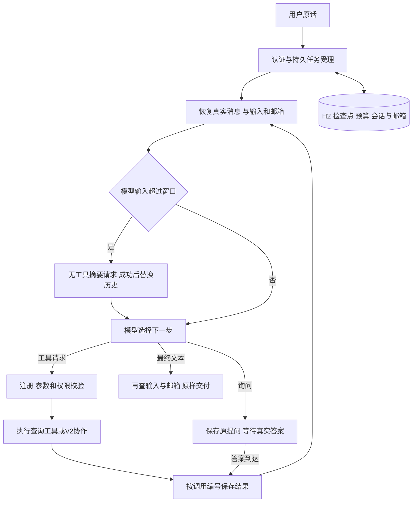
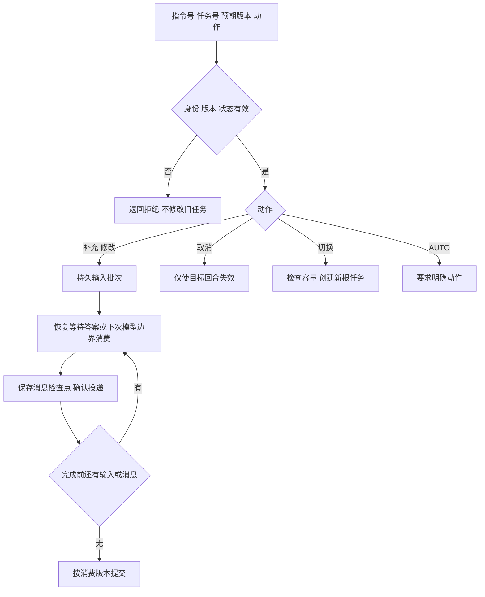

# Supervisor 全包实现说明

v3.5，2026-10-29。核心采用固定 Codex 提交的 MultiAgent V2 与本地模型摘要路径；主子会话共用显式模型—工具循环。模型最终文本原样返回，取消固定改写/意图阶段、固定澄清模板和必经第二个答案模型。v3.5 在保持上述行为基线的同时补齐七项运行策略：业务语义校验、确定性事实校验、纠错上限、多 Agent 量化门槛、统一失败分类、压缩保真与话题切分。源码行号与尚未对齐项见[源码参考与适配边界](源码参考与适配边界.md)，执行证据见[实施记录](实施记录.md)。

保留用户已审阅的 controller/service/repo/pojo 分层、MyBatis、声明式事务、请求filter和HTTP接口；对应要求见[重构对照说明](重构对照说明.md)。

## 整体执行



天气、车票、行程是角色提示词和工具集合。主模型可以直接使用可见查询工具，也可以创建独立子会话；没有“必须先天气再车票再校验”的固定链。子会话使用相同循环，自己决定查询、继续协作或结束。离线脚本只模拟示例场景，不能证明真实模型的理解或规划效果。

`rewrittenQuery` 保留旧接口字段，表示当前输入而非隐藏改写；`intent` 是兼容展示字段，不驱动前置分类。最终`answer`来自实际模型文本；`evidence`与`agents`是附件，不把模型答复改成模板。

## 独立 Agent 与 V2 协作

| 模型工具 | 参数与行为 |
|---|---|
| `spawn_agent` | `task_name,message`，可选`agent_type,fork_turns`；角色为weather_agent/train_agent/itinerary_agent，fork为all或none；返回已受理子身份，不等待最终结果 |
| `send_message` | `target,message`；只入收件人邮箱，不启动闲置会话 |
| `followup_task` | `target,message`；闲置子会话开始新回合，运行中的会话排队；不把普通消息与新任务混为一类 |
| `wait_agent` | 可选`timeout_ms`；等待调用者自己的消息或新输入；不消费消息、不取消子会话，不接受legacy ids参数 |
| `list_agents` | 可选`path_prefix`；查看树内会话及状态 |
| `interrupt_agent` | `target`；返回中断前状态，只停止目标当前回合，不删除session，不级联取消后代 |
| `request_user_input` | `questions`包含问题编号、标题、正文与可选选项；保留提问原文和call ID，收到实际回答才生成工具结果 |

接受前失败/取消清理临时子记录；接受后子会话具有独立订阅、取消代数和检查点。父正常完成或CANCEL不撤回已接受子会话。子回合完成/失败通知进入直接父邮箱；普通中断不是最终完成，之后可followup。同树共享调用额度和绝对期限，父子独立取消不会获得新额度。


协作操作还保存单独回执：稳定回合号 + 工具调用号对应一次 spawn/send/followup/interrupt。操作已受理但工具消息尚未保存时重启，恢复原回执，不重复操作。普通读缓存、协作回执和外部写入账本分别处理不同防重边界。

fork默认保留父消息作为历史，添加继承身份说明；历史工具调用不会在子会话再次执行，父审批和父执行状态不直接成为子权限。`fork_turns=none`从新历史开始。当前模型工厂不提供上游model/reasoning_effort覆盖参数，差异不能用“角色相同”掩盖。

## 输入、等待与恢复

补充和修改以原顺序逐条入队，在模型安全边界加入会话；不预先猜用户意图，也不把多个输入拼成一条。收到父子消息时附发送者、种类和正文，代理消息不能被当作真实用户授权。队列投递与循环检查点配合确认，避免drain后崩溃丢输入。

询问等待时任务为NEEDS_INPUT，原工具请求保持未回答；通过指令接口提交答案后，按原call ID恢复。单题普通文本原样回传；多题可提交`{"answers":{"问题编号":{"answers":["回答"]}}}`。保存提问后不能用“等待用户补充”伪造工具成功结果。



HTTP断开只停止等待；后台任务继续。补充/修改不重置默认期限或模型次数。任务、子身份、邮箱、工具消息和压缩替换历史写入H2；重启沿用用量与期限，旧代执行不能提交新代结果。H2是单进程恢复，不能代替分布式执行租约。相同会话取消后再次提交，会继承已完成工具历史，为未完成调用补中断结果，再追加真实新输入。当前 HTTP 仍沿用新请求建立新根任务的约定，旧树已受理的子会话继续归原根管理。

## 上下文与终答

ContextBuilder只重建可信提示、日期和历史信任说明。旧问答以真实user/assistant消息初始化一次，不再塞进SYSTEM的“用户条件清单”。窗口过长时由`compact`角色生成交接摘要，压缩请求不提供业务工具；只有完整摘要成功后才替换正式历史。内部超窗从临时历史头部移除，并同步处理工具调用/结果；失败、取消和无效摘要保留旧历史。

当前用户问题优先保留全文，只按最小摘要预留计算预算；旧条件和最近工具配对按完整摘要预留，放不下就放弃；摘要最后放，只有完整摘要确实放不下时才截断并标记 `summaryTruncated`。旧摘要、代理消息和内部通知不作为新用户原文保留。替换成功写“摘要忠实度”事件，低于阈值且开关开启时写告警；`SummaryFaithfulness` 只做确定性 token 级评测，不证明语义忠实。替换历史、摘要及代数写在同一检查点，协议1旧记录可迁移，恢复不重新注入已压缩request.history。

主模型的终答不自动经过AnswerVerifier，也不会被能力说明/澄清模板覆盖。KnowledgeService仍能提供文档号、版本、位置和有效期；AnswerVerifier仍是可独立复用组件，但当前不是核心强制校验链。不能因为保留了这两个类，就宣称自由文本答复、引用忠实性或全部自然语言条件已自动验证。

## 16 项能力与边界

| # | 能力 | 当前处理与限制 |
|---|---|---|
| 1 | 子Agent失败 | 独立状态与完成/失败通知；父模型决定修正，不强制重跑整树 |
| 2 | 执行中新输入 | 有序队列、持久投递确认、完成版本栅栏 |
| 3 | 时间与次数 | 共享根预算、绝对期限、每次真实请求预留；恢复不归零 |
| 4 | 工具幂等 | 读缓存与写账本分开；工具调用号不能替代业务操作号 |
| 5 | 多Agent理由 | `MultiAgentGate` 量化并行度、token、时延和深度；默认 `ADVISORY` 只记录决策，`ENFORCE` 执行硬上限 |
| 6 | 传递与去重 | 带来源邮箱、call ID配对、按回合去重通知；fork不复制父执行权 |
| 7 | 多轮与长期记忆 | 会话历史和显式确认偏好分别保存；`TopicSegmenter` 只改变历史装配范围，不删除旧会话 |
| 8 | 召回正确但回答错 | `AnswerFactChecker` 确定性比对数值和日期；冲突或高风险无证据数值降级 `PARTIAL`；语义校验默认关闭 |
| 9 | 上下文过长 | 模型摘要、当前问题优先、完整摘要预留、边界截断标记、token 级忠实度告警、失败保留旧历史 |
| 10 | 单工具失败 | 错误回模型，已成功证据不被其他失败覆盖 |
| 11 | 重试分类 | `FailureClassifier` 统一分类；429 限流可重试、配额耗尽不重试；识别 `Retry-After` |
| 12 | 外部副作用 | 先落RUNNING claim，再调用下游；未知结果查状态，不直接重复写 |
| 13 | 参数格式错 | Schema 与工具字段校验；连续两次同工具 schema 错误后在本运行禁用，错误配对回模型 |
| 14 | 参数含义错 | `BusinessRules` 在数据源前校验过去日期、超出未来窗口和同城路线，返回 `BUSINESS_RULE_VIOLATION`；平台级规则声明未实现 |
| 15 | 不存在工具 | 运行期工具快照拒绝并回模型；第二次要求澄清，第三次进入 `FAILED`，不暴露内部工具清单 |
| 16 | 无权限工具 | 认证、角色工具可见性、运行时与历史/缓存/证据回放重新检查 |

SideEffectLedger在调用外部系统前独立提交claim，故有意不加`@Transactional`；未知结果可在任务取消后继续核对。下游没有稳定幂等和查询能力时不承诺恰好一次。默认天气/车次是只读演示数据，写入恢复通过专用测试适配器验证。

## 如何运行

环境：Java 17、Maven。默认离线模型和本地演示数据，不需要模型 Key。

```bash
mvn -q package
export SUPERVISOR_AUTH_TOKENS='demo-token=demo-tenant:demo-user:query_weather,query_trains,search_knowledge,memory:write'
bash run-supervisor-server.sh
```

令牌只是本机演示认证配置，实际使用请替换。无认证映射时服务拒绝启动。默认监听 `127.0.0.1:8080`，数据库为项目 `data/supervisor`。不要让两个进程同时打开同一个文件库。

发起任务，普通调用等结果，带 Prefer 则立即取得任务号：

```bash
curl 'http://127.0.0.1:8080/api/supervisor/chat'   -H 'Authorization: Bearer demo-token'   -H 'Content-Type: application/json'   -H 'Prefer: respond-async'   -d '{"requestId":"request-1","sessionId":"session-1","question":"明天从杭州到上海玩一天，看看天气和火车票，规划行程","history":[]}'
```

所有接口都需要同一认证请求头；鉴权与 `Prefer: respond-async` 由请求 filter 统一处理，接口方法不接收这些参数：

| 方法与路径 | 请求/用途 |
|---|---|
| POST `/api/supervisor/chat` | 唯一参数 `ChatParam`；发起任务，requestId 相同内容重放、不同内容 409 |
| GET `/api/supervisor/runs/{runId}` | 查询进度、结果、revision、modelCalls、deadline |
| POST `/api/supervisor/instructions` | 唯一参数 `InstructionParam`：`{runId,instructionId,expectedRevision,action,message}`；动作 SUPPLEMENT、REVISE、SWITCH、CANCEL、AUTO |
| GET `/api/supervisor/memories` | 获取当前用户有效偏好第一页，固定 20 条；返回下一游标 |
| GET `/api/supervisor/memories/{cursor}` | 按游标获取下一页 |
| PUT `/api/supervisor/memories/{key}` | `{value,expectedVersion,expiresAt}`；首次版本 0；键为 preferredDepartureCity 或 preferredSeat |
| DELETE `/api/supervisor/memories/{key}/{expectedVersion}` | 按路径中的版本删除偏好 |

每个接口的独立处理流程图见[技术方案](技术方案.md)“接口设计”。`POST /api/supervisor/chat` 的请求/响应字段、完整链路、状态码与同步异步时间线另见 [chat接口详解](chat接口详解.md)。指令示例中预期版本必须使用 GET 的最新值：

```json
{"runId":"实际任务号","instructionId":"instruction-1","expectedRevision":1,"action":"REVISE","message":"改成上海后天的天气"}
```

正常业务结果为 200，异步受理和明确修改为 202；认证错误 401，无权限 403，不可访问任务 404，版本/幂等冲突 409，过大 413，容量满 429，存储不可用 503。普通同步任务失败返回 502、超时 504；查询接口返回 200 和任务实际状态。

命令行：

```bash
bash run-supervisor.sh --offline '杭州明天的天气'
bash run-supervisor.sh --offline '明天从杭州到上海玩一天，看看天气和火车票，规划行程'
bash run.sh
```

最后一条仍运行原乘法示例。服务包是 `target/agentscope-react-demo-boot.jar`，命令行包是 `target/agentscope-react-demo.jar`。

真实模型需设置 DEMO_BASE_URL、DEMO_MODEL、DEMO_API_KEY，再用 `SUPERVISOR_MODE=live bash run-supervisor-server.sh` 或 `bash run-supervisor.sh --live '问题'`。密钥通过环境注入，不写进源码。**live 仅替换模型，业务数据仍为示例。** 本次没有调用外部付费模型。

## 配置与尚未一致的行为

| 控制 | 当前默认配置 |
|---|---|
| 单任务树 | 60秒绝对期限，16次预留模型尝试；父子及摘要共享 |
| 单次模型/工具等待 | 最多20秒/5秒，并受剩余期限约束 |
| 重试 | 最多3次真实尝试含首次；普通已发分片不重放，摘要失败分片隔离后可重试 |
| 上下文 | 完整输入按JSON UTF-8字节估算，上限6656；默认输出1024，摘要同样计入用量 |
| HTTP准入 | 全局8、每用户2；工具物理线程8、队列32 |
| Agent树并发 | 最多8个活动子会话，根会话不占此名额；与HTTP容量分开 |
| 速率 | 每用户每分钟10个新根任务；全局每分钟120次模型尝试、90000预留估值 |
| 保存 | 最多10000任务；任务7天、会话30天、偏好默认90天 |

七项运行策略使用 `supervisor.policy.*`，默认安全开启值如下：

| 配置 | 默认值 | 说明 |
|---|---|---|
| `business-rules-enabled` | `true` | 工具内业务语义校验；关闭后不检查过去日期、未来窗口和同城路线 |
| `business-max-future-days` | `30` | 允许查询的最大未来天数 |
| `fact-check-enabled` | `true` | 确定性数值和日期事实校验、冲突降级 |
| `semantic-verifier-enabled` | `false` | 高风险可选 `AnswerVerifier`；开启后普通任务仍不增加模型调用 |
| `fact-high-risk-tools` | `query_weather,query_trains` | 高风险工具集合 |
| `correction-limits-enabled` | `true` | 纠错次数上限与运行内工具禁用 |
| `max-consecutive-schema-errors` | `2` | 同一工具连续 schema 错误上限 |
| `max-tool-not-found` | `2` | 工具不存在次数；第二次要求澄清，第三次失败 |
| `max-business-violations` | `2` | 同一运行业务违规上限 |
| `max-total-corrections` | `6` | 同一运行总纠错上限 |
| `multi-agent-mode` | `"ADVISORY"` | `OFF` 保持原行为，`ADVISORY` 只记录决策，`ENFORCE` 执行深度/数量硬上限 |
| `multi-agent-min-parallelism` | `2` | 低于该并行度不建议多 Agent |
| `multi-agent-max-agents` | `4` | `ENFORCE` 下允许的活动子会话数 |
| `multi-agent-max-depth` | `2` | `ENFORCE` 下允许的会话深度 |
| `multi-agent-max-token-multiplier` | `2.0` | 多 Agent 预计 token 相对单 Agent 的上限倍数 |
| `multi-agent-min-latency-saving-ms` | `500` | 非时延敏感任务要求的最小收益 |
| `topic-segmentation-enabled` | `true` | 确定性话题切分；只影响历史装配，不删除会话 |
| `topic-recent-turns` | `6` | 判断话题时考察的历史问题数 |
| `topic-min-confidence` | `0.6` | 意图变化触发切换的最低置信度 |
| `retry-max-attempts` | `3` | 单次真实请求的最大尝试次数 |
| `retry-backoff-cap-ms` | `2000` | 指数退避上限 |
| `summary-fidelity-alert-enabled` | `true` | 摘要忠实度低于阈值时写告警事件 |
| `summary-fidelity-threshold` | `1.0` | token 级保留率阈值 |

`multi-agent-mode` 在 YAML 中必须加引号，例如 `"OFF"`；YAML 1.1 会把未加引号的 `OFF` 解析成布尔 `false`。

以上是服务配置，非Codex标准、实测吞吐或供应商账单。子会话独立调度与HTTP请求槽分开；子会话上限见 AgentLifecycle.MAX_ACTIVE_CHILDREN。忽略中断的阻塞调用仍占用原物理资源。

当前选择Chat Completions和local compact。Responses继续标记、远端opaque压缩、后台压缩候选、完整world-state/hook协议未接入；V2全部可选配置、resident-only列举、懒加载等也不能宣称已经一致。源码文档逐项说明差异，不能用“演示场景无需”替代核对。

默认数据只有部分示例城市与线路，离线模型只识别示例句式。live只替换模型，业务数据仍是示例。HTTP返回JSON，通过查询取进度；当前没有SSE逐字输出。没有使用外部付费模型效果来证明本地脚本验收结论。

## 阅读与验证

先读Supervisor、LoopConversation、ContextCompactor，再读RunControl、LocalAgentControl、TaskService、TaskStoreService；最后读工具、记忆、校验和repo/MyBatis。主子运行不依赖ReActAgent隐式子循环；独立校验组件仍有SDK入口。HTTP/controller、filter、service、repo、pojo等分层保持不变。

```bash
mvn -q test
mvn -q -Dtest=SupervisorSocketIT test
mvn -q -DskipTests package
```

测试与实际结果统一写入[实施记录](实施记录.md)。新核心行为重点看CoreSourceParityTest、ContextCompactionTest、AgentLifecycleTest和OfflineSourceProfileTest；事务、权限、幂等、网络传输与重启仍需对应集成验证。测试名称和源码映射不是通过记录。
