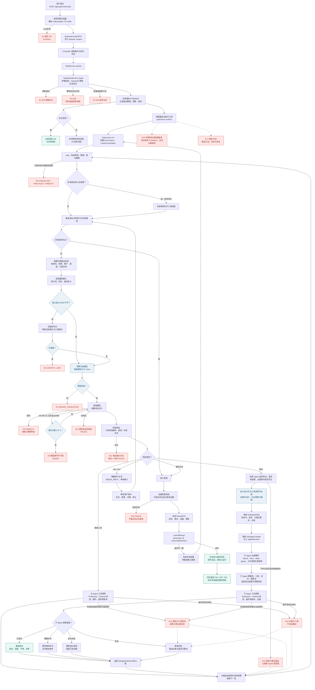
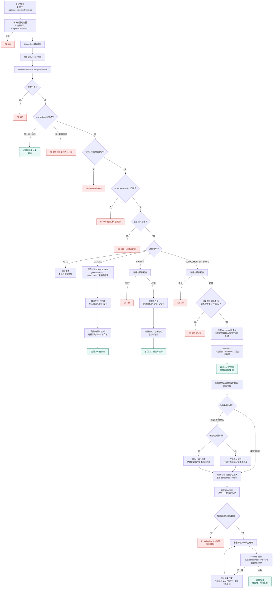
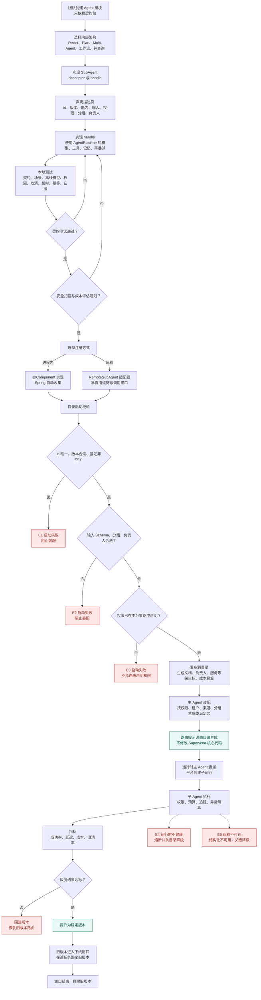

# 多agent平台改造

日期：2026-10-29。

状态：待审阅。本文只描述方案，尚未改动代码。

范围：`src/main/java/dev/garden/demo/supervisor` 的 Agent 编排层，以及新增的子 Agent 注册、委派、子运行、目录与治理能力。`TaskService` 的顶层任务状态机、绝对截止时间、预算预留、重启恢复、输入排队、副作用账本、证据权限检查保持为行为基线，不在本文的替换范围内。

---

## 一、背景与目标

### 1.1 产品背景

这个项目是一个多 Agent 编排平台。公司主要做旅行相关业务，平台只有一个顶层入口，所有用户都通过这个入口和主 Agent 对话：

- 普通用户关注旅行信息，例如天气、车票、行程。
- 运营用户关注数据信息，例如订单量、退款率、转化率。
- 平台内部会有很多子 Agent，由不同团队和业务线开发维护。

对子 Agent 开发团队的期望是：只关心自己的 Agent 怎么实现，按照少量配置或声明挂到主 Agent 上，不需要修改主 Agent 的核心代码。

### 1.2 目标

1. 顶层入口保持唯一，用户不选择 Agent，由主 Agent 负责委派。
2. 子 Agent 可以采用任意内部架构，包括 ReAct、Plan-and-Execute、多 Agent 协作、固定工作流、纯确定性查询、人工处理。
3. 子 Agent 开发团队只提供“描述符 + 实现”，平台负责注册、发现、权限、预算、持久化、追踪和失败隔离。
4. 子 Agent 是独立执行体，不是父级循环里的无状态函数。
5. 平台具备规模化所需的目录、分层路由、上下文预算和治理能力。

### 1.3 非目标

1. 不把自由群聊式多 Agent 作为默认编排方式。自由群聊成本高、难控制，不适合作为统一平台的默认路径。
2. 不推翻 `TaskService` 的顶层任务外壳。子运行是新增的一层，不是替代顶层任务。
3. 第一阶段不要求跨进程部署。远程子 Agent 先预留契约和适配器接口，进程内实现先行。
4. 不要求所有子 Agent 都支持细粒度恢复。允许实现声明“仅边界取消”，由平台按声明降级。

---

## 二、现状与阻塞点

### 2.1 写死的位置

当前要新增一个子 Agent，至少要改以下位置：

| 位置 | 写死的内容 | 影响 |
|---|---|---|
| `Supervisor.PROMPT` | 旅行场景的系统提示词，直接点名 `weather_agent`、`train_agent`、`itinerary_agent` | 非旅行子 Agent 没有路由入口 |
| `Supervisor.registry()` | `List.of("weather_agent", "train_agent", "itinerary_agent")` | 新增 Agent 必须改平台代码 |
| `ChildAgentDispatcher.tool(name)` | 每个 Agent 的中文名称、参数 Schema，使用 `switch` 分支 | 新增 Agent 必须补分支 |
| `ChildAgentDispatcher.allowed(name)` | 每个 Agent 对应的权限名，使用条件分支 | 权限模型与 Agent 实现耦合 |
| `TravelAgentFactory.child(name)` | 每个 Agent 的角色、提示词、工具集合，使用条件分支 | 子 Agent 实现无法独立演进 |
| `ContextBuilder.modelInput(...)` | 当前输入上限为 6656 字节，且工具 Schema 计入输入 | 子 Agent 数量增长后必然超限 |

这些位置共同构成“接入税”：团队要实现一个子 Agent，必须读懂并修改主 Agent 核心代码。这与平台目标冲突。

### 2.2 子 Agent 被当成无状态工具

当前 `ChildAgentDispatcher.tool(name)` 返回 `AgentTool`，`callAsync` 只返回一个 `ToolResultBlock`。这带来以下具体问题：

| 问题 | 当前表现 | 后果 |
|---|---|---|
| 没有独立上下文 | 子 Agent 的结果直接追加到父级对话 | 子 Agent 的内部消息、判断过程、检查点都不存在，无法审计和恢复 |
| 预算记在父级 | `RunContext.budgeted(...)` 按父级步骤预留 | 无法按子 Agent、团队、租户归集成本 |
| 不能中途提问 | `ask_user` 是特例，且不能与业务工具混在同一批 | 子 Agent 无法在任务中途要求补充条件 |
| 失败退化成文本 | 工具错误作为一段文本返回给模型 | 父级无法区分“输入无效”“无权限”“暂时不可用”“预算耗尽” |
| 不支持再委派 | 工具调用工具不是一等概念 | 多 Agent 子 Agent 无法自然组合 |
| 生命周期短 | 工具在父级 `concatMap` 里同步执行 | 长任务无法取消、暂停、恢复 |

### 2.3 隐含的 ReAct 假设

上一版方案提出由平台提供 `ReActSubAgent` 基类。如果把它当成平台契约，就等于假设所有子 Agent 都走 ReAct 循环。这与“团队可以自己实现 Agent 架构”的目标冲突。

正确的边界是：平台只规定任务如何进入、结果如何返回、可以使用哪些平台能力，不规定内部循环。

---

## 三、总体设计

### 3.1 架构总览

```text
用户
  │
  ▼
顶层任务（TaskService：状态机、幂等、期限、预算、恢复）
  │
  ▼
主 Agent（Supervisor 主循环：理解、委派、汇总）
  │
  ├── 委派 ──► 子运行 A（travel.weather）
  │               └── 可再委派 ──► 子运行 A1
  │
  ├── 委派 ──► 子运行 B（operations.data）
  │
  └── 汇总 ──► 最终答复（结论 + 证据 + 状态）
```

顶层任务仍然由 `TaskService` 管理。每次委派创建一个子运行，子运行有自己的记录、预算、期限、权限、检查点和结果。主 Agent 只拿到结构化的委派结果，不直接操作子 Agent 的内部消息。

### 3.2 三个层次要分开

| 层次 | 内容 | 归属 |
|---|---|---|
| 语义层 | 委派：父级把一项任务交给子 Agent，子 Agent 自主完成 | 平台 |
| 协议层 | 模型函数调用：父级模型用结构化参数表达委派 | 模型协议 |
| 运行时层 | 子运行：独立记录、独立预算、独立权限、独立追踪、可恢复 | 平台 |

把这三层压成一个 `AgentTool`，就会得到当前的状态。正确的做法是：模型仍然通过函数调用发起委派，但平台把它展开成一次子运行。

### 3.3 子 Agent 契约

```java
public interface SubAgent {
    /** 描述这个 Agent 是什么、需要什么、能做什么、要什么权限。 */
    SubAgentDescriptor descriptor();

    /** 执行一次任务；内部可以是任意架构。 */
    Mono<SubAgentOutcome> handle(SubAgentTask task, AgentRuntime runtime);
}
```

契约只包含两个方法：

- `descriptor()`：让平台和主 Agent 知道它是谁。
- `handle(...)`：接收任务，返回结果。

平台不检查内部是否使用 ReAct、是否调用模型、是否再委派。

### 3.4 平台能力 AgentRuntime

`AgentRuntime` 是平台给子 Agent 的能力集合，不是循环模板：

```java
public interface AgentRuntime {
    /** 子运行的期限、预算、取消检查和检查点。 */
    RunControl control();

    /** 真实调用者身份，权限判断以此为准。 */
    IdentityDTO identity();

    /** 按角色取模型，已经包好预算检查。 */
    Model model(String role);

    /** 按声明权限和用户权限过滤后的工具集合。 */
    Toolbox tools(Set<String> scopes);

    /** 按租户、用户、Agent 分区的记忆。 */
    MemoryPort memory();

    /** 再委派；受深度、扇出和环检测限制。 */
    Mono<DelegationResult> delegate(String agentId, SubAgentTask task);

    /** 向父级和用户发送进度事件。 */
    void progress(ProgressEvent event);
}
```

平台通过这个接口提供能力，同时保留强制检查点：

- `control().remaining()` 返回绝对期限剩余时间。
- `control().checkActive()` 在安全点检查取消、替换、超期。
- `model(role)` 返回的模型已经绑定子运行预算，不能绕过。
- `tools(scopes)` 只返回用户拥有且 Agent 声明过的工具。
- `delegate(...)` 在平台内创建下一层子运行，统一做深度和预算控制。

### 3.5 任务与结果类型

```java
public record SubAgentTask(
        String instruction,
        Map<String, Object> slots,
        List<VerifiedFact> facts,
        List<String> constraints,
        String expectedOutput) {}
```

- `instruction`：自包含的任务说明，父级模型负责写清楚目标、范围、约束。
- `slots`：已经确认的结构化条件，例如城市、日期、指标名。
- `facts`：父级已经核实的事实，带来源和时间，避免子级重复查询。
- `constraints`：用户约束，例如“只看高铁”“不超过 500 元”。
- `expectedOutput`：期望的输出形态，便于子级组织结果。

```java
public sealed interface SubAgentOutcome {

    /** 已完成，给出结论、证据和产物。 */
    record Answered(String answer, List<Evidence> evidence, List<String> artifactIds)
            implements SubAgentOutcome {}

    /** 缺少必要条件，需要用户补充。 */
    record NeedsInput(String question, List<String> missingSlots, String continuation)
            implements SubAgentOutcome {}

    /** 部分完成，已有结论，但有未完成部分。 */
    record Partial(String answer, List<Evidence> evidence, String reason)
            implements SubAgentOutcome {}

    /** 失败，带错误分类和是否可重试。 */
    record Failed(FailureKind kind, String message, boolean retryable)
            implements SubAgentOutcome {}
}
```

四种结果互斥，平台按类型处理：

- `Answered`：落库为成功，父级可以引用结论和证据。
- `NeedsInput`：平台合并缺失条件，一次性问用户，不进入失败统计。
- `Partial`：落库为部分完成，父级可以决定继续、换 Agent 或告知用户。
- `Failed`：按错误分类决定重试、换 Agent、熔断或直接失败。

### 3.6 描述符

```java
public record SubAgentDescriptor(
        String id,                    // 稳定标识，写入任务记录，不能随实现改名
        int version,                  // 描述符与实现版本
        String displayName,
        String summary,               // 给路由看的一句话
        List<String> capabilities,    // 结构化能力标签
        List<InputSlot> inputs,       // 需要的前提条件
        OutputContract output,        // 输出约定
        Set<String> permissions,      // 需要的权限
        String group,                 // 所属领域，用于分层路由
        Duration timeout,
        int maxConcurrency,
        boolean resumable,            // 是否支持检查点恢复
        boolean idempotent,           // 是否可安全重试
        boolean interruptible,        // 是否支持执行中接收修订信号
        boolean streaming,            // 是否发送进度事件
        boolean needsApproval,        // 是否可能返回待审批
        String owner,                 // 负责团队
        String modelRole) {}
```

描述符是注册、路由、权限、治理的共同依据。目录、文档、测试工具包都从描述符生成，避免多处维护。

### 3.7 基类只是可选便利

平台可以提供以下基类，团队也可以完全不用：

| 基类 | 适用场景 |
|---|---|
| `ReActSubAgent` | 大多数“提示词 + 工具”的 Agent |
| `PlanAndExecuteSubAgent` | 先规划再执行，适合步骤较多的任务 |
| `WorkflowSubAgent` | 固定步骤、少量模型或纯确定性查询 |
| `CompositeSubAgent` | 内部是多 Agent，通过 `runtime.delegate` 组合 |
| `RemoteSubAgent` | 把远程服务适配成同一契约 |
| `HumanSubAgent` | 需要人工审批或人工处理 |

团队直接实现 `SubAgent` 也完全可以。契约只有 `handle`，基类不是门槛。

### 3.8 能力等级与降级

不同实现能配合到什么程度，必须在描述符里写清楚，平台据此降级：

| 声明 | 含义 | 平台行为 |
|---|---|---|
| `resumable = true` | 支持检查点，崩溃后能从中间继续 | 恢复时从检查点继续 |
| `resumable = false` | 只支持边界取消 | 崩溃后从头重跑一次，或明确失败 |
| `idempotent = true` | 重复执行不会产生重复副作用 | 允许自动重试 |
| `idempotent = false` | 可能有副作用 | 只重试明确未执行的调用，否则先核对 |
| `interruptible = true` | 执行中可接收修订信号 | 父级发送修订信号，子运行返回部分结果或停止 |
| `interruptible = false` | 只支持边界取消 | 父级等子运行结束，再按版本栅栏丢弃旧结果 |
| `streaming = true` | 会发送进度事件 | 转发进度给用户 |
| `needsApproval = true` | 可能返回待审批 | 平台挂起子运行，等待审批 |

平台能强制的是边界：期限、取消、预算、权限、追踪、结果落库。平台不能强制一个不配合的实现做细粒度恢复，所以要用声明加降级策略，而不是假设所有 Agent 都一样。

---

## 四、委派与子运行

### 4.1 为什么子 Agent 不是工具

| 维度 | 工具 | 子 Agent |
|---|---|---|
| 语义 | 父级循环内的一个函数 | 独立执行体 |
| 上下文 | 共享父级对话 | 独立上下文和检查点 |
| 输入 | 一次给全的结构化参数 | 任务书、条件、已核实事实、约束 |
| 输出 | 文本结果块 | 结论、证据、状态、产物、成本 |
| 生命周期 | 同步、短 | 可长、可取消、可恢复 |
| 预算 | 记在父级 | 独立配额，父级预留 |
| 权限 | 父级工具权限 | 自己的最小权限 |
| 失败 | 文本错误，父级重试 | 结构化失败，父级决定重试、换人、澄清 |
| 审计 | 一行结果 | 独立运行记录与消息 |
| 递归 | 不支持 | 支持，深度受限 |

模型看到的仍然可以是一个委派工具调用，但那只是协议层；平台内部必须按子运行处理。

### 4.2 一次委派的时序

1. 父级模型输出 `delegate(agent="travel.weather", task="查询杭州 2026-10-30 天气", slots={...})`。
2. 平台检查：Agent 是否存在、当前身份是否有权限、必填条件是否齐全。
3. 条件不全：直接返回“需要补充”，由平台合并问题后一次性问用户，而不是让子 Agent 再问一轮。
4. 创建子运行：子运行编号、父运行、Agent 标识与版本、预算切片、绝对期限、状态。
5. 组装任务书：任务说明、条件、父级已核实事实、约束、期望输出。
6. 调用 `subAgent.handle(task, runtime)`，子 Agent 内部按自己的架构执行。
7. 结果落库：已答复、需要补充、部分完成、失败，连同证据、产物、成本、耗时。
8. 父级收到结构化的委派结果，不是子 Agent 的原始消息；父级只看到结论、证据引用和子运行编号。

### 4.3 模型接口的两种暴露方式

| 方式 | 适用 | 代价 |
|---|---|---|
| 每个子 Agent 一个委派工具 | 数量少，例如不超过 8 个 | 模型能直接看到字段，但定义会占用上下文 |
| 一个通用 `delegate` 工具加目录 | 数量大 | 模型需要目录；可加按描述检索和 `list_agents` 展开 |

建议：

- 当前三个旅行 Agent 用第一种，行为最容易保持。
- 平台化后用第二种加分层目录。
- 不要把“模型看到的是工具调用”误当成“子 Agent 是工具”。前者只是协议，后者是运行时。

### 4.4 数据模型

顶层任务继续使用现有任务表。新增子运行表 `supervisor_agent_runs`，建议字段：

| 字段 | 说明 |
|---|---|
| `run_id` | 子运行编号 |
| `parent_run_id` | 父运行编号，顶层任务也使用同一套编号空间 |
| `tool_call_id` | 触发这次委派的模型工具调用编号，用于恢复配对 |
| `agent_id` | 子 Agent 标识 |
| `agent_version` | 子 Agent 版本 |
| `state` | 已创建、运行中、等待补充、成功、失败、取消、超期 |
| `instruction` | 任务说明 |
| `slots_json` | 结构化条件 |
| `facts_json` | 已核实事实 |
| `budget_json` | 预算切片与已用量 |
| `deadline` | 绝对期限 |
| `checkpoint_json` | 实现声明的检查点 |
| `outcome_json` | 结果、证据、失败分类 |
| `cost_json` | Token、模型调用次数、耗时 |
| `created_at`、`updated_at` | 时间 |

索引建议：`parent_run_id`、`state`、`agent_id`、`deadline`。

子 Agent 的消息可以复用会话表并加运行作用域，也可以单独建 `supervisor_agent_messages`。无论哪种，子 Agent 的消息不能混进父级对话。

### 4.5 预算与权限继承

预算：

- 父级为每次委派预留一个切片。
- 子运行有自己的 Token、模型步数、时间上限。
- 子运行结束后，未使用的预算返还父级。
- 计数键包含子运行编号、Agent 标识、模型角色，支持按维度和团队归集。
- 平台设置最大深度、最大扇出、最大子运行数、最大总步数。

权限：

- 描述符声明所需权限。
- 平台按真实用户身份与 Agent 声明取交集，父级不能把权限放大给子级。
- 子级工具集只包含用户拥有且 Agent 声明的工具。
- 凭证按 Agent 作用域发放，不共享平台主密钥。

### 4.6 恢复与幂等

恢复：

- 子运行有独立状态机，崩溃后由恢复扫描接手。
- `resumable = true` 从检查点继续。
- `resumable = false` 从头重跑一次，或明确失败。
- 父运行已结束的子运行取消；父运行还在的子运行接管或重启。
- 工具调用编号与子运行编号的映射持久化，重启后先补齐未完成的委派结果，再继续父级循环。

幂等：

- 委派键等于父运行编号加工具调用编号；重复调用返回已有子运行。
- 子运行内的副作用使用平台账本，幂等键包含子运行编号和操作编号。
- 父级重试前先查子运行状态，不盲目新建。

### 4.7 递归与多 Agent

子 Agent 内部如果是多 Agent，它通过 `runtime.delegate` 再委派。平台统一做：

- 深度限制，建议 2 到 3 层。
- 扇出限制，一次最多并行几个子任务。
- 环检测，同一 Agent 不能在调用链上重复出现。
- 预算切分，父级预留，子级配额，未用返还。
- 调用链追踪，每次委派一个跨度。

这样“子 Agent 自己实现多 Agent 架构”不需要平台特批，只需要遵守同一套委派能力。

---

## 五、流程图

说明：以下三张图使用 Mermaid，需要在支持 Mermaid 的 Markdown 查看器中查看。红色节点是异常点，编号与后面的表对应；蓝色节点是 Token 与预算控制点；绿色节点是正常结果。图中包含目标设计里的处理分支，当前代码尚未实现的分支会在迁移阶段逐步落地。

### 5.1 图 1：一次用户输入到最终结果



#### 图 1 的主 Agent、子 Agent 与平台分工

| 阶段 | 主 Agent | 子 Agent | 平台 |
|---|---|---|---|
| 受理 | 不参与 | 不参与 | 过滤器认证、`TaskService` 建任务、容量与配额、绝对期限与总预算 |
| 理解与路由 | 读用户原话、历史、当前日期和可用目录，决定直接回答、澄清或委派 | 不参与 | 目录按身份、权限、租户、渠道、分组过滤 |
| 委派 | 写任务书、选择 Agent、给出条件和约束 | 接收任务，不参与路由 | 校验权限与必填条件，创建子运行，切分预算与期限 |
| 执行 | 等待委派结果；独立子任务可并行发出多个委派；也可调用平台直接工具 | 自己决定内部循环、模型、工具、记忆和是否再委派 | 提供 `AgentRuntime`，执行预算、权限、追踪、超时和取消 |
| 汇总 | 合并结论与证据，决定重试、换 Agent、部分回答或澄清 | 返回已答复、需要补充、部分完成或失败 | 结果落库、证据权限校验、成本归集 |
| 收尾 | 生成最终答复 | 不参与 | `commitResult`、版本栅栏、状态机、会话保存、HTTP 状态映射 |

#### 图 1 的异常点与处理

| 编号 | 触发条件 | 处理 |
|---|---|---|
| E1 | 缺少或无效的 `Authorization` | 过滤器直接返回 401 `ErrorRes`，不进入 Controller，不建任务 |
| E2 | 请求体格式错误、问题为空、超过 2000 字 | 返回 400，任务不落库 |
| E3 | `requestId` 幂等冲突；同一会话已有 RUNNING 任务 | 返回 409；同一 `requestId` 且内容一致时返回原任务快照 |
| E4 | 全局并发、单用户并发、存储上限或配额不足 | 返回 429，任务不启动 |
| E5 | 任务被取消、被替换、超过绝对期限 | 循环结束，状态分别为 CANCELLED、REPLACED、TIMEOUT |
| E6 | 压缩旧轮次后输入仍超过 6656 字节 | 返回 CONTEXT_LIMIT，不静默删除当前条件 |
| E7 | 模型步或 Token 预算不足 | 返回 BUDGET_EXHAUSTED，保留已完成结果 |
| E8 | 模型调用超过绝对期限剩余时间 | 返回 TIMEOUT，由任务状态机落库 |
| E9 | 模型返回 429 或 5xx，且尚未发出任何内容，重试已达 2 次 | 返回 FAILED，保留错误分类 |
| E10 | 模型返回空响应 | 返回 FAILED，记录异常 |
| E11 | 工具调用编号缺失或重复、`ask_user` 与业务调用混用、内容类型非法、纯文本为空 | 修正一次；仍非法则 FAILED，并记录修正事件 |
| E12 | 委派目标不存在、无权限、必填条件缺失 | 返回结构化委派错误；父级换 Agent、补充条件或向用户澄清 |
| E13 | 工具权限拒绝、参数 Schema 非法、工具超时 | 返回结构化工具错误；子 Agent 修正、换工具或失败 |
| E14 | 副作用状态未知，例如调用下游后崩溃 | 先通过账本核对下游状态，再决定是否重试；不盲目重试 |
| E15 | 最终答复引用的证据超出权限或无法对应 | 返回 FAILED，不输出未证实事实 |
| E16 | 存储失败或进程崩溃 | 任务保持 RUNNING；恢复扫描按检查点继续或标记失败 |
| E17 | 服务关闭 | 取消执行订阅；任务记录保留，下次启动恢复扫描接手 |

#### 图 1 的 Token 与预算控制点

| 控制点 | 机制 | 触发时机 | 不足或超限时 |
|---|---|---|---|
| 任务总预算 | `LimitsDTO` 的超时、最大模型调用次数、最大输出 Token | 建任务时 | 返回 BUDGET_EXHAUSTED 或 TIMEOUT |
| 输入上下文 | `ContextBuilder` 的 6656 字节上限 | 每次模型调用前 | 先压缩旧轮次；仍超限则 CONTEXT_LIMIT |
| 模型步预留 | `reserveModelStep(stepKey, estimatedTokens, maxAttempts)` | 每次模型调用前 | 预留失败则 BUDGET_EXHAUSTED；重试受最大尝试次数限制 |
| 输出长度 | `GenerateOptions.maxTokens` | 每次模型调用 | 按模型响应截断或失败处理 |
| 子运行预算 | 父级预留切片，子级配额，未用返还 | 创建子运行 | 子级 BUDGET_EXHAUSTED，父级决定重试、换 Agent 或部分回答 |
| 递归限制 | 最大深度、最大扇出、最大子运行数、最大总步数 | 每次再委派 | 结构化拒绝，不再创建子运行 |
| 并发与配额 | 全局并发、单用户并发、单 Agent 并发、租户配额 | 提交与委派 | 429 或排队超时 |
| 成本归集 | 按子运行、Agent、租户、团队记录 Token 与模型调用次数 | 每次模型调用 | 用于限额、账单和异常告警 |

#### 图 1 的权限控制点

| 控制点 | 机制 | 失败处理 |
|---|---|---|
| 入口认证 | `SupervisorRequestFilter` 解析 `Authorization`，`AccessPolicy` 解析身份 | 401，不进入业务 |
| 目录过滤 | 真实用户身份 ∩ Agent 声明权限 ∩ 租户、渠道、功能开关 | Agent 不出现在可委派列表 |
| 委派校验 | 用真实用户身份校验，父级权限不能放大给子级 | 结构化拒绝，父级换 Agent 或澄清 |
| 工具调用 | `ToolGuard` 加 Agent 声明的工具范围，主 Agent 与子 Agent 同样适用 | 结构化工具错误，调用方修正或失败 |
| 凭证 | 按 Agent 作用域发放，不共享平台主密钥 | 无凭证则失败，不降级到平台凭证 |
| 证据 | 最终答复引用证据时做权限校验 | FAILED，不输出未证实事实 |

### 5.2 图 2：用户在执行期间追加问题



#### 图 2 的动作语义

| 动作 | 语义 | 任务状态变化 | 执行侧处理 |
|---|---|---|---|
| `SUPPLEMENT` | 补充条件，不推翻原问题 | `revision++`，状态回到 RUNNING，清空旧结果 | 在下个执行边界取走，追加用户消息，清空结束标记，继续循环 |
| `REVISE` | 修改原问题，推翻旧结论 | `revision++`，状态回到 RUNNING，清空旧结果 | 同上；旧结果按版本栅栏作废 |
| `SWITCH` | 切换到新任务 | 旧任务 REPLACED，新任务 RUNNING | 取消旧执行与子运行，启动新任务 |
| `CANCEL` | 停止任务 | CANCELLED，清空待处理 | 取消执行订阅与子运行，核对副作用账本 |
| `AUTO` | 让平台自动判断 | 不改变 | 返回澄清，要求用户明确选择；不自动执行 |

#### 图 2 的关键规则

1. **版本栅栏。** `expectedRevision` 防止指令落到旧版本；`commitResult` 用 `consumedRevision` 防止旧执行覆盖新输入。两者缺一不可。
2. **排队边界。** `SUPPLEMENT` 和 `REVISE` 不直接打断模型调用，而是进入待处理队列，在 `step` 的边界由 `drainInput` 取走；模型调用结束后才能安全追加消息。
3. **子运行中断。** 子运行支持中断时，父级发送修订信号，子运行返回部分结果或停止；不支持中断时，父级等它结束，再按版本栅栏丢弃结果。已消耗的 Token 不返还。
4. **预算与期限不续期。** 追加输入只增加 `revision`，不重置绝对期限，也不重置总预算；新一轮只能用剩余预算继续。
5. **副作用不回滚。** `CANCEL` 和 `SWITCH` 取消的是执行订阅，已经提交到下游的副作用通过账本核对，不能假设撤销。
6. **指令幂等。** 同一 `instructionId` 且内容指纹一致时返回原结果；指纹不同返回 409。
7. **权限边界。** 指令接口只能操作当前身份可见的任务；子运行不能直接接收用户指令。子运行返回 `NeedsInput` 时，平台把问题呈现给用户，用户答复进入父级；父级可以用延续令牌恢复同一个子运行，也可以重新委派，由父级决定。

### 5.3 图 3：子 Agent 从研发到装配



#### 图 3 的团队与平台分工

| 角色 | 负责 | 不负责 |
|---|---|---|
| 子 Agent 团队 | 描述符、`handle` 实现、内部提示词与工具、场景测试、成本预算、值班 | 主 Agent 路由、平台权限模型、子运行持久化、目录实现 |
| 平台团队 | 契约、目录、子运行、预算、权限、追踪、恢复、评测工具包、灰度与熔断 | 子 Agent 内部循环、业务提示词、业务数据源 |

#### 图 3 的装配门槛

| 门槛 | 检查内容 | 不通过时 |
|---|---|---|
| 编译 | 只依赖契约包，不依赖平台内部实现 | 构建失败 |
| 契约测试 | 描述符合法、输入输出 Schema、权限、超时、取消、幂等、证据 | 阻止合并 |
| 场景测试 | 正常、缺条件、无权限、超时、工具失败、空结果 | 阻止合并 |
| 安全扫描 | 密钥不落盘、网络出口、代码执行、依赖漏洞 | 阻止合并 |
| 成本评估 | 最坏情况 Token、最大并发、超时预算 | 阻止发布或降低配额 |
| 路由评估 | 描述是否清晰、是否与已有 Agent 重叠、正例与反例 | 退回修改描述 |
| 灰度 | 成功率、延迟、成本、澄清率是否达标 | 回滚版本 |
| 运行健康 | 错误率、熔断状态、队列积压 | 目录降级或摘除 |

#### 图 3 的关键约束

1. 团队只依赖契约包，不直接访问数据库、平台主密钥或其他 Agent 的内部实现。
2. 装配不需要修改 `Supervisor`、`ChildAgentDispatcher`、`TravelAgentFactory` 或配置类；目录生成委派定义和路由提示词。
3. 描述符是文档、路由、权限、测试和治理的唯一来源，避免多处维护。
4. 远程 Agent 与进程内 Agent 使用同一契约；远程适配器负责认证、重试、超时、取消和版本固定。
5. 版本只做向后兼容的增补；破坏性变更升主版本，并保留在途任务所需的旧版本。

## 六、平台级问题与解法

### A. 路由与上下文

#### A1. 规模：子 Agent 多了，委派定义超出输入预算

当前 `ContextBuilder` 的输入上限是 6656 字节，几十个 Agent 的定义一定会超。

解法：

- 分层路由：主 Agent 只看到领域 Agent，例如旅行、运营；领域 Agent 再看到叶子 Agent。
- 按描述检索：用用户问题与 Agent 描述做相似度，只注入前若干个。
- 预过滤：按权限、租户、渠道、功能开关先筛掉不可用的。
- 目录摘要加 `list_agents(query)`：默认只给摘要，需要时展开。
- 监控每次注入的 Schema 字节数和候选数，超限告警。

#### A2. 路由准确率

描述相似、意图模糊时，模型会选错 Agent。

解法：

- 描述规范：能力、需要什么输入、不适用场景、两个正例、一个反例。
- 路由评测集：每条用户话标注期望 Agent，改描述就跑一遍。
- 低置信度时澄清，或并行探测两个 Agent，取证据更强者。
- 记录选择理由和候选分数，便于复盘。
- “不要用我”的反例和正例同样重要。

#### A3. 上下文隔离

把父级完整对话传给子级，既浪费 Token，又会让子级被无关内容带偏。

解法：

- 任务书自包含：目标、范围、约束、输出格式。
- 只传已核实事实，带来源和时间。
- 子级不回传思维过程，只回结论和证据。
- 父级保留结论与证据引用，不复制子级消息。
- 需要更多上下文时，子级按事实编号取，而不是拿全量对话。

#### A4. 长任务压缩

长任务会超出上下文，摘要又会丢细节。

解法：

- 检查点加分段摘要，每段保留证据引用。
- 父级引用子运行编号，需要时再展开。
- 证据去重、按来源分组。
- 每层设上下文字节预算，超限先压缩旧内容，不删当前条件。

#### A5. 提示词治理

当前 `Supervisor.PROMPT` 一个字符串写死旅行场景，团队无法拥有自己的提示词。

解法：

- 路由提示词由目录生成，包含能力、输入、边界。
- 每个 Agent 自己的提示词、版本、负责人。
- 提示词变更走评测门禁，版本写入子运行记录。
- 模板与变量分离，权限判断不写在提示词里。

### B. 预算、并发与延迟

#### B1. 预算层级与成本归因

当前预算按父级步骤记，子 Agent 的调用无法单独归集。

解法：

- 预算树：父级预留切片，子级配额，未用返还。
- 计数键包含子运行编号、Agent 标识、模型角色。
- 最大深度、最大扇出、最大子运行数、最大总步数。
- 成本按租户、任务、Agent、团队归集，支持配额和限流。

#### B2. 多 Agent 成本膨胀

公开资料中的多 Agent 研究系统普遍观察到 Token 消耗显著高于单 Agent。Anthropic 的多 Agent 研究系统给出的数量级约为普通对话的 15 倍，并明确说明它适合广度优先、可并行的研究任务，不适合紧耦合任务。

解法：

- 默认单 Agent；只有独立、可并行的子任务才用多 Agent。
- 紧耦合任务用一个 Agent 加工具，不用多 Agent。
- 每个子运行设 Token 上限，父级设总上限。
- 路由层评估“并行收益是否值得 Token 成本”。
- 只读查询可缓存，缓存键包含身份和权限范围。

#### B3. 并发与舱壁

一个慢 Agent 可能占满共享模型连接池和线程池。

解法：

- 每个 Agent 一个信号量加有界队列，排队超时快速失败。
- 独立线程池或至少独立并发配额；模型连接池按优先级分区。
- 背压：并行调用带并发上限，不用无界并发。
- 关键 Agent 保留容量，非关键 Agent 可降级。

#### B4. 延迟与用户体验

串行委派会让用户等很久。

解法：

- 独立子任务并行，父级一次发多个委派，平台并发执行后汇合。
- 进度事件、首字节时间、阶段提示。
- 每个子运行时间盒，超时返回部分结果。
- 最终答复流式输出，任务记录仍是事实来源。

#### B5. 取消、中断与重试

取消不传播、用户中途补充输入、重试重复副作用，是三个常见问题。

解法：

- 取消传播到子运行和远程 Agent，`control.checkActive()` 在安全点检查。
- 补充输入排队；子运行完成后按版本栅栏丢弃旧结果；支持中断的实现可以立即接收。
- 错误分类：瞬时、输入无效、无权限、未找到、超时、不可用、预算耗尽、策略拒绝、内部错误。
- 只重试瞬时且幂等的调用；副作用走账本，未知状态先核对再重试。

### C. 可靠性与版本

#### C1. 子运行持久化

崩溃发生在子 Agent 中途时，当前实现没有地方恢复。

解法：

- 子运行表：编号、父运行、Agent 与版本、状态、任务书、预算、期限、检查点、结果、成本。
- 状态机：已创建、运行中、等待补充、成功、失败、取消、超期。
- 恢复扫描：可恢复的从检查点继续；不可恢复的从头重跑一次或明确失败。
- 孤儿处理：父运行已结束的子运行取消；父运行还在的子运行接管或重启。

#### C2. 委派幂等

模型可能重试同一个委派调用，导致重复子运行和重复副作用。

解法：

- 委派键等于父运行编号加工具调用编号；重复调用返回已有子运行。
- 子运行内的副作用用平台账本，幂等键包含子运行编号和操作编号。
- 父级重试前先查子运行状态，不盲目新建。

#### C3. 配对与恢复

工具调用和结果要配对，委派调用和子运行也要配对。

解法：

- 持久化工具调用编号到子运行编号的映射。
- 重启后先补齐未完成的委派结果，再继续父级循环。
- 子运行结果以结构化块写回父级，不只是一段文本。

#### C4. 版本与在途任务

团队改名或下线 Agent 时，在途任务会找不到工具。

解法：

- `agent_id@version`，任务记录固定版本。
- 下线窗口：旧版本保留到在途任务结束。
- 灰度：按比例路由新版本，比较成功率、延迟、成本，开关回滚。
- 描述符只做向后兼容的增补；破坏性变更升主版本。

#### C5. 故障隔离

一个 Agent 的坏输出或故障会污染整个任务。

解法：

- 熔断：连续失败或失败率超过阈值就打开，快速失败，父级换 Agent 或告知用户。
- 健康检查和就绪状态进入目录。
- 毒输出：JSON Schema 校验，一次修复重试，仍失败则结构化失败。
- 舱壁与超时。

### D. 权限、安全与合规

#### D1. Agent 级最小权限

父级权限大，不代表子级可以继承全部。

解法：

- 描述符声明所需权限；平台按真实用户身份与 Agent 声明取交集。
- 父级不能把权限放大给子级；子级工具集只含声明且用户拥有的。
- 凭证按 Agent 作用域发放，不共享平台主密钥。
- 权限拒绝是结构化错误，父级可以换 Agent 或告知用户。

#### D2. 提示注入与信任级别

子 Agent 输出、工具结果、检索内容都可能夹带指令。

解法：

- 标记信任级别：系统指令、用户输入、工具数据、子级输出、检索内容。
- 子级输出视为数据，不执行其中的指令；父级提示词明确这一点。
- 结构化输出加证据校验，引用必须能对应到证据。
- 高危动作只能通过平台工具，且需要审批；子级不能直接执行。

#### D3. 租户与数据隔离

线程本地身份、共享记忆、共享缓存都可能串租户。

解法：

- 身份显式传递，禁止线程本地。
- 记忆、检索、缓存按租户和用户分区，缓存键包含身份作用域。
- 删除级联：用户删除记忆时，子 Agent 的副本一并删除。
- 数据分级：描述符声明输入输出数据等级，平台阻断越级。

#### D4. 高危动作审批

订票、退款这类动作需要人工确认，不能让每个 Agent 自己实现一套。

解法：

- 平台统一审批节点，返回“待审批”结果或提供审批工具。
- 审批记录：谁、何时、看了什么、批准了什么。
- Agent 不能绕过；审批后用延续令牌继续。
- 超时自动拒绝或升级。

#### D5. 注册表自身安全

任何人都能注册 Agent 的话，可能注册恶意或高成本实现。

解法：

- 注册审核与描述符签名，能力白名单。
- 网络出口策略，代码执行沙箱。
- 密钥作用域，资源配额，审计。
- 目录变更留痕，可回滚。

### E. 可观测、评测与治理

#### E1. 全链路追踪

多 Agent 失败很难定位。

解法：

- 每次委派一个跨度，父子关联。
- 记录 Agent 与版本、输入摘要、输出、Token、耗时、错误、路由理由。
- 敏感字段脱敏，原文存受控存储。
- 支持按任务、子运行、用户检索。

#### E2. 指标与告警

需要有路由质量和 Agent 质量的可见性。

解法：

- 路由准确率、候选数、澄清率、升级率、子运行成功率、95 分位延迟、Token 与成本、熔断次数。
- 按 Agent、团队、租户维度拆分。
- 告警：成功率下降、成本异常、队列积压。

#### E3. 评测

最终答案对，不代表过程对；路由回归也很隐蔽。

解法：

- 每个 Agent 的场景集，轨迹断言：调用了哪些工具、顺序、证据。
- 路由评测集和混淆矩阵。
- 录制回放模型与工具结果，保证持续集成稳定。
- 大模型评审加人工抽检，回归门禁。
- 混沌测试：Agent 慢、挂、返回垃圾、权限拒绝、重复调用。

#### E4. 契约测试与脚手架

不同团队容易实现出不同语义。

解法：

- 平台测试工具包：描述符合法性、权限、超时、取消、幂等、证据、Schema。
- 模板工程，一条命令生成 Agent，本地离线跑通。
- 文档由描述符生成，减少漂移。

#### E5. 目录与组织治理

团队多了会出现重复 Agent、责任不清、发布互相影响。

解法：

- 目录字段：负责人、值班、服务等级目标、成本预算、数据分级、状态、版本、文档。
- 去重：能力标签加描述相似度，发布前评审。
- 独立部署：进程内与远程同一契约；远程适配器处理认证、重试、超时、版本。
- 远程协议可用代理间协议（A2A）的能力卡；工具与数据仍用模型上下文协议（MCP），两者不要混。

#### E6. 数据、记忆与合规

共享记忆会被污染，数据会无限增长，删除不彻底。

解法：

- 每个 Agent 一个记忆命名空间；共享记忆需显式提升和审核。
- 保留期与容量，摘要与归档。
- 删除级联，导出与审计。
- 平台边界做内容审核、个人信息脱敏、数据驻留与模型路由。

---

## 七、成熟实践对照

| 实践 | 关键点 | 对本平台的取舍 |
|---|---|---|
| Claude Code 子代理 | 独立上下文、独立工具权限、返回报告，主代理通过委派通道调用 | 借鉴上下文隔离和报告压缩；不照搬“工具”语义 |
| Anthropic 多 Agent 研究系统 | 编排者加工作者，子代理独立上下文，Token 消耗约为普通对话的 15 倍，适合广度并行研究，不适合紧耦合任务 | 预算上限和适用边界直接采用 |
| OpenAI Agents SDK | 区分“移交”和“作为工具的 Agent” | 本平台选工作者模式，保留主代理控制权；移交暂不引入 |
| LangGraph | 监督者模式、检查点、人机协同、持久执行 | 子运行持久化和审批节点直接借鉴 |
| AutoGen / CrewAI | 群聊、层级流程 | 自由群聊成本高、难控制，不作为默认 |
| A2A / MCP | A2A 解决代理间目录与调用，MCP 解决工具与数据 | 远程 Agent 和工具分开建模 |

---

## 八、迁移步骤与验收

### 阶段 0：设计文档与契约基线

内容：

- 本文评审通过。
- 确定接口、子运行表、委派时序、权限模型。
- 补现有三个旅行 Agent 的行为基线测试，确保迁移前后输出一致。

验收：

- 设计文档归档。
- 现有测试全部通过。
- 行为基线用例可重复运行。

### 阶段 1：子运行模型与持久化

内容：

- 新增 `supervisor_agent_runs` 表、数据对象、仓储、事务服务。
- 实现子运行状态机、恢复扫描、孤儿处理。
- 暂不改变主 Agent 调用路径。

验收：

- 子运行可以创建、查询、取消、超期、恢复。
- 崩溃后重启，子运行状态一致。
- 顶层任务行为不变。

### 阶段 2：子 Agent 契约与三个旅行 Agent 迁移

内容：

- 新增 `SubAgent`、`SubAgentDescriptor`、`SubAgentTask`、`SubAgentOutcome`、`AgentRuntime`。
- 提供 `ReActSubAgent` 基类。
- 把 `TravelAgentFactory` 里的三个 Agent 改成 `SubAgent` 实现，行为不变。

验收：

- 三个旅行 Agent 的输入输出与迁移前一致。
- 离线场景测试全部通过。
- 团队实现一个最小 Agent 不需要修改平台代码。

### 阶段 3：委派服务替换工具适配

内容：

- 新增委派服务，替换 `ChildAgentDispatcher` 和 `Supervisor.registry()`。
- 模型接口改成委派，父级对话只存结构化委派结果。
- `ask_user` 特例改为 `NeedsInput` 合并处理。
- 预算、权限、追踪切到子运行维度。

验收：

- 主 Agent 能委派、汇总、失败重试、澄清。
- 取消传播到子运行。
- 父级对话不再出现子 Agent 原始消息。
- 现有可靠性能力全部保留。

### 阶段 4：目录、分层路由与上下文预算

内容：

- 新增 Agent 目录，启动时校验描述符。
- 按权限、租户、渠道预过滤。
- 大目录按描述检索，只注入前若干个。
- 领域 Agent 作为一层，管理叶子 Agent。

验收：

- 新增一个非旅行 Agent 只需注册，不改主 Agent 代码。
- 输入 Schema 字节数在预算内。
- 路由评测集达到约定准确率。

### 阶段 5：远程适配、治理与评测工具包

内容：

- 远程子 Agent 适配器，使用同一契约。
- 目录治理字段：负责人、服务等级目标、成本预算、数据分级。
- 契约测试工具包、模板工程、录制回放。
- 灰度、熔断、健康检查。

验收：

- 一个远程 Agent 与进程内 Agent 行为一致。
- 契约测试可以在团队仓库独立运行。
- 灰度与回滚可用。

---

## 九、风险与取舍

| 风险 | 说明 | 应对 |
|---|---|---|
| 改造成本高 | 涉及主 Agent 循环、工具适配、预算、持久化 | 分阶段，先保持行为，再替换路径 |
| 子运行表增长快 | 每次委派一行，长任务多 | 保留期、归档、按父运行分区 |
| 目录一致性 | 进程内注册与远程目录可能不一致 | 启动校验、版本固定、健康检查 |
| 模型协议仍是函数调用 | 容易被误解为“子 Agent 是工具” | 文档明确三层区分；运行时按子运行处理 |
| 远程取消与审批复杂 | 远程 Agent 可能不支持取消 | 契约声明能力；不支持时按边界处理 |
| 多 Agent 成本失控 | 并行和递归放大 Token | 深度、扇出、总预算、默认单 Agent |
| 团队实现质量不一 | 描述、权限、证据格式不一致 | 契约测试、模板、评审、评测门禁 |

---

## 十、待审阅决策点

| 编号 | 决策 | 选项 | 建议 |
|---|---|---|---|
| 1 | 委派接口怎么暴露 | 每个 Agent 一个委派工具；通用 `delegate` 加目录；先路由再委派 | 当前三个用第一种，平台化后用第二种加分层 |
| 2 | 子运行是否独立持久化 | 是；否，只存父级消息 | 是，否则恢复和审计都做不了 |
| 3 | 远程 Agent 现在做还是留接口 | 现在做；先定契约，进程内先行 | 先定契约，远程适配器留接口 |
| 4 | 分层路由的层级 | 主 Agent 直接看叶子；领域层也是 Agent | 领域层也是 Agent，控制上下文预算 |
| 5 | 契约等级 | 强制可恢复；允许仅边界取消 | 允许声明，平台按声明降级 |
| 6 | 是否保留“移交”能力 | 保留；暂不引入 | 暂不引入，先保住单入口和主代理控制权 |
| 7 | 目录形态 | 进程内 Spring 注册；独立控制面 | 先进程内，接口按控制面预留 |

---

## 十一、审阅记录

- 审阅人：
- 审阅日期：
- 结论：
- 修改意见：

---

## 附录：术语

| 术语 | 含义 |
|---|---|
| 顶层任务 | 用户通过唯一入口提交的一次任务，由 `TaskService` 管理 |
| 主 Agent | 顶层任务里的编排者，负责理解、委派、汇总 |
| 子 Agent | 由团队实现并注册的执行体，内部架构不限 |
| 子运行 | 一次委派产生的独立执行记录，有预算、期限、状态、检查点和结果 |
| 委派 | 父级把一项任务交给子 Agent 的动作 |
| 描述符 | 子 Agent 的自我声明，包含标识、能力、输入、权限、版本、负责人 |
| 目录 | 所有已注册子 Agent 的描述符集合，支持发现、过滤和检索 |
| 运行时 | 平台提供给子 Agent 的能力集合，包含模型、工具、记忆、预算、取消、再委派 |
| 证据 | 结论对应的来源、位置、时间和可信度 |
| 检查点 | 子运行保存的中间状态，用于崩溃恢复 |
