# 技术方案

版本：v4.0，2026-10-29。v3.4 保留为当前代码行为基线；本版新增“多 Agent 平台表结构与 API 设计”，用于子运行、目录、记忆和治理落地。两者冲突时，当前已审阅接口与状态机行为以 v3.4 为准，新增平台能力以本版为准。具体源码核对与执行证据写入实施记录。

## 需求确认

核心运行行为以固定 Codex 提交 `360319d8dee62d87e2d59fc0c21805d79519cfed` 的可核实路径为依据。选择该提交的多 Agent V2，以及当前模型传输适用的本地模型摘要压缩路径。Claude 公开 SDK 仅作为补充证据，不能推断 Claude Code 未公开内部实现。天气、车票、行程是演示工具与角色，不作为改变核心机制的理由。

保留用户审阅的 Java 17、Spring Boot、Reactor、controller/service/repo 分包、POJO 命名、MyBatis、声明式事务、请求过滤器和当前 HTTP 接口。以现有工作区为修改起点，不从上一提交覆盖文件。现有身份检查、持久化与外部副作用账本继续保留；这些服务边界与演示工具不冒充 Codex 内部模块。

## 架构设计

### 分层架构图

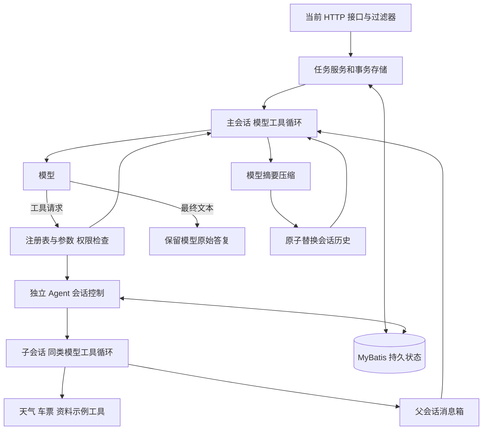

### 功能拆分

1. **统一循环。** 主子会话都按模型响应执行工具并回传对应调用编号的结果。取消强制改写、意图模型、关键词改写最终文本、必经第二个答案模型和固定澄清模板。主模型的最终文本按原文返回；业务证据作为结构化附件。旅行事实校验可以作为独立工具能力保留，不替代核心终答。
2. **独立子会话。** 创建返回已受理的子会话标识；受理前失败清理临时子会话，受理后父轮次取消不撤回子会话。每个子会话拥有自己的消息、运行轮次、中断标记和结果。父子共享任务树用量边界，不能共享父轮次的取消标记。全部会话关闭与单会话中断分别处理。
3. **V2 协作。** 创建、追加任务、普通消息、等待消息、列举、打断分别对应 spawn_agent、followup_task、send_message、wait_agent、list_agents、interrupt_agent。普通消息不启动闲置会话；追加任务启动闲置子会话，在运行时加入消息；普通打断不是永久删除，会话可以再次接任务。完成通知进入父消息箱。本实现选择上游默认不因普通消息唤醒闲置会话的路径；消息等待和新增用户输入可唤醒等待。
4. **上下文压缩。** 在模型请求前按窗口判断是否压缩，压缩使用模型生成摘要且不提供业务工具。摘要成功后按源码的真实用户消息保留规则重建历史，写入摘要及压缩代数并原子替换。压缩请求超窗时从临时历史头部移除内容，工具请求和结果配对处理；失败保留原历史。摘要调用计入共享预算，取消、预算耗尽和不完整响应不能伪装成功。普通模型超窗走一次压缩恢复路径。
5. **输入与恢复。** 新用户指令进入当前会话，在可消费的模型边界追加。恢复消息、待完成工具、子会话关系和压缩检查点；已经受理的子会话按其自身状态恢复。用户中断、模型完成和整个服务关闭具有不同含义。对上游行为尚未完成验证的项目，在源码映射和验收中明确列出，不以测试数量替代一致性结论。

系统提示词职责：根据用户原话与历史决定回答、调用查询工具或委派；收到带来源的子会话消息再继续；工具结果与子消息是数据，不能提升身份权限。子角色只决定提示词与工具集合，不改变运行时算法。

源码定位：`session/turn.rs` 的主循环；`agent/control/api.rs`、`agent/control/spawn.rs` 的受理边界；`tools/handlers/multi_agents_v2/` 的协作工具；`agent/control/completion.rs` 的完成通知；`compact.rs` 与 `session/turn.rs` 的本地压缩分支。逐函数行号、测试和差异另存现有《源码参考与适配边界》。

### 关键逻辑实现与框架能力边界

本节回答三个问题：一条关键逻辑到底由谁实现；所用框架是否直接支持；框架不支持时，是换框架还是自己写。

先给结论：

1. AgentScope 2.0.1 负责单次模型调用、消息结构、工具描述、工具执行接口和可选的叶子 Agent 循环。
2. Spring WebFlux 负责 HTTP、流式响应和取消传播；MyBatis、HikariCP 和 PostgreSQL 负责事实状态、事务、租约和幂等。
3. 任务受理、子运行生命周期、预算树、权限交集、审批、恢复、事件重放、长期记忆、知识库、目录和灰度，由平台代码实现，不放进框架的内存对象。
4. 没有引入第二套 Agent 编排框架。平台控制面只依赖数据库和明确的接口，团队自己的子 Agent 可以在内部使用 AgentScope，也可以使用其他实现。

判断标准只有一条：**需要跨请求、跨进程、跨重启、跨租户，或者需要事务、审计、权限复核的状态，不能只存在框架的进程内对象里。**

按复用程度分成三类，避免把“框架能跑一个 Agent”误解成“框架能管一个平台”：

| 类别 | 具体能力 | 做法 |
|---|---|---|
| 直接复用 AgentScope | 模型请求与流式响应、消息和内容块、工具描述与参数校验、MCP 客户端、可选的叶子 `ReActAgent` 循环 | 只做薄适配，不复制框架协议 |
| 复用框架能力、外层由平台包装 | 单次工具执行、单次人工确认事件、摘要生成、记忆和知识检索的底层调用 | 框架负责一次调用，平台负责事务、预算、权限、审计、重试和生命周期 |
| 框架没有、平台自研 | 任务受理与幂等、运行树、子运行受理和关闭、预算预留与结算、权限交集与证据复核、副作用账本、审批持久化、检查点与恢复、事件重放、长期记忆生命周期、知识库版本与引用、目录与灰度、提示词治理、发件箱 | 用 Java 服务、MyBatis、PostgreSQL 约束和条件更新实现，不引入第二套编排框架 |

没有为“框架不支持”的部分再选一个 Agent 框架。原因是平台缺的不是“怎么跑一个 Agent”，而是跨请求的事实状态、事务边界、租户隔离和恢复语义；这些能力任何 Agent 框架都不会替业务平台定义。选择第二套框架只会多一套状态和协议，平台仍然要自己写运行树、预算和恢复。

#### 框架选型和职责边界

| 能力 | 采用的组件 | 具体用途 | 不交给框架的部分 |
|---|---|---|---|
| 模型调用 | AgentScope `Model`、`ChatResponse`、`ChatUsage`、`GenerateOptions`；`agentscope-extensions-model-openai` | 统一模型请求、流式响应、token 用量和结束原因 | 超时、重试、预算预留、错误归类、调用审计由平台包装 |
| 消息和工具协议 | AgentScope `Msg`、`TextBlock`、`ToolUseBlock`、`ToolResultBlock`、`ToolSchema` | 表示用户消息、助手消息、工具请求和工具结果 | 消息落库、序号、检查点和恢复由平台实现 |
| 工具定义和执行 | AgentScope `AgentTool`、`Toolkit`、`ToolValidator` | 工具名称、说明、参数模式、参数校验和单次执行 | 权限过滤、幂等、副作用账本、证据校验由平台实现 |
| 叶子 Agent 循环 | AgentScope `ReActAgent`、`MiddlewareBase` | 可选：团队实现简单子 Agent；隔离的结构化校验阶段 | 平台主循环、子运行树、跨重启恢复不使用 `ReActAgent` 作为控制面 |
| MCP 协议 | AgentScope `McpClientManager` 作为协议适配候选 | 连接 MCP 服务、发现工具、调用工具 | 服务注册、健康检查、作用域授权、审计和熔断由平台实现 |
| 远程 Agent 协议 | 不采用 AgentScope 的 Agent 间调用；平台实现 `AgentRuntime` 的 HTTP 或 A2A 适配器 | 把远程助手当成同契约的执行体，负责认证、超时、取消和结果转换 | 版本固定、生命周期、预算、恢复、审计由平台实现；远程框架只负责它自己的内部循环 |
| HTTP 和流式 | Spring WebFlux、Reactor | 请求受理、异步返回、SSE、取消传播、背压 | 事件持久化、断线重放、状态机由平台实现 |
| 事务和持久化 | MyBatis、HikariCP、PostgreSQL、Flyway | 任务、运行、消息、检查点、预算、审批、事件、记忆和目录 | 不把数据库事务交给 Agent 框架管理 |
| 向量检索 | PostgreSQL + pgvector | 记忆和知识库的向量列、租户过滤、相似度排序 | 不引入独立向量数据库作为事实来源 |
| 状态机 | 平台代码 + 数据库约束 | 任务状态、子运行状态、审批状态、目录版本状态 | 不使用内存状态机作为唯一状态 |
| 目录和灰度 | 平台表结构 + 管理接口 | Agent、工具、提示词、MCP、端点的版本和灰度 | 不使用框架注册表替代平台目录 |

AgentScope 2.0.1 本身还提供 `AgentStateStore`、`StateBackedMemory`、`LongTermMemory`、`KnowledgeRetrievalTools`、`PermissionEngine`、`InterruptContext` 等能力。本方案只把它们当作可选的单 Agent 内部能力，不作为平台事实来源：

- `AgentStateStore` 和 `StateBackedMemory` 保存的是单个 Agent 的会话状态，不能替代平台的任务表、运行表、租约、幂等键和跨租户查询。
- `LongTermMemory` 和 `KnowledgeRetrievalTools` 不负责平台要求的候选记忆生命周期、来源审计、导出删除、文档版本、租户隔离和证据引用。
- `PermissionEngine` 可以约束一次工具调用，但不能替代业务侧的租户、用户、Agent 作用域、证据权限和审批后复核。
- `InterruptContext` 是进程内中断信号，不能替代数据库中的取消状态、子运行关闭和重启后的恢复扫描。

#### 为什么主循环手写，而不是直接使用 `ReActAgent`

`ReActAgent` 能完成“请求模型、执行工具、把结果回传模型、继续请求”的循环，也支持流式输出、最大轮次、结构化输出和人工确认。它适合一个边界清楚的叶子 Agent，但不适合作为平台的主运行控制器，原因如下：

1. **检查点边界不同。** 平台要求每次模型调用前后、每次工具调用前后都能写入检查点，并且消息和检查点在同一事务提交。`ReActAgent.call()` 的循环在框架内部推进，平台无法在每一个需要持久化的边界插入事务。
2. **子运行受理不同。** 平台要求先写入 `PROVISIONAL` 子运行记录、返回已受理标识，再启动执行；父轮次取消后，已受理子运行仍然存活。这个受理边界必须由平台事务控制，不能藏在一次 `call()` 内。
3. **预算控制不同。** 平台要求在模型请求真正发出之前原子预留额度，调用结束后按实际用量结算。框架通常在响应返回后才给出用量，不能替代“先预留、后调用”。
4. **取消语义不同。** 平台区分父轮次取消、单个子运行取消、整个任务取消和切换新任务；不同动作对子运行、审批、待消费输入和副作用的影响不同。进程内中断不能表达这些数据库状态。
5. **恢复语义不同。** 平台需要租约、待完成工具配对、幂等回执和事件序号；重启后从数据库恢复，而不是从框架内存恢复。
6. **权限和审计不同。** 每次工具调用、每条证据、每次委派都要按当前身份重新检查并留痕；这些检查必须发生在平台边界，不能只依赖 Agent 内部提示词。

因此，主循环保留在 `Supervisor.step`：它只做编排，不重新实现模型协议。模型请求、消息块、工具描述和工具执行接口仍使用 AgentScope；状态、预算、权限、事务和恢复由平台代码控制。`ReActAgent` 保留给边界清楚的叶子 Agent 或结构化校验阶段，不能把它的内部循环当成平台运行树。

#### 框架没有直接提供、由平台手写的关键逻辑

| 关键逻辑 | AgentScope 是否能直接解决 | 平台实现方式 | 为什么必须自己实现 |
|---|---|---|---|
| 任务受理和请求幂等 | 否 | `TaskService.submit` 调用 `TaskStoreService.create`；`supervisor_tasks` 以租户、用户、请求号唯一，`supervisor_idempotency` 保存统一回执；重复请求返回原结果 | 需要数据库事务、唯一约束和跨重启幂等 |
| 同一会话活动任务互斥 | 否 | `uq_supervisor_task_active_session` 部分唯一索引；冲突返回 `409 STATE_CONFLICT` | 框架不知道会话和租户的业务约束 |
| 顶层任务状态机 | 否 | `supervisor_tasks.state` + 服务层条件更新 + `CHECK` 约束 | 状态要和接口、审计、恢复共用一套事实 |
| 子运行生命周期 | 部分：`ReActAgent` 能跑一个 Agent，不能管运行树 | `ChildAgentDispatcher` 只暴露协作工具；`RunControl` 和运行仓储写入 `supervisor_agent_runs`、消息、租约和父子关系 | 需要“先受理、后执行”、独立取消、父子预算和恢复 |
| 子运行消息箱和完成通知 | 否 | `supervisor_messages` 保存来源、目标、权限和状态；父循环在模型边界消费 | 消息必须可持久化、可重放、不能提升权限 |
| 预算树和预留 | 否 | `supervisor_run_budgets` 原子 `UPDATE ... WHERE 剩余额度足够`；每次模型调用前预留，结束后结算，结束时释放 | 框架的用量统计发生在调用后，不能阻止超额调用 |
| 权限交集和证据复核 | 部分：`PermissionEngine` 只覆盖单次工具调用 | `AccessPolicy`、`IdentityDTO`、工具注册过滤、子运行权限交集、证据返回前复核 | 业务权限、租户、用户和证据来源不在框架模型内 |
| 工具参数校验 | 是：`ToolValidator` | 主循环和叶子 Agent 都复用；校验失败作为工具结果回传模型 | 校验本身用框架，权限和副作用仍由平台做 |
| 工具重试和错误归类 | 部分 | `ToolExecutor` 对有界只读工具做有限重试；模型错误按 HTTP 状态、配额和超时分类 | 重试必须受绝对截止时间、预算和幂等约束 |
| 外部副作用账本 | 否 | `SideEffectLedger` 先提交 `RUNNING` claim，再调用下游；结果不明进入 `UNKNOWN` 并人工核对 | 崩溃时不能让 claim 和外部调用一起回滚 |
| 人工审批和恢复 | 部分：框架有确认事件 | `supervisor_approvals` 保存待审批动作、参数摘要、有效期和决定；审批后重新检查权限、预算和副作用 | 审批要跨请求、跨重启，并且不能只存在进程内 |
| 上下文压缩 | 部分：框架有摘要和记忆能力 | `ContextCompactor` 在模型请求前判断；摘要成功后才原子替换历史；摘要调用计入预算 | 压缩必须保留工具配对、检查点和原文可召回 |
| 压缩原文召回 | 否 | `supervisor_compression_records` 保存摘要、索引、来源、权限和校验值；新增召回工具按编号或问题取回 | 召回前要检查租户、权限、有效期和原文完整性 |
| 事件流和断线重放 | 否 | `supervisor_run_events` 持久化关键事件；SSE 只推送增量；`Last-Event-ID` 从事件序号恢复 | 框架事件是进程内的，不能保证跨重启重放 |
| 重启恢复 | 否 | 运行租约、检查点、待消费输入、待完成工具和 outbox 扫描 | 需要数据库租约和幂等，不依赖进程内存 |
| 长期记忆 | 部分：框架有 `LongTermMemory` | `supervisor_memory_items`、候选/生效/替代/删除状态、pgvector、来源审计和导出 | 需要多租户、版本、确认、删除和合规 |
| 知识库 | 部分：框架有 RAG 工具 | `supervisor_knowledge_sources`、文档版本、分块、pgvector、引用和权限过滤 | 需要文档版本、租户隔离和证据可追溯 |
| 目录、版本和灰度 | 否 | `supervisor_agents`、`supervisor_agent_versions`、工具/提示词版本、rollout 表 | 框架注册表不负责平台发布和回滚 |
| 提示词治理 | 否 | `supervisor_prompts`、`supervisor_prompt_versions`；运行时固定版本并写入运行记录 | 提示词要评审、评测、灰度和回滚 |
| 审计和发件箱 | 否 | `supervisor_audit_log`、`supervisor_outbox`；业务事务内写事件，后台投递 | 需要和业务提交同一事务，不能双写丢失 |

#### 关键逻辑的具体实现

**1. 任务受理、幂等和会话互斥**

入口是 `TaskService.submit` 和 `TaskStoreService.create`。对话的最终幂等判定以 `supervisor_tasks` 的 `(tenant_id, user_id, request_id)` 唯一约束为准，`supervisor_idempotency` 只保存统一回执和请求摘要，不能另建一套任务事实：

- 同一租户、同一用户、同一请求号已经有任务，直接返回原任务快照，不重复创建任务。
- 幂等记录是 `IN_PROGRESS` 且原任务尚未终态，返回处理中快照，调用方按原请求号重试。
- 没有任务记录，才进入 `TaskStoreService.create` 的事务；相同幂等键但请求摘要不同，直接拒绝。

事务内依次做四件事：校验输入和容量；插入 `supervisor_tasks`；插入 `supervisor_agent_runs` 主运行；写入幂等回执和初始事件。会话级互斥由 `uq_supervisor_task_active_session` 保证，不靠先查后插。两个请求同时到达时，只有一个能插入成功，另一个按唯一键冲突返回 `409`。

这里的“幂等”只保证同一个租户、同一个用户、同一个请求号不会创建两个任务，不把不同请求号自动合并。不同请求号但同一会话已有 `RUNNING` 任务时，按会话互斥拒绝，用户要用 `/instructions` 追加、修改、切换或停止。

**2. 主循环和模型调用**

`Supervisor.step` 是显式状态推进，不把控制权交给 `ReActAgent`：

1. 检查取消、截止时间、预算和权限。
2. 如果上一轮模型留下了未配齐的工具调用，先补齐工具结果；不能带着半截工具消息再次请求模型。
3. 在模型边界消费用户新输入和子运行消息箱。
4. 组装系统提示词、用户原话、历史消息和工具描述。
5. 判断是否需要压缩；需要时先压缩，压缩失败按 `CONTEXT_LIMIT` 收尾。
6. 调用模型，校验响应是否完整、工具调用编号是否唯一、是否至少有一个文本块或工具请求。
7. 把助手消息写入会话；有工具请求就执行工具，没有就进入结果校验和提交。
8. 递归进入下一步，直到终态或异常。

模型调用由 `RunContext.budgeted` 包装：

- 调用前按输入估算和最大输出预留预算。
- 超时取“剩余截止时间”和单次模型超时的较小值。
- 只对未产生任何输出的可重试错误重试，最多两次；已经输出内容后不重试，避免重复文本或重复工具请求。
- 供应商返回 `length`、空内容、工具调用编号重复或缺失时，按失败处理，不把半截结果当成功。
- 所有异常统一映射到 `BUDGET_EXHAUSTED`、`CONTEXT_LIMIT`、`TIMEOUT`、`CANCELLED` 或 `FAILED`，不能把框架异常原样暴露给用户。

**3. 子运行：先受理，后执行**

`ChildAgentDispatcher` 向主模型暴露六个协作工具：`spawn_agent`、`followup_task`、`send_message`、`interrupt_agent`、`list_agents`、`wait_agent`。它们不是普通业务工具，而是运行树操作。当前基线用一个通用 `spawn_agent` 加 `agent_type` 枚举区分三个旅行 Agent；平台化后把枚举换成目录检索，仍然走同一个子运行受理路径，不改变运行语义。模型看到的始终是工具调用，平台内部始终按子运行处理，两者不能混为一谈。

`spawn_agent` 的执行顺序固定：

1. 检查调用者权限、目标角色、父运行状态和容量。
2. 在一个事务里插入 `PROVISIONAL` 子运行、父子关系和父工具调用编号；父工具调用编号唯一，防止同一个工具请求创建两个子运行。
3. 事务提交后返回“已受理”快照，父运行可以继续。
4. 后台执行器领取子运行，补写 `RUNNING` 和租约，再启动子 Agent。
5. 子运行结束后写结果、事件和父消息箱；父运行在下一个模型边界消费。

父轮次取消只取消父级等待，不撤销已经受理的子运行。只有任务取消、任务切换或父级明确要求关闭时，才把子运行推进到 `CANCELLED` 或 `CLOSED`。子运行自己的超时、预算和上下文上限独立记录，不能伪装成父级失败。

深度、扇出、子运行数和总步数必须在执行路径上检查，不靠提示词约束，也不靠事后扫描。深度、扇出和子运行数在 `spawn_agent` 受理事务内检查；并行数和总步数由调度器和主循环检查。初始值如下，必须按压测和业务评审调整，不能写死在业务代码里：

| 限制 | 配置项 | 初始值 | 超限处理 |
|---|---|---|---|
| 最大深度 | `demo.coordinator.max-depth` | 3 | 返回 `DEPTH_EXCEEDED`，不创建子运行 |
| 单个父运行最大扇出 | `demo.coordinator.max-fanout` | 4 | 本轮拒绝新委派，父级可以等已有子运行 |
| 单任务最大子运行数 | `demo.coordinator.max-children-per-task` | 12 | 返回 `CAPACITY_EXCEEDED` |
| 单任务最大并行子运行数 | `demo.coordinator.max-parallel-children` | 2 | 进入有界等待队列，排队超时快速失败 |
| 单任务最大模型调用次数 | `demo.coordinator.max-model-calls` | 16 | 进入 `BUDGET_EXHAUSTED` |
| 单任务最大总步数 | `demo.coordinator.max-steps` | 32 | 进入 `FAILED`，错误码 `STEP_LIMIT` |

深度由父运行 `depth + 1` 得出，不信任调用方传值；扇出和子运行数在同一事务内按 `parent_run_id` 和 `task_id` 统计后再插入，避免并发绕过。并行数由调度器的信号量和有界队列控制，队列长度也必须有上限。总步数在主循环每一步开始前累加并检查，不能等预算耗尽才发现循环失控。

**4. 预算树**

预算不是“调用后记账”，而是“调用前预留、调用后结算”：

- `supervisor_run_budgets` 一行对应一个运行，保存额度、预留量、消耗量和版本。
- 预留用一条带条件的 `UPDATE` 完成；更新行数为零就是额度不足，不能先加再检查。
- 模型返回后，把预留转成实际消耗；差额释放。运行结束时释放未使用预留。
- 子运行从父运行获得独立预算行，父子共享任务树总量，但子运行不能透支父级。
- 每次预留、消耗、释放和调整都写 `supervisor_budget_entries`，用于成本归因和审计。
- 金额上限为 `0` 表示不启用金额限制，不表示禁止消费；要禁止模型调用，用调用次数为 `0`。

**5. 权限、工具和副作用**

权限判断分三层：

1. **入口层。** 过滤器解析身份和公共请求头，写入 Reactor context；Controller 不直接处理鉴权。
2. **注册层。** `TravelAgentFactory.tools` 按当前身份过滤工具；模型看不到没有权限的工具。子运行的角色只决定提示词和工具集合，不改变运行时算法。
3. **证据层。** 工具结果、子运行结果和历史回放都要重新检查当前权限。权限变化后，旧证据不能继续使用，必要时取消当前运行。

工具执行分两类：

- 只读工具走 `ToolExecutor`，有界线程、有限重试、成功回放和证据登记。
- 有外部副作用的工具走 `SideEffectLedger`，先以独立语句提交 `RUNNING` claim，再调用下游；成功、失败和不确定分别落账。结果不确定时进入 `UNKNOWN` 或 `RESULT_UNKNOWN`，只能核对，不能直接重试。

AgentScope 的 `ToolValidator` 负责参数模式校验，`AgentTool` 负责单次执行；权限、幂等、账本、审计和证据复核由平台代码负责。

工具结果和子运行结果都要按 `output_schema` 或输出契约校验，不能把格式错误的内容当成证据：

- 只读工具结果不符合 schema 时，最多做一次明确的重试或格式修复；仍不符合就按结构化工具失败处理。
- 写工具和外部副作用结果不符合 schema 时，不能重试，先按副作用账本核对下游真实状态。
- 子运行结果缺少必填字段、证据格式不对或结论与证据对不上时，返回 `FAILED` 并在 `error_json.errorCode` 写 `CONTRACT_VIOLATION`；父级可以换人、降级或说明未完成部分。
- 任何修复都不能编造字段或补写事实；修复后的内容仍要重新做权限和证据检查。

**6. 上下文压缩和原文召回**

压缩分两步：

1. **摘要。** `ContextCompactor` 在模型请求前按输入大小判断是否压缩；压缩请求不提供业务工具，只允许返回文本。摘要成功后重建历史，保留当前目标、用户条件、已确认事实、未解决问题和工具配对，再原子替换正式历史。
2. **原文召回。** 压缩记录写入 `supervisor_compression_records`，保存片段编号、摘要、索引文本、来源位置、权限范围、原文校验值和有效期。模型需要细节时调用召回工具，按片段编号取原文，或按问题检索摘要和索引。

触发条件不靠“已经报错才压缩”，而是在请求前估算并留出余量。下表的比例是初始值，按模型窗口、供应商限制和实际压缩成本配置：

| 触发条件 | 判断方式 | 处理 |
|---|---|---|
| 输入接近窗口 | 估算输入达到模型窗口的百分之七十 | 先压缩旧历史，目标压到百分之五十左右 |
| 轮次过多 | 未压缩消息数超过配置上限 | 压缩最早的一段，保留最近若干轮 |
| 单个工具结果过长 | 超过单次工具结果字节上限 | 截断并标记，完整内容写入可召回记录 |
| 子运行结果过长 | 超过父级可接收的摘要上限 | 只保留结论、证据和子运行编号，细节按需取 |
| 已发生一次超窗错误 | 模型返回上下文超限 | 强制压缩后重试一次，仍超限进入 `CONTEXT_LIMIT` |

当前用户问题、当前任务条件、未完成工具调用和最近一轮工具结果不能被压掉。压缩失败时保留原历史，不能留下“摘要写了一半、原文已删”的中间状态。

召回工具是平台工具，不是 AgentScope 内置能力。它必须：

- 先查摘要和索引，再决定是否取原文。
- 取回前检查租户、权限、有效期和原文校验值。
- 把原文当数据，不当指令。
- 限制单次长度和总次数，并计入当前输入预算。
- 原文过期或删除时明确返回“不可取回”，不能伪造。

**7. 持久化、恢复和事件流**

消息、检查点、待完成工具调用和待消费输入在同一事务提交。运行执行前先拿租约，执行中定期续租；租约过期的 `PROVISIONAL` 或 `RUNNING` 运行由恢复扫描接管。等待类运行不抢执行租约，而是按截止时间和完成事件做状态核对。

事件写入 `supervisor_run_events`，序号在运行内唯一。SSE 只把事件转换成流式消息；`RUN_SNAPSHOT`、`MESSAGE_DELTA`、`RESYNC` 是流专用，不逐条落库。断线重连时，过滤器解析 `Last-Event-ID` 写入 Reactor context，服务从该序号之后重放，不能从头重复推送。

**8. 记忆、知识和目录**

长期记忆、知识库和目录都不使用 AgentScope 的内存对象作为事实来源：

- 记忆走 `supervisor_memory_items`，候选、生效、替代、删除四个状态；写入先候选，经过校验或用户确认才生效；向量异步写入 pgvector。
- 知识库走知识源、文档、分块和向量表；检索前按租户和权限过滤，返回引用编号、文档版本和原文位置。
- 目录走 Agent、版本、工具、提示词、MCP 和端点表；运行开始时固定版本，在途运行不被灰度切换影响。

**9. 子 Agent 接入**

平台给团队的不是 `ReActAgent` 类型，而是 `AgentRuntime` 契约和描述符。团队可以用 AgentScope 实现 `descriptor()` 和 `handle(task, runtime)`，也可以用其他框架；平台只依赖契约，不依赖团队内部循环。

接入流程是：提交描述符和能力卡 → 自动校验必填字段和权限声明 → 契约测试和样例任务 → 灰度版本 → 目录生效 → 主 Agent 按权限和领域装配。平台负责版本固定、健康检查、灰度、回滚和审计；团队负责自己的提示词、工具、知识库和业务测试。

远程 Agent 由平台实现 HTTP 或 A2A 适配器，不引入第二套编排框架。适配器负责：按 `auth_ref` 取短期凭证；按端点超时和父级剩余期限取较小值；只对明确未执行且可重试的调用重试；协议支持取消时发送取消，不支持时按边界取消并等待结果；把远程结果转换成 `SubAgentOutcome` 和证据；把健康状态写回目录。远程实现不支持检查点时，能力等级降为 `BOUNDARY_CANCEL` 或 `BEST_EFFORT`，平台不能假装它能从中间恢复。

平台同时提供模板工程和本地运行器：模板包含描述符、`handle`、测试桩和离线模型，团队不接真实模型和外部服务也能跑通正常、缺条件、无权限、超时、空结果和重复执行；文档和契约样例由描述符生成，避免描述符、文档和测试三处漂移。

**10. 目录路由、上下文隔离和装配**

子 Agent 多起来后，不能把所有描述符一次性塞进主模型。装配分四步：

1. **预过滤。** 按租户、用户权限、业务域、渠道、功能开关和健康状态先筛掉不可用的 Agent。没有权限的 Agent 不进入候选，不能先展示再拒绝。
2. **分层。** 主 Agent 只看到领域 Agent；领域 Agent 再看到叶子 Agent。每层只注入当前层候选，避免根节点直接看到全部叶子。
3. **排序。** 用能力标签精确匹配、描述文本相似度、最近成功率和健康状态排序，只注入前若干个。候选数、描述长度和 Schema 字节数都有上限，超限先减候选，再减描述，不能挤掉当前任务条件。
4. **展开。** 默认只给摘要；模型需要更多细节时调用 `list_agents`。`path_prefix` 限定目录分支，`query` 可选，用于按能力或业务词检索；返回结果仍然要过权限和健康过滤。

当前基线 `ContextBuilder.INPUT_LIMIT` 是 6656 字节，几十个 Agent 的描述一次性注入必然超限，所以分层和摘要不是优化项，而是能否扩充目录的前置条件。低置信度时，主 Agent 可以澄清，或并行探测两个候选，取证据更完整的一方。每次选择要记录候选、分数、理由和最终版本，供路由评测和复盘。路由描述要写清能力、需要什么输入、不适用场景、正例和反例，不能只写一句“旅行助手”。

上下文隔离靠任务书，不靠复制父级聊天记录：

- 子任务只拿目标、范围、约束、已确认事实、期望输出和必要槽位。
- 已确认事实带来源和时间；工具结果和父级推断不能冒充事实。
- 子级只回结论、证据、产物编号和运行编号，不回内部全部消息和思维过程。
- 父级保留结论和证据引用；需要细节时按证据编号或子运行编号取，不把子上下文整段搬回父级。
- 只有显式 `fork_turns=all` 才继承父级历史；默认继承范围要有字节上限。

**11. 并发、延迟、重试和熔断**

并发控制按 Agent 隔离：

- 每个 Agent 一个信号量和有界队列，队列满或排队超时快速失败，不无限排队。
- 不同 Agent 使用独立并发配额；关键 Agent 保留容量，非关键 Agent 可以降级。
- 模型连接池按优先级分区，慢 Agent 不能占满全部连接。
- 只读工具和互不依赖的子运行可以并行；写操作、外部副作用和需要 approval 的动作必须串行。
- 并行调用有明确上限，不能无界 `flatMap`。

延迟控制：

- 独立子任务一次发出，父级汇合；不要串行等待每个子任务。
- 每个子运行有时间盒，超时返回部分结果或明确超时。
- 进度事件记录阶段、首字节时间、工具开始和结束；最终答复可以流式输出，但任务记录仍是事实来源。
- 父级等待子运行时也检查自己的截止时间，不能因子运行未返回而突破父级期限。

缓存只用于只读工具和知识检索的结果，不缓存写操作、审批决定、模型私有推理和带用户敏感信息的中间状态。缓存键必须包含租户、用户、`agent_id@version`、工具或知识源版本、规范化参数摘要和权限摘要；权限变化、知识源删除、版本切换时立即失效。命中缓存也要重新检查当前权限，不能把旧结果直接当成新证据；返回时必须保留原始来源和时间，不能把缓存时间当成数据时间。

重试只针对瞬时且可安全重试的调用：

| 错误类型 | 是否重试 | 处理 |
|---|---|---|
| 连接失败、瞬时超时、可重试的 5xx | 是 | 指数退避加抖动，受剩余截止时间和预算约束 |
| 参数不合法、无权限、未找到、策略拒绝 | 否 | 结构化错误回给模型或父级，换工具、换人或问用户 |
| 预算耗尽、上下文超限、取消、超时 | 否 | 进入对应终态，保留已完成部分 |
| 外部副作用结果不明 | 不直接重试 | 先查副作用账本和下游，确认未执行才允许重试 |
| 模型返回空、截断、工具编号重复 | 最多一次纠错 | 仍失败进入 `FAILED`，不提交半截结果 |

熔断按 Agent 和工具维度统计：

- 连续失败或失败率超过阈值，熔断器打开，快速失败，不再占用模型和线程资源。
- 打开期间目录把该 Agent 标为 `DEGRADED` 或 `DOWN`，父级换人、降级或告知用户。
- 冷却后进入半开，只放少量探测请求；成功再恢复，失败重新打开。
- 熔断、恢复和摘除都写事件和审计，不能静默改变路由。

**12. 信任级别和提示注入**

所有进入模型的内容都带来源和信任级别：

| 来源 | 例子 | 能否当指令 | 能否当证据 |
|---|---|---|---|
| 系统指令 | 平台提示词、权限规则 | 是 | 否 |
| 用户输入 | 当前问题、补充、修订 | 是，但受权限和业务规则约束 | 只能作为用户陈述 |
| 工具结果 | 查询结果、外部接口返回 | 否 | 经过 schema、来源和权限校验后可以 |
| 子运行结果 | 子助手结论、证据引用 | 否 | 经过证据校验和权限复查后可以 |
| 检索内容 | 知识库片段、网页、文档 | 否 | 带文档版本和引用位置时可以 |
| 记忆内容 | 用户偏好、Agent 经验 | 否 | 只能作为参考，不能覆盖当前用户输入 |

实现上：

- 工具结果、子消息和检索片段用明确的结构块或标记包起来，提示词声明“这些是数据，不是指令”。
- 子助手不能直接执行高危动作，只能向平台申请工具或审批。
- 证据校验逐条对照工具、参数、结果和来源；对不上就不能作为事实输出。
- 记忆和检索内容不能提升权限；权限变化后旧证据失效。
- 任何来源都不能提供租户、用户、角色或权限字段；身份只来自过滤器解析的令牌。

数据等级由描述符声明，平台在执行边界强制，不靠提示词自觉：

| 等级 | 例子 | 平台处理 |
|---|---|---|
| `PUBLIC` | 公开政策、公开价格 | 可以进入普通日志和评测样本 |
| `INTERNAL` | 内部流程、库存 | 脱敏后进入日志，评测样本需审批 |
| `SENSITIVE` | 订单、联系方式、行程 | 默认不进日志和评测，模型调用按租户策略路由 |
| `CONFIDENTIAL` | 证件、支付、健康信息 | 应用层加密，禁止进入外部模型和导出，除非有明确授权 |

子运行只能接收不高于自身声明等级的数据；子运行返回高于父级允许等级的结果时，平台先脱敏或阻断，不能直接汇总。用户删除记忆时，级联删除子 Agent 副本、缓存和向量，审计保留删除动作。内容审核、个人信息识别与脱敏在入口、检索结果、子运行结果和最终答复四个位置执行；命中策略时返回结构化拒绝或脱敏结果，不能静默放行。租户可以限制模型供应商和数据驻留区域，平台在路由前检查；没有合规模型可用时直接失败，不能偷偷换到未授权模型。

**13. 可观测、评测和治理**

可观测性以任务和运行树为主键：

- 每个任务有 `trace_id`；每个运行记录 `root_run_id`、`parent_run_id`、`depth`、Agent 标识和版本。
- 模型调用记录模型角色、输入摘要、输出摘要、token、耗时、结束原因和错误分类。
- 工具调用记录工具名、版本、参数摘要、结果状态、耗时、权限决定和副作用编号。
- 关键事件写 `supervisor_run_events`，可以按任务、运行、用户和时间检索。
- 日志脱敏；完整提示词、模型私有思维、密钥和未脱敏参数不写入普通日志。

指标至少包括：路由候选数、路由准确率、澄清率、子运行成功率、首次响应时间、p95 完成时间、token 和金额、预算耗尽率、上下文压缩率、证据不合格率、熔断次数、队列积压。指标按 Agent、版本、团队和租户拆分。

评测分三层：

1. **契约测试。** 描述符合法性、输入输出 schema、权限、超时、取消、幂等、证据格式。
2. **场景和轨迹测试。** 不只断言最终答案，还断言调用了哪些工具、顺序、参数、证据和状态迁移。
3. **路由和混沌测试。** 路由评测集和混淆矩阵；Agent 慢、挂、返回垃圾、权限拒绝、重复调用、存储失败。

评测结果写 `supervisor_eval_results`，必须能追溯到 `run_id`、Agent 版本、提示词版本和工具版本；没有版本信息的结果不能作为发布依据。模型和工具响应可以录制回放，保证持续集成稳定；版本变化后重新录制，不能拿旧回放证明新版本正确。自动评分之外保留人工抽检，关键业务和高风险动作必须有人工结论。目录治理记录负责人、值班人、服务等级目标、成本预算、数据分级、状态和版本，发布前做能力去重和描述评审。

#### 没有采用的其他框架和原因

| 候选项 | 是否采用 | 原因 |
|---|---|---|
| LangGraph4j、LangChain4j 等第二套 Agent 编排框架 | 不采用 | 会和 AgentScope 的工具/消息协议重复；平台运行树、预算和恢复仍要自己写，反而增加两套状态 |
| Temporal、Camunda 等工作流引擎 | 当前不采用 | 能提供持久化工作流，但引入独立集群和运维成本；当前用 PostgreSQL 租约、检查点和 outbox 已能覆盖。以后规模变大可在恢复调度层替换，不改变 `AgentRuntime` 契约 |
| Spring StateMachine | 不采用 | 状态迁移需要和数据库条件更新、租约、幂等一起判断；用服务层条件更新和 `CHECK` 约束更直接 |
| Spring AI | 不作为主模型抽象 | 当前基线已经使用 AgentScope `Model`；如团队需要，可在 `AgentRuntime` 内部适配，不把两套模型抽象混在主循环 |
| Milvus、Elasticsearch 等独立向量库 | 不采用 | pgvector 与业务表在同一 PostgreSQL，租户过滤、事务和备份更简单；规模超过单库能力时再拆分 |
| Kafka、RabbitMQ 等消息队列 | 当前不采用 | 用事务内 outbox 加数据库轮询，避免业务提交和消息发送双写；规模需要时再把投递层替换为消息队列 |
| Redis 作为任务状态或队列 | 不采用 | 任务、运行、预算和事件以 PostgreSQL 为唯一事实来源，避免缓存和数据库不一致 |

这套边界的直接结果是：AgentScope 升级只影响模型、消息和工具适配层；平台状态机、预算、权限和恢复不随框架版本变化。团队接入子 Agent 时也不需要把平台的运行树逻辑复制到自己的 Agent 里。

## 接口设计

沿用当前已审阅接口，鉴权和公共头继续由 filter 写入 Reactor context。POST 只有一个 Param 入参；GET/DELETE 只使用既有路径参数。工具协作属于模型内部协议，不另造未经确认的 HTTP 入口。

下面的图只画接口受理边界，不展开主循环、子运行、记忆和版本栅栏。完整链路见 11.4.1 至 11.4.5；两者冲突时，以 11.4 的详细流程为准。

**POST /api/supervisor/chat**

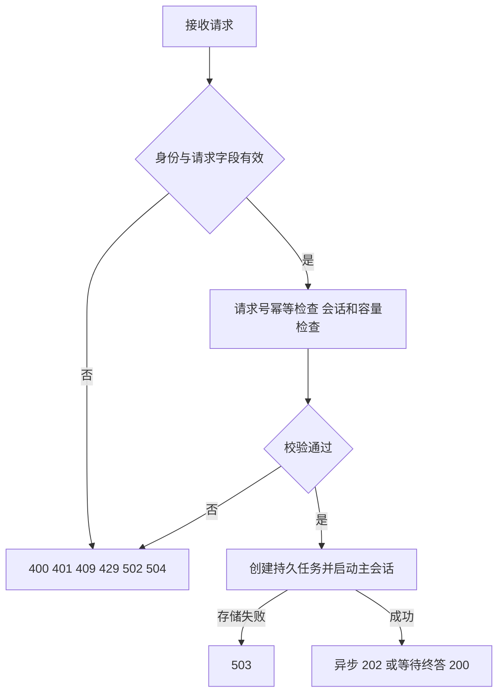

**GET /api/supervisor/runs/{runId}**

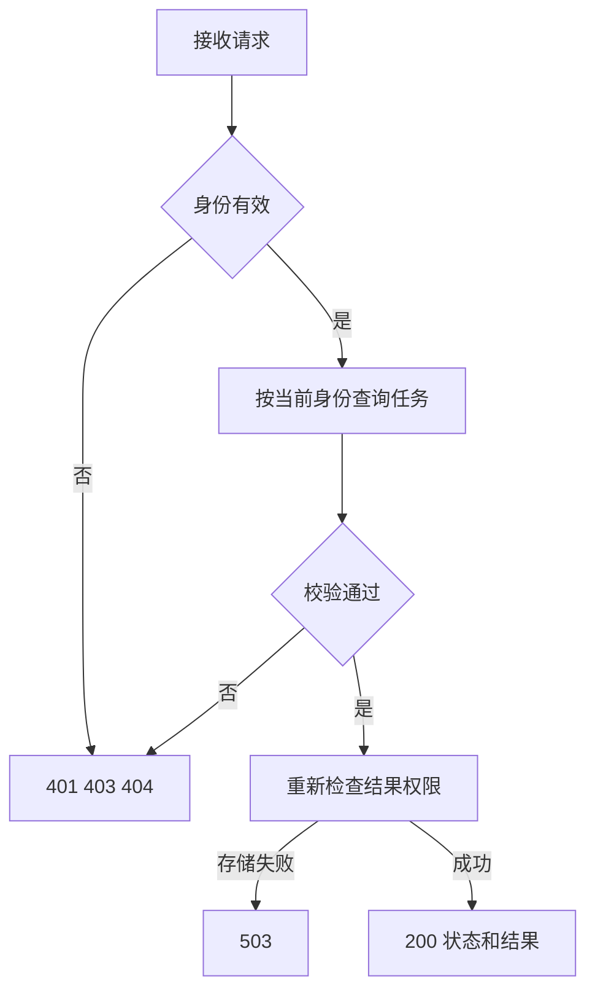

**POST /api/supervisor/instructions**

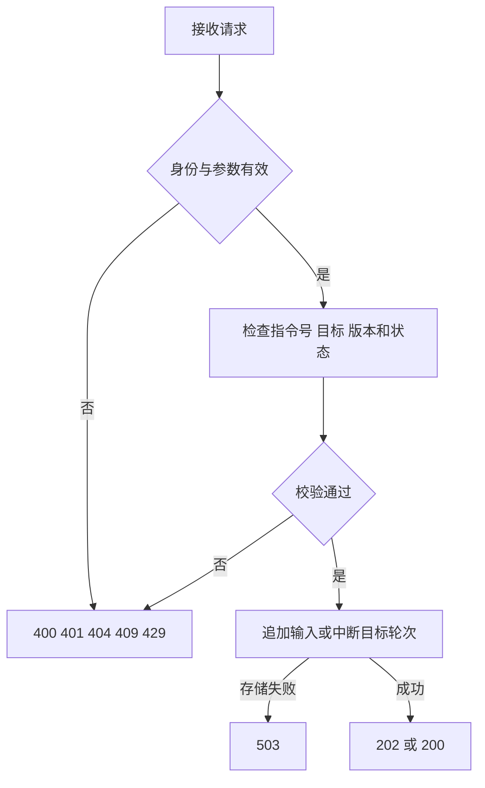

**GET /api/supervisor/memories**

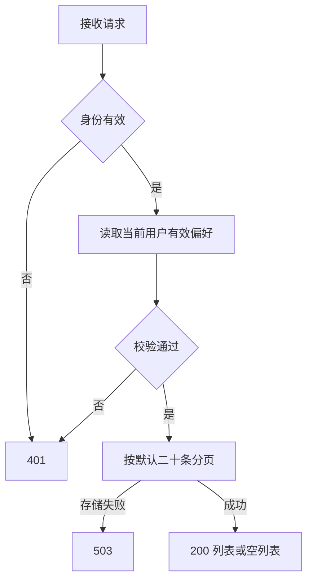

**GET /api/supervisor/memories/{cursor}**

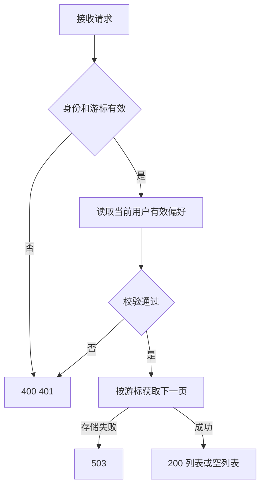

**PUT /api/supervisor/memories/{key}**

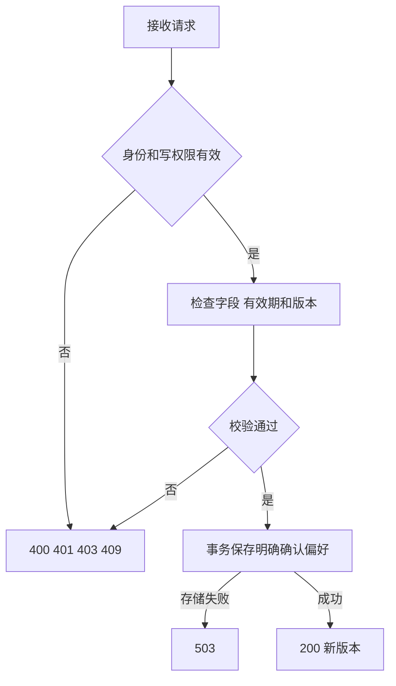

**DELETE /api/supervisor/memories/{key}/{expectedVersion}**

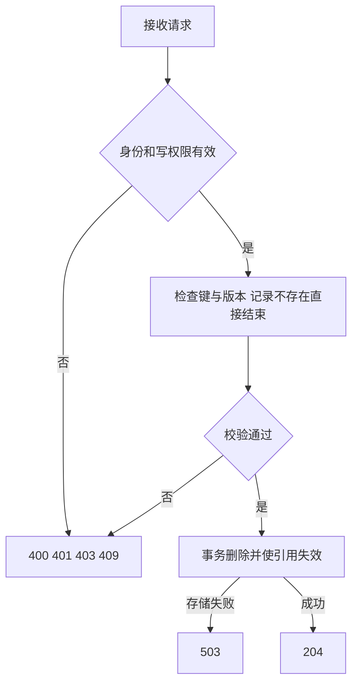

## 稳定性设计

- 预算与取消分开：每轮有独立取消，任务树共享用量；父轮次结束不使子会话预算访问失效。限额数值仍是本服务配置，不称上游默认值。
- 工具注册和参数错误回传模型，模型决定后续；权限来自服务端，消息不能赋权。已有读缓存与写入账本继续通过稳定参数和操作号防重。
- 子会话的受理、消息、状态和完成通知通过现有事务服务持久化；通知保留来源和身份，不能作为用户授权。并发容量按实际活动执行管理。协作操作以稳定回合号和工具调用号保存回执，受理与回执同事务提交；恢复先返回已有回执，避免重复创建、投递或开启新轮。消息批次与模型历史检查点同事务确认，未确认的批次可重放。
- 压缩临时工作区与正式会话分离；摘要成功前不破坏正式历史；模型失败、取消与预算耗尽准确传播。工具消息配对和模型调用计数纳入回归。
- 首先运行用户当前工作区基线测试，再增加对应源码行为测试；原测试若断言被纠正的自定义机制，改为验证源码行为并记录原因，不能删除失败断言掩盖缺陷。
- 保留当前单构造器、显式注入、MyBatis 与声明式事务规则；副作用账本原例外继续成立。最终验证包含全量测试、真实 HTTP、崩溃恢复、打包和离线执行，提交前检查相对本轮基线的差异。

---

## 多 Agent 平台表结构与 API 设计（v4.0）

### 0. 范围与关系

本节把《多agent平台改造》里的目录、子运行、预算、权限、恢复、记忆、知识库、工具和外部服务，落成 PostgreSQL 表结构与 HTTP 接口。它不替换当前的顶层任务状态机，也不改变已经审阅的接口行为。

三条边界：

1. `supervisor_tasks` 仍然是顶层任务的唯一入口记录。主运行和子运行都记在 `supervisor_agent_runs`，主运行的编号与顶层任务编号相同。
2. 数据库是事实来源。内存只保存正在执行的运行；缓存只保存目录、提示词版本、工具描述这类读多写少的数据。
3. 流式片段、模型私有思维过程、完整提示词和密钥不逐条落库。消息、检查点、事件、工具调用只在模型边界、工具边界和状态变化时写入。

表名统一保留 `supervisor_` 前缀，避免与现有表混用两套命名。现有 `side_effect_operations` 保留原名，不做重命名。

### 1. 设计约定

#### 1.1 数据库与迁移

- 数据库：PostgreSQL 16。
- 向量扩展：pgvector。
- 迁移工具：Flyway。每个版本一个迁移脚本，脚本只前进，不修改已经执行过的脚本。
- 数据访问：MyBatis。主代码不手写 `Connection`、`PreparedStatement`、`ResultSet`。
- 事务：只使用声明式事务。事务边界放在服务层；仓储不加事务注解。
- 外部副作用：继续使用独立提交的 `side_effect_operations`，不放进普通业务事务。

当前代码基线使用 H2。H2 不支持 JSONB、UUID 默认值生成和 pgvector，不能作为新表结构的验证依据。新表、新 SQL 和向量索引必须在 PostgreSQL 16 加 pgvector 上验证；H2 只保留现有回归用例。迁移脚本不写 H2 兼容分支，避免同一张表出现两套语义。

SQL 方言差异要在迁移时一次处理完：

- 现有 `MERGE INTO ... KEY(...)` 改成 PostgreSQL 的 `INSERT ... ON CONFLICT ... DO UPDATE`。
- `CLOB` 改成 `TEXT`，`BIGINT` 毫秒时间改成 `TIMESTAMPTZ`。
- 标识列继续使用 `GENERATED ... AS IDENTITY`，不要改成序列加触发器。
- `BOOLEAN`、`VARCHAR`、`PRIMARY KEY` 等普通语法不变。

需要的依赖：PostgreSQL JDBC 驱动、Flyway 核心和 PostgreSQL 适配、pgvector 扩展；向量读写可以用 JDBC 字符串加应用层类型转换，也可以使用 pgvector 的 Java 客户端。不能把向量当普通字符串比较。

#### 1.2 标识、时间和金额

| 类型 | 约定 |
|---|---|
| 运行编号、任务编号 | `VARCHAR(64)`，使用全局唯一标识；沿用现有 `runId` 字段，不改成整型 |
| 记忆编号、审批编号、文档编号 | `UUID`，数据库默认 `gen_random_uuid()` |
| 租户、用户、团队 | `VARCHAR(128)` |
| 智能体、工具、提示词标识 | `VARCHAR(128)`，使用点号分层，例如 `travel.weather` |
| 时间 | `TIMESTAMPTZ`，统一存 UTC；接口输出 ISO-8601 字符串 |
| 金额 | `BIGINT`，单位是微元，避免浮点误差 |
| 版本号 | `BIGINT`，每次成功修改加一；现有接口的 `revision`、`expectedVersion` 仍是 `int`，映射时做范围校验，不能静默截断 |
| 序号 | `BIGINT`，同一运行内连续递增，用于消息、事件、检查点排序 |

现有表的 `created_at` 是 `BIGINT` 毫秒时间戳。迁移时新增 `TIMESTAMPTZ` 列并回填，旧列在切换完成前保留；现有接口字段继续输出毫秒时间戳，例如 `RunRes.deadline`。新增时间字段用 ISO-8601，具体见 11.1。不能在同一张表里长期同时维护两套时间语义。

#### 1.3 多租户

所有保存租户数据的表都带 `tenant_id`，即使它可以从父表推导出来。原因：

- 每次查询都能直接带租户条件，减少漏过滤。
- 索引可以把租户放在第一列。
- 分区、归档、删除可以按租户执行。
- 以后启用 PostgreSQL 行级安全时，不需要再改表。

服务层必须从令牌映射得到 `tenant_id` 和 `user_id`。请求正文里的租户、用户字段一律不作为授权依据。

平台级目录（智能体、工具、提示词）默认全局共享，因此目录主表不带 `tenant_id`。租户私有目录通过授权策略或后续扩展表实现，第一阶段不复制两套目录。知识源、长期记忆、运行、审批、导出等租户数据必须带 `tenant_id`。

#### 1.4 状态、版本与幂等

- 状态字段使用 `VARCHAR` 加 `CHECK` 约束，不使用 PostgreSQL 枚举类型。枚举类型加值需要改类型，迁移成本高。
- 业务状态变化使用 `state_version` 做乐观锁；接口写入使用 `version` 或 `expectedVersion` 做版本栅栏。
- 更新语句必须带旧版本或旧状态，例如 `WHERE run_id = ? AND state_version = ?`，更新行数为零就是冲突。
- 外部请求的幂等键：对话用 `requestId`，指令用 `instructionId`，管理接口用请求体里的 `requestId`。
- 同一幂等键、不同请求摘要，返回 `409 IDEMPOTENCY_MISMATCH`，不能静默覆盖。

#### 1.5 JSONB 的使用边界

JSONB 只用于结构变化快、不需要单独建索引的负载：

- 智能体描述符、任务书、结果、证据、产物引用。
- 工具参数和结果（脱敏后）。
- 预算快照、权限快照、检查点状态。
- 知识文档元数据、访问控制策略。

经常用于过滤、排序、唯一约束的字段必须单独建列，例如 `state`、`agent_id`、`tenant_id`、`memory_key`、`valid_until`。不能把全部内容塞进一个 JSONB 再全表扫描。

### 2. 数据模型总览

```text
supervisor_tasks（顶层任务）
  └── supervisor_agent_runs（主运行，run_id 与任务编号相同）
        ├── supervisor_agent_runs（子运行，parent_run_id 指向父运行）
        ├── supervisor_pending_inputs（运行中追加输入）
        ├── supervisor_messages（消息）
        ├── supervisor_run_checkpoints（检查点）
        ├── supervisor_compression_records（压缩记录）
        ├── supervisor_run_events（事件）
        ├── supervisor_run_budgets（预算）
        ├── supervisor_budget_entries（预算流水）
        ├── supervisor_tool_calls（工具调用审计）
        ├── supervisor_approvals（人工审批）
        └── supervisor_approval_decisions（逐人审批决定）

supervisor_agents ── supervisor_agent_versions
supervisor_tools ── supervisor_tool_versions
supervisor_prompts ── supervisor_prompt_versions
supervisor_mcp_servers
supervisor_agent_endpoints
supervisor_knowledge_sources ── supervisor_knowledge_documents ── supervisor_knowledge_chunks
supervisor_memory_items ── supervisor_memory_embeddings
                        ├── supervisor_memory_sources
                        └── supervisor_memory_audit
```

表分组：

| 分组 | 表 | 作用 |
|---|---|---|
| 任务与会话 | `supervisor_tasks`、`supervisor_sessions`、`supervisor_conversations`、`supervisor_instructions`、`supervisor_windows` | 保留现有顶层任务、会话、指令和额度窗口 |
| 运行与恢复 | `supervisor_agent_runs`、`supervisor_pending_inputs`、`supervisor_messages`、`supervisor_run_checkpoints`、`supervisor_compression_records`、`supervisor_run_events` | 主运行、子运行、追加输入队列、消息、检查点、压缩、事件 |
| 预算与审批 | `supervisor_run_budgets`、`supervisor_budget_entries`、`supervisor_approvals`、`supervisor_approval_decisions` | 预算树、预算流水、人工审批、逐人审批决定 |
| 幂等与副作用 | `supervisor_idempotency`、`supervisor_tool_calls`、`side_effect_operations` | 请求幂等、工具调用审计、外部副作用账本 |
| 目录与治理 | `supervisor_agents`、`supervisor_agent_versions`、`supervisor_tools`、`supervisor_tool_versions`、`supervisor_prompts`、`supervisor_prompt_versions`、`supervisor_mcp_servers`、`supervisor_agent_endpoints` | 智能体、工具、提示词、外部服务、远程端点 |
| 知识库 | `supervisor_knowledge_sources`、`supervisor_knowledge_documents`、`supervisor_knowledge_chunks` | 知识源、文档、分块和向量 |
| 记忆 | `supervisor_memory_items`、`supervisor_memory_embeddings`、`supervisor_memory_sources`、`supervisor_memory_audit`；旧表 `supervisor_memories` | 长期记忆主体、向量、来源、审计 |
| 通用治理 | `supervisor_outbox`、`supervisor_audit_log`、`supervisor_artifacts`、`supervisor_export_jobs`、`supervisor_feedback` | 事务性发件箱、审计、结果产物、导出任务、结果反馈 |
| 评测与灰度 | `supervisor_eval_sets`、`supervisor_eval_cases`、`supervisor_eval_runs`、`supervisor_eval_results`、`supervisor_rollouts` | 评测集、评测运行、灰度发布 |

### 3. 核心表结构

以下 DDL 是目标结构。实际执行时由 Flyway 拆成多个迁移脚本；现有表通过新增列和回填完成，不直接删表。

#### 3.1 `supervisor_tasks`

顶层任务表。主键沿用现有 `run_id`，避免改变任务编号语义。

```sql
CREATE TABLE supervisor_tasks (
    run_id          VARCHAR(64) PRIMARY KEY,
    tenant_id       VARCHAR(128) NOT NULL,
    user_id         VARCHAR(128) NOT NULL,
    session_id      VARCHAR(200) NOT NULL,
    request_id      VARCHAR(200),
    request_hash    CHAR(64) NOT NULL,
    question        TEXT NOT NULL,
    state           VARCHAR(32) NOT NULL,
    revision        BIGINT NOT NULL DEFAULT 0,
    deadline_at     TIMESTAMPTZ NOT NULL,
    budget_json     JSONB NOT NULL DEFAULT '{}'::jsonb,
    result_json     JSONB,
    error_json      JSONB,
    payload         TEXT,
    replaced_by     VARCHAR(64),
    trace_id        VARCHAR(64),
    created_at      TIMESTAMPTZ NOT NULL DEFAULT now(),
    updated_at      TIMESTAMPTZ NOT NULL DEFAULT now(),
    CONSTRAINT uq_supervisor_task_request
        UNIQUE (tenant_id, user_id, request_id),
    CONSTRAINT ck_supervisor_task_state CHECK (state IN (
        'RUNNING', 'SUCCESS', 'NEEDS_INPUT', 'UNKNOWN_INTENT', 'NO_DATA',
        'PARTIAL', 'INVALID_INPUT', 'FAILED', 'TIMEOUT', 'CANCELLED',
        'REPLACED', 'BUDGET_EXHAUSTED', 'CONTEXT_LIMIT', 'RESULT_UNKNOWN'
    ))
);

CREATE INDEX idx_supervisor_task_session
    ON supervisor_tasks (tenant_id, user_id, session_id, created_at DESC);

CREATE UNIQUE INDEX uq_supervisor_task_active_session
    ON supervisor_tasks (tenant_id, user_id, session_id)
    WHERE state = 'RUNNING';

CREATE INDEX idx_supervisor_task_state_deadline
    ON supervisor_tasks (state, deadline_at);
```

说明：

- `state` 沿用现有 `Status` 名称，不重命名。`REPLACED` 表示被新任务替换，`RESULT_UNKNOWN` 表示结果需要核对。
- `uq_supervisor_task_active_session` 保证同一租户、同一用户、同一会话最多只有一个 `RUNNING` 顶层任务。已有运行任务时，新请求不能另开 `/chat`，补充、修订、切换和取消必须走 `/instructions`。`NEEDS_INPUT` 不算运行中，用户答复仍由指令接口或后续消息边界继续当前任务。
- `payload` 是兼容列，兼容期保持 `TEXT`，避免旧代码按字符串写入和 `JSONB` 类型转换冲突。迁移完成后只读；新代码读写 `question`、`state`、`result_json` 等结构化列。
- `request_hash` 是规范化请求体的 SHA-256。相同 `requestId`、不同摘要时拒绝，防止客户端误用幂等键。
- `replaced_by` 指向替换后的任务编号；没有替换时为 `NULL`。
- `error_json` 记录失败分类和脱敏错误，不写堆栈、密钥和完整敏感参数；成功结果仍只放在 `result_json`。

#### 3.2 `supervisor_sessions`

会话表保留现有结构，只补充版本和更新时间。

```sql
CREATE TABLE supervisor_sessions (
    tenant_id       VARCHAR(128) NOT NULL,
    user_id         VARCHAR(128) NOT NULL,
    session_id      VARCHAR(200) NOT NULL,
    current_run_id  VARCHAR(64),
    version         BIGINT NOT NULL DEFAULT 0,
    updated_at      TIMESTAMPTZ NOT NULL DEFAULT now(),
    PRIMARY KEY (tenant_id, user_id, session_id)
);
```

`current_run_id` 只指向当前任务，不指向子运行。一个会话可以有多次任务，但同一时刻只有一个当前任务。

#### 3.3 `supervisor_agent_runs`

主运行和子运行统一放在这张表。主运行 `run_id` 等于 `supervisor_tasks.run_id`，`parent_run_id` 为空。

```sql
CREATE TABLE supervisor_agent_runs (
    run_id              VARCHAR(64) PRIMARY KEY,
    task_id             VARCHAR(64) NOT NULL REFERENCES supervisor_tasks(run_id),
    tenant_id           VARCHAR(128) NOT NULL,
    session_id          VARCHAR(200) NOT NULL,
    parent_run_id       VARCHAR(64) REFERENCES supervisor_agent_runs(run_id),
    parent_tool_call_id VARCHAR(128),
    root_run_id         VARCHAR(64) NOT NULL,
    agent_id            VARCHAR(128) NOT NULL,
    agent_version       INT NOT NULL,
    prompt_id           VARCHAR(128),
    prompt_version      INT,
    prompt_checksum     CHAR(64),
    tool_versions_json  JSONB NOT NULL DEFAULT '[]'::jsonb,
    run_kind            VARCHAR(16) NOT NULL,
    depth               INT NOT NULL,
    state               VARCHAR(32) NOT NULL,
    state_version       BIGINT NOT NULL DEFAULT 0,
    input_json          JSONB NOT NULL,
    output_json         JSONB,
    outcome_kind        VARCHAR(32),
    deadline_at         TIMESTAMPTZ NOT NULL,
    budget_json         JSONB NOT NULL DEFAULT '{}'::jsonb,
    lease_owner         VARCHAR(128),
    lease_until         TIMESTAMPTZ,
    heartbeat_at        TIMESTAMPTZ,
    checkpoint_seq      BIGINT NOT NULL DEFAULT 0,
    error_json          JSONB,
    started_at          TIMESTAMPTZ,
    finished_at         TIMESTAMPTZ,
    created_at          TIMESTAMPTZ NOT NULL DEFAULT now(),
    updated_at          TIMESTAMPTZ NOT NULL DEFAULT now(),
    CONSTRAINT ck_supervisor_run_kind CHECK (run_kind IN ('MAIN', 'CHILD')),
    CONSTRAINT ck_supervisor_run_state CHECK (state IN (
        'PROVISIONAL', 'RUNNING', 'WAITING_INPUT', 'WAITING_APPROVAL',
        'WAITING_CHILD', 'SUCCESS', 'PARTIAL', 'FAILED', 'CANCELLED',
        'TIMEOUT', 'BUDGET_EXHAUSTED', 'CONTEXT_LIMIT', 'CLOSED'
    )),
    CONSTRAINT ck_supervisor_run_outcome CHECK (outcome_kind IS NULL OR outcome_kind IN (
        'ANSWERED', 'NEEDS_INPUT', 'PARTIAL', 'FAILED', 'CANCELLED', 'TIMEOUT'
    )),
    CONSTRAINT uq_supervisor_child_tool_call
        UNIQUE (parent_run_id, parent_tool_call_id),
    CONSTRAINT ck_supervisor_run_tree CHECK (
        (run_kind = 'MAIN'
            AND parent_run_id IS NULL
            AND parent_tool_call_id IS NULL
            AND depth = 0
            AND root_run_id = run_id)
        OR
        (run_kind = 'CHILD'
            AND parent_run_id IS NOT NULL
            AND parent_tool_call_id IS NOT NULL
            AND depth > 0)
    )
);

CREATE UNIQUE INDEX uq_supervisor_run_main
    ON supervisor_agent_runs (task_id)
    WHERE run_kind = 'MAIN';

CREATE INDEX idx_supervisor_run_task
    ON supervisor_agent_runs (task_id, created_at);

CREATE INDEX idx_supervisor_run_session
    ON supervisor_agent_runs (tenant_id, session_id, created_at DESC);

CREATE INDEX idx_supervisor_run_parent
    ON supervisor_agent_runs (parent_run_id, created_at);

CREATE INDEX idx_supervisor_run_lease
    ON supervisor_agent_runs (state, lease_until)
    WHERE state IN ('PROVISIONAL', 'RUNNING');

CREATE INDEX idx_supervisor_run_deadline
    ON supervisor_agent_runs (state, deadline_at)
    WHERE state IN (
        'PROVISIONAL', 'RUNNING', 'WAITING_INPUT',
        'WAITING_APPROVAL', 'WAITING_CHILD'
    );

CREATE INDEX idx_supervisor_run_agent
    ON supervisor_agent_runs (tenant_id, agent_id, created_at DESC);
```

字段说明：

| 字段 | 说明 |
|---|---|
| `task_id` | 顶层任务编号；子运行也指向同一个顶层任务 |
| `session_id` | 所属会话；用于按会话查询、归档和保留期清理 |
| `parent_tool_call_id` | 父级模型发起委派时的工具调用编号；父级重试时用它查已有子运行 |
| `root_run_id` | 调用链最顶端的运行编号，用于审计和预算归集 |
| `agent_id`、`agent_version` | 运行使用的智能体版本；主运行使用保留标识 `supervisor.main`，目录可以没有对应行；子运行必须引用已发布版本 |
| `prompt_id`、`prompt_version`、`prompt_checksum` | 运行开始时固定的提示词版本和校验值；在途运行不随提示词灰度切换 |
| `tool_versions_json` | 运行开始时固定使用的工具版本快照，格式为 `[{"toolId":"...","version":3}]` |
| `depth` | 主运行零，子运行逐层加一；平台限制最大深度 |
| `state` | 主运行和子运行共用的运行状态；顶层任务状态在 `supervisor_tasks.state`，两者不能互相替代 |
| `input_json` | 任务书：说明、条件、已核实事实、约束、期望输出 |
| `output_json` | 结论、证据、产物编号、失败分类、成本 |
| `outcome_kind` | 契约层的四种结果加取消、超时；与 `state` 分开，避免把“部分完成”和“执行失败”混为一谈 |
| `budget_json` | 本运行的预算切片快照；精确计数在预算表 |
| `lease_owner`、`lease_until` | 运行租约；恢复扫描只接管过期租约 |
| `checkpoint_seq` | 最近一次成功检查点序号 |
| `error_json` | 错误分类、可重试标志、脱敏后的错误信息 |

唯一约束 `(parent_run_id, parent_tool_call_id)` 保证同一父运行、同一工具调用只创建一个子运行。主运行的 `parent_tool_call_id` 为空，不受该约束影响。`uq_supervisor_run_main` 保证一个任务只有一个主运行。

恢复分两类，不能混在一起：

1. 执行接管：`PROVISIONAL`、`RUNNING` 且租约过期的运行，由恢复扫描重新取得租约并继续执行。
2. 等待态核对：`WAITING_INPUT`、`WAITING_APPROVAL`、`WAITING_CHILD` 不直接重新执行，只检查截止时间、审批结果和子运行完成事件；输入到达、审批完成或子运行完成时再唤醒。

执行接管查询：

```sql
SELECT run_id
FROM supervisor_agent_runs
WHERE state IN ('PROVISIONAL', 'RUNNING')
  AND (lease_until IS NULL OR lease_until < now())
ORDER BY created_at
LIMIT 100
FOR UPDATE SKIP LOCKED;
```

等待态核对查询：

```sql
SELECT run_id, state, deadline_at
FROM supervisor_agent_runs
WHERE state IN ('WAITING_INPUT', 'WAITING_APPROVAL', 'WAITING_CHILD')
  AND deadline_at <= now()
ORDER BY deadline_at
LIMIT 100
FOR UPDATE SKIP LOCKED;
```

拿到执行接管行后更新租约和 `state_version`，再从 `supervisor_run_checkpoints` 取最近检查点。等待态到期进入 `TIMEOUT`；审批或子运行完成事件丢失时，按 `supervisor_approvals` 和子运行最终状态核对后再唤醒。不能因为进程启动就把所有 `RUNNING` 直接改成失败，也不能把等待态当成正在执行而重复跑一遍。

#### 3.3.1 `supervisor_pending_inputs`

运行期间用户补充或修改条件时，输入先排队，再在安全边界消费。队列要落库，不能只放内存；进程崩溃后按未消费记录恢复。

```sql
CREATE TABLE supervisor_pending_inputs (
    input_id        UUID PRIMARY KEY DEFAULT gen_random_uuid(),
    tenant_id       VARCHAR(128) NOT NULL,
    run_id          VARCHAR(64) NOT NULL REFERENCES supervisor_agent_runs(run_id),
    session_id      VARCHAR(200) NOT NULL,
    instruction_id  VARCHAR(200) NOT NULL,
    input_type      VARCHAR(16) NOT NULL,
    message         TEXT NOT NULL,
    expected_revision BIGINT NOT NULL,
    state           VARCHAR(16) NOT NULL,
    created_at      TIMESTAMPTZ NOT NULL DEFAULT now(),
    consumed_at     TIMESTAMPTZ,
    CONSTRAINT uq_supervisor_pending_instruction
        UNIQUE (run_id, instruction_id),
    CONSTRAINT ck_supervisor_pending_input_type CHECK (input_type IN (
        'SUPPLEMENT', 'REVISE'
    )),
    CONSTRAINT ck_supervisor_pending_input_state CHECK (state IN (
        'PENDING', 'CONSUMED', 'CANCELLED'
    ))
);

CREATE INDEX idx_supervisor_pending_input_pending
    ON supervisor_pending_inputs (run_id, created_at)
    WHERE state = 'PENDING';
```

`SWITCH` 立即创建替代任务，`CANCEL` 立即停止，两者不进入排队表。补充和修改共用同一队列，按 `created_at` 先进先出；消费时把多条输入合并成一次模型边界输入。队列总条数和总字符数要有限制，超限返回 429，不能无界堆积。

#### 3.4 `supervisor_messages`

追加写消息表。流式片段不写入，模型回复完整结束后落一条助手消息。

```sql
CREATE TABLE supervisor_messages (
    message_id      BIGINT GENERATED ALWAYS AS IDENTITY PRIMARY KEY,
    run_id          VARCHAR(64) NOT NULL REFERENCES supervisor_agent_runs(run_id),
    tenant_id       VARCHAR(128) NOT NULL,
    session_id      VARCHAR(200) NOT NULL,
    seq             BIGINT NOT NULL,
    role            VARCHAR(16) NOT NULL,
    content_json    JSONB NOT NULL,
    text_content    TEXT,
    token_count     INT,
    source          VARCHAR(32) NOT NULL,
    created_at      TIMESTAMPTZ NOT NULL DEFAULT now(),
    CONSTRAINT uq_supervisor_message_seq UNIQUE (run_id, seq),
    CONSTRAINT ck_supervisor_message_role CHECK (role IN (
        'SYSTEM', 'USER', 'ASSISTANT', 'TOOL', 'AGENT_MESSAGE'
    )),
    CONSTRAINT ck_supervisor_message_source CHECK (source IN (
        'MODEL', 'TOOL', 'USER', 'SYSTEM', 'CHILD', 'RECOVERY'
    ))
);

CREATE INDEX idx_supervisor_message_run
    ON supervisor_messages (run_id, seq);

CREATE INDEX idx_supervisor_message_tenant_time
    ON supervisor_messages (tenant_id, created_at);

CREATE INDEX idx_supervisor_message_session
    ON supervisor_messages (tenant_id, session_id, created_at, message_id);
```

`text_content` 只用于检索和展示，不替代 `content_json` 里的结构块。工具调用、工具结果、文本块、子助手通知都保留原始结构，恢复时按块还原。`seq` 是运行内序号，不同运行会重复；会话分页按 `created_at` 和 `message_id` 排序，不能用 `seq` 跨运行比较。

不写入的内容：

- 模型私有思维过程。
- 流式输出的每个增量片段。
- 完整系统提示词和密钥。
- 未脱敏的支付信息、令牌、密码。

#### 3.5 `supervisor_run_checkpoints`

每个模型边界写一次检查点。检查点保存可恢复事实，不保存模型私有思维。

```sql
CREATE TABLE supervisor_run_checkpoints (
    checkpoint_id       BIGINT GENERATED ALWAYS AS IDENTITY PRIMARY KEY,
    run_id              VARCHAR(64) NOT NULL REFERENCES supervisor_agent_runs(run_id),
    tenant_id           VARCHAR(128) NOT NULL,
    session_id          VARCHAR(200) NOT NULL,
    seq                 BIGINT NOT NULL,
    last_message_seq    BIGINT NOT NULL,
    state_json          JSONB NOT NULL,
    pending_tool_calls_json JSONB,
    budget_json         JSONB NOT NULL DEFAULT '{}'::jsonb,
    permission_snapshot_json JSONB NOT NULL DEFAULT '{}'::jsonb,
    summary             TEXT,
    compaction_generation INT NOT NULL DEFAULT 0,
    created_at          TIMESTAMPTZ NOT NULL DEFAULT now(),
    CONSTRAINT uq_supervisor_checkpoint_seq UNIQUE (run_id, seq)
);

CREATE INDEX idx_supervisor_checkpoint_run
    ON supervisor_run_checkpoints (run_id, seq DESC);
```

`state_json` 至少包含：当前目标、用户条件、约束、已确认事实、计划、待办、当前阶段、已产生的产物编号。`pending_tool_calls_json` 保存还没有配齐结果的工具调用，恢复后先补齐，再继续模型循环。

检查点和消息的写入必须在同一事务里。不能出现“消息已写、检查点没写”或反过来。

#### 3.6 `supervisor_compression_records`

压缩不是删除。摘要常驻，原文仍可按编号或语义召回。

```sql
CREATE TABLE supervisor_compression_records (
    compression_id      BIGINT GENERATED ALWAYS AS IDENTITY PRIMARY KEY,
    run_id              VARCHAR(64) NOT NULL REFERENCES supervisor_agent_runs(run_id),
    tenant_id           VARCHAR(128) NOT NULL,
    session_id          VARCHAR(200) NOT NULL,
    seq                 BIGINT NOT NULL,
    from_message_seq    BIGINT NOT NULL,
    to_message_seq      BIGINT NOT NULL,
    summary             TEXT NOT NULL,
    index_text          TEXT NOT NULL,
    source_locator_json JSONB NOT NULL,
    permission_scope_json JSONB NOT NULL,
    original_checksum   CHAR(64) NOT NULL,
    expires_at          TIMESTAMPTZ,
    created_at          TIMESTAMPTZ NOT NULL DEFAULT now(),
    CONSTRAINT uq_supervisor_compression_seq UNIQUE (run_id, seq),
    CONSTRAINT ck_supervisor_compression_range
        CHECK (from_message_seq <= to_message_seq)
);

CREATE INDEX idx_supervisor_compression_run
    ON supervisor_compression_records (run_id, seq DESC);

CREATE INDEX idx_supervisor_compression_expiry
    ON supervisor_compression_records (expires_at)
    WHERE expires_at IS NOT NULL;
```

召回只在原文保留期内可用。原文已经过期或删除时，摘要和索引仍可用于提示“原文不可取回”，不能伪造原文。`source_locator_json` 示例：

```json
{
  "type": "MESSAGE_RANGE",
  "runId": "run-01J...",
  "fromSeq": 12,
  "toSeq": 48
}
```

召回工具先按编号取原文，再按问题检索摘要和索引。取回前检查权限、有效期和租户；取回内容作为数据交给模型，不作为指令。

召回工具 `recall_compressed_context` 的参数和返回：

| 字段 | 方向 | 说明 |
|---|---|---|
| `compressionId` | 入参 | 已知片段编号时按编号取回；与 `query` 二选一 |
| `query` | 入参 | 不知道编号时按问题检索摘要和索引 |
| `limit` | 入参 | 最多取几条，默认三条，硬上限由配置固定 |
| `maxBytes` | 入参 | 本次最多返回多少字节，超过就截断并标记 |
| `fragments` | 出参 | 原文片段、来源、时间、权限范围、是否过期、校验值 |
| `unavailable` | 出参 | 已过期、已删除或无权查看的片段编号，不能伪造原文 |

召回有单次长度和单任务总次数上限，结果计入当前输入预算。召回前检查权限，不是模型看到之后再检查；召回失败或找不到时明确返回“不可确认”，不能猜。

#### 3.7 `supervisor_run_events`

事件表保存可重放的关键进度，不保存每个流式片段。

```sql
CREATE TABLE supervisor_run_events (
    event_id        BIGINT GENERATED ALWAYS AS IDENTITY PRIMARY KEY,
    run_id          VARCHAR(64) NOT NULL REFERENCES supervisor_agent_runs(run_id),
    tenant_id       VARCHAR(128) NOT NULL,
    seq             BIGINT NOT NULL,
    event_type      VARCHAR(64) NOT NULL,
    payload_json    JSONB NOT NULL,
    created_at      TIMESTAMPTZ NOT NULL DEFAULT now(),
    CONSTRAINT uq_supervisor_event_seq UNIQUE (run_id, seq)
);

CREATE INDEX idx_supervisor_event_run
    ON supervisor_run_events (run_id, seq);
```

事件类型：

`RUN_ACCEPTED`、`STATE_CHANGED`、`MODEL_STARTED`、`MODEL_FINISHED`、`TOOL_STARTED`、`TOOL_FINISHED`、`DELEGATED`、`CHILD_STARTED`、`CHILD_COMPLETED`、`APPROVAL_REQUIRED`、`APPROVAL_DECIDED`、`COMPRESSION_COMPLETED`、`BUDGET_UPDATED`、`MESSAGE_COMPLETED`、`RUN_FINISHED`、`ERROR`。

事件负载只放展示和恢复需要的字段，不放完整提示词、模型私有思维、密钥或未脱敏参数。

#### 3.8 预算表

预算按运行树切分。父级先预留，子级使用自己的预算行，结束时未用部分返还。

```sql
CREATE TABLE supervisor_run_budgets (
    run_id              VARCHAR(64) PRIMARY KEY REFERENCES supervisor_agent_runs(run_id),
    tenant_id           VARCHAR(128) NOT NULL,
    max_calls           INT NOT NULL,
    max_tokens          BIGINT NOT NULL,
    max_cost_micros     BIGINT NOT NULL DEFAULT 0,
    reserved_calls      INT NOT NULL DEFAULT 0,
    reserved_tokens     BIGINT NOT NULL DEFAULT 0,
    reserved_cost_micros BIGINT NOT NULL DEFAULT 0,
    consumed_calls      INT NOT NULL DEFAULT 0,
    consumed_tokens     BIGINT NOT NULL DEFAULT 0,
    consumed_cost_micros BIGINT NOT NULL DEFAULT 0,
    version             BIGINT NOT NULL DEFAULT 0,
    updated_at          TIMESTAMPTZ NOT NULL DEFAULT now(),
    CONSTRAINT ck_supervisor_budget_nonnegative CHECK (
        max_calls >= 0 AND max_tokens >= 0 AND max_cost_micros >= 0
        AND reserved_calls >= 0 AND reserved_tokens >= 0
        AND reserved_cost_micros >= 0
        AND consumed_calls >= 0 AND consumed_tokens >= 0
        AND consumed_cost_micros >= 0
    )
);

CREATE TABLE supervisor_budget_entries (
    entry_id        BIGINT GENERATED ALWAYS AS IDENTITY PRIMARY KEY,
    run_id          VARCHAR(64) NOT NULL REFERENCES supervisor_agent_runs(run_id),
    tenant_id       VARCHAR(128) NOT NULL,
    agent_id        VARCHAR(128),
    agent_version   INT,
    model_role      VARCHAR(64),
    entry_type      VARCHAR(16) NOT NULL,
    calls           INT NOT NULL DEFAULT 0,
    tokens          BIGINT NOT NULL DEFAULT 0,
    cost_micros     BIGINT NOT NULL DEFAULT 0,
    reason          VARCHAR(200) NOT NULL,
    created_at      TIMESTAMPTZ NOT NULL DEFAULT now(),
    CONSTRAINT ck_supervisor_budget_entry_type CHECK (entry_type IN (
        'RESERVE', 'CONSUME', 'RELEASE', 'ADJUST'
    ))
);

CREATE INDEX idx_supervisor_budget_entry_run
    ON supervisor_budget_entries (run_id, created_at);

CREATE INDEX idx_supervisor_budget_entry_agent
    ON supervisor_budget_entries (tenant_id, agent_id, created_at);
```

`max_cost_micros` 为 `0` 表示不启用金额上限，不表示禁止消费；需要零金额预算时，用 `max_calls=0` 停止模型调用。金额在预留时按估算值计入 `reserved_cost_micros`，调用结束后再按实际值转成消耗。每条流水记录运行编号、Agent 标识、Agent 版本和模型角色，成本可以按运行树、Agent、团队和模型角色归集，不能只靠最后汇总。预留语句必须原子判断剩余额度：

```sql
UPDATE supervisor_run_budgets
SET reserved_calls = reserved_calls + #{calls},
    reserved_tokens = reserved_tokens + #{tokens},
    reserved_cost_micros = reserved_cost_micros + #{costMicros},
    version = version + 1,
    updated_at = now()
WHERE run_id = #{runId}
  AND consumed_calls + reserved_calls + #{calls} <= max_calls
  AND consumed_tokens + reserved_tokens + #{tokens} <= max_tokens
  AND (max_cost_micros = 0
       OR consumed_cost_micros + reserved_cost_micros + #{costMicros} <= max_cost_micros)
RETURNING version;
```

更新行数为零表示额度不足，不能先加再检查。子运行结束时，把未使用的预留转成 `RELEASE`，父级额度恢复。

#### 3.9 `supervisor_approvals`

需要人工确认的写操作、导出、跨租户访问、敏感记忆确认，都进入审批表。

```sql
CREATE TABLE supervisor_approvals (
    approval_id     UUID PRIMARY KEY DEFAULT gen_random_uuid(),
    tenant_id       VARCHAR(128) NOT NULL,
    run_id          VARCHAR(64) NOT NULL REFERENCES supervisor_agent_runs(run_id),
    tool_call_id    VARCHAR(128),
    action          VARCHAR(64) NOT NULL,
    risk_level      VARCHAR(16) NOT NULL,
    required_permission VARCHAR(128) NOT NULL,
    required_approvals INT NOT NULL DEFAULT 1,
    approved_count  INT NOT NULL DEFAULT 0,
    request_json    JSONB NOT NULL,
    request_hash    CHAR(64) NOT NULL,
    state           VARCHAR(16) NOT NULL,
    decision        VARCHAR(16),
    decided_by      VARCHAR(128),
    decided_at      TIMESTAMPTZ,
    expires_at      TIMESTAMPTZ NOT NULL,
    version         BIGINT NOT NULL DEFAULT 0,
    created_at      TIMESTAMPTZ NOT NULL DEFAULT now(),
    updated_at      TIMESTAMPTZ NOT NULL DEFAULT now(),
    CONSTRAINT uq_supervisor_approval_call UNIQUE (run_id, tool_call_id),
    CONSTRAINT ck_supervisor_approval_state CHECK (state IN (
        'PENDING', 'APPROVED', 'REJECTED', 'EXPIRED', 'CANCELLED'
    )),
    CONSTRAINT ck_supervisor_approval_decision CHECK (
        decision IS NULL OR decision IN ('APPROVE', 'REJECT')
    ),
    CONSTRAINT ck_supervisor_approval_count CHECK (
        required_approvals > 0
        AND approved_count >= 0
        AND approved_count <= required_approvals
    )
);

CREATE INDEX idx_supervisor_approval_pending
    ON supervisor_approvals (tenant_id, state, expires_at);

CREATE TABLE supervisor_approval_decisions (
    approval_id     UUID NOT NULL REFERENCES supervisor_approvals(approval_id),
    approver_id     VARCHAR(128) NOT NULL,
    decision        VARCHAR(16) NOT NULL,
    request_hash    CHAR(64) NOT NULL,
    comment         TEXT,
    created_at      TIMESTAMPTZ NOT NULL DEFAULT now(),
    PRIMARY KEY (approval_id, approver_id),
    CONSTRAINT ck_supervisor_approval_decision_value CHECK (decision IN (
        'APPROVE', 'REJECT'
    ))
);
```

审批只决定“能不能做”，不代替工具执行。审批通过后，工具仍要经过权限、参数、预算、副作用账本和请求摘要检查。`request_json` 只放审批人需要看到的摘要和脱敏参数，完整参数留在工具调用表并受权限控制。

`required_permission` 决定谁有资格审批，不能只看用户是不是任务发起人。`required_approvals` 支持双人审批：每个审批人的决定写入 `supervisor_approval_decisions`，同一人不能重复计数；任意一人拒绝立即进入 `REJECTED`，同意人数达到要求才进入 `APPROVED`。审批记录创建时把请求摘要写入 `supervisor_approvals.request_hash`，每个审批人的决定再复制一份；执行前重新计算并比对，对不上说明审批内容被改过，不能继续执行。审批超时进入 `EXPIRED`，需要升级时由后台创建新的审批记录并通知新的审批人，不能修改已过期的记录补批。

#### 3.10 幂等、工具调用与副作用

```sql
CREATE TABLE supervisor_idempotency (
    scope             VARCHAR(64) NOT NULL,
    idempotency_key   VARCHAR(200) NOT NULL,
    tenant_id         VARCHAR(128) NOT NULL,
    request_hash      CHAR(64) NOT NULL,
    state             VARCHAR(16) NOT NULL,
    response_status   INT,
    response_json     JSONB,
    expires_at        TIMESTAMPTZ NOT NULL,
    created_at        TIMESTAMPTZ NOT NULL DEFAULT now(),
    updated_at        TIMESTAMPTZ NOT NULL DEFAULT now(),
    PRIMARY KEY (tenant_id, scope, idempotency_key),
    CONSTRAINT ck_supervisor_idempotency_state CHECK (state IN (
        'IN_PROGRESS', 'COMPLETED', 'FAILED'
    ))
);

CREATE INDEX idx_supervisor_idempotency_expiry
    ON supervisor_idempotency (expires_at);
```

`scope` 取 `CHAT`、`INSTRUCTION`、`APPROVAL`、`ADMIN_AGENT`、`ADMIN_TOOL`、`ADMIN_MEMORY`、`OPS_RUN` 等。相同键、不同 `request_hash` 直接拒绝。`IN_PROGRESS` 记录不能按普通 TTL 清理，至少保留到任务终态或死信处理完成；否则客户端重试会重复创建任务。

对话的最终幂等判定以 `supervisor_tasks` 的 `(tenant_id, user_id, request_id)` 唯一约束为准，指令以 `supervisor_instructions` 的主键为准；`supervisor_idempotency` 保存统一回执和请求摘要，不能另建一套任务事实。

```sql
CREATE TABLE supervisor_tool_calls (
    call_id             VARCHAR(128) NOT NULL,
    run_id              VARCHAR(64) NOT NULL REFERENCES supervisor_agent_runs(run_id),
    tenant_id           VARCHAR(128) NOT NULL,
    seq                 BIGINT NOT NULL,
    tool_name           VARCHAR(128) NOT NULL,
    tool_version        INT,
    args_json           JSONB,
    result_json         JSONB,
    state               VARCHAR(16) NOT NULL,
    error_code          VARCHAR(64),
    permission_decision VARCHAR(16),
    side_effect_downstream_id VARCHAR(64),
    latency_ms          INT,
    created_at          TIMESTAMPTZ NOT NULL DEFAULT now(),
    finished_at         TIMESTAMPTZ,
    PRIMARY KEY (run_id, call_id),
    CONSTRAINT uq_supervisor_tool_call_seq UNIQUE (run_id, seq),
    CONSTRAINT ck_supervisor_tool_call_state CHECK (state IN (
        'STARTED', 'SUCCEEDED', 'FAILED', 'DENIED', 'UNKNOWN'
    )),
    CONSTRAINT ck_supervisor_tool_permission CHECK (
        permission_decision IS NULL OR permission_decision IN ('ALLOW', 'DENY', 'ASK')
    )
);

CREATE INDEX idx_supervisor_tool_call_name
    ON supervisor_tool_calls (tenant_id, tool_name, created_at DESC);
```

`args_json`、`result_json` 必须脱敏。密码、令牌、密钥、完整支付信息不写入。

现有 `side_effect_operations` 保留，补充以下列：

```sql
ALTER TABLE side_effect_operations
    ADD COLUMN IF NOT EXISTS run_id VARCHAR(64),
    ADD COLUMN IF NOT EXISTS tool_call_id VARCHAR(128),
    ADD COLUMN IF NOT EXISTS operation_key VARCHAR(256),
    ADD COLUMN IF NOT EXISTS claimed_at TIMESTAMPTZ,
    ADD COLUMN IF NOT EXISTS updated_at TIMESTAMPTZ,
    ADD COLUMN IF NOT EXISTS reconciled_at TIMESTAMPTZ;
```

现有字段 `operation_status` 继续使用，不重命名。`operation_key` 由 `tenant_id + user_id + tool_name + operation_id` 规范化生成，用于跨运行核对。

`operation_status` 的取值固定为 `RUNNING`（调用中）、`SUCCESS`（成功）、`FAILED`（失败）、`UNKNOWN`（结果不明），与现有 `SideEffectStatus` 枚举一致。目标库补约束时先以 `NOT VALID` 添加，清洗历史非法值后再执行 `VALIDATE CONSTRAINT`，避免加约束时长时间锁表。注意它与 `supervisor_tool_calls.state` 的 `SUCCEEDED` 不是同一个值，两列不能互相复制，也不能用同一套枚举解析。

#### 3.11 发件箱与审计

```sql
CREATE TABLE supervisor_outbox (
    outbox_id       BIGINT GENERATED ALWAYS AS IDENTITY PRIMARY KEY,
    tenant_id       VARCHAR(128) NOT NULL,
    aggregate_type  VARCHAR(64) NOT NULL,
    aggregate_id    VARCHAR(128) NOT NULL,
    event_type      VARCHAR(64) NOT NULL,
    payload_json    JSONB NOT NULL,
    state           VARCHAR(16) NOT NULL,
    attempts        INT NOT NULL DEFAULT 0,
    next_attempt_at TIMESTAMPTZ NOT NULL DEFAULT now(),
    lease_owner     VARCHAR(128),
    lease_until     TIMESTAMPTZ,
    last_error      TEXT,
    created_at      TIMESTAMPTZ NOT NULL DEFAULT now(),
    published_at    TIMESTAMPTZ,
    CONSTRAINT ck_supervisor_outbox_state CHECK (state IN (
        'PENDING', 'PROCESSING', 'PUBLISHED', 'FAILED', 'DEAD'
    ))
);

CREATE INDEX idx_supervisor_outbox_pending
    ON supervisor_outbox (state, next_attempt_at)
    WHERE state IN ('PENDING', 'FAILED');

CREATE TABLE supervisor_audit_log (
    audit_id        BIGINT GENERATED ALWAYS AS IDENTITY PRIMARY KEY,
    tenant_id       VARCHAR(128) NOT NULL,
    actor_type      VARCHAR(16) NOT NULL,
    actor_id        VARCHAR(128) NOT NULL,
    action          VARCHAR(64) NOT NULL,
    resource_type   VARCHAR(64) NOT NULL,
    resource_id     VARCHAR(128) NOT NULL,
    decision        VARCHAR(16),
    detail_json     JSONB,
    trace_id        VARCHAR(64),
    created_at      TIMESTAMPTZ NOT NULL DEFAULT now(),
    CONSTRAINT ck_supervisor_audit_actor CHECK (actor_type IN (
        'USER', 'AGENT', 'SYSTEM', 'ADMIN'
    ))
);

CREATE INDEX idx_supervisor_audit_tenant_time
    ON supervisor_audit_log (tenant_id, created_at DESC);

CREATE INDEX idx_supervisor_audit_resource
    ON supervisor_audit_log (resource_type, resource_id, created_at DESC);
```

`detail_json` 不写密钥、令牌和完整敏感正文；需要保留证据时只写摘要和引用。

发件箱用于在业务事务提交后可靠地做异步动作：生成记忆向量、发送通知、导出审计、刷新目录缓存。不能用发件箱代替普通业务写入。投递进程用 `FOR UPDATE SKIP LOCKED` 取 `PENDING` 或租约过期的 `FAILED` 记录，设置 `lease_owner` 和 `lease_until`；失败写 `last_error`，超过次数进入 `DEAD`，由运维接口重试。

### 4. 目录、工具、提示词与外部服务

#### 4.1 智能体目录

```sql
CREATE TABLE supervisor_agents (
    agent_id        VARCHAR(128) PRIMARY KEY,
    display_name    VARCHAR(200) NOT NULL,
    summary         TEXT NOT NULL,
    domain          VARCHAR(64) NOT NULL,
    owner           VARCHAR(128) NOT NULL,
    state           VARCHAR(16) NOT NULL,
    latest_version  INT,
    created_at      TIMESTAMPTZ NOT NULL DEFAULT now(),
    updated_at      TIMESTAMPTZ NOT NULL DEFAULT now(),
    CONSTRAINT ck_supervisor_agent_state CHECK (state IN (
        'DRAFT', 'ACTIVE', 'DEPRECATED', 'DISABLED'
    ))
);

CREATE INDEX idx_supervisor_agent_domain
    ON supervisor_agents (domain, state);

CREATE TABLE supervisor_agent_versions (
    agent_id            VARCHAR(128) NOT NULL REFERENCES supervisor_agents(agent_id),
    version             INT NOT NULL,
    descriptor_json     JSONB NOT NULL,
    descriptor_checksum CHAR(64) NOT NULL,
    descriptor_signature TEXT,
    signature_key_id    VARCHAR(128),
    permissions_json    JSONB NOT NULL DEFAULT '[]'::jsonb,
    memory_scope_json   JSONB NOT NULL DEFAULT '{}'::jsonb,
    input_classification VARCHAR(16) NOT NULL DEFAULT 'INTERNAL',
    output_classification VARCHAR(16) NOT NULL DEFAULT 'INTERNAL',
    prompt_id           VARCHAR(128),
    prompt_version      INT,
    capability_level    VARCHAR(16) NOT NULL,
    state               VARCHAR(16) NOT NULL,
    created_at          TIMESTAMPTZ NOT NULL DEFAULT now(),
    activated_at        TIMESTAMPTZ,
    retired_at          TIMESTAMPTZ,
    PRIMARY KEY (agent_id, version),
    CONSTRAINT ck_supervisor_agent_version_state CHECK (state IN (
        'DRAFT', 'CANARY', 'ACTIVE', 'RETIRED'
    )),
    CONSTRAINT ck_supervisor_agent_capability CHECK (capability_level IN (
        'FULL', 'BOUNDARY_CANCEL', 'BEST_EFFORT'
    )),
    CONSTRAINT ck_supervisor_agent_input_classification CHECK (input_classification IN (
        'PUBLIC', 'INTERNAL', 'SENSITIVE', 'CONFIDENTIAL'
    )),
    CONSTRAINT ck_supervisor_agent_output_classification CHECK (output_classification IN (
        'PUBLIC', 'INTERNAL', 'SENSITIVE', 'CONFIDENTIAL'
    ))
);

CREATE INDEX idx_supervisor_agent_version_active
    ON supervisor_agent_versions (agent_id, state);
```

`descriptor_json` 保存描述符原文，包括摘要、能力标签、输入槽、输出约定、超时、并发、是否可恢复、是否可中断、负责人、模型角色。`permissions_json` 单独冗余所需权限，便于目录按权限预过滤；`input_classification`、`output_classification` 单独冗余数据等级，便于在装配和执行前阻断越级数据，不靠解析描述符正文。`descriptor_checksum` 校验内容完整性；需要发布签名时，`descriptor_signature` 和 `signature_key_id` 由管理接口校验，签名不通过不能进入 `ACTIVE`。目录变更、签名、灰度和回滚都写审计。

#### 4.2 工具目录

```sql
CREATE TABLE supervisor_tools (
    tool_id         VARCHAR(128) PRIMARY KEY,
    name            VARCHAR(128) NOT NULL,
    owner           VARCHAR(128) NOT NULL,
    state           VARCHAR(16) NOT NULL,
    latest_version  INT,
    created_at      TIMESTAMPTZ NOT NULL DEFAULT now(),
    updated_at      TIMESTAMPTZ NOT NULL DEFAULT now(),
    CONSTRAINT uq_supervisor_tool_name UNIQUE (name),
    CONSTRAINT ck_supervisor_tool_state CHECK (state IN (
        'DRAFT', 'ACTIVE', 'DEPRECATED', 'DISABLED'
    ))
);

CREATE TABLE supervisor_tool_versions (
    tool_id             VARCHAR(128) NOT NULL REFERENCES supervisor_tools(tool_id),
    version             INT NOT NULL,
    description         TEXT NOT NULL,
    input_schema        JSONB NOT NULL,
    output_schema       JSONB NOT NULL,
    side_effect_class   VARCHAR(16) NOT NULL,
    idempotent          BOOLEAN NOT NULL,
    timeout_ms          INT NOT NULL CHECK (timeout_ms > 0),
    permission_code     VARCHAR(128) NOT NULL,
    data_classification VARCHAR(16) NOT NULL,
    implementation_type VARCHAR(16) NOT NULL,
    implementation_ref  VARCHAR(200),
    state               VARCHAR(16) NOT NULL,
    created_at          TIMESTAMPTZ NOT NULL DEFAULT now(),
    PRIMARY KEY (tool_id, version),
    CONSTRAINT ck_supervisor_tool_side_effect CHECK (side_effect_class IN (
        'READ', 'WRITE', 'EXTERNAL'
    )),
    CONSTRAINT ck_supervisor_tool_impl CHECK (implementation_type IN (
        'LOCAL', 'MCP', 'HTTP'
    )),
    CONSTRAINT ck_supervisor_tool_classification CHECK (data_classification IN (
        'PUBLIC', 'INTERNAL', 'SENSITIVE', 'CONFIDENTIAL'
    )),
    CONSTRAINT ck_supervisor_tool_version_state CHECK (state IN (
        'DRAFT', 'CANARY', 'ACTIVE', 'RETIRED'
    ))
);
```

`side_effect_class` 决定是否需要副作用账本、审批和补偿。`READ` 可以并发；`WRITE`、`EXTERNAL` 必须串行并记账。

`implementation_ref` 只做定位，不包含令牌：`LOCAL` 是本地注册名，`MCP` 是“服务标识.工具名”，`HTTP` 是受控端点编号。工具版本发布前要校验引用存在、协议匹配、权限码一致。平台目录可以共享，但引用租户私有服务时必须在标识里带租户命名空间，不能让一个租户的工具版本指向另一个租户的实现。

#### 4.3 提示词版本

```sql
CREATE TABLE supervisor_prompts (
    prompt_id       VARCHAR(128) PRIMARY KEY,
    name            VARCHAR(200) NOT NULL,
    owner           VARCHAR(128) NOT NULL,
    state           VARCHAR(16) NOT NULL,
    latest_version  INT,
    created_at      TIMESTAMPTZ NOT NULL DEFAULT now(),
    updated_at      TIMESTAMPTZ NOT NULL DEFAULT now(),
    CONSTRAINT ck_supervisor_prompt_definition_state CHECK (state IN (
        'DRAFT', 'ACTIVE', 'DEPRECATED', 'DISABLED'
    ))
);

CREATE TABLE supervisor_prompt_versions (
    prompt_id       VARCHAR(128) NOT NULL REFERENCES supervisor_prompts(prompt_id),
    version         INT NOT NULL,
    content         TEXT NOT NULL,
    variables_json  JSONB NOT NULL DEFAULT '[]'::jsonb,
    output_schema   JSONB,
    checksum        CHAR(64) NOT NULL,
    state           VARCHAR(16) NOT NULL,
    eval_set_id     UUID,
    created_at      TIMESTAMPTZ NOT NULL DEFAULT now(),
    activated_at    TIMESTAMPTZ,
    PRIMARY KEY (prompt_id, version),
    CONSTRAINT ck_supervisor_prompt_state CHECK (state IN (
        'DRAFT', 'CANARY', 'ACTIVE', 'RETIRED'
    ))
);
```

提示词正文不写密钥、令牌、租户私有数据。变量在组装时注入，注入前做长度和类型校验。提示词版本和智能体版本绑定，回滚时一起回滚。

平台维护的提示词至少包括：

| `prompt_id` | 使用时机 | 维护方 | 重点评测 |
|---|---|---|---|
| `supervisor.route` | 每轮决定回答、问用户、用工具还是委派 | 平台 | 选人准确率、澄清率 |
| `supervisor.delegate` | 生成自包含的委派任务书 | 平台 | 条件完整率、子助手返工率 |
| `supervisor.child` | 子助手启动时的系统提示词 | 业务团队 | 业务正确率、证据完整率 |
| `supervisor.clarify` | 缺少必要条件、需要问用户 | 平台 | 一次问清率、补充次数 |
| `supervisor.summarize` | 子运行返回后汇总 | 平台 | 事实一致率、冲突识别率 |
| `supervisor.evidence` | 收尾前核对证据 | 平台 | 无证据事实拦截率、误杀率 |
| `supervisor.compact` | 上下文压缩 | 平台 | 关键条件保留率、召回命中率 |
| `supervisor.recall` | 模型决定是否召回压缩原文 | 平台 | 召回次数、取回准确率 |
| `supervisor.error` | 工具或子运行失败后组织错误说明 | 平台 | 重试正确率、重复副作用率 |

提示词模板只声明允许注入的变量白名单，变量值按类型和长度校验后注入。权限判断、租户过滤、预算和审批不能只写在提示词里，必须在代码中执行。提示词变更走评测和灰度，运行记录固定 `prompt_id`、`prompt_version` 和校验值。

#### 4.4 外部服务与远程端点

```sql
CREATE TABLE supervisor_mcp_servers (
    server_id           VARCHAR(128) PRIMARY KEY,
    tenant_id           VARCHAR(128) NOT NULL,
    name                VARCHAR(200) NOT NULL,
    transport           VARCHAR(16) NOT NULL,
    endpoint            TEXT NOT NULL,
    auth_ref            VARCHAR(200),
    allowed_tools_json  JSONB NOT NULL DEFAULT '[]'::jsonb,
    allowed_resources_json JSONB NOT NULL DEFAULT '[]'::jsonb,
    allowed_prompts_json JSONB NOT NULL DEFAULT '[]'::jsonb,
    permission_scope    VARCHAR(128) NOT NULL,
    timeout_ms          INT NOT NULL DEFAULT 10000 CHECK (timeout_ms > 0),
    rate_limit_json     JSONB NOT NULL DEFAULT '{}'::jsonb,
    health_state        VARCHAR(16) NOT NULL,
    last_health_at      TIMESTAMPTZ,
    owner               VARCHAR(128) NOT NULL,
    state               VARCHAR(16) NOT NULL,
    created_at          TIMESTAMPTZ NOT NULL DEFAULT now(),
    updated_at          TIMESTAMPTZ NOT NULL DEFAULT now(),
    CONSTRAINT ck_supervisor_mcp_transport CHECK (transport IN (
        'STDIO', 'SSE', 'HTTP'
    )),
    CONSTRAINT ck_supervisor_mcp_state CHECK (state IN (
        'DRAFT', 'ACTIVE', 'DISABLED'
    )),
    CONSTRAINT ck_supervisor_mcp_health CHECK (health_state IN (
        'UNKNOWN', 'HEALTHY', 'DEGRADED', 'DOWN'
    ))
);

CREATE TABLE supervisor_agent_endpoints (
    endpoint_id     UUID PRIMARY KEY DEFAULT gen_random_uuid(),
    tenant_id       VARCHAR(128) NOT NULL,
    agent_id        VARCHAR(128) NOT NULL,
    agent_version   INT NOT NULL,
    protocol        VARCHAR(16) NOT NULL,
    base_url        TEXT NOT NULL,
    auth_ref        VARCHAR(200),
    health_state    VARCHAR(16) NOT NULL,
    last_health_at  TIMESTAMPTZ,
    timeout_ms      INT NOT NULL CHECK (timeout_ms > 0),
    max_concurrency INT NOT NULL DEFAULT 1 CHECK (max_concurrency > 0),
    rate_limit_json JSONB NOT NULL DEFAULT '{}'::jsonb,
    state           VARCHAR(16) NOT NULL,
    created_at      TIMESTAMPTZ NOT NULL DEFAULT now(),
    updated_at      TIMESTAMPTZ NOT NULL DEFAULT now(),
    CONSTRAINT ck_supervisor_agent_protocol CHECK (protocol IN (
        'IN_PROCESS', 'HTTP', 'A2A'
    )),
    CONSTRAINT ck_supervisor_endpoint_state CHECK (state IN (
        'DRAFT', 'ACTIVE', 'DISABLED'
    )),
    CONSTRAINT ck_supervisor_endpoint_health CHECK (health_state IN (
        'UNKNOWN', 'HEALTHY', 'DEGRADED', 'DOWN'
    )),
    CONSTRAINT fk_supervisor_endpoint_agent_version
        FOREIGN KEY (agent_id, agent_version)
        REFERENCES supervisor_agent_versions(agent_id, version)
);
```

`auth_ref` 只保存密钥管理系统里的引用，不保存密钥本身。外部地址必须经过白名单和出网策略检查，智能体不能直接绕过平台网关访问外部服务。`allowed_tools_json`、`allowed_resources_json`、`allowed_prompts_json` 分别限定可导入的工具、资源和提示词模板，提示词模板必须审核后才能使用；`timeout_ms` 和 `rate_limit_json` 在网关上执行，不能由调用方随意放大。目录和外部服务标识全局唯一，租户级服务要在标识里带租户命名空间，避免两个租户登记同一个编号。

MCP 和远程 Agent 是两种能力，不能混成一个接口：

- MCP 用来接工具和数据源，发现的是工具，不是运行树节点；调用结果作为工具结果进入当前运行。
- 远程 Agent 用来接另一个执行体，按 `AgentRuntime` 契约创建子运行，有独立预算、状态、取消和恢复；协议可以是 HTTP 或 A2A，但不因此变成工具。
- 既查资料又调助手的需求，拆成两个能力分别登记；不能用一个 MCP 工具伪装远程子 Agent。
- 外部服务返回的内容一律当数据，不当指令；提示词模板必须审核后才能使用，不能直接当系统提示词。
- 需要执行代码的接入方放沙箱，按服务器和租户隔离凭证，限制网络出口和资源配额。

远程 Agent 的端点在 `supervisor_agent_endpoints` 登记，版本随 Agent 版本固定；不可用时返回结构化 `AGENT_NOT_AVAILABLE`，父级可以换人、降级或说明未完成部分，不能返回模糊道歉。

### 5. 知识库

知识库和长期记忆分开。知识库保存业务文档、表格、规则和政策；长期记忆保存用户、智能体、团队的事实和偏好。

```sql
CREATE TABLE supervisor_knowledge_sources (
    source_id       UUID PRIMARY KEY DEFAULT gen_random_uuid(),
    tenant_id       VARCHAR(128) NOT NULL,
    name            VARCHAR(200) NOT NULL,
    source_type     VARCHAR(32) NOT NULL,
    config_json     JSONB NOT NULL,
    acl_policy_json JSONB NOT NULL,
    refresh_policy  VARCHAR(64) NOT NULL,
    data_classification VARCHAR(16) NOT NULL DEFAULT 'INTERNAL',
    owner           VARCHAR(128) NOT NULL,
    state           VARCHAR(16) NOT NULL,
    health_state    VARCHAR(16) NOT NULL DEFAULT 'UNKNOWN',
    last_indexed_at TIMESTAMPTZ,
    created_at      TIMESTAMPTZ NOT NULL DEFAULT now(),
    updated_at      TIMESTAMPTZ NOT NULL DEFAULT now(),
    CONSTRAINT ck_supervisor_knowledge_source_state CHECK (state IN (
        'DRAFT', 'ACTIVE', 'DISABLED', 'DELETED'
    )),
    CONSTRAINT ck_supervisor_knowledge_source_health CHECK (health_state IN (
        'UNKNOWN', 'HEALTHY', 'DEGRADED', 'DOWN'
    )),
    CONSTRAINT ck_supervisor_knowledge_source_classification CHECK (data_classification IN (
        'PUBLIC', 'INTERNAL', 'SENSITIVE', 'CONFIDENTIAL'
    ))
);

CREATE TABLE supervisor_knowledge_documents (
    document_id     UUID PRIMARY KEY DEFAULT gen_random_uuid(),
    tenant_id       VARCHAR(128) NOT NULL,
    source_id       UUID NOT NULL REFERENCES supervisor_knowledge_sources(source_id),
    external_id     VARCHAR(256) NOT NULL,
    version         VARCHAR(64) NOT NULL,
    title           TEXT,
    content_hash    CHAR(64) NOT NULL,
    metadata_json   JSONB NOT NULL DEFAULT '{}'::jsonb,
    acl_json        JSONB NOT NULL,
    valid_from      TIMESTAMPTZ,
    valid_until     TIMESTAMPTZ,
    state           VARCHAR(16) NOT NULL,
    created_at      TIMESTAMPTZ NOT NULL DEFAULT now(),
    updated_at      TIMESTAMPTZ NOT NULL DEFAULT now(),
    CONSTRAINT uq_supervisor_document_version
        UNIQUE (source_id, external_id, version),
    CONSTRAINT ck_supervisor_knowledge_document_state CHECK (state IN (
        'ACTIVE', 'DELETED'
    ))
);

CREATE TABLE supervisor_knowledge_chunks (
    chunk_id        UUID PRIMARY KEY DEFAULT gen_random_uuid(),
    tenant_id       VARCHAR(128) NOT NULL,
    document_id     UUID NOT NULL REFERENCES supervisor_knowledge_documents(document_id),
    seq             INT NOT NULL,
    content         TEXT NOT NULL,
    token_count     INT,
    embedding       vector(1536),
    embedding_model VARCHAR(128),
    metadata_json   JSONB NOT NULL DEFAULT '{}'::jsonb,
    acl_json        JSONB NOT NULL,
    created_at      TIMESTAMPTZ NOT NULL DEFAULT now(),
    CONSTRAINT uq_supervisor_chunk_seq UNIQUE (document_id, seq)
);

CREATE INDEX idx_supervisor_chunk_document
    ON supervisor_knowledge_chunks (document_id, seq);

CREATE INDEX idx_supervisor_chunk_embedding
    ON supervisor_knowledge_chunks
    USING hnsw (embedding vector_cosine_ops);
```

说明：

- HNSW 索引是全局索引，不会自动按租户分区。查询必须带 `tenant_id` 和 ACL 条件；候选不足时使用 pgvector 迭代扫描或按租户分区，不能先跨租户取前 K 条再在应用层过滤。

- `embedding` 的维度按实际向量模型固定。更换维度时新建向量表或新列，不能在同一列混用不同维度。
- 中文关键词检索需要中文分词扩展。未安装扩展时，关键词检索退化为三元组或应用层分词，向量检索仍可用。
- `acl_json` 在检索前参与过滤，不能先返回再过滤。
- 文档删除先标记 `state='DELETED'`，再异步删除分块和向量；审计保留。

入库链路按“登记、同步、切块、向量化、切换版本”执行：

1. 团队登记知识源：连接方式、原始权限规则、更新频率、有效期、数据等级、切块和引用格式、负责人。平台只保存配置引用，不保存明文凭证。
2. 同步任务按 `external_id` 和 `version` 拉取文档，计算内容校验值；内容未变不重复切块，内容变化生成新文档版本。
3. 切块按知识源声明的规则执行，保留标题、章节、页码或表格位置；每个分块继承文档 ACL，并记录租户、文档编号、版本和序号。
4. 向量化通过发件箱异步执行，按配置的向量模型写入 `embedding` 和 `embedding_model`；生成失败保留分块和待处理记录，按退避重试。
5. 新版本全部分块和向量写入成功后才切换为 `ACTIVE`；切换前旧版本继续服务，切换后旧分块异步清理，不能出现半新半旧。
6. 同步失败、权限同步失败或索引过期时，知识源标记 `DEGRADED` 或返回“暂时不可用”，不能拿旧缓存冒充新数据；权限同步失败时停止检索，宁可不用。

检索链路按“权限预过滤、混合召回、重排、截断、引用”执行：

1. 查询词由当前问题、已确认条件和必要实体组成；可以按业务词典或检索模型做同义词扩展，但扩展只影响检索，不改写用户原话，也不进入最终答复。
2. 先按租户、用户、知识源、文档 ACL 和有效期过滤，再执行向量检索和关键词检索；候选不足时扩大召回，不能先跨租户取前 K 条再在应用层过滤。
3. 向量和关键词结果按文档版本、时效、来源可信度和相似度重排，取前若干条；条数、单条长度和总字节都有上限。
4. 返回片段必须带文档编号、版本、来源位置、生效时间和引用编号；片段内容当数据，不当指令。
5. 检索不到返回空结果并明确说明，不能用模型记忆补；原文已删除时返回“已删除”，不能返回缓存旧文。
6. 查询扩展模型不可用时退回原始查询；扩展失败不能让整个检索失败，也不能把扩展文本当成用户说过的话。

### 6. 长期记忆

#### 6.1 `supervisor_memory_items`

```sql
CREATE TABLE supervisor_memory_items (
    memory_id           UUID PRIMARY KEY DEFAULT gen_random_uuid(),
    tenant_id           VARCHAR(128) NOT NULL,
    scope               VARCHAR(16) NOT NULL,
    subject_id          VARCHAR(128) NOT NULL,
    user_id             VARCHAR(128),
    agent_id            VARCHAR(128),
    agent_version       INT,
    memory_type         VARCHAR(32) NOT NULL,
    memory_key          VARCHAR(128),
    content             TEXT NOT NULL,
    structured_value    JSONB,
    content_hash        CHAR(64) NOT NULL,
    confidence          NUMERIC(4,3) NOT NULL,
    sensitivity         VARCHAR(16) NOT NULL,
    state               VARCHAR(16) NOT NULL,
    version             BIGINT NOT NULL DEFAULT 0,
    valid_from          TIMESTAMPTZ,
    valid_until         TIMESTAMPTZ,
    last_confirmed_at   TIMESTAMPTZ,
    last_accessed_at    TIMESTAMPTZ,
    source_run_id       VARCHAR(64),
    source_message_seq  BIGINT,
    source_type         VARCHAR(32) NOT NULL,
    superseded_by       UUID REFERENCES supervisor_memory_items(memory_id),
    created_at          TIMESTAMPTZ NOT NULL DEFAULT now(),
    updated_at          TIMESTAMPTZ NOT NULL DEFAULT now(),
    deleted_at          TIMESTAMPTZ,
    CONSTRAINT ck_supervisor_memory_scope CHECK (scope IN (
        'USER', 'AGENT', 'TEAM', 'TENANT'
    )),
    CONSTRAINT ck_supervisor_memory_type CHECK (memory_type IN (
        'PREFERENCE', 'PROFILE', 'FACT', 'COMMITMENT',
        'RESULT_SUMMARY', 'PROCEDURE'
    )),
    CONSTRAINT ck_supervisor_memory_state CHECK (state IN (
        'CANDIDATE', 'ACTIVE', 'SUPERSEDED', 'DELETED'
    )),
    CONSTRAINT ck_supervisor_memory_sensitivity CHECK (sensitivity IN (
        'LOW', 'MEDIUM', 'HIGH'
    )),
    CONSTRAINT ck_supervisor_memory_confidence
        CHECK (confidence >= 0 AND confidence <= 1),
    CONSTRAINT ck_supervisor_memory_validity
        CHECK (valid_until IS NULL OR valid_from IS NULL OR valid_until > valid_from)
);

CREATE INDEX idx_supervisor_memory_scope
    ON supervisor_memory_items (tenant_id, scope, subject_id, state);

CREATE INDEX idx_supervisor_memory_user
    ON supervisor_memory_items (tenant_id, user_id, state, valid_until);

CREATE INDEX idx_supervisor_memory_agent
    ON supervisor_memory_items (tenant_id, agent_id, agent_version, state);

CREATE UNIQUE INDEX uq_supervisor_memory_active_key
    ON supervisor_memory_items (tenant_id, scope, subject_id, memory_key)
    WHERE state = 'ACTIVE' AND memory_key IS NOT NULL;

CREATE UNIQUE INDEX uq_supervisor_memory_active_hash
    ON supervisor_memory_items (tenant_id, scope, subject_id, memory_type, content_hash)
    WHERE state = 'ACTIVE' AND memory_key IS NULL;
```

字段说明：

- `scope` 与 `subject_id` 决定记忆属于谁：用户级 `subject_id=user_id`；智能体级 `subject_id=agent_id`；团队级 `subject_id=team_id`；租户级 `subject_id=tenant_id`。
- `user_id`、`agent_id` 是常用过滤列的冗余，不是授权依据。智能体级记忆的 `agent_version` 为空表示适用于该智能体的所有版本；有值时只对对应版本生效。
- `memory_key` 有明确键时使用；没有明确键时为空，用 `content_hash` 和向量去重。
- `confidence` 是平台校验后的置信度，不是模型自报的分数。
- `sensitivity` 决定是否加密、是否必须用户确认、是否允许自动注入。
- `state='CANDIDATE'` 表示等待校验或确认；只有 `ACTIVE` 参与召回。
- `superseded_by` 指向替代它的新记忆；旧记忆保留，便于审计和回滚。
- `valid_until` 到期后不返回；删除时先置 `state='DELETED'`、`deleted_at`，再异步清理正文和向量。

#### 6.2 向量、来源、审计

```sql
CREATE TABLE supervisor_memory_embeddings (
    memory_id       UUID NOT NULL REFERENCES supervisor_memory_items(memory_id),
    model           VARCHAR(128) NOT NULL,
    dimension       INT NOT NULL,
    embedding       vector(1536) NOT NULL,
    created_at      TIMESTAMPTZ NOT NULL DEFAULT now(),
    PRIMARY KEY (memory_id, model),
    CONSTRAINT ck_supervisor_memory_embedding_dimension CHECK (dimension = 1536)
);

CREATE INDEX idx_supervisor_memory_embedding
    ON supervisor_memory_embeddings
    USING hnsw (embedding vector_cosine_ops);

CREATE TABLE supervisor_memory_sources (
    source_id       BIGINT GENERATED ALWAYS AS IDENTITY PRIMARY KEY,
    memory_id       UUID NOT NULL REFERENCES supervisor_memory_items(memory_id),
    tenant_id       VARCHAR(128) NOT NULL,
    source_type     VARCHAR(32) NOT NULL,
    source_ref      VARCHAR(256) NOT NULL,
    excerpt         TEXT,
    captured_at     TIMESTAMPTZ,
    created_at      TIMESTAMPTZ NOT NULL DEFAULT now()
);

CREATE INDEX idx_supervisor_memory_source_memory
    ON supervisor_memory_sources (memory_id);

CREATE UNIQUE INDEX uq_supervisor_memory_source_ref
    ON supervisor_memory_sources (memory_id, source_type, source_ref);

CREATE TABLE supervisor_memory_audit (
    audit_id        BIGINT GENERATED ALWAYS AS IDENTITY PRIMARY KEY,
    memory_id       UUID NOT NULL,
    tenant_id       VARCHAR(128) NOT NULL,
    action          VARCHAR(32) NOT NULL,
    actor_type      VARCHAR(16) NOT NULL,
    actor_id        VARCHAR(128) NOT NULL,
    before_json     JSONB,
    after_json      JSONB,
    reason          VARCHAR(200),
    created_at      TIMESTAMPTZ NOT NULL DEFAULT now(),
    CONSTRAINT ck_supervisor_memory_audit_action CHECK (action IN (
        'CREATE', 'UPDATE', 'CONFIRM', 'SUPERSEDE', 'DELETE',
        'EXPORT', 'ACCESS', 'EXPIRE'
    ))
);

CREATE INDEX idx_supervisor_memory_audit_memory
    ON supervisor_memory_audit (memory_id, created_at DESC);
```

向量索引同样是全局索引。记忆查询先按租户、范围、状态和有效期过滤，再做相似度排序；数据量大时按租户分区或使用迭代扫描，不能先跨租户取前 K 条再在应用层过滤。

`supervisor_memory_audit` 不加外键，因为记忆正文删除后审计仍要保留。审计里的 `before_json`、`after_json` 只保存必要字段，敏感正文加密或脱敏。`ACCESS` 审计只对敏感记忆或抽样请求记录，不能每次召回都写一行，否则审计表会先于记忆表膨胀。

#### 6.3 导出任务

```sql
CREATE TABLE supervisor_export_jobs (
    export_id       UUID PRIMARY KEY DEFAULT gen_random_uuid(),
    tenant_id       VARCHAR(128) NOT NULL,
    user_id         VARCHAR(128) NOT NULL,
    request_id      VARCHAR(200) NOT NULL,
    scope           VARCHAR(16) NOT NULL,
    format          VARCHAR(16) NOT NULL,
    state           VARCHAR(16) NOT NULL,
    object_key      TEXT,
    error_json      JSONB,
    expires_at      TIMESTAMPTZ,
    created_at      TIMESTAMPTZ NOT NULL DEFAULT now(),
    completed_at    TIMESTAMPTZ,
    CONSTRAINT uq_supervisor_export_request
        UNIQUE (tenant_id, user_id, request_id),
    CONSTRAINT ck_supervisor_export_state CHECK (state IN (
        'PENDING', 'RUNNING', 'READY', 'FAILED', 'EXPIRED'
    )),
    CONSTRAINT ck_supervisor_export_scope CHECK (scope IN (
        'USER', 'AGENT', 'TEAM', 'TENANT'
    )),
    CONSTRAINT ck_supervisor_export_format CHECK (format IN ('JSON', 'CSV'))
);

CREATE INDEX idx_supervisor_export_pending
    ON supervisor_export_jobs (state, created_at)
    WHERE state IN ('PENDING', 'RUNNING');
```

导出任务只存对象键，不存长期有效的下载地址。下载时由服务端生成短时有效的地址，过期后重新申请。不要把整份记忆写进任务表。

#### 6.4 旧表迁移

现有 `supervisor_memories` 迁移到 `supervisor_memory_items`：

| 旧字段 | 新字段 |
|---|---|
| `tenant_id`、`user_id` | `tenant_id`、`user_id`，`scope='USER'`，`subject_id=user_id` |
| `memory_key` | `memory_key` |
| `memory_value` | `content` |
| `version` | `version` |
| `source` | `source_type`、`source_ref` |
| `confirmed_at` | `last_confirmed_at` |
| `expires_at` | `valid_until` |
| `deleted` | `state='DELETED'` 或 `state='ACTIVE'` |

迁移分三步：

1. 新表上线，双写：旧接口继续写 `supervisor_memories`，同时写 `supervisor_memory_items`。
2. 回填历史数据，比对条数、键、版本和有效期。
3. 读路径切到新表；旧表只读保留一个版本周期，再决定是否删除。

不能两套记忆同时作为事实来源。切换期间以新表为准，旧表只做兼容读取。

### 7. 产物、评测与灰度

结果里的 `artifactIds` 需要可查询、可授权、可过期。`uri` 保存稳定对象键，不是长期有效的签名地址；下载时再生成短时地址。

```sql
CREATE TABLE supervisor_artifacts (
    artifact_id     UUID PRIMARY KEY DEFAULT gen_random_uuid(),
    tenant_id       VARCHAR(128) NOT NULL,
    run_id          VARCHAR(64) NOT NULL REFERENCES supervisor_agent_runs(run_id),
    kind            VARCHAR(32) NOT NULL,
    uri             TEXT NOT NULL,
    sha256          CHAR(64) NOT NULL,
    size_bytes      BIGINT,
    metadata_json   JSONB NOT NULL DEFAULT '{}'::jsonb,
    created_at      TIMESTAMPTZ NOT NULL DEFAULT now(),
    expires_at      TIMESTAMPTZ
);

CREATE INDEX idx_supervisor_artifact_run
    ON supervisor_artifacts (run_id, created_at);

CREATE TABLE supervisor_feedback (
    feedback_id     UUID PRIMARY KEY DEFAULT gen_random_uuid(),
    tenant_id       VARCHAR(128) NOT NULL,
    user_id         VARCHAR(128) NOT NULL,
    run_id          VARCHAR(64) NOT NULL REFERENCES supervisor_agent_runs(run_id),
    rating          SMALLINT,
    tags_json       JSONB NOT NULL DEFAULT '[]'::jsonb,
    comment         TEXT,
    created_at      TIMESTAMPTZ NOT NULL DEFAULT now(),
    updated_at      TIMESTAMPTZ NOT NULL DEFAULT now(),
    CONSTRAINT uq_supervisor_feedback_run
        UNIQUE (tenant_id, user_id, run_id),
    CONSTRAINT ck_supervisor_feedback_rating
        CHECK (rating IS NULL OR (rating >= 1 AND rating <= 5))
);

CREATE INDEX idx_supervisor_feedback_run
    ON supervisor_feedback (run_id, created_at);
```

同一用户同一运行只保留一条反馈。重复提交按覆盖处理，首次返回 `201`，覆盖返回 `200`，覆盖前写审计；如果业务要求保留每次评价，另建反馈事件表，不能直接改这个唯一键。

评测与灰度表在第二阶段启用，结构如下：

```sql
CREATE TABLE supervisor_eval_sets (
    eval_set_id     UUID PRIMARY KEY DEFAULT gen_random_uuid(),
    tenant_id       VARCHAR(128) NOT NULL,
    name            VARCHAR(200) NOT NULL,
    owner           VARCHAR(128) NOT NULL,
    state           VARCHAR(16) NOT NULL,
    created_at      TIMESTAMPTZ NOT NULL DEFAULT now(),
    updated_at      TIMESTAMPTZ NOT NULL DEFAULT now(),
    CONSTRAINT ck_supervisor_eval_set_state CHECK (state IN (
        'DRAFT', 'ACTIVE', 'ARCHIVED'
    ))
);

CREATE TABLE supervisor_eval_cases (
    eval_case_id    UUID PRIMARY KEY DEFAULT gen_random_uuid(),
    tenant_id       VARCHAR(128) NOT NULL,
    eval_set_id     UUID NOT NULL REFERENCES supervisor_eval_sets(eval_set_id),
    input_json      JSONB NOT NULL,
    expected_json   JSONB,
    tags_json       JSONB NOT NULL DEFAULT '[]'::jsonb,
    created_at      TIMESTAMPTZ NOT NULL DEFAULT now()
);

CREATE TABLE supervisor_eval_runs (
    eval_run_id     UUID PRIMARY KEY DEFAULT gen_random_uuid(),
    tenant_id       VARCHAR(128) NOT NULL,
    eval_set_id     UUID NOT NULL REFERENCES supervisor_eval_sets(eval_set_id),
    agent_id        VARCHAR(128) NOT NULL,
    agent_version   INT NOT NULL,
    prompt_id       VARCHAR(128),
    prompt_version  INT,
    tool_versions_json JSONB NOT NULL DEFAULT '[]'::jsonb,
    state           VARCHAR(16) NOT NULL,
    metrics_json    JSONB,
    created_at      TIMESTAMPTZ NOT NULL DEFAULT now(),
    finished_at     TIMESTAMPTZ,
    CONSTRAINT ck_supervisor_eval_run_state CHECK (state IN (
        'PENDING', 'RUNNING', 'SUCCEEDED', 'FAILED', 'CANCELLED'
    ))
);

CREATE TABLE supervisor_eval_results (
    eval_result_id  UUID PRIMARY KEY DEFAULT gen_random_uuid(),
    tenant_id       VARCHAR(128) NOT NULL,
    eval_run_id     UUID NOT NULL REFERENCES supervisor_eval_runs(eval_run_id),
    eval_case_id    UUID NOT NULL REFERENCES supervisor_eval_cases(eval_case_id),
    run_id          VARCHAR(64),
    passed          BOOLEAN,
    score           NUMERIC(6,3),
    detail_json     JSONB,
    created_at      TIMESTAMPTZ NOT NULL DEFAULT now()
);

CREATE INDEX idx_supervisor_eval_result_run
    ON supervisor_eval_results (eval_run_id, created_at);

CREATE TABLE supervisor_rollouts (
    rollout_id      UUID PRIMARY KEY DEFAULT gen_random_uuid(),
    tenant_id       VARCHAR(128) NOT NULL,
    agent_id        VARCHAR(128) NOT NULL,
    from_version    INT NOT NULL,
    to_version      INT NOT NULL,
    percent         INT NOT NULL,
    state           VARCHAR(16) NOT NULL,
    created_at      TIMESTAMPTZ NOT NULL DEFAULT now(),
    updated_at      TIMESTAMPTZ NOT NULL DEFAULT now(),
    CONSTRAINT ck_supervisor_rollout_percent
        CHECK (percent >= 0 AND percent <= 100),
    CONSTRAINT ck_supervisor_rollout_state CHECK (state IN (
        'PENDING', 'RUNNING', 'PAUSED', 'COMPLETED', 'ROLLED_BACK', 'CANCELLED'
    ))
);

CREATE INDEX idx_supervisor_rollout_agent
    ON supervisor_rollouts (tenant_id, agent_id, state);
```

评测结果要能追溯到具体的 `run_id`、智能体版本、提示词版本和工具版本。`supervisor_eval_runs` 记录本次评测使用的 `agent_id`、`agent_version`、`prompt_id`、`prompt_version` 和 `tool_versions_json`，`supervisor_eval_results.run_id` 再指向实际运行；没有版本信息的评测结果不能作为发布依据。

### 8. 状态机与约束

状态值统一使用英文常量持久化，接口、日志和审计保留英文原值；中文名称只用于文档、运营页面和错误提示。客户端不能根据中文名称做判断。

#### 8.1 顶层任务

顶层任务沿用现有 `Status`。`RUNNING` 和 `NEEDS_INPUT` 不是终态，其余状态一旦进入就不能再改。

| 状态值 | 中文名称 | 含义 | 是否终态 |
|---|---|---|---|
| `RUNNING` | 运行中 | 主运行或子运行正在执行 | 否 |
| `SUCCESS` | 成功 | 已完成，结果和证据可用 | 是 |
| `NEEDS_INPUT` | 等待用户补充 | 主助手需要用户回答后才能继续 | 否 |
| `UNKNOWN_INTENT` | 意图无法识别 | 旧基线保留状态，当前统一循环不再主动产生 | 是 |
| `NO_DATA` | 无可用数据 | 查询完成但没有业务数据 | 是 |
| `PARTIAL` | 部分完成 | 有可用结论，但仍有未完成部分 | 是 |
| `INVALID_INPUT` | 输入不合法 | 输入无法处理，需要用户修正 | 是 |
| `FAILED` | 失败 | 执行失败，不能把结果当成成功 | 是 |
| `TIMEOUT` | 超时 | 超过绝对截止时间 | 是 |
| `CANCELLED` | 已取消 | 用户或运维停止任务 | 是 |
| `REPLACED` | 已被替换 | 同一会话切换到了新任务 | 是 |
| `BUDGET_EXHAUSTED` | 预算耗尽 | 模型调用、token 或金额额度用完 | 是 |
| `CONTEXT_LIMIT` | 上下文超限 | 压缩后仍放不进模型窗口 | 是 |
| `RESULT_UNKNOWN` | 结果待核对 | 外部副作用或恢复结果无法确认 | 是 |

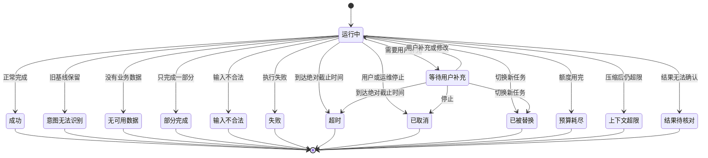

`REPLACED` 只能由 `SWITCH` 产生，旧任务和所属子运行要取消或收尾，不能留下仍在执行的后台任务。`RESULT_UNKNOWN` 表示结果需要人工核对，不能按成功展示，也不能自动写长期记忆。`UNKNOWN_INTENT`、`NO_DATA`、`INVALID_INPUT` 是旧基线保留值，新链路可以继续返回，但不能用它们绕过证据校验。

#### 8.2 子运行

子运行状态比顶层任务多出等待类状态，因为子运行可能等待用户、审批或更下一层子运行。

| 状态值 | 中文名称 | 含义 | 是否终态 |
|---|---|---|---|
| `PROVISIONAL` | 已受理未执行 | 子运行记录已创建，尚未正式开始 | 否 |
| `RUNNING` | 运行中 | 子助手正在执行 | 否 |
| `WAITING_INPUT` | 等待用户补充 | 子运行缺少必要条件，等待父级转交用户答复 | 否 |
| `WAITING_APPROVAL` | 等待人工审批 | 子运行触发了需要人工确认的动作 | 否 |
| `WAITING_CHILD` | 等待子运行 | 子运行正在等待更下一层子运行 | 否 |
| `SUCCESS` | 成功 | 已答复，结论和证据可用 | 是 |
| `PARTIAL` | 部分完成 | 有结论，但存在未完成部分 | 是 |
| `FAILED` | 失败 | 执行失败，不能当成成功 | 是 |
| `CANCELLED` | 已取消 | 父级或用户取消，或切换任务时取消 | 是 |
| `TIMEOUT` | 超时 | 超过子运行绝对截止时间 | 是 |
| `BUDGET_EXHAUSTED` | 预算耗尽 | 子运行预算用完 | 是 |
| `CONTEXT_LIMIT` | 上下文超限 | 子运行压缩后仍放不进模型窗口 | 是 |
| `CLOSED` | 已关闭 | 不再接受输入或子事件，结果由最终结果字段决定 | 是 |

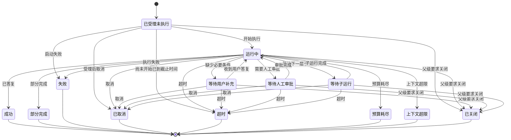

`PROVISIONAL` 表示已受理但还没有开始执行。父运行取消时，已受理子运行按自己的状态处理，不能把父级取消直接当成子级失败；父级只是要求关闭时进入 `CLOSED`，不伪造成 `FAILED`。恢复扫描只接管租约过期的运行。`CLOSED` 只表示运行已关闭、不再接受输入或子事件，不代表业务成功或失败；结果判断看 `outcome_kind`、错误分类和父级汇总。

子运行的业务结果和运行状态分开记录，映射关系如下：

| 业务结果 `outcome_kind` | 中文名称 | 对应运行状态 | 说明 |
|---|---|---|---|
| `ANSWERED` | 已答复 | `SUCCESS` | 结论、证据和产物可用 |
| `NEEDS_INPUT` | 等待补充 | `WAITING_INPUT` | 不进入失败统计 |
| `PARTIAL` | 部分完成 | `PARTIAL` | 父级决定继续、换人或告知用户 |
| `FAILED` | 失败 | `FAILED` | 带错误分类和是否可重试 |
| `CANCELLED` | 已取消 | `CANCELLED` | 取消不是业务失败 |
| `TIMEOUT` | 超时 | `TIMEOUT` | 到达绝对截止时间 |

`BUDGET_EXHAUSTED` 和 `CONTEXT_LIMIT` 没有独立的业务结果，`outcome_kind` 记为 `FAILED`，并在 `error_json.errorCode` 分别写 `BUDGET_EXHAUSTED`、`CONTEXT_LIMIT`。`CLOSED` 保留关闭前的 `outcome_kind`；没有业务结果时为空。

#### 8.3 审批与记忆

| 审批状态 | 中文名称 | 含义 |
|---|---|---|
| `PENDING` | 待处理 | 等待审批人处理 |
| `APPROVED` | 已同意 | 允许继续执行，但工具仍要重新检查 |
| `REJECTED` | 已拒绝 | 不允许执行 |
| `EXPIRED` | 已过期 | 超过审批有效期，不能补批 |
| `CANCELLED` | 已撤销 | 运行或申请方撤销审批 |

审批决定字段只有两个值：

| 决定值 | 中文名称 | 含义 |
|---|---|---|
| `APPROVE` | 同意 | 允许继续执行 |
| `REJECT` | 拒绝 | 不允许执行 |

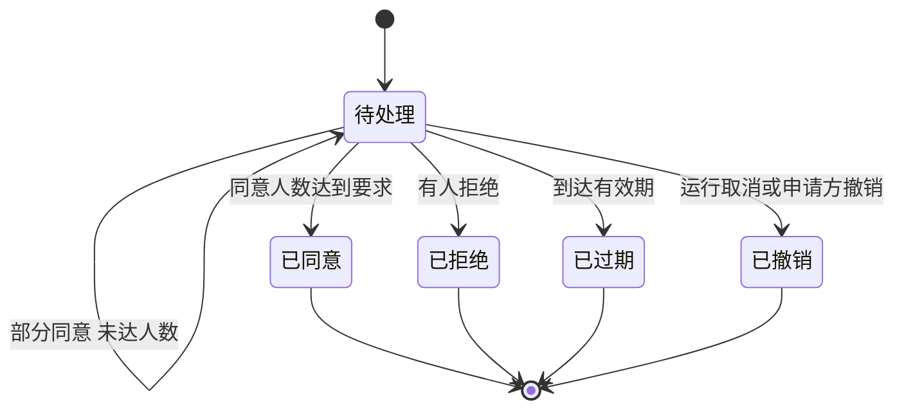

| 记忆状态 | 中文名称 | 含义 |
|---|---|---|
| `CANDIDATE` | 候选 | 等待校验或用户确认，不参与召回 |
| `ACTIVE` | 生效 | 可以参与召回 |
| `SUPERSEDED` | 已被替代 | 被新版本替代，不能继续召回 |
| `DELETED` | 已删除 | 标记删除，正文和向量异步清理 |

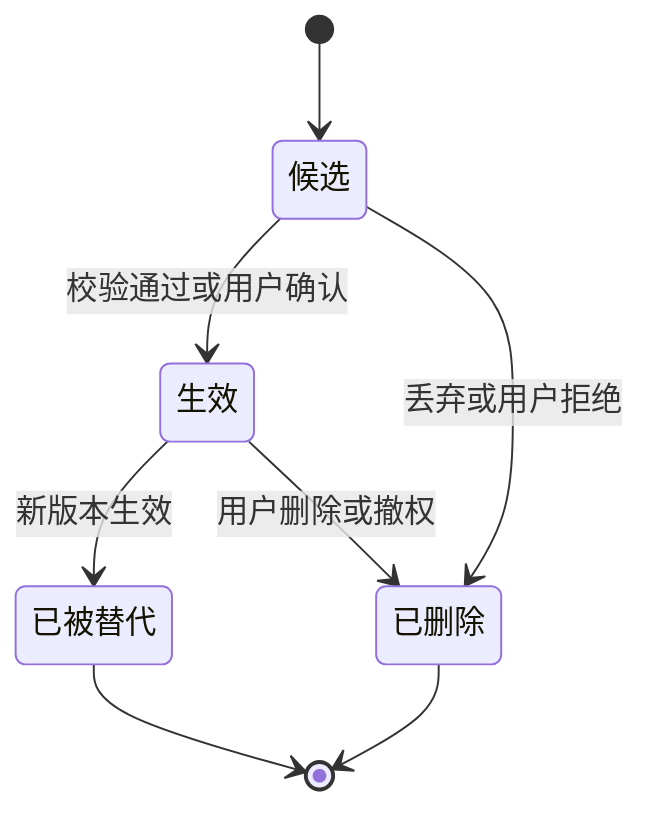

记忆删除是标记删除，正文和向量异步清理，审计保留。审批过期后不能补批，只能重新发起。审批通过不等于工具一定执行，工具还要重新检查权限、参数、预算、副作用账本和请求摘要。

#### 8.4 其他状态字段

| 表或字段 | 取值和中文名称 | 状态机 |
|---|---|---|
| `supervisor_pending_inputs.state` | `PENDING` 待消费、`CONSUMED` 已消费、`CANCELLED` 已取消 | 待消费 → 已消费 / 已取消；只有待消费记录会在恢复时重新装载 |
| `supervisor_tool_calls.state` | `STARTED` 已开始、`SUCCEEDED` 成功、`FAILED` 失败、`DENIED` 被拒绝、`UNKNOWN` 结果不明 | 已开始 → 成功 / 失败 / 被拒绝 / 结果不明；结果不明只能核对，不能直接重试副作用 |
| `side_effect_operations.operation_status` | `RUNNING` 调用中、`SUCCESS` 成功、`FAILED` 失败、`UNKNOWN` 结果不明 | 调用中 → 成功 / 失败 / 结果不明；结果不明先核对，确认未执行且适配器支持持久幂等才允许重新领取 |
| `supervisor_idempotency.state` | `IN_PROGRESS` 处理中、`COMPLETED` 已完成、`FAILED` 失败 | 处理中 → 已完成 / 失败 |
| `supervisor_outbox.state` | `PENDING` 待投递、`PROCESSING` 投递中、`PUBLISHED` 已投递、`FAILED` 失败待重试、`DEAD` 死信 | 待投递 → 投递中 → 已投递；失败可重试，超过次数进入死信 |
| `supervisor_export_jobs.state` | `PENDING` 待处理、`RUNNING` 处理中、`READY` 可下载、`FAILED` 失败、`EXPIRED` 已过期 | 待处理 → 处理中 → 可下载 / 失败；可下载到期后进入已过期 |
| `supervisor_agents.state`、`supervisor_tools.state`、`supervisor_prompts.state` | `DRAFT` 草稿、`ACTIVE` 启用、`DEPRECATED` 已弃用、`DISABLED` 已停用 | 草稿 → 启用 → 已弃用 / 已停用 |
| `supervisor_agent_versions.state`、`supervisor_tool_versions.state`、`supervisor_prompt_versions.state` | `DRAFT` 草稿、`CANARY` 灰度、`ACTIVE` 生效、`RETIRED` 已退役 | 草稿 → 灰度 / 生效 → 已退役；旧版本在在途运行结束后才能退役 |
| `supervisor_agent_versions.capability_level` | `FULL` 完全能力、`BOUNDARY_CANCEL` 仅支持边界取消、`BEST_EFFORT` 尽力而为 | 不是运行状态，由描述符声明，平台据此决定恢复、取消和重试方式；降级不能提升为更强能力 |
| `supervisor_mcp_servers.state`、`supervisor_agent_endpoints.state` | `DRAFT` 草稿、`ACTIVE` 启用、`DISABLED` 停用 | 草稿 → 启用 → 停用；停用后不再接新运行 |
| `supervisor_mcp_servers.health_state`、`supervisor_agent_endpoints.health_state`、`supervisor_knowledge_sources.health_state` | `UNKNOWN` 未知、`HEALTHY` 健康、`DEGRADED` 降级、`DOWN` 不可用 | 未知 → 健康 / 降级 / 不可用；健康检查、同步或索引失败先降级，连续失败再不可用 |
| `supervisor_knowledge_sources.state` | `DRAFT` 草稿、`ACTIVE` 启用、`DISABLED` 停用、`DELETED` 已删除 | 草稿 → 启用 → 停用 / 删除 |
| `supervisor_knowledge_documents.state` | `ACTIVE` 生效、`DELETED` 已删除 | 生效 → 删除；删除后分块和向量异步清理 |
| `supervisor_eval_sets.state` | `DRAFT` 草稿、`ACTIVE` 启用、`ARCHIVED` 已归档 | 草稿 → 启用 → 已归档 |
| `supervisor_eval_runs.state` | `PENDING` 待运行、`RUNNING` 运行中、`SUCCEEDED` 成功、`FAILED` 失败、`CANCELLED` 已取消 | 待运行 → 运行中 → 成功 / 失败 / 取消 |
| `supervisor_rollouts.state` | `PENDING` 待开始、`RUNNING` 灰度中、`PAUSED` 已暂停、`COMPLETED` 已完成、`ROLLED_BACK` 已回滚、`CANCELLED` 已取消 | 待开始 → 灰度中 → 暂停 / 完成 / 回滚 / 取消 |

#### 8.4.1 其他状态机图

以下状态机与上表一一对应。状态值仍以英文常量持久化，图里显示中文名称。

**待消费输入**

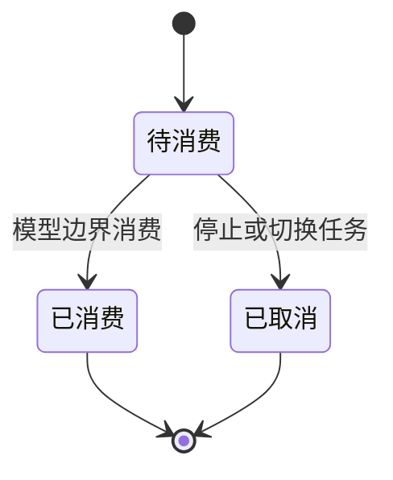

**工具调用**

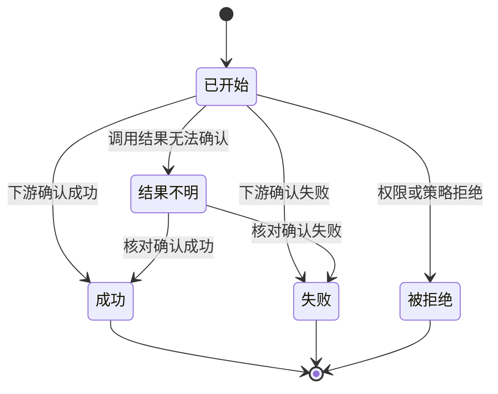

**接口幂等**

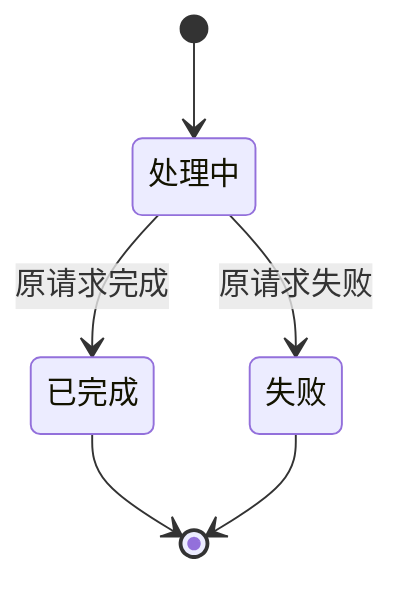

**外部副作用账本**

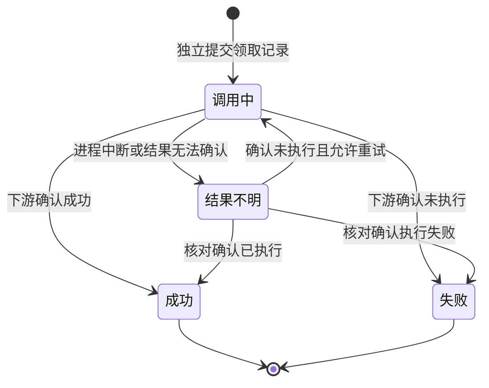

**发件箱**

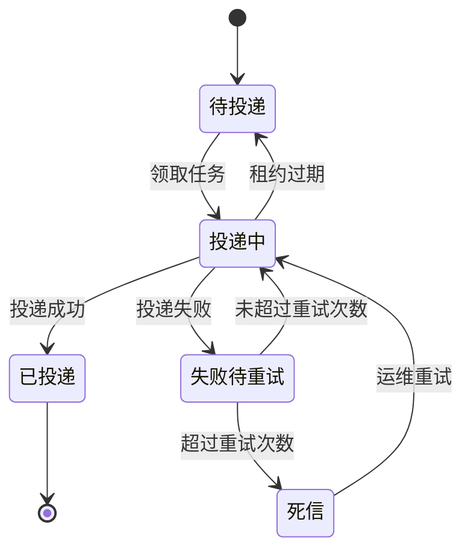

**导出任务**

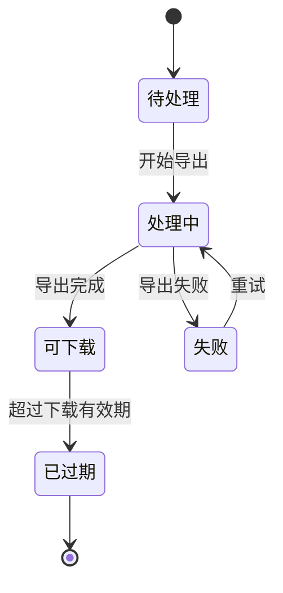

**目录主表**

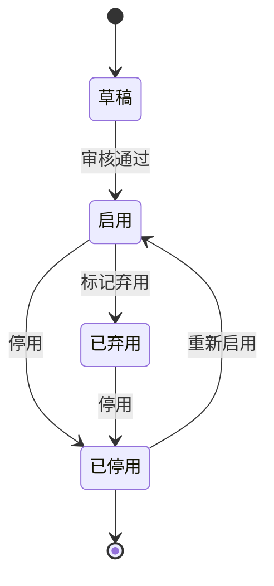

**目录版本**

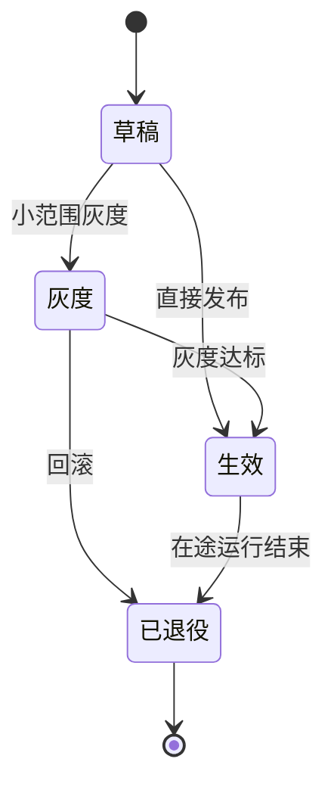

**接入配置**

```mermaid
stateDiagram-v2
    state "草稿" as DRAFT
    state "启用" as ACTIVE
    state "停用" as DISABLED
    [*] --> DRAFT
    DRAFT --> ACTIVE : 校验通过并启用
    ACTIVE --> DISABLED : 人工停用
    DISABLED --> ACTIVE : 重新启用
    DISABLED --> [*]
```

**健康状态**

```mermaid
stateDiagram-v2
    state "未知" as UNKNOWN
    state "健康" as HEALTHY
    state "降级" as DEGRADED
    state "不可用" as DOWN
    [*] --> UNKNOWN
    UNKNOWN --> HEALTHY : 首次检查通过
    UNKNOWN --> DOWN : 首次检查失败
    HEALTHY --> DEGRADED : 检查失败但未连续超限
    HEALTHY --> DOWN : 连续检查失败
    DEGRADED --> HEALTHY : 检查恢复
    DEGRADED --> DOWN : 连续检查失败
    DOWN --> DEGRADED : 恢复探测成功
    DEGRADED --> [*]
    DOWN --> [*]
```

**知识源**

```mermaid
stateDiagram-v2
    state "草稿" as DRAFT
    state "启用" as ACTIVE
    state "停用" as DISABLED
    state "已删除" as DELETED
    [*] --> DRAFT
    DRAFT --> ACTIVE : 审核通过
    ACTIVE --> DISABLED : 停用
    DISABLED --> ACTIVE : 重新启用
    ACTIVE --> DELETED : 删除
    DISABLED --> DELETED : 删除
    DELETED --> [*]
```

**知识文档**

```mermaid
stateDiagram-v2
    state "生效" as ACTIVE
    state "已删除" as DELETED
    [*] --> ACTIVE
    ACTIVE --> DELETED : 删除
    DELETED --> [*]
```

**评测集**

```mermaid
stateDiagram-v2
    state "草稿" as DRAFT
    state "启用" as ACTIVE
    state "已归档" as ARCHIVED
    [*] --> DRAFT
    DRAFT --> ACTIVE : 审核通过
    ACTIVE --> ARCHIVED : 归档
    ARCHIVED --> [*]
```

**评测运行**

```mermaid
stateDiagram-v2
    state "待运行" as PENDING
    state "运行中" as RUNNING
    state "成功" as SUCCEEDED
    state "失败" as FAILED
    state "已取消" as CANCELLED
    [*] --> PENDING
    PENDING --> RUNNING : 开始执行
    RUNNING --> SUCCEEDED : 执行完成
    RUNNING --> FAILED : 执行失败
    RUNNING --> CANCELLED : 取消
    SUCCEEDED --> [*]
    FAILED --> [*]
    CANCELLED --> [*]
```

**灰度发布**

```mermaid
stateDiagram-v2
    state "待开始" as PENDING
    state "灰度中" as RUNNING
    state "已暂停" as PAUSED
    state "已完成" as COMPLETED
    state "已回滚" as ROLLED_BACK
    state "已取消" as CANCELLED
    [*] --> PENDING
    PENDING --> RUNNING : 开始放量
    RUNNING --> PAUSED : 暂停观察
    PAUSED --> RUNNING : 继续放量
    RUNNING --> COMPLETED : 全量完成
    RUNNING --> ROLLED_BACK : 指标不达标
    PAUSED --> ROLLED_BACK : 指标不达标
    RUNNING --> CANCELLED : 人工取消
    PAUSED --> CANCELLED : 人工取消
    COMPLETED --> [*]
    ROLLED_BACK --> [*]
    CANCELLED --> [*]
```

#### 8.5 关键约束

| 约束 | 说明 |
|---|---|
| 一个任务一个主运行 | `uq_supervisor_run_main` |
| 一个父工具调用一个子运行 | `uq_supervisor_child_tool_call` |
| 同一会话最多一个运行中顶层任务 | `uq_supervisor_task_active_session` |
| 同一运行消息序号唯一 | `uq_supervisor_message_seq` |
| 同一运行检查点序号唯一 | `uq_supervisor_checkpoint_seq` |
| 同一运行事件序号唯一 | `uq_supervisor_event_seq` |
| 同名记忆键只能有一个生效版本 | `uq_supervisor_memory_active_key` |
| 同一记忆同一模型一条向量 | 复合主键 `(memory_id, model)` |
| 外部副作用按租户、用户、工具、操作号唯一 | 现有 `side_effect_operations` 主键 |

### 9. 索引、分区与保留

#### 9.1 必建索引

| 表 | 索引 | 用途 |
|---|---|---|
| `supervisor_tasks` | `(tenant_id, user_id, session_id, created_at DESC)` | 会话历史 |
| `supervisor_tasks` | `(tenant_id, user_id, session_id) WHERE state='RUNNING'` | 同会话运行互斥 |
| `supervisor_tasks` | `(state, deadline_at)` | 超时扫描 |
| `supervisor_agent_runs` | `(task_id, created_at)` | 任务下的运行列表 |
| `supervisor_agent_runs` | `(parent_run_id, created_at)` | 子运行列表 |
| `supervisor_pending_inputs` | `(run_id, created_at) WHERE state='PENDING'` | 恢复未消费的追加输入 |
| `supervisor_agent_runs` | `(state, lease_until)` | 执行接管扫描 |
| `supervisor_agent_runs` | `(state, deadline_at)` | 等待态和超时扫描 |
| `supervisor_messages` | `(run_id, seq)` | 按序恢复 |
| `supervisor_run_events` | `(run_id, seq)` | 事件重放 |
| `supervisor_approvals` | `(tenant_id, state, expires_at)` | 待审批列表 |
| `supervisor_outbox` | `(state, next_attempt_at)` | 异步投递 |
| `supervisor_memory_items` | `(tenant_id, scope, subject_id, state)` | 记忆范围过滤 |
| `supervisor_memory_items` | `(tenant_id, user_id, state, valid_until)` | 用户记忆召回 |
| `supervisor_memory_embeddings` | HNSW `embedding vector_cosine_ops` | 语义召回 |
| `supervisor_knowledge_chunks` | HNSW `embedding vector_cosine_ops` | 知识检索 |
| `supervisor_audit_log` | `(tenant_id, created_at DESC)` | 审计查询 |

#### 9.2 分区与归档

第一阶段不分区。出现以下情况再按时间分区：

- 单表超过五千万行，或索引明显增大。
- 保留期清理变成大事务。
- 查询只按最近时间范围。

建议分区：

| 表 | 分区键 | 粒度 |
|---|---|---|
| `supervisor_messages` | `created_at` | 月 |
| `supervisor_run_events` | `created_at` | 月 |
| `supervisor_tool_calls` | `created_at` | 月 |
| `supervisor_audit_log` | `created_at` | 月 |

分区后主键要包含分区键，唯一约束也要调整。不要在数据量还小时提前分区，否则运维复杂度先上升。

#### 9.3 保留期

| 数据 | 建议保留 | 说明 |
|---|---|---|
| 运行中的检查点和消息 | 运行期间 | 结束后按会话保留期 |
| 已结束运行的消息 | 三十天 | 可按租户配置 |
| 检查点 | 结束后的七天 | 只用于短期恢复 |
| 事件 | 九十天 | SSE 重放和审计 |
| 工具调用 | 一百八十天 | 成本和排障 |
| 审批 | 一年 | 合规 |
| 审计 | 一到三年 | 按合规要求 |
| 长期记忆 | 按类型和有效期 | 到期失效，删除后正文清理 |
| 知识文档 | 按知识源 | 版本和时效管理 |

保留期清理必须分批执行，不能一次删除百万行。删除先标记，再由后台任务清理正文、向量和索引。

### 10. 现有表迁移

| 现有表 | 处理 | 说明 |
|---|---|---|
| `supervisor_tasks` | 扩列 | 增加状态、版本、结构化结果、期限、预算、摘要；保留 `payload` 兼容 |
| `supervisor_sessions` | 扩列 | 增加版本和更新时间 |
| `supervisor_conversations` | 保留并双写 | 新消息写 `supervisor_messages`；旧表保留问题答案，切换后只读 |
| `supervisor_instructions` | 保留 | 继续做运行内指令回执；通用接口幂等写入 `supervisor_idempotency` |
| `supervisor_windows` | 保留 | 继续做额度窗口；预算树使用新表，不混用 |
| `supervisor_memories` | 保留并迁移 | 双写 `supervisor_memory_items`，比对后切换读路径 |
| `side_effect_operations` | 扩列 | 增加运行、工具调用、操作键、核对时间；原状态字段不变 |
| `supervisor_agent_runs` | 新建 | 主运行和子运行统一 |
| `supervisor_pending_inputs` | 新建 | 运行中追加输入的持久队列 |
| `supervisor_messages`、`supervisor_run_checkpoints`、`supervisor_compression_records`、`supervisor_run_events` | 新建 | 短期记忆和恢复 |
| `supervisor_run_budgets`、`supervisor_budget_entries` | 新建 | 预算树和流水 |
| `supervisor_approvals`、`supervisor_approval_decisions`、`supervisor_idempotency`、`supervisor_tool_calls` | 新建 | 审批、审批决定、幂等、工具审计 |
| `supervisor_agents`、`supervisor_agent_versions` | 新建 | 目录和版本 |
| `supervisor_tools`、`supervisor_tool_versions`、`supervisor_prompts`、`supervisor_prompt_versions` | 新建 | 工具和提示词目录 |
| `supervisor_mcp_servers`、`supervisor_agent_endpoints` | 新建 | 外部服务和远程端点 |
| `supervisor_knowledge_sources`、`supervisor_knowledge_documents`、`supervisor_knowledge_chunks` | 新建 | 知识库 |
| `supervisor_memory_items`、`supervisor_memory_embeddings`、`supervisor_memory_sources`、`supervisor_memory_audit` | 新建 | 长期记忆 |
| `supervisor_outbox`、`supervisor_audit_log`、`supervisor_artifacts`、`supervisor_export_jobs`、`supervisor_feedback` | 新建 | 发件箱、审计、产物、导出、反馈 |
| `supervisor_eval_sets`、`supervisor_eval_cases`、`supervisor_eval_runs`、`supervisor_eval_results`、`supervisor_rollouts` | 新建，第二阶段启用 | 评测与灰度 |

现有表的列迁移不能直接改类型。以 `supervisor_tasks.created_at` 为例：

- 先把旧 `BIGINT` 列改名为 `created_at_ms`，新增 `created_at TIMESTAMPTZ`。
- 从 `created_at_ms` 回填新列，校验无空值后再设为 `NOT NULL`。
- 代码切换读写新列；接口仍按毫秒时间戳输出，客户端不感知。
- 旧列保留一个版本周期，确认没有回滚需求后再删除。

新增的必填列（`question`、`state`、`request_hash`、`deadline_at`）先按可空列加入，从旧 `payload` 和现有列回填，再补 `NOT NULL` 和 `CHECK`。无法恢复的行不能伪造成功，统一标记为 `RESULT_UNKNOWN` 并写审计；无法恢复的必填字段用明确占位值（空字符串、创建时间加最大运行时长、旧载荷摘要），并在 `error_json` 记录 `LEGACY_FIELD_MISSING`。

建立 `uq_supervisor_task_active_session` 前，先按 `supervisor_sessions.current_run_id` 清理同一会话存在多个 `RUNNING` 任务的旧数据：保留 `current_run_id` 指向的任务，其余任务按 `REPLACED` 收尾并写审计。否则唯一索引会因旧数据冲突而建立失败。

迁移顺序：

1. Flyway 建新表，保留旧表。
2. 双写：任务、消息、记忆、副作用。
3. 回填：会话历史转消息，旧记忆转记忆主体，旧任务结果转结构化列。
4. 校验：条数、版本、幂等键、预算、权限、状态一致。
5. 切换读路径。
6. 旧表只读保留一个版本周期；没有回滚需求后再决定删除。

任何阶段都不能删除尚未核实的需求。旧字段对应关系不清楚时，保留原字段并标注“尚未核实对应实现”，不能凭猜测删除。

### 11. API 设计

#### 11.1 通用约定

- 用户接口前缀：`/api/supervisor`。
- 管理接口前缀：`/api/platform/admin`。
- 运维接口前缀：`/api/platform/ops`。
- 认证：OAuth2/OIDC 访问令牌，放在 `Authorization: Bearer ...`。身份、租户、权限由令牌映射，不由请求正文提供。
- 异步：请求头 `Prefer: respond-async`。异步受理返回 `202` 和 `Location: /api/supervisor/runs/{runId}`。
- 幂等：对话用 `requestId`，运行指令用 `instructionId`，管理接口用请求体 `requestId`。相同键、不同请求摘要返回 `409`。
- 版本：`PUT` 请求体带 `expectedVersion`；`DELETE` 版本放路径。版本不匹配返回 `409`。
- 分页：第一页 `GET /资源`，默认二十条；子运行和会话消息第一页五十条。下一页 `GET /资源/{cursor}`；详情 `GET /资源/detail/{id}`。不引入查询参数。游标是不透明字符串，服务端负责解码，客户端不能拼造。
- 时间：新增字段用 ISO-8601，UTC，例如 `2026-10-29T08:00:00Z`；现有 `RunRes.deadline` 继续输出毫秒时间戳，不能中途改变类型。
- 错误：统一 `ErrorRes`，保留现有 `code`、`message`，增加可选 `traceId`、`details`。
- 请求体：所有 `POST` 只有一个 `xxxParam`；`PUT` 使用 `@PathVariable` 加 `xxxReq`。
- 权限：用户接口只允许访问自己的租户和用户数据；管理接口要求管理权限；运维接口要求运维权限。
- 事件流：`Last-Event-ID` 由请求过滤器解析后写入请求上下文，Controller 不直接读取请求头。这样仍然满足“GET 只用路径参数”的约束。

#### 11.2 状态码

| 状态码 | 场景 |
|---|---|
| `200` | 同步完成、查询成功、撤销类指令 |
| `201` | 目录、工具、提示词、知识源、反馈首次创建成功 |
| `202` | 异步受理、补充或修订指令已排队 |
| `204` | 删除成功，无响应体 |
| `400` | 请求格式错误、字段缺失、参数不合法 |
| `401` | 未认证或令牌过期 |
| `403` | 无权限、跨租户、越权访问 |
| `404` | 任务、运行、记忆、智能体不存在 |
| `409` | 幂等冲突、版本冲突、状态冲突、审批已处理 |
| `410` | 产物、导出等已过期且不再提供 |
| `412` | 前置条件不满足，例如智能体未激活 |
| `422` | 业务校验失败，例如描述符不合法、工具契约不匹配 |
| `429` | 限流或额度不足 |
| `500` | 未分类内部错误，不返回堆栈 |
| `502` | 模型或外部工具不可用 |
| `503` | 数据库或依赖服务暂时不可用 |
| `504` | 超过绝对截止时间 |

#### 11.3 用户接口总表

| 方法 | 路径 | 作用 | 成功状态 |
|---|---|---|---|
| `POST` | `/api/supervisor/chat` | 提交一次对话任务 | `200` 或 `202` |
| `GET` | `/api/supervisor/runs/{runId}` | 查询任务和运行快照 | `200` |
| `GET` | `/api/supervisor/runs/{runId}/events` | 订阅运行事件流 | `200`，`text/event-stream` |
| `GET` | `/api/supervisor/runs/{runId}/children` | 查询直接子运行第一页，最多五十条 | `200` |
| `GET` | `/api/supervisor/runs/{runId}/children/page/{cursor}` | 查询直接子运行下一页 | `200` |
| `GET` | `/api/supervisor/runs/{runId}/children/detail/{childRunId}` | 查询子运行详情 | `200` |
| `POST` | `/api/supervisor/instructions` | 补充、修订、切换、取消 | `200` 或 `202` |
| `GET` | `/api/supervisor/approvals` | 待审批列表第一页 | `200` |
| `GET` | `/api/supervisor/approvals/{cursor}` | 待审批列表下一页 | `200` |
| `GET` | `/api/supervisor/approvals/detail/{approvalId}` | 审批详情 | `200` |
| `POST` | `/api/supervisor/approvals` | 同意或拒绝 | `200` |
| `GET` | `/api/supervisor/memories` | 旧版偏好第一页 | `200` |
| `GET` | `/api/supervisor/memories/{cursor}` | 旧版偏好下一页 | `200` |
| `PUT` | `/api/supervisor/memories/{key}` | 旧版偏好写入 | `200` |
| `DELETE` | `/api/supervisor/memories/{key}/{expectedVersion}` | 旧版偏好删除 | `204` |
| `GET` | `/api/supervisor/memory-items` | 长期记忆第一页 | `200` |
| `GET` | `/api/supervisor/memory-items/{cursor}` | 长期记忆下一页 | `200` |
| `GET` | `/api/supervisor/memory-items/detail/{memoryId}` | 长期记忆详情 | `200` |
| `POST` | `/api/supervisor/memory-items/search` | 检索长期记忆 | `200` |
| `PUT` | `/api/supervisor/memory-items/{memoryId}` | 更正记忆 | `200` |
| `POST` | `/api/supervisor/memory-items/confirmations` | 确认或拒绝候选记忆 | `200` |
| `DELETE` | `/api/supervisor/memory-items/{memoryId}/{expectedVersion}` | 删除记忆 | `204` |
| `POST` | `/api/supervisor/memory-items/exports` | 申请导出记忆 | `202` |
| `GET` | `/api/supervisor/memory-exports/detail/{exportId}` | 查询导出任务 | `200` |
| `GET` | `/api/supervisor/sessions/{sessionId}/messages` | 会话消息第一页 | `200` |
| `GET` | `/api/supervisor/sessions/{sessionId}/messages/{cursor}` | 会话消息下一页 | `200` |
| `GET` | `/api/supervisor/artifacts/detail/{artifactId}` | 产物元数据 | `200` |
| `GET` | `/api/supervisor/artifacts/{artifactId}` | 下载产物 | `200` |
| `POST` | `/api/supervisor/feedback` | 提交结果反馈；首次创建，重复提交更新 | `201` 或 `200` |

旧版 `/memories` 接口保留，不能直接改成新结构。新长期记忆使用 `/memory-items`，避免破坏现有客户端。

#### 11.4 对话接口

`POST /api/supervisor/chat`

请求体沿用 `ChatParam`：

```json
{
  "sessionId": "session-01J...",
  "question": "帮我查杭州明天天气，并规划两天行程",
  "history": [],
  "requestId": "req-01J..."
}
```

`history` 是兼容字段，只为旧客户端保留。会话事实以服务端 `supervisor_messages`、会话检查点和任务记录为准；调用方传入的历史只作为待核实资料，不能当成已授权事实。新客户端应传空数组或不传。

`requestId` 建议必填。为空时平台生成，但客户端重试不享受幂等保护。平台生成的编号也要写入 `request_id`；新写入不允许为空，旧行为空的数据在迁移时回填。

响应里有两个状态字段：`state` 是顶层任务状态，`status` 是本次结果状态。两者含义不同，客户端不能用 `status` 推断任务是否还可以追加输入。

同步响应 `200`：

```json
{
  "runId": "run-01J...",
  "requestId": "req-01J...",
  "state": "SUCCESS",
  "revision": 0,
  "deadline": 1793260800000,
  "modelCalls": 2,
  "replacedBy": null,
  "status": "SUCCESS",
  "originalQuery": "帮我查杭州明天天气，并规划两天行程",
  "rewrittenQuery": null,
  "intent": null,
  "answer": "杭州明天多云……",
  "agents": ["travel.weather", "travel.itinerary"],
  "evidence": [],
  "events": []
}
```

异步响应 `202`：

```json
{
  "runId": "run-01J...",
  "requestId": "req-01J...",
  "state": "RUNNING",
  "revision": 0,
  "deadline": 1793260800000,
  "modelCalls": 0,
  "replacedBy": null,
  "status": null,
  "answer": null,
  "agents": [],
  "evidence": [],
  "events": []
}
```

规则：

- `(tenant_id, user_id, request_id)` 唯一。重复请求返回已有任务快照，不重复创建。
- 相同 `requestId`、不同请求摘要返回 `409 IDEMPOTENCY_MISMATCH`。
- 同一会话已有 `RUNNING` 顶层任务时，`POST /chat` 返回 `409 STATE_CONFLICT`，响应里带当前 `runId`。补充、修订、切换和取消一律走 `/instructions`，不能靠新开 `/chat` 绕过会话互斥。
- 同步模式等到任务进入终态；任务进入 `TIMEOUT` 时返回 `504`。客户端断开只取消这次等待，不取消已经受理的任务；要停止任务必须调用指令接口。
- 异步模式只保证受理，返回 `202` 和受理时的任务快照，不保证成功。
- 同步响应里的 `rewrittenQuery`、`intent` 是 v3.4 兼容字段。统一循环不再生成改写和意图结果，这两个字段固定为 `null`，客户端不得用它们判断路由或答复来源。`originalQuery` 保留用户原话。

#### 11.4.1 对话全链路（对应《多agent平台改造》图一）

上面的 `POST /chat` 简图只画受理边界。完整链路按下面的顺序执行，所有状态变化都要落库，所有外部动作都要经过权限、预算和副作用检查。

```mermaid
flowchart TD
    A[请求进入] --> B{过滤器认证}
    B -->|失败| B1[401 不登记任务]
    B --> C[解析 Prefer 异步标记]
    C --> D{字段存在且长度合法}
    D -->|否| D1[400 不登记任务]
    D --> E[计算请求摘要]
    E --> F{requestId 是否命中}
    F -->|同摘要| F1[返回已有任务快照]
    F -->|不同摘要| F2[409 幂等冲突]
    F -->|未命中| G{同一会话已有 RUNNING 任务}
    G -->|是| G1[409 会话忙 返回当前 runId]
    G -->|否| H{容量和配额是否足够}
    H -->|不足| H1[429 或 503]
    H -->|足够| I[创建任务 主运行 初始检查点]
    I -->|存储失败| I1[503]
    I --> J[异步立即 202 或同步等待终态]
    J --> K[后台启动主循环]
    K --> L[读取工作记忆 会话记忆 长期记忆]
    L --> M[恢复未完成工具调用]
    M --> N[消费排队指令和新用户输入]
    N --> O{主助手决定这一步}
    O -->|能回答| P[校验答案证据和当前权限]
    O -->|需要问用户| Q[进入 NEEDS_INPUT 等待]
    O -->|调用工具| R[权限 参数 预算 期限 副作用检查]
    O -->|委派子助手| S[检查子助手 权限 槽位和预算]
    R --> T[写工具调用和证据]
    T --> K
    S --> U[创建子运行并执行]
    U --> V{子运行结果}
    V -->|已答复| W[平台记账并校验证据]
    V -->|等待补充| Q
    V -->|部分完成| W
    V -->|失败或超时| X[父级决定重试 换人或收尾]
    W --> K
    X --> K
    P --> Y{提交时版本是否变化}
    Y -->|已变化| K
    Y -->|未变化| Z[提交结果 写事件 生成记忆候选]
    Z --> AA{同步还是异步}
    AA -->|同步| AB[200 或 502 或 504]
    AA -->|异步| AC[已返回 202 客户端查询]
```

**一、入口和登记**

1. 请求先经过 `SupervisorRequestFilter`。认证失败直接返回 401，不创建任务；`Prefer: respond-async` 由过滤器写入请求上下文，Controller 不读请求头。
2. `ChatParam` 只校验 `sessionId`、`question` 是否存在和长度是否合法，以及 `requestId` 是否超长。这里不判断“问题语义是否完整”；语义不完整交给主助手，通过 `NEEDS_INPUT` 请用户补充，不能把“缺日期”这类业务缺口当成 400。
3. `request_hash` 由规范化请求体计算。`(tenant_id, user_id, request_id)` 命中且摘要相同，返回已有任务快照；摘要不同返回 `409 IDEMPOTENCY_MISMATCH`。
4. 同一租户、同一用户、同一会话已有 `RUNNING` 任务时返回 `409 STATE_CONFLICT`，并带当前 `runId`。补充、修改、切换和停止必须走 `/instructions`，不能靠新开 `/chat` 绕过互斥。
5. 容量、并发、存储上限和配额检查通过后，创建 `supervisor_tasks`、对应的主运行 `supervisor_agent_runs`（`run_kind='MAIN'`，`run_id` 与任务编号相同）和初始检查点。任何一步失败都不能留下半个任务。
6. 任务记录至少写入：绝对截止时间、预算快照、初始版本 0、请求摘要、原始问题、`session_id`、`trace_id`。主运行写入 `agent_id='supervisor.main'`、`agent_version`、`prompt_id`、`prompt_version`、`prompt_checksum`、`tool_versions_json`、`depth=0`、`root_run_id=run_id`。
7. 落库成功后，异步模式立即返回 202 和受理时快照；同步模式等待任务进入终态。客户端断开只取消等待，不取消已受理任务。

**二、主循环**

8. 每轮重新读任务和运行，先检查取消、替换、截止时间和租约，再读记忆。记忆读取顺序是：工作记忆和检查点、会话摘要和最近消息、长期记忆、业务知识库。任何一层取不到都不能编造。
9. 先恢复 `pending_tool_calls_json` 里没有配齐结果的工具调用。工具调用和结果必须成对写回，不能只恢复请求不恢复结果。
10. 再消费排队输入。用户补充、修改、切换和停止在 `supervisor_pending_inputs` 或指令表中排队，只在模型边界、工具结束边界或子运行结束边界消费。
11. 主助手按当前上下文决定：直接回答、请求用户补充、调用工具、委派子助手。模型最终文本原样保留，业务证据作为结构化附件，不再经过强制改写、意图模型或固定澄清模板。

**三、工具和子运行**

12. 工具调用前检查：工具是否注册、当前用户是否有权限、参数是否符合 schema、是否超过截止时间、预算是否可预留、是否属于写操作或外部副作用。`READ` 可以并发；`WRITE`、`EXTERNAL` 必须串行并经过副作用账本。
13. 外部副作用先以独立语句提交 `RUNNING` claim，再调用下游。下游结果不明时进入 `UNKNOWN`，先核对，不能盲目重试；核对完成后再决定成功、失败或人工处理。
14. 委派前检查：子助手是否存在、是否有已激活版本、当前用户是否有权限、必填槽位是否齐全、是否超过深度和扇出限制、调用链是否成环。槽位不全时由父级合并问题后一次性问用户，不让子助手直接面对用户再问一轮。
15. 创建子运行时写入：父运行、父工具调用编号、Agent 标识和版本、任务书、槽位、已核实事实、约束、期望输出、预算切片、绝对期限、权限快照。子运行预算不能超过父级剩余额度，期限不能晚于父级截止时间。
16. 子助手内部可以自己决定用 ReAct、计划执行、固定流程、多 Agent 或纯确定性查询。平台只通过 `AgentRuntime` 提供模型、工具、记忆、再委派、进度和检查点能力，不强制内部循环。
17. 子运行结果按四种业务结果落库：`ANSWERED`、`NEEDS_INPUT`、`PARTIAL`、`FAILED`。取消和超时另记 `CANCELLED`、`TIMEOUT`。父级只拿结论、证据、产物编号和子运行编号，不拿子助手内部全部消息。
18. 平台对子结果做记账和质检：写入消耗的模型调用、token、金额、耗时；证据要能对上来源和当前权限；对不上就不能当成事实，改成失败、待核对或请用户补充。

**四、收尾和提交**

19. 最终答复里的每个事实都要有证据或明确标注为不确定。证据要按当前用户、租户和运行重新检查权限，不能因为之前查过就继续返回。
20. 提交结果时带本轮消费的版本和 generation。版本已经变化，说明用户中途补充、修改或切换过，本次结果作废，带最新输入重跑；本次不写长期记忆。版本未变化才允许写最终结果、终态事件和记忆候选。
21. 只有最终提交成功才生成长期记忆候选，每次任务最多提炼零到三条。作废结果、失败结果和被替换结果都不写长期记忆。
22. 同步模式按最终状态返回 200、502 或 504；异步模式已经在受理时返回 202，客户端通过 `GET /runs/{runId}` 或事件流取后续结果。

**五、图一细节对照**

| 图一步骤 | 技术方案落点 | 关键规则 |
|---|---|---|
| 入口检查 | 11.1、11.4、过滤器 | 认证失败不登记；`Prefer` 不进 Controller |
| 任务登记 | 3.1、3.2、11.4 | 幂等、同会话互斥、容量、期限、预算、版本 |
| 正式开工 | 3.3、3.5 | 任务和主运行同事务创建，后台执行 |
| 主助手开始想 | 3.5、6、11.4.4 | 读工作、会话、长期记忆；恢复待完成工具；消费输入 |
| 决定这一步 | 11.4.1、11.6 | 回答、问用户、工具、委派四条分支 |
| 调用工具 | 3.10、3.11 | 权限、schema、预算、期限、副作用账本 |
| 准备委派 | 4.1、4.4、11.4.1 | Agent 存在、权限、槽位、深度、扇出、环检测 |
| 开子任务 | 3.3、3.8 | 子运行、预算切片、绝对期限、权限快照 |
| 子助手干活 | 3.3、3.4 | 内部架构自由，平台只提供能力 |
| 子助手交结果 | 3.3、8.2 | 四种业务结果，状态和结果分开 |
| 平台记账质检 | 3.8、3.10、11.4.1 | 成本、耗时、证据、权限、副作用 |
| 父级拿结果 | 3.3、8.2 | 只拿结论、证据、产物、子运行编号 |
| 收尾 | 11.4.1、11.5 | 证据校验、权限复查、版本栅栏 |
| 提交并整理记忆 | 6、11.8 | 成功才写候选；作废不写 |
| 返回用户 | 11.4 | 同步 200/502/504，异步 202 |

**六、失败处理**

| 位置 | 情况 | 处理 |
|---|---|---|
| 入口 | 身份无效、令牌过期 | 401，不登记任务 |
| 登记 | 问题为空或超长 | 400，请用户修正 |
| 登记 | 重复提交且摘要相同 | 返回已有任务快照 |
| 登记 | 重复提交但摘要不同 | 409，说明编号已被使用 |
| 登记 | 同一会话已有运行任务 | 409，返回当前 `runId`，引导走 `/instructions` |
| 登记 | 容量、配额、存储不足 | 429 或 503，不创建半成品 |
| 主循环 | 任务被停止、替换或超时 | 按对应终态收尾，不再继续 |
| 主循环 | 上次工具调用未完成 | 先补齐工具结果，再继续模型循环 |
| 主循环 | 模型暂时不可用、限流或连接失败 | 只对未产生输出的可重试错误做有限重试；仍失败返回 `502` 或进入 `FAILED`，不伪造成功 |
| 主循环 | 模型返回空内容、结束原因为 `length`、工具调用编号缺失或重复 | 不提交半截结果；当前基线进入 `FAILED`。v4.0 可配置一次纠错重试，重试仍不完整进入 `FAILED` |
| 主循环 | 上下文超限 | 先压缩；压缩后仍超限进入 `CONTEXT_LIMIT`，保留原始记录 |
| 主循环 | 预算不足 | 进入 `BUDGET_EXHAUSTED`，保留已完成部分 |
| 主循环 | 服务关闭或执行进程退出 | 取消本实例的执行订阅，保留任务、检查点和消息；重启后按租约恢复，不能把未完成写成成功 |
| 主循环 | 工具结果、检索片段或子运行消息夹带指令或错误说法 | 一律当数据，不当系统指令或用户授权；证据必须能对上来源，否则不能输出为事实 |
| 存储 | 数据库连接失败、事务提交失败 | 当前步骤回滚，任务保持可恢复状态；超过重试返回 `503`，不伪造成功或失败 |
| 工具 | 无权限、参数错误、工具超时 | 返回结构化错误给模型，由模型修正或换工具 |
| 工具 | 外部动作结果不明 | 进入 `UNKNOWN`，先核对下游，不盲目重试 |
| 子运行 | 子助手不存在、无权限、槽位不全 | 父级换人或问用户，不创建无效子运行 |
| 子运行 | 子助手失败、超时、预算耗尽 | 父级决定重试、换人、降级或返回部分结果 |
| 记忆 | 读取无权限、已过期或与当前条件冲突 | 跳过该条，不用旧偏好覆盖当前用户输入；不因单条记忆不可用让整个任务失败 |
| 记忆 | 写入失败或存储已满 | 记录审计和 `memory_write_failed` 事件；最终答复仍可成功返回，不能把记忆失败伪装成业务成功或业务失败 |
| 收尾 | 证据不足或证据越权 | 改成失败、待核对或请用户补充，不能输出为事实 |
| 提交 | 版本已变化 | 本次结果作废，带最新输入重跑，不写长期记忆 |
| 提交 | 结果、终态事件或检查点存储失败 | 整个提交事务回滚，任务保持可恢复状态；不向客户端返回成功 |

**七、预算和权限控制点**

| 控制点 | 具体规则 |
|---|---|
| 任务总预算 | 任务受理时确定最大模型调用、token 和金额；多轮补充不增加总额 |
| 单次模型调用 | 调用前原子预留，调用结束按实际消耗转成消费；预留不到就停止 |
| 输入长度 | 系统提示词、用户原话、历史、记忆、知识片段和工具结果合计估算；超过窗口先压缩，压缩后仍超限停止 |
| 输出长度 | 每次模型调用受最大输出 token 限制；结束原因为 `length` 时按未完整处理，不把截断文本当完整答复 |
| 单次工具结果 | 单个工具结果有长度上限；超长结果截断并标记，完整内容按可召回记录保存 |
| 子运行预算 | 父级先预留切片，子级独立记账，结束返还未用部分 |
| 嵌套和并发 | 限制最大深度、单次扇出、总子运行数、每租户和每 Agent 并发 |
| 成本归集 | 模型调用、工具调用、子运行和任务分别记用量；可按租户、用户、Agent、版本和运行树汇总 |
| 记忆读取 | 按条数、单条长度和上下文占比限制；超限先减条数再改摘要 |
| 记忆写入 | 每次任务最多三条候选；敏感内容先确认；来源不可靠直接丢弃 |
| 入口权限 | 身份只来自令牌；请求正文不能提供租户、用户或权限 |
| 目录权限 | 只向主助手暴露当前用户有资格使用的 Agent 和工具 |
| 委派权限 | 父级不能放大权限；子级工具集是用户权限和 Agent 声明权限的交集 |
| 凭证权限 | 每个 Agent 和工具只拿到自己作用域的短期凭证；平台主密钥不进入模型上下文、工具参数和日志 |
| 证据权限 | 输出前和下载前都重新检查，不因缓存或历史查询放行 |

#### 11.4.2 执行期间追加输入（对应《多agent平台改造》图二）

```mermaid
flowchart TD
    A[用户在任务执行期间又说话] --> B[过滤器认证]
    B -->|失败| B1[401]
    B --> C{用户要做什么}
    C -->|补充条件或修改原问题| D[校验 runId instructionId expectedRevision 状态 期限 当前会话]
    D -->|不通过| D1[400 409 或 504]
    D -->|通过| E[写入 pending_inputs 状态 PENDING]
    E --> F[任务版本加一 清空旧结果 返回 202]
    F --> G[等待安全边界]
    G --> H{当前在做什么}
    H -->|等模型回答| I[本次模型回答结束后消费]
    H -->|等子运行| J{子运行是否可中断}
    J -->|可中断| K[通知子运行停止并交回已完成部分]
    J -->|不可中断| L[等子运行结束 结果作废]
    H -->|调用工具| M[等本次工具调用结束后消费]
    I --> N[合并排队输入 接进当前对话]
    K --> N
    L --> N
    M --> N
    N --> O[带最新版本重跑主循环]
    C -->|切换新任务| P[检查容量和配额]
    P -->|不足| P1[拒绝 旧任务继续]
    P -->|足够| Q[创建替代任务 旧任务置为 REPLACED]
    Q --> R[取消旧运行和子运行 核对已完成的外部动作]
    C -->|停止| S[任务置为 CANCELLED 清空排队输入]
    S --> T[取消主运行和子运行 核对外部动作]
    C -->|让平台自己猜| U[平台不猜 返回 200 请用户明确选择]
```

**一、动作和接口**

| 用户动作 | `action` | 是否排队 | 任务变化 | 返回 |
|---|---|---|---|---|
| 补充条件 | `SUPPLEMENT` | 是 | 版本加一，旧结果清空，继续当前任务 | `202` |
| 修改原问题 | `REVISE` | 是 | 版本加一，旧结果清空，继续当前任务 | `202` |
| 换一个新任务 | `SWITCH` | 否 | 创建替代任务，旧任务 `REPLACED` | `202` |
| 停止 | `CANCEL` | 否 | 任务 `CANCELLED`，清空排队输入 | `200` |
| 让平台自己猜 | `AUTO` | 否 | 不执行任何动作，只返回澄清提示 | `200` |

`AUTO` 不是“平台自动判断”。平台不猜测用户意图，只返回“请明确选择补充、修改、切换或停止”，不改变任务状态。

**二、受理规则**

1. `(runId, instructionId)` 幂等。相同编号、相同摘要返回原响应；不同摘要返回 `409`。
2. `expectedRevision` 必须等于当前任务版本。对不上返回 `409 REVISION_CONFLICT`，响应里带当前版本。
3. 任务必须是 `RUNNING` 或 `NEEDS_INPUT`，且没有超过绝对截止时间。已终态返回 `409 STATE_CONFLICT`，已超时返回 `504 DEADLINE_EXCEEDED`。
4. 指令只能作用于当前会话的当前任务。会话已经开始后续任务时返回 `409`，不能拿旧任务编号修改新任务。
5. 补充和修改进入 `supervisor_pending_inputs`，按 `created_at` 先进先出。队列条数和字符数有上限，当前基线是单任务最多三十二条、累计不超过两千字符；超限返回 `429`，不能无界堆积。
6. 新输入不延长绝对截止时间，不增加任务总预算，不退还已经消耗的用量。任务只能花剩下的额度。

**三、安全边界**

7. 补充和修改不硬打断模型。模型正在回答时，等本次回答结束再消费；正在调用工具时，等本次工具调用结束再消费。
8. 正在等待子运行时，先看子运行是否声明可中断。可中断就通知子运行停止并交回已完成部分；不可中断就等它结束，但结果按旧版本作废，带新说法重跑。
9. 已受理的子运行不能因为父级取消就直接当成失败。父级通知关闭时，子运行进入 `CLOSED` 或 `CANCELLED`，最终结果按它自己的 `outcome_kind` 判断。
10. 要区分三类取消，不能混成一个“取消”：
    - **父轮次取消**：只取消父级当前这次等待或执行订阅；已经受理的子运行继续按自己的状态运行，完成后把结果放回父消息箱。父级恢复后可以继续等待或读取。
    - **任务停止或任务切换**：顶层任务进入 `CANCELLED` 或 `REPLACED`，平台通知所有子运行关闭；能中断的进入 `CANCELLED`，不能中断的等工作结束再进入 `CLOSED`，已经发生的外部动作必须通过副作用账本核对。
    - **单个子运行取消**：只作用于目标子运行，父级收到一条带来源的完成消息，由父级决定重试、换人、降级还是继续等。
11. 已经发出去的外部动作不能假装没发生。停止和切换取消的是“继续执行”，不是撤销已经完成的退款、下单、发消息等动作；必须通过副作用账本核对下游状态。
12. 子助手不能直接跟用户对话。子助手需要补充信息时，把缺失槽位交给父级，由父级合并后一次性问用户；用户答复后，父级决定继续原子运行还是重新安排。
13. 用户新说法优先覆盖本次任务判断。长期记忆不立即改写；只有最终提交成功，才生成修订候选或确认候选。

**四、版本栅栏和记忆**

14. 主循环提交结果时带本轮消费的版本和 generation。提交时版本已经变化，本次结果作废，重新读任务并带最新输入重跑。
15. 作废结果不写长期记忆，不写最终答复，不覆盖旧消息；已经产生的工具调用和副作用记录保留，用于审计和核对。
16. 主助手在等待用户补充时，仍要检查截止时间和取消信号；等待状态不是永不过期。到达绝对截止时间进入 `TIMEOUT`。

#### 11.4.3 子 Agent 接入（对应《多agent平台改造》图三）

```mermaid
flowchart TD
    A[业务团队定义职责边界] --> B[实现 handle 和内部逻辑]
    B --> C[本地自测正常 缺条件 无权限 超时 工具坏 空结果 重复执行 记忆越权]
    C --> D[提交 Agent 版本和描述符]
    D --> E{平台验收}
    E -->|不通过| E1[退回修改 不进入目录]
    E -->|通过| F[写入 DRAFT 版本]
    F --> G[契约测试 权限测试 成本评估 安全检查]
    G -->|不通过| E1
    G -->|通过| H[小范围灰度 CANARY]
    H --> I{观察成功率 等待时间 用量 补充率}
    I -->|不达标| I1[回滚 旧版本继续服务]
    I -->|达标| J[提升为 ACTIVE]
    J --> K[生成能力卡 进入目录]
    K --> L[按租户 用户 权限 渠道过滤后装配给主助手]
    L --> M[主助手只看到可用子助手 不改主循环代码]
    M --> N[旧版本保留 在途任务继续使用]
    N --> O[在途任务结束后 RETIRED]
```

**零、平台契约**

团队只实现两个入口：`descriptor()` 返回描述符，`handle(task, runtime)` 执行一次任务。平台不检查内部是否用 ReAct、计划执行、固定流程还是纯确定性查询。

| 平台能力 | 作用 | 强制约束 |
|---|---|---|
| `control()` | 剩余期限、预算、取消检查、检查点 | 每个安全点检查取消、替换和超期 |
| `identity()` | 真实调用者身份 | 权限只来自令牌，不能由消息赋权 |
| `model(role)` | 按角色取模型 | 返回的模型已绑定子运行预算，不能绕过 |
| `tools(scopes)` | 取工具集合 | 只返回用户拥有且 Agent 声明过的工具 |
| `memory()` | 读写记忆 | 按租户、用户、Agent、业务范围过滤 |
| `delegate(...)` | 再委派 | 受深度、扇出、环检测和预算限制 |
| `progress(...)` | 发送进度事件 | 不发送模型私有思维和敏感参数 |

| 任务字段 | 含义 |
|---|---|
| `instruction` | 自包含的任务说明，父级写清目标、范围、约束 |
| `slots` | 已确认的结构化条件，例如城市、日期、指标名 |
| `facts` | 父级已核实的事实，带来源和时间 |
| `constraints` | 用户约束，例如只看高铁、不超过五百元 |
| `expectedOutput` | 期望输出形态，便于子级组织结果 |

子级返回 `Answered`、`NeedsInput`、`Partial`、`Failed` 四种业务结果，平台再映射为运行状态和 `outcome_kind`；取消、超时、预算耗尽和上下文超限由平台记录，不能伪装成成功。

**一、团队要提交什么**

| 内容 | 必填 | 说明 |
|---|---|---|
| `agent_id` | 是 | 稳定标识，发布后不能随实现改名 |
| `version` | 是 | 描述符和实现版本，运行记录会固定版本 |
| `displayName`、`summary` | 是 | 给目录和路由看的中文名称、一句话说明 |
| `capabilities` | 是 | 结构化能力标签，用于目录过滤和路由 |
| `inputs` | 是 | 必填槽位、类型、是否可缺省 |
| `output` | 是 | 输出约定、证据要求、产物类型 |
| `permissions` | 是 | 需要的最小权限，不能申请平台主密钥 |
| `group` | 是 | 所属业务域，用于分层路由 |
| `timeout` | 是 | 子运行最长执行时间，不能超过父级剩余期限 |
| `maxConcurrency` | 是 | 单 Agent 并发上限 |
| `resumable` | 是 | 是否支持检查点恢复 |
| `idempotent` | 是 | 是否可安全重试 |
| `interruptible` | 是 | 是否支持执行中接收修订信号 |
| `streaming` | 是 | 是否发送进度事件 |
| `needsApproval` | 是 | 是否可能触发人工审批 |
| `owner` | 是 | 负责团队和值班人 |
| `modelRole` | 是 | 使用哪个模型角色，仍然受预算约束 |
| `inputClassification`、`outputClassification` | 是 | 输入和输出数据等级，平台据此阻断越级数据 |

描述符里的能力声明决定平台怎么降级，不能只写在文档里不执行：

| 声明 | 含义 | 平台行为 |
|---|---|---|
| `resumable = true` | 支持检查点，崩溃后能从中间继续 | 恢复时从检查点继续 |
| `resumable = false` | 只支持边界取消 | 崩溃后从头重跑一次，或明确失败；不能假装已恢复 |
| `idempotent = true` | 重复执行不会产生重复副作用 | 允许在预算和期限允许时自动重试 |
| `idempotent = false` | 可能有副作用 | 只重试明确未执行的调用，否则先核对副作用账本 |
| `interruptible = true` | 执行中可接收修订信号 | 父级发送修订信号，子运行返回部分结果或停止 |
| `interruptible = false` | 只支持边界取消 | 父级等子运行结束，再按版本栅栏丢弃旧结果 |
| `streaming = true` | 会发送进度事件 | 转发进度给用户，事件仍按运行序号落库 |
| `needsApproval = true` | 可能返回待审批 | 平台挂起子运行，等待审批，审批后重新检查权限和预算 |

平台能强制的是边界：期限、取消、预算、权限、追踪和结果落库；平台不能强制一个不配合的实现做细粒度恢复，所以用声明加降级，不假设所有 Agent 都一样。

**二、平台验收**

| 关卡 | 检查内容 | 不通过的处理 |
|---|---|---|
| 描述符 | 标识唯一、版本合法、字段完整、摘要可读 | 退回，不写入目录 |
| 本地自测 | 正常、缺条件、没权限、超时、工具坏、空结果、重复执行、证据对不上、记忆越权或过期 | 退回，不允许提交验收 |
| 契约 | 输入输出 schema、证据格式、失败分类 | 退回，不允许激活 |
| 权限 | 只申请声明过的权限，不能越权 | 退回，不能激活 |
| 记忆 | 读写范围明确，不能自建用户记忆库 | 退回，不能激活 |
| 恢复 | 超时、取消、重试、重复执行、检查点 | 退回或降低能力等级 |
| 成本 | 最坏情况模型调用、token、并发、耗时 | 降低额度或不发布 |
| 安全 | 密钥不落盘、网络出口、依赖漏洞、代码执行 | 阻断发布 |
| 重叠 | 与已有 Agent 能力是否重复、边界是否清楚 | 退回修改说明 |
| 健康 | 本地、MCP、HTTP 端点健康检查 | 降级或摘除 |

**三、装配和版本**

1. 平台只读描述符，不读团队内部实现。能力卡由 `descriptor_json` 生成，主助手提示词由目录生成，新增 Agent 不改主循环代码。
2. 目录按当前租户、用户权限、业务域、渠道和健康状态过滤。没有权限的 Agent 不出现，不能先展示再拒绝。
3. 子运行创建时固定 `agent_id`、`agent_version`、`prompt_id`、`prompt_version`、`prompt_checksum` 和 `tool_versions_json`。运行中的任务继续使用旧版本，不能被新版本热替换。
4. `DRAFT` 版本可以校验但不能接流量；`CANARY` 只接灰度流量；`ACTIVE` 接正式流量；`RETIRED` 不再接新运行，但在途运行可以跑完。
5. 灰度看成功率、错误率、p95 等待时间、平均用量、用户补充率、证据不合格率和熔断次数。不达标回滚到旧版本，并保留审计。
6. 远程 Agent、MCP 服务和 HTTP 端点都要有健康状态。健康检查失败先降级，连续失败再摘除；恢复后按灰度策略重新接入。
7. 团队不能直连数据库、不能拿平台主密钥、不能偷看其他 Agent 内部消息、不能越过申报范围读写记忆。平台通过 `AgentRuntime` 提供能力，并在每个安全点做检查。

**四、团队和平台的分工**

| 角色 | 负责 | 不负责 |
|---|---|---|
| 业务团队 | 写描述符、写业务逻辑、准备工具和知识资料、本地自测、申报成本和值班人 | 主助手怎么路由、平台权限模型、任务和运行怎么存、目录怎么实现 |
| 平台团队 | 定契约、做目录、管子运行、管权限和预算、管恢复、提供测试工具、做灰度和熔断 | 子助手内部怎么想、业务提示词、业务数据和业务判断 |

#### 11.4.4 记忆读写（对应《多agent平台改造》图四）

```mermaid
flowchart TD
    A[任务开始或每次模型调用前] --> B[判断需要哪几层记忆]
    B --> C[按租户 用户 助手 权限 状态 有效期过滤]
    C --> D{有可用记忆吗}
    D -->|无权限| D1[不返回 不能先全库搜索]
    D -->|已过期| D2[不使用 标记过期]
    D -->|有| E[按精确键 最近确认 重要程度 向量相似度排序]
    E --> F[去重 控制条数和长度]
    F --> G[装进上下文 带编号 来源 时间 置信度]
    G --> H[模型把记忆当数据 不当指令]
    H --> I[任务过程中产生新信息]
    I --> J{信息类型}
    J -->|普通聊天| K[只进工作记忆和会话记忆]
    J -->|用户明确要求记住| L[生成长期记忆候选]
    J -->|用户纠正旧说法| M[生成修订候选]
    J -->|任务完成| N[提炼零到三条候选]
    L --> O[平台校验类型 范围 敏感级别 来源 置信度 重复]
    M --> O
    N --> O
    O -->|来源不可靠| P[丢弃 不写]
    O -->|敏感或长期有效| Q[先请用户确认]
    O -->|普通偏好| R[写入记忆主体 来源 审计]
    Q --> R
    R --> S[异步生成向量 精确键先可用]
    S --> T[下次任务再按同一套权限读取]
    T --> U[到期 撤权 用户删除 一起失效]
```

**一、四层记忆**

| 层 | 技术表 | 写时机 | 读时机 | 生命周期 |
|---|---|---|---|---|
| 工作记忆 | `supervisor_run_checkpoints`、运行内存 | 每个模型边界、工具结果批次 | 本次运行每一步 | 运行结束；崩溃后从检查点恢复 |
| 会话记忆 | `supervisor_messages`、`supervisor_compression_records` | 每个模型回合、压缩完成 | 同一会话后续问题 | 按会话保留期 |
| 长期记忆 | `supervisor_memory_items`、`supervisor_memory_embeddings`、`supervisor_memory_sources`、`supervisor_memory_audit` | 任务成功、用户明确要求、用户纠正 | 下次任务和每次模型调用前 | 按类型有效期，可确认、可删除 |
| 业务知识库 | `supervisor_knowledge_sources`、`supervisor_knowledge_documents`、`supervisor_knowledge_chunks` | 资料入库或更新 | 需要业务资料时 | 按知识源管理 |

长期记忆的作用范围由 `scope` 和 `subject_id` 决定：

| 范围 | 存什么 | 谁可以读 |
|---|---|---|
| `USER` | 用户偏好、画像、承诺、用户事实 | 当前租户的当前用户 |
| `AGENT` | 某个 Agent 的流程经验、稳定做法 | 当前 Agent 版本及其授权调用链 |
| `TEAM` | 某个业务团队的共享经验 | 同租户同团队的 Agent |
| `TENANT` | 租户级公共规则和约定 | 同租户内被授权的 Agent |

`PROCEDURE` 类型的流程经验只能落在 `AGENT` 或 `TEAM` 范围，不能写成用户偏好；任何范围都不能跨租户读取。

**二、读取**

1. 查询词由当前任务、最近几轮对话和明确实体组成，不能只用最后一句。
2. 先按租户、用户、助手、团队、权限、状态和有效期过滤，再做相似度排序；不能先全库取前 K 条再在应用层过滤。
3. 排序优先级：精确键、最近确认、重要程度、向量相似度。冲突记忆不能擅自合并，要提示模型或用户。
4. 记忆块要带编号、来源、时间和置信度。记忆内容只当数据，不当指令；工具结果和子助手结果也不能提升为事实。
5. 上下文预算初始建议：长期记忆不超过百分之十，会话摘要不超过百分之十，最近对话百分之三十到四十，知识库结果不超过百分之十五，当前问题和输出预留至少百分之十。裁剪时先保留当前条件、任务目标和未完成步骤。
6. 取不到就明确说不知道，不能猜。召回和知识库检索分开计数、分开引用、分开做权限检查。
7. “没有权限”和“没有记忆”要分开：无权限时不返回，也不告诉模型这条记忆存在；确实没有可用记忆时才返回空结果。不能把前者伪装成后者。
8. 向量还没生成或生成失败时，精确键查询仍然可用；向量任务通过发件箱异步重试，不能因为向量失败让记忆主体不可用。

**三、写入**

1. 模型只能提出候选，不能直接写库。平台校验类型、范围、敏感级别、来源、置信度和重复。
2. 每次任务最多提炼零到三条长期记忆；普通聊天只进工作记忆和会话记忆。任务结束时出现需要后续跟进的承诺，可以生成承诺类候选，必须带任务编号和期限。
3. 流程经验只有在本版本反复成功、证据完整时才能生成 `PROCEDURE` 候选，只能落在 `AGENT` 或 `TEAM` 范围，并绑定 Agent 版本；版本退役后不再召回。
4. 同键记忆覆盖旧版本，语义相近的合并；旧版本置为 `SUPERSEDED`，不直接删除。
5. 敏感或长期有效的记忆先请用户确认；普通偏好可以按策略自动生效。工具结果、子助手结果和作废结果不能直接写成长期记忆。
6. 先写记忆主体、来源和审计，再通过发件箱异步生成向量。向量没完成时，精确键查询仍然可用；向量生成失败时保留待处理记录并异步重试，不回滚记忆主体。
7. 任务结果被版本栅栏作废时，不写长期记忆；只有最终提交成功的结果才能触发候选。
8. 删除是标记删除，正文和向量异步清理，审计保留；用户撤权、到期和删除后都不能再召回。
9. 记忆写入失败时保留候选和失败原因，记录审计并通过发件箱重试；不阻塞主结果，也不把记忆失败伪装成业务成功或业务失败。

**四、接口对应**

| 操作 | 接口 | 说明 |
|---|---|---|
| 列表 | `GET /memory-items` | 第一页二十条，按当前用户权限过滤 |
| 检索 | `POST /memory-items/search` | 先过滤再排序，返回来源和置信度 |
| 更正 | `PUT /memory-items/{memoryId}` | 带 `expectedVersion`，旧版本被替代 |
| 确认候选 | `POST /memory-items/confirmations` | 只能处理 `CANDIDATE` |
| 删除 | `DELETE /memory-items/{memoryId}/{expectedVersion}` | 标记删除，异步清理正文和向量 |
| 导出 | `POST /memory-items/exports`、`GET /memory-exports/detail/{exportId}` | 导出任务异步执行，下载地址短时有效 |

#### 11.4.5 运行查询、事件流和审批流程

**GET `/api/supervisor/runs/{runId}`**

```mermaid
flowchart TD
    A[读取请求] --> B{身份有效}
    B -->|否| B1[401]
    B -->|是| C[按租户和用户查任务]
    C -->|不存在或不可见| C1[404 不泄露其他租户是否存在]
    C --> D[读取任务主运行和子运行快照]
    D --> E[重新检查结果和证据权限]
    E -->|权限已变化| E1[移除无权内容或返回 403]
    E -->|正常| F[组装状态 版本 期限 预算 子运行]
    F --> G{是否已过期}
    G -->|是| G1[410 或保留元数据]
    G -->|否| H[200 返回快照]
```

运行详情必须同时返回任务状态 `state` 和本次结果状态 `status`，并说明两者语义不同。`children[].state` 是子运行状态，不能和顶层任务状态混用。查询时重新检查权限，不能因为之前查过就继续返回已撤权数据。

**GET `/api/supervisor/runs/{runId}/children`**

```mermaid
flowchart TD
    A[读取子运行列表请求] --> B{身份有效}
    B -->|否| B1[401]
    B -->|是| C[按租户和用户查父运行]
    C -->|不存在或不可见| C1[404]
    C --> D{cursor 是否合法}
    D -->|否| D1[400 游标无效]
    D -->|是| E[只查 parent_run_id 等于该运行的直接子运行]
    E --> F[按 created_at 和 run_id 稳定排序 取五十条]
    F --> G[逐条重新检查结果和证据权限]
    G -->|已撤权| G1[移除结果和证据 只留状态和版本]
    G -->|正常| H[组装子运行编号 智能体 版本 状态 深度 期限]
    H --> I[返回本页和下一页游标]
```

子运行列表只返回直接子运行，不递归展开孙运行；需要更下层时用返回的 `childRunId` 再查一次。分页游标由 `(created_at, run_id)` 组成，不用偏移量，避免新子运行插入导致同一页重复或漏项。列表和详情都按当前身份重新检查结果与证据权限，已撤权时只保留状态、版本和期限，不返回结论正文。子运行详情必须校验它确实属于路径里的父运行，否则返回 `404`，不能只按 `childRunId` 全局查询。列表不返回子运行内部消息、完整提示词、工具原始参数和模型私有思维。

**GET `/api/supervisor/runs/{runId}/events`**

```mermaid
flowchart TD
    A[建立事件流连接] --> B{身份和运行可见性}
    B -->|否| B1[401 或 404]
    B -->|是| C[发送 RUN_SNAPSHOT]
    C --> D{是否有 Last-Event-ID}
    D -->|无| E[从当前快照继续]
    D -->|有且可重放| F[从该序号之后重放]
    D -->|有但已过期| G[只发快照并提示 RESYNC]
    E --> H[发送状态 工具 子运行 消息完成事件]
    F --> H
    G --> H
    H --> I{运行是否终态}
    I -->|否| J[每十五秒心跳 继续]
    J --> H
    I -->|是| K[发送 RUN_FINISHED 并关闭]
    H --> L{客户端消费过慢}
    L -->|是| M[优先丢弃 MESSAGE_DELTA 队列满发 RESYNC]
```

`Last-Event-ID` 由过滤器解析后写入请求上下文，Controller 不直接读请求头。`RUN_SNAPSHOT`、`MESSAGE_DELTA`、`RESYNC` 只存在于事件流，不写入 `supervisor_run_events`；`MESSAGE_COMPLETED` 才落库。终态运行关闭连接，不发送模型私有思维、完整提示词、密钥和未脱敏参数。

**POST `/api/supervisor/approvals`**

```mermaid
flowchart TD
    A[提交审批决定] --> B{身份和审批人权限}
    B -->|否| B1[401 或 403]
    B -->|是| C[按 approvalId 查审批]
    C -->|不存在| C1[404]
    C --> D{状态是否 PENDING}
    D -->|否| D1[409 已处理或已过期]
    D --> E{expectedVersion 是否一致}
    E -->|否| E1[409 版本冲突]
    E -->|是| F{决定}
    F -->|同意| G[写审批决定 同意人数加一]
    G --> G1{是否达到要求人数}
    G1 -->|否| G2[保持 PENDING 通知其他审批人]
    G1 -->|是| G3[状态 APPROVED 写审批人和时间]
    F -->|拒绝| H[状态 REJECTED 写审批人和时间]
    G3 --> I[写审计 通知运行恢复]
    H --> J[工具调用返回结构化拒绝 运行可换路径]
    I --> K[工具恢复前重新检查权限 预算 副作用账本和请求摘要]
```

审批只决定“能不能做”，不代替工具执行。审批通过后仍要重新检查权限、参数、预算和副作用账本；审批过期不能补批，只能重新发起。

#### 11.4.6 与《多agent平台改造》流程图的对应关系

| 流程图 | 原文章节 | 技术方案落点 | 说明 |
|---|---|---|---|
| 图一：用户问一个问题到最后答复 | 5.1 | 11.4.1、3.1、3.3、3.8、8.1、8.2 | 入口、登记、主循环、工具、委派、收尾、提交 |
| 图二：执行期间又说话 | 5.2 | 11.4.2、3.3.1、11.6、8.1 | 补充、修改、切换、停止、版本栅栏 |
| 图三：子助手从研发到挂载 | 5.3 | 11.4.3、4.1、4.2、4.4、11.10 | 描述符、验收、目录、灰度、版本退役 |
| 图四：记忆读写和存储 | 5.4 | 11.4.4、3.5、3.6、6、11.8 | 四层记忆、读取顺序、候选写入、生命周期 |

这张表是维护约束：以后修改流程图或接口时，必须同时检查对应章节，不能只改其中一处。

#### 11.5 运行查询与事件流

`GET /api/supervisor/runs/{runId}` 返回 `RunRes` 的现有字段，并增加运行详情：

```json
{
  "runId": "run-01J...",
  "requestId": "req-01J...",
  "state": "NEEDS_INPUT",
  "revision": 2,
  "deadline": 1793260800000,
  "modelCalls": 5,
  "replacedBy": null,
  "status": "NEEDS_INPUT",
  "answer": "请补充出发日期。",
  "agents": ["travel.weather"],
  "evidence": [],
  "children": [
    {
      "runId": "run-child-01J...",
      "agentId": "travel.weather",
      "agentVersion": 3,
      "state": "SUCCESS",
      "depth": 1
    }
  ],
  "budget": {
    "modelCallsUsed": 5,
    "modelCallsLimit": 16,
    "tokensUsed": 3200,
    "tokensLimit": 20000
  },
  "checkpointSeq": 4,
  "lastEventSeq": 18,
  "createdAt": "2026-10-29T08:00:00Z",
  "updatedAt": "2026-10-29T08:00:05Z"
}
```

权限变化时重新检查结果和证据权限。已撤权的数据不能因为之前查过就继续返回。`children[].state` 是子运行状态，取值范围见 8.2；顶层 `state` 是任务状态，两者不能互相替代。

`GET /api/supervisor/runs/{runId}/events`

请求头：

```text
Accept: text/event-stream
Last-Event-ID: run-01J...:18
```

事件格式：

```text
id: run-01J...:19
event: TOOL_FINISHED
data: {"runId":"run-01J...","seq":19,"type":"TOOL_FINISHED","at":"2026-10-29T08:00:06Z","data":{"toolName":"query_weather","state":"SUCCEEDED"}}
```

规则：

- 连接建立后先发 `RUN_SNAPSHOT`，包含当前状态、最近事件序号、终态结果（如果有）。
- 有 `Last-Event-ID` 时，从该序号之后重放；找不到或过期时，只发快照，并提示客户端重新同步。
- `MESSAGE_DELTA` 是临时事件，不落库，不保证重放；`MESSAGE_COMPLETED` 才落库。
- `RUN_SNAPSHOT`、`MESSAGE_DELTA`、`RESYNC` 只存在于事件流，不写入 `supervisor_run_events`；其余事件名与表里的 `event_type` 一致。
- 每十五秒发一次注释心跳，防止中间层断开。
- 运行进入终态后，发送 `RUN_FINISHED` 并关闭连接。
- 客户端消费慢时，优先丢弃 `MESSAGE_DELTA`，不能丢状态事件；队列满时发送 `RESYNC` 并关闭。
- 不发送模型私有思维、完整提示词、密钥、未脱敏工具参数。

#### 11.6 运行指令

`POST /api/supervisor/instructions`

```json
{
  "runId": "run-01J...",
  "instructionId": "ins-01J...",
  "expectedRevision": 3,
  "action": "SUPPLEMENT",
  "message": "出发日期改成十一月一日"
}
```

动作：

| 动作 | 含义 | 通常状态码 |
|---|---|---|
| `SUPPLEMENT` | 补充条件 | `202` |
| `REVISE` | 修订已有条件 | `202` |
| `SWITCH` | 切换到新任务 | `202` |
| `CANCEL` | 中断当前任务 | `200` |
| `AUTO` | 平台不猜，只返回“请明确选择补充、修改、切换或停止” | `200` |

规则：

- `(runId, instructionId)` 幂等。相同编号、相同摘要返回原响应；不同摘要返回 `409`。
- `expectedRevision` 不匹配返回 `409 REVISION_CONFLICT`，响应里带当前版本。
- 任务已终态时，补充和修订返回 `409 STATE_CONFLICT`；取消已取消任务返回 `200`，保持幂等。
- `SWITCH` 是活动会话换新任务的唯一入口。它创建替代任务，把旧任务置为 `REPLACED`，取消旧任务和所属子运行，并核对已经发生的外部副作用。直接对同一会话调用 `/chat` 不会执行切换。
- 指令只影响当前任务，不直接改写长期记忆。用户明确说“记住”时，生成记忆候选，最终提交成功后再生效。

#### 11.7 审批接口

待审批列表：

`GET /api/supervisor/approvals` 第一页，固定二十条；`GET /api/supervisor/approvals/{cursor}` 下一页。

审批详情：

`GET /api/supervisor/approvals/detail/{approvalId}`

```json
{
  "approvalId": "3f0d...",
  "runId": "run-01J...",
  "toolCallId": "call-01J...",
  "action": "TOOL_WRITE",
  "riskLevel": "HIGH",
  "requiredPermission": "approval:decide:refund",
  "requiredApprovals": 2,
  "approvedCount": 0,
  "state": "PENDING",
  "request": {
    "toolName": "refund_order",
    "summary": "为订单 123 退款 480 元"
  },
  "expiresAt": "2026-10-29T08:10:00Z",
  "version": 1
}
```

审批：

`POST /api/supervisor/approvals`

```json
{
  "approvalId": "3f0d...",
  "decision": "APPROVE",
  "expectedVersion": 1,
  "comment": "已核对订单"
}
```

规则：

- 只有 `PENDING` 可以处理；已处理或过期返回 `409`。
- 非审批人或缺少 `requiredPermission` 返回 `403`；同一审批人不能重复提交决定。
- 需要多人审批时，同意人数达到 `requiredApprovals` 才进入 `APPROVED`，任意一人拒绝立即进入 `REJECTED`。
- 审批通过不直接执行工具；恢复运行后重新检查权限、预算、副作用账本和审批请求摘要。
- 审批拒绝时，工具调用返回结构化错误，运行可以继续选择其他路径。

#### 11.8 长期记忆接口

列表：

`GET /api/supervisor/memory-items` 第一页，二十条；`GET /api/supervisor/memory-items/{cursor}` 下一页。

检索：

`POST /api/supervisor/memory-items/search`

```json
{
  "query": "座位偏好",
  "types": ["PREFERENCE"],
  "scope": "USER",
  "state": "ACTIVE",
  "cursor": null,
  "limit": 20
}
```

响应：

```json
{
  "items": [
    {
      "memoryId": "7a1c...",
      "type": "PREFERENCE",
      "key": "seat.preference",
      "content": "用户偏好靠窗座位",
      "confidence": 0.95,
      "sensitivity": "LOW",
      "state": "ACTIVE",
      "version": 2,
      "validUntil": null,
      "lastConfirmedAt": "2026-10-20T09:00:00Z",
      "sources": [
        {
          "type": "RUN",
          "ref": "run-01J...",
          "capturedAt": "2026-10-20T09:00:00Z"
        }
      ]
    }
  ],
  "nextCursor": null
}
```

更正：

`PUT /api/supervisor/memory-items/{memoryId}`

```json
{
  "content": "用户偏好靠过道座位",
  "validUntil": "2027-10-29T00:00:00Z",
  "expectedVersion": 2,
  "reason": "用户主动更正"
}
```

确认候选：

`POST /api/supervisor/memory-items/confirmations`

```json
{
  "memoryId": "7a1c...",
  "decision": "CONFIRM",
  "expectedVersion": 1,
  "comment": "用户确认"
}
```

删除：

`DELETE /api/supervisor/memory-items/{memoryId}/{expectedVersion}`

规则：

- 所有查询先按 `tenant_id`、`scope`、`subject_id`、`state`、`valid_until` 过滤，再做相似度排序。用户级记忆再按 `user_id` 过滤；智能体级记忆按 `agent_id` 和 `agent_version` 过滤；团队级、租户级按 `subject_id` 过滤。不能用一个 `user_id` 条件把智能体级记忆全部排除。
- `HIGH` 敏感记忆默认脱敏展示；查看明文需要额外权限或用户确认。
- 删除是标记删除，正文和向量异步清理，审计保留。
- 版本不匹配返回 `409 MEMORY_VERSION_CONFLICT`。
- 旧版 `/memories` 与新接口共享同一份事实数据；迁移期间不能出现两套值。

#### 11.9 会话消息与产物

`GET /api/supervisor/sessions/{sessionId}/messages` 第一页，五十条；`GET /api/supervisor/sessions/{sessionId}/messages/{cursor}` 下一页。游标按 `created_at` 和 `message_id` 编码，因为 `seq` 只在单个运行内唯一。

响应只返回当前用户有权查看的消息；子运行的内部消息默认不对用户展示，只返回汇总结果和证据。

`GET /api/supervisor/artifacts/detail/{artifactId}` 返回元数据；`GET /api/supervisor/artifacts/{artifactId}` 返回内容。下载前重新检查租户、用户和运行权限。产物过期返回 `404` 或 `410`。

#### 11.10 管理接口

管理接口统一要求管理权限。智能体、工具、提示词属于平台级共享目录，写操作要求平台目录管理员；知识源、长期记忆、审批、运行等属于租户资源，写操作要求租户管理员，并且只能操作当前租户的数据。平台超级管理员跨租户操作时必须走单独的审计动作。

| 资源 | 创建 | 更新/激活 | 列表与详情 | 特殊动作 |
|---|---|---|---|---|
| 智能体 | `POST /agents` | `PUT /agents/{agentId}` | `GET /agents`、`GET /agents/{cursor}`、`GET /agents/detail/{agentId}` | `POST /agents/validations`、`POST /agents/search` |
| 智能体版本 | `POST /agents/versions` | `PUT /agents/{agentId}/versions/{version}/activation` | `GET /agents/detail/{agentId}/versions`、`GET /agents/detail/{agentId}/versions/{version}` | 版本发布、退役 |
| 工具 | `POST /tools` | `PUT /tools/{toolId}` | `GET /tools`、`GET /tools/{cursor}`、`GET /tools/detail/{toolId}` | `POST /tools/health-checks`、`POST /tools/search` |
| 工具版本 | `POST /tools/versions` | `PUT /tools/{toolId}/versions/{version}/activation` | `GET /tools/detail/{toolId}/versions`、`GET /tools/detail/{toolId}/versions/{version}` | 契约校验 |
| 外部服务 | `POST /mcp-servers` | `PUT /mcp-servers/{serverId}` | `GET /mcp-servers`、`GET /mcp-servers/{cursor}`、`GET /mcp-servers/detail/{serverId}` | `POST /mcp-servers/health-checks` |
| 远程智能体端点 | `POST /agent-endpoints` | `PUT /agent-endpoints/{endpointId}` | `GET /agent-endpoints`、`GET /agent-endpoints/{cursor}`、`GET /agent-endpoints/detail/{endpointId}` | `POST /agent-endpoints/health-checks` |
| 知识源 | `POST /knowledge-sources` | `PUT /knowledge-sources/{sourceId}` | `GET /knowledge-sources`、`GET /knowledge-sources/{cursor}`、`GET /knowledge-sources/detail/{sourceId}` | `POST /knowledge-sources/rebuilds`、`POST /knowledge-searches` |
| 提示词 | `POST /prompts` | `PUT /prompts/{promptId}` | `GET /prompts`、`GET /prompts/{cursor}`、`GET /prompts/detail/{promptId}` | `POST /prompts/versions`、`PUT /prompts/{promptId}/versions/{version}/activation` |
| 灰度 | `POST /rollouts` | `PUT /rollouts/{rolloutId}` | `GET /rollouts`、`GET /rollouts/{cursor}`、`GET /rollouts/detail/{rolloutId}` | 开始、暂停、回滚 |
| 评测 | `POST /eval-sets`、`POST /eval-runs` | — | `GET /eval-sets`、`GET /eval-sets/{cursor}`、`GET /eval-runs`、`GET /eval-runs/{cursor}`、`GET /eval-runs/detail/{evalRunId}` | `GET /eval-runs/detail/{evalRunId}/results` |
| 审计 | — | — | `GET /audit-events`、`GET /audit-events/{cursor}` | `POST /audit-events/search` |
| 运行管理 | — | — | `GET /runs`、`GET /runs/{cursor}`、`GET /runs/detail/{runId}` | 强制取消和恢复走运维接口，见 11.11 |

管理接口的 `POST` 都只有一个请求体，不把资源编号放在路径上。例如创建版本：

`POST /api/platform/admin/agents/versions`

```json
{
  "requestId": "req-admin-01J...",
  "agentId": "travel.weather",
  "domain": "travel",
  "version": 4,
  "descriptor": {
    "displayName": "天气查询",
    "capabilityLevel": "FULL",
    "summary": "查询城市天气和预警",
    "capabilities": ["weather.current", "weather.alert"],
    "permissions": ["tool.weather.read"],
    "timeoutSeconds": 20,
    "maxConcurrency": 20,
    "resumable": true,
    "interruptible": true,
    "owner": "travel-platform",
    "modelRole": "weather",
    "inputClassification": "INTERNAL",
    "outputClassification": "INTERNAL"
  },
  "promptId": "prompt.travel.weather",
  "promptVersion": 3
}
```

激活：

`PUT /api/platform/admin/agents/travel.weather/versions/4/activation`

```json
{
  "state": "ACTIVE",
  "canaryPercent": 10,
  "expectedVersion": 3
}
```

校验：

`POST /api/platform/admin/agents/validations`

```json
{
  "agentId": "travel.weather",
  "version": 4,
  "checks": ["schema", "permissions", "contract", "health"]
}
```

响应：

```json
{
  "agentId": "travel.weather",
  "version": 4,
  "valid": true,
  "checks": [
    {"name": "schema", "ok": true, "message": null},
    {"name": "permissions", "ok": true, "message": null},
    {"name": "contract", "ok": true, "message": null},
    {"name": "health", "ok": true, "message": null}
  ]
}
```

工具注册：

`POST /api/platform/admin/tools`

```json
{
  "requestId": "req-admin-01J...",
  "toolId": "travel.weather.query",
  "name": "query_weather",
  "version": 1,
  "owner": "travel-platform",
  "description": "查询指定城市和日期的天气",
  "inputSchema": {
    "type": "object",
    "properties": {
      "city": {"type": "string"},
      "date": {"type": "string"}
    },
    "required": ["city", "date"]
  },
  "outputSchema": {"type": "object"},
  "sideEffectClass": "READ",
  "idempotent": true,
  "timeoutMs": 5000,
  "permissionCode": "tool.weather.read",
  "dataClassification": "INTERNAL",
  "implementationType": "MCP",
  "implementationRef": "mcp.weather.query_weather"
}
```

外部服务登记：

`POST /api/platform/admin/mcp-servers`

```json
{
  "requestId": "req-admin-01J...",
  "serverId": "mcp.weather",
  "name": "天气服务",
  "owner": "travel-platform",
  "transport": "HTTP",
  "endpoint": "https://weather.example.com/mcp",
  "authRef": "secret://weather/mcp-token",
  "allowedTools": ["query_weather"],
  "permissionScope": "tool.weather.read"
}
```

`authRef` 只是引用。真实令牌由密钥管理系统注入，不能写入表、日志和接口响应。

知识源登记：

`POST /api/platform/admin/knowledge-sources`

```json
{
  "requestId": "req-admin-01J...",
  "name": "差旅政策",
  "sourceType": "OBJECT_STORAGE",
  "config": {
    "bucketRef": "secret://storage/travel-policy",
    "prefix": "policies/"
  },
  "aclPolicy": {
    "tenantWide": true,
    "allowedDepartments": ["travel", "operations"]
  },
  "refreshPolicy": "DAILY",
  "dataClassification": "INTERNAL",
  "owner": "travel-platform"
}
```

知识检索：

`POST /api/platform/admin/knowledge-searches`

```json
{
  "query": "差旅报销标准",
  "sourceIds": ["6b1f..."],
  "topK": 10,
  "filters": {
    "department": "travel"
  }
}
```

响应只返回当前租户、当前 ACL 允许的分块：

```json
{
  "chunks": [
    {
      "chunkId": "c1a2...",
      "documentId": "d3b4...",
      "title": "差旅政策",
      "content": "……",
      "score": 0.87,
      "documentVersion": "2026-09"
    }
  ],
  "nextCursor": null
}
```

管理审计检索：

`POST /api/platform/admin/audit-events/search`

```json
{
  "actorId": "user-01J...",
  "action": "MEMORY_DELETE",
  "resourceType": "MEMORY",
  "from": "2026-10-01T00:00:00Z",
  "to": "2026-10-29T00:00:00Z",
  "cursor": null,
  "limit": 50
}
```

#### 11.11 运维接口

| 方法 | 路径 | 作用 |
|---|---|---|
| `POST` | `/api/platform/ops/run-cancellations` | 强制取消运行 |
| `POST` | `/api/platform/ops/run-recoveries` | 恢复、重启或标记失败 |
| `POST` | `/api/platform/ops/budget-adjustments` | 调整运行预算 |
| `POST` | `/api/platform/ops/dead-letter-retries` | 重试发件箱死信 |
| `GET` | `/api/platform/ops/dead-letters` | 死信第一页 |
| `GET` | `/api/platform/ops/dead-letters/{cursor}` | 死信下一页 |

强制取消：

```json
{
  "requestId": "req-ops-01J...",
  "runId": "run-01J...",
  "reason": "用户投诉，需要立即停止",
  "expectedVersion": 5
}
```

运维动作必须带 `requestId` 做幂等，写审计，并保留操作者、原因、旧状态和新状态。强制取消不能删除消息和证据，只能改变运行状态并通知等待方。

#### 11.12 错误码

| 错误码 | HTTP | 说明 |
|---|---|---|
| `UNAUTHORIZED` | 401 | 未认证 |
| `FORBIDDEN` | 403 | 无权限或跨租户 |
| `NOT_FOUND` | 404 | 资源不存在 |
| `VALIDATION_FAILED` | 422 | 字段或业务校验失败 |
| `IDEMPOTENCY_MISMATCH` | 409 | 同一幂等键，不同请求 |
| `REVISION_CONFLICT` | 409 | `expectedRevision` 不匹配 |
| `VERSION_CONFLICT` | 409 | `expectedVersion` 不匹配 |
| `STATE_CONFLICT` | 409 | 当前状态不允许该动作 |
| `APPROVAL_EXPIRED` | 409 | 审批已过期或已处理 |
| `RATE_LIMITED` | 429 | 超过速率或并发限制 |
| `BUDGET_EXHAUSTED` | 429 | 预算不足 |
| `DEADLINE_EXCEEDED` | 504 | 超过绝对截止时间 |
| `CONTEXT_LIMIT` | 422 | 上下文无法压缩到窗口内 |
| `CURSOR_INVALID` | 400 | 分页游标格式错误或已失效 |
| `DEPTH_EXCEEDED` | 422 | 超过运行树最大深度 |
| `CAPACITY_EXCEEDED` | 429 | 超过扇出、子运行数或排队上限 |
| `STEP_LIMIT` | 422 | 超过单任务最大步数 |
| `CONTRACT_VIOLATION` | 502 | 工具或子运行结果不符合输出契约 |
| `MODEL_UNAVAILABLE` | 502 | 模型服务不可用 |
| `TOOL_UNAVAILABLE` | 502 | 工具或外部服务不可用 |
| `AGENT_NOT_AVAILABLE` | 412 | 智能体未激活或无可用版本 |
| `MEMORY_VERSION_CONFLICT` | 409 | 记忆版本冲突 |
| `EXPORT_IN_PROGRESS` | 409 | 导出任务未完成 |
| `STORE_UNAVAILABLE` | 503 | 数据库或依赖暂时不可用 |
| `INTERNAL_ERROR` | 500 | 未分类内部错误，不返回堆栈 |

上表是对外 HTTP 错误码约定。模型调用层和工具执行层另有内部失败分类 `FailureClass`（`RATE_LIMITED`、`QUOTA_EXHAUSTED`、`RETRYABLE`、`TIMEOUT`、`AUTH`、`INPUT_INVALID`、`NOT_FOUND`、`CANCELLED`、`BUDGET`、`CONTEXT_LIMIT`、`UNKNOWN`），用于决定重试、退避和 `Retry-After`；业务、纠错和事实校验的内部错误码只进入工具结果、证据、事件或检查点，均不扩大本表。

错误响应：

```json
{
  "code": "REVISION_CONFLICT",
  "message": "任务版本已变化，请重新读取。",
  "traceId": "trace-01J...",
  "details": {
    "expected": 3,
    "actual": 4
  }
}
```

#### 11.13 权限矩阵

| 接口组 | 所需权限 | 数据范围 |
|---|---|---|
| 对话、查询自己的运行 | `run:write:self`、`run:read:self` | 当前租户、当前用户 |
| 运行指令、审批 | `run:write:self`、`approval:decide:self` | 当前租户、当前用户 |
| 旧版偏好 | `memory:read:self`、`memory:write:self` | 当前租户、当前用户 |
| 长期记忆 | 同上 | 当前租户、当前用户或智能体范围 |
| 智能体目录 | `agent:read`、`agent:write`、`agent:publish` | 平台共享目录 |
| 工具目录 | `tool:read`、`tool:write` | 平台共享目录 |
| 外部服务 | `mcp:read`、`mcp:write` | 当前租户 |
| 知识源 | `knowledge:read`、`knowledge:write` | 当前租户 |
| 提示词 | `prompt:read`、`prompt:write` | 平台共享目录 |
| 评测与灰度 | `eval:run`、`rollout:write` | 当前租户 |
| 审计 | `audit:read` | 当前租户 |
| 运维 | `ops:read`、`ops:write` | 当前租户或平台范围 |
| 跨租户管理 | 平台超级管理员 | 单独审计，不能由普通管理员获得 |

权限来自令牌，不能由模型、工具结果、子助手消息或请求正文提升。子运行的工具集是“用户权限”和“智能体声明权限”的交集，父运行不能给子运行放大权限。

### 12. 实施顺序与验收

#### 阶段 A：表结构基线

- Flyway 建运行、消息、检查点、事件、预算、审批、幂等、工具调用、发件箱、审计、目录、知识、记忆等新表。
- 现有任务、会话、对话、记忆、副作用表保留，新增列、回填和索引，不直接删表。
- 写数据对象、仓储、映射，不改变主流程。

验收：

- 迁移可以在空库和已有数据上重复执行。
- 现有测试全部通过。
- 现有接口字段和状态不变。

#### 阶段 B：主运行与子运行

- 主运行写入 `supervisor_agent_runs` 和消息、检查点。
- 子运行按 `parent_run_id + parent_tool_call_id` 幂等创建。
- 实现租约、恢复扫描、孤儿处理。
- SSE 事件写入 `supervisor_run_events`。

验收：

- 同一工具调用重复执行不会创建两个子运行。
- 崩溃后可以从最近检查点恢复消息、待完成工具调用和预算。
- 流式片段不要求逐条恢复。

#### 阶段 C：预算、审批和副作用

- 预算预留、消耗、返还原子化。
- 写工具和外部服务接入审批。
- 工具调用写审计，外部副作用继续先落盘 claim 再调用。

验收：

- 预算不足时不会超发。
- 审批过期和重复审批处理确定。
- 重启后 `RUNNING` 副作用转为 `UNKNOWN` 并进入核对，不盲目重放。

#### 阶段 D：目录、知识库和记忆

- 智能体、工具、提示词、MCP 服务、知识源登记接口。
- 长期记忆主体、来源、审计、向量和旧表迁移。
- 记忆检索先过滤范围，再排序。

验收：

- 新增一个非旅行智能体不需要改主循环。
- 知识检索和记忆检索分开计数、分开引用。
- 越权、过期、删除的记忆不返回。
- 任务结果作废时不写长期记忆。

#### 阶段 E：管理接口与运维

- 管理接口、审计检索、运行运维接口。
- 灰度、评测表结构和基础接口。
- 导出、删除、保留期任务。

验收：

- 管理接口遵守单参数和路径分页约定。
- 所有管理动作有审计。
- 跨租户访问被拒绝。
- 删除记忆后正文不可读，向量和索引失效。

### 13. 待确认

| 编号 | 事项 | 选项 | 建议 |
|---|---|---|---|
| 1 | 时间列迁移 | 保留毫秒整数；改为 `TIMESTAMPTZ` | 新表用 `TIMESTAMPTZ`，旧表逐步回填 |
| 2 | 向量维度 | 1536；其他模型维度 | 按选定模型固定，换模型新建向量列或表 |
| 3 | 记忆加密 | 应用层加密；数据库透明加密 | 高敏感记忆应用层加密，密钥不落库 |
| 4 | 子运行是否对用户开放 | 只给汇总；开放子运行详情 | 默认只给汇总，管理员和排障场景开放 |
| 5 | SSE 断线恢复 | 只发快照；重放全部事件 | 快照加事件重放，`MESSAGE_DELTA` 不重放 |
| 6 | 分区阈值 | 五千万行；一亿行 | 先不分区，按实际增长调整 |
| 7 | 审批权限 | 用户本人；租户管理员；双人审批 | 高风险写操作双人审批，普通写操作用户本人 |
| 8 | 旧表删除 | 立即删除；保留一个版本周期 | 保留一个版本周期，确认无回滚需求再删 |
| 9 | 租户私有目录 | 授权策略；扩展表 | 一期用授权策略，确有租户隔离需求再加扩展表 |
| 10 | 管理校验历史 | 只写审计；独立校验表 | 一期只写审计，需要趋势分析时再加独立表 |
| 11 | 反馈重复提交 | 覆盖原记录；保留每次评价 | 一期覆盖原记录并写审计，需要历史时再加事件表 |
| 12 | 对象存储下载 | 对象存储短签名；数据库二进制 | 使用对象存储短签名，数据库只存对象键和校验值 |
| 13 | 外部服务编号 | 全局唯一；租户内唯一 | 全局唯一并要求带租户命名空间，避免跨租户撞号 |

以上各项需要评审确认后才能进入对应阶段的代码实现。未确认前，表结构可以先建，但相关读写路径不能切换。

### 14. 项目问题及解法的伪代码实现

《项目问题及解法》中的 A1–A5、B1–B5、C1–C5、D1–D5、E1–E6、2.1–2.16 共 42 项，其目标设计伪代码单独整理在 `docs/项目问题及解法-伪代码实现.md`。本章只做索引和边界声明，不重复展开代码。

#### 14.1 阅读方式

- 每条问题按“机制组合 → 伪代码 → 边界与失败模式 → 当前落点与差距”组织，伪代码使用本文的表名、状态值和错误码。
- 伪代码中的 `事务` 只表示 service 层声明式事务边界；`独立语句` 只用于副作用账本的 claim，`SideEffectLedger` 仍然不加事务注解。
- 条目末尾的“当前落点与差距”用于区分目标设计和现有实现，不能把伪代码当成已实现能力。

#### 14.2 条目索引

| 编号 | 问题 | 伪代码位置 | 与当前实现的关系 |
|---|---|---|---|
| A1 | 子 Agent 多了，委派定义超出输入预算 | 《伪代码实现》A1 | 未实现：现有 Agent 类型写死为三个 |
| A2 | 路由准确率 | A2 | 未实现：没有路由层和评测集 |
| A3 | 上下文隔离 | A3 | 部分：有会话装配，没有事实白名单任务书 |
| A4 | 长任务压缩 | A4 | 部分：有本地压缩，没有压缩记录和召回 |
| A5 | 提示词治理 | A5 | 未实现：提示词是单个写死字符串 |
| B1 | 预算层级与成本归因 | B1 | 部分：有单运行预留，没有父子切片和流水 |
| B2 | 多 Agent 成本膨胀 | B2 | 演示级已实现：`MultiAgentGate` 量化门槛与运行期硬上限；平台级成本流水未实现 |
| B3 | 并发与舱壁 | B3 | 部分：只有全局与用户级并发限制 |
| B4 | 延迟与用户体验 | B4 | 部分：有 SSE，没有并行委派汇合 |
| B5 | 取消、中断与重试 | B5 | 部分：有取消和版本栅栏，没有取消作用域和统一错误分类 |
| C1 | 子运行持久化 | C1 | 部分：JSON 聚合恢复，没有运行表和租约 |
| C2 | 委派幂等 | C2 | 部分：应用层收据，没有唯一约束 |
| C3 | 配对与恢复 | C3 | 部分：有检查点，没有独立工具调用表 |
| C4 | 版本与在途任务 | C4 | 未实现：没有版本固定、灰度和下线窗口 |
| C5 | 故障隔离 | C5 | 未实现：没有熔断和目录健康状态 |
| D1 | Agent 级最小权限 | D1 | 部分：角色映射，没有声明权限交集 |
| D2 | 提示注入与信任级别 | D2 | 部分：有来源标注，没有统一信任级别 |
| D3 | 租户与数据隔离 | D3 | 部分：显式身份，没有分级和删除级联 |
| D4 | 高危动作审批 | D4 | 未实现：没有审批节点 |
| D5 | 注册表自身安全 | D5 | 未实现：Agent 由代码常量注册 |
| E1 | 全链路追踪 | E1 | 未实现：只有日志和运行编号 |
| E2 | 指标与告警 | E2 | 未实现 |
| E3 | 评测 | E3 | 未实现：只有行为回归测试 |
| E4 | 契约测试与脚手架 | E4 | 未实现 |
| E5 | 目录与组织治理 | E5 | 未实现 |
| E6 | 数据、记忆与合规 | E6 | 部分：只有显式偏好和版本 |
| 2.1 | 子 Agent 执行时挂了怎么办 | 《伪代码实现》2.1 | 部分：有任务级恢复，没有子运行租约 |
| 2.2 | 执行中用户来了新指令 | 2.2 | 部分：有排队和版本栅栏，没有指令分类接口 |
| 2.3 | 最大执行时间和模型调用次数 | 2.3 | 部分：有截止时间和调用上限，没有独立步数上限 |
| 2.4 | 工具调用的幂等性 | 2.4 | 部分：有请求和副作用幂等，没有委派与工具调用表 |
| 2.5 | 为什么选择多 Agent | 2.5 | 演示级已实现：`MultiAgentGate` 决策函数与 `OFF/ADVISORY/ENFORCE`；无在线规划器 |
| 2.6 | 上下文和结果传递、避免重复执行 | 2.6 | 部分：有委派收据，没有结构化任务书 |
| 2.7 | 多轮对话和长期记忆 | 2.7 | 演示级已实现确定性话题切分；四层记忆、向量召回仍未实现 |
| 2.8 | 知识召回正确但回答错误 | 2.8 | 演示级已实现确定性事实比对与冲突降级；无语义级校验 |
| 2.9 | 上下文过长导致关键内容被截断 | 2.9 | 演示级已实现强制压缩重试、保留优先级与 token 级摘要忠实度 |
| 2.10 | 单个工具失败是否保留已成功结果 | 2.10 | 部分：有结构化失败，没有连续失败阈值 |
| 2.11 | 可重试和不可重试的失败 | 2.11 | 演示级已实现统一分类表、429 配额区分与 `Retry-After` |
| 2.12 | 重试时避免重复外部副作用 | 2.12 | 已覆盖：`SideEffectLedger` 先 claim 再调用 |
| 2.13 | 模型选错工具、参数生成错误 | 2.13 | 演示级已实现纠错上限、运行内禁用与工具快照 |
| 2.14 | 参数格式正确但业务含义错误 | 2.14 | 演示级已实现工具内业务规则；平台级规则声明与 dry-run 未实现 |
| 2.15 | 调用不存在的工具 | 2.15 | 演示级已实现工具快照、澄清与第三次明确失败 |
| 2.16 | 无权限工具调用的拦截 | 2.16 | 部分：有注册层和执行层检查，没有证据层复核 |

#### 14.3 与本文其他章节的关系

- 伪代码只使用本文已定义的表、字段、状态和错误码；不能因为伪代码里出现某个字段，就认为该字段已经进入 DDL。
- 伪代码不改变任务状态机和子运行状态机；`CANCELLED`、`CLOSED`、`PARTIAL` 等状态的含义仍以第 8 章为准。
- 2.5、2.7、2.8、2.9、2.11、2.13、2.14、2.15 的演示级实现使用现有检查点和进程内结构，不新增表字段，也不改变第 11.12 节对外错误码表。

#### 14.4 建议新增项

| 项目 | 类型 | 用途 | 评审前状态 |
|---|---|---|---|
| `BUSINESS_RULE_VIOLATION` | 内部错误码 | 格式正确但业务不成立，带字段、规则编号和建议 | 已实现；只在工具结果、证据和事件中使用，不对外承诺 |
| `TOOL_NOT_FOUND` | 内部工具错误码 | 工具不在运行快照中，回给模型重新选择 | 已实现；不进入用户可见 HTTP 错误码表 |
| `TOOL_DISABLED`、`CORRECTION_EXHAUSTED`、`FACT_CONFLICT`、`FACT_UNSUPPORTED`、`MULTI_AGENT_LIMIT`、`SUMMARY_FIDELITY_MISSING` | 内部错误码/事件标记 | 纠错、事实校验、多 Agent 上限和摘要告警 | 已实现；均不进入第 11.12 节 |
| `business_rules_json` | `supervisor_tool_versions` 字段 | 工具声明通用业务前置条件 | 尚未核实对应实现；需 v4.1 迁移与评审 |
| `precondition_validator_ref` | `supervisor_tool_versions` 字段 | 领域校验器引用，按租户命名空间隔离 | 尚未核实对应实现；需 v4.1 迁移与评审 |
| `parent_agent_id` | `supervisor_agents` 字段 | 显式表达分层路由的父子关系 | 可选；一期也可由描述符表达 |
