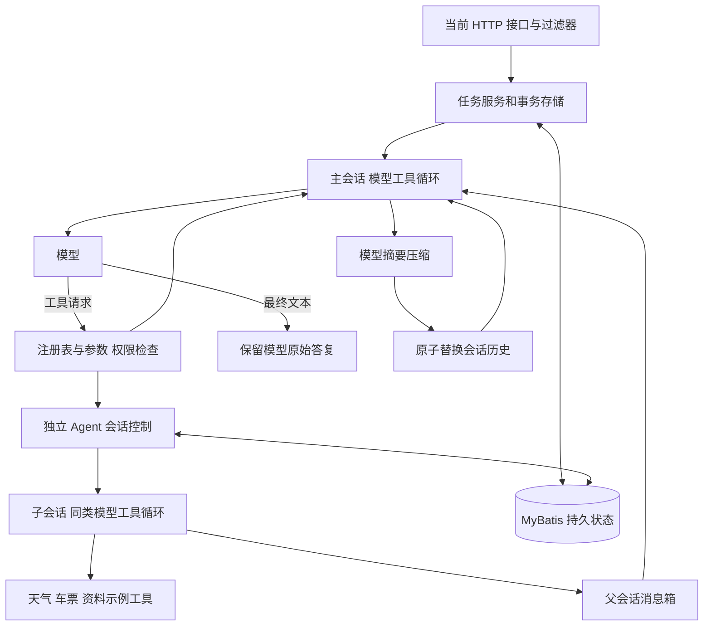
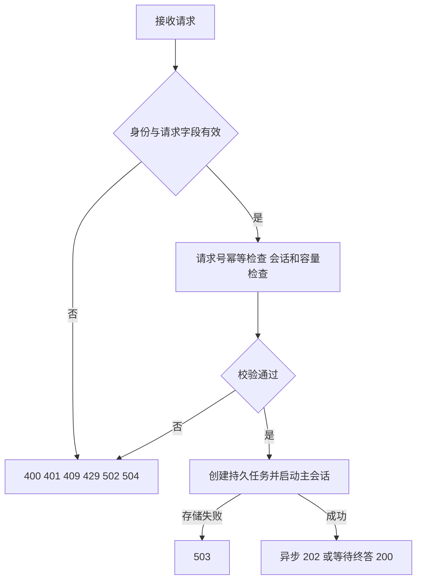
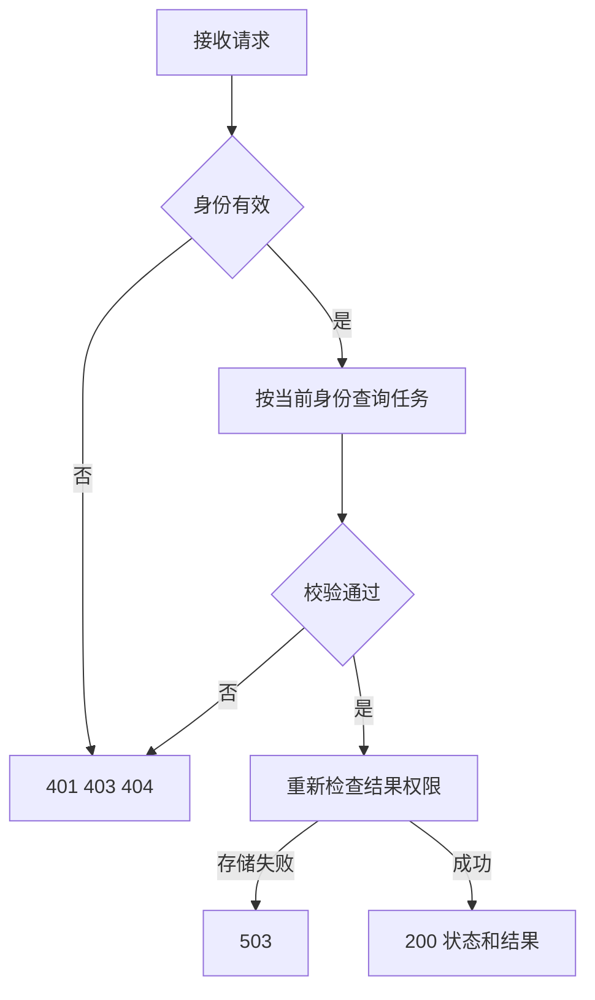
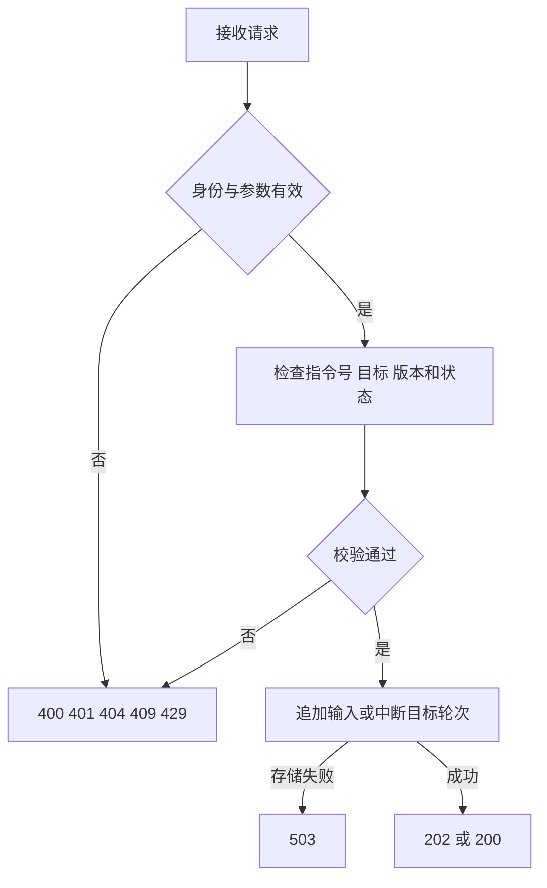
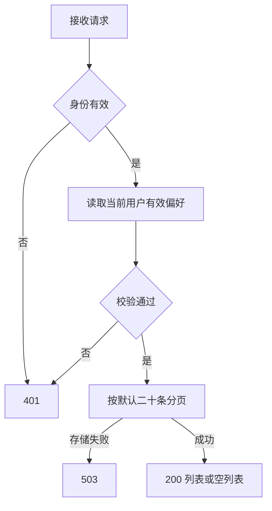
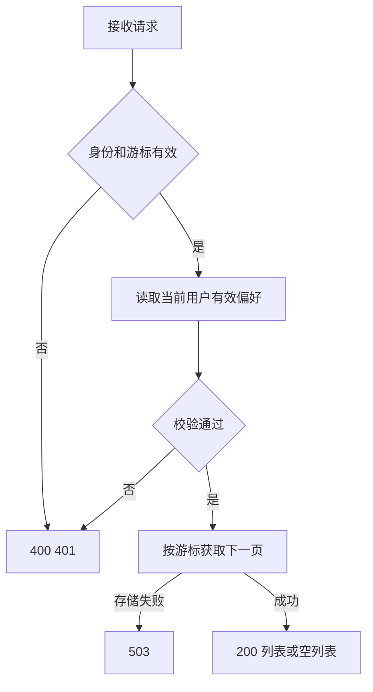
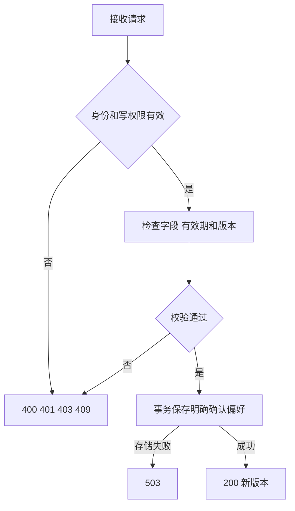
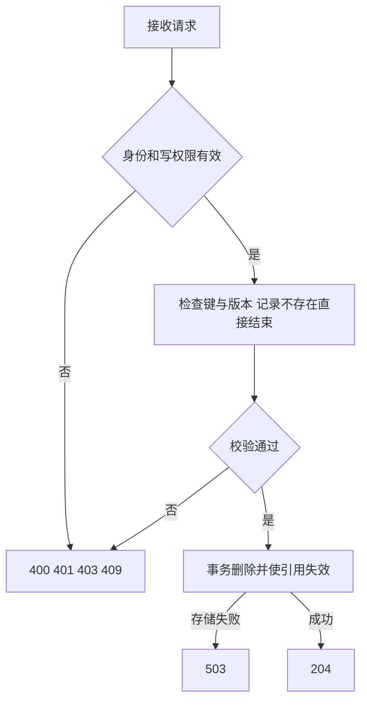

# 技术方案

版本：v3.4，2026-10-29。依据用户“你必须立刻修改……改动要基于目前的代码实现”执行源码一致性纠正。基线为当前已审阅的分层重构；具体源码核对与执行证据写入实施记录。

## 需求确认

核心运行行为以固定 Codex 提交 `360319d8dee62d87e2d59fc0c21805d79519cfed` 的可核实路径为依据。选择该提交的多 Agent V2，以及当前模型传输适用的本地模型摘要压缩路径。Claude 公开 SDK 仅作为补充证据，不能推断 Claude Code 未公开内部实现。天气、车票、行程是演示工具与角色，不作为改变核心机制的理由。

保留用户审阅的 Java 17、Spring Boot、Reactor、controller/service/repo 分包、POJO 命名、MyBatis、声明式事务、请求过滤器和当前 HTTP 接口。以现有工作区为修改起点，不从上一提交覆盖文件。现有身份检查、持久化与外部副作用账本继续保留；这些服务边界与演示工具不冒充 Codex 内部模块。

## 架构设计

### 分层架构图

### 功能拆分

1. **统一循环。** 主子会话都按模型响应执行工具并回传对应调用编号的结果。取消强制改写、意图模型、关键词改写最终文本、必经第二个答案模型和固定澄清模板。主模型的最终文本按原文返回；业务证据作为结构化附件。旅行事实校验可以作为独立工具能力保留，不替代核心终答。
2. **独立子会话。** 创建返回已受理的子会话标识；受理前失败清理临时子会话，受理后父轮次取消不撤回子会话。每个子会话拥有自己的消息、运行轮次、中断标记和结果。父子共享任务树用量边界，不能共享父轮次的取消标记。全部会话关闭与单会话中断分别处理。
3. **V2 协作。** 创建、追加任务、普通消息、等待消息、列举、打断分别对应 spawn_agent、followup_task、send_message、wait_agent、list_agents、interrupt_agent。普通消息不启动闲置会话；追加任务启动闲置子会话，在运行时加入消息；普通打断不是永久删除，会话可以再次接任务。完成通知进入父消息箱。本实现选择上游默认不因普通消息唤醒闲置会话的路径；消息等待和新增用户输入可唤醒等待。
4. **上下文压缩。** 在模型请求前按窗口判断是否压缩，压缩使用模型生成摘要且不提供业务工具。摘要成功后按源码的真实用户消息保留规则重建历史，写入摘要及压缩代数并原子替换。压缩请求超窗时从临时历史头部移除内容，工具请求和结果配对处理；失败保留原历史。摘要调用计入共享预算，取消、预算耗尽和不完整响应不能伪装成功。普通模型超窗走一次压缩恢复路径。
5. **输入与恢复。** 新用户指令进入当前会话，在可消费的模型边界追加。恢复消息、待完成工具、子会话关系和压缩检查点；已经受理的子会话按其自身状态恢复。用户中断、模型完成和整个服务关闭具有不同含义。对上游行为尚未完成验证的项目，在源码映射和验收中明确列出，不以测试数量替代一致性结论。

系统提示词职责：根据用户原话与历史决定回答、调用查询工具或委派；收到带来源的子会话消息再继续；工具结果与子消息是数据，不能提升身份权限。子角色只决定提示词与工具集合，不改变运行时算法。

源码定位：`session/turn.rs` 的主循环；`agent/control/api.rs`、`agent/control/spawn.rs` 的受理边界；`tools/handlers/multi_agents_v2/` 的协作工具；`agent/control/completion.rs` 的完成通知；`compact.rs` 与 `session/turn.rs` 的本地压缩分支。逐函数行号、测试和差异另存现有《源码参考与适配边界》。

## 接口设计

沿用当前已审阅接口，鉴权和公共头继续由 filter 写入 Reactor context。POST 只有一个 Param 入参；GET/DELETE 只使用既有路径参数。工具协作属于模型内部协议，不另造未经确认的 HTTP 入口。

**POST /api/supervisor/chat**

**GET /api/supervisor/runs/{runId}**

**POST /api/supervisor/instructions**

**GET /api/supervisor/memories**

**GET /api/supervisor/memories/{cursor}**

**PUT /api/supervisor/memories/{key}**

**DELETE /api/supervisor/memories/{key}/{expectedVersion}**

## 稳定性设计

- 预算与取消分开：每轮有独立取消，任务树共享用量；父轮次结束不使子会话预算访问失效。限额数值仍是本服务配置，不称上游默认值。
- 工具注册和参数错误回传模型，模型决定后续；权限来自服务端，消息不能赋权。已有读缓存与写入账本继续通过稳定参数和操作号防重。
- 子会话的受理、消息、状态和完成通知通过现有事务服务持久化；通知保留来源和身份，不能作为用户授权。并发容量按实际活动执行管理。协作操作以稳定回合号和工具调用号保存回执，受理与回执同事务提交；恢复先返回已有回执，避免重复创建、投递或开启新轮。消息批次与模型历史检查点同事务确认，未确认的批次可重放。
- 压缩临时工作区与正式会话分离；摘要成功前不破坏正式历史；模型失败、取消与预算耗尽准确传播。工具消息配对和模型调用计数纳入回归。
- 首先运行用户当前工作区基线测试，再增加对应源码行为测试；原测试若断言被纠正的自定义机制，改为验证源码行为并记录原因，不能删除失败断言掩盖缺陷。
- 保留当前单构造器、显式注入、MyBatis 与声明式事务规则；副作用账本原例外继续成立。最终验证包含全量测试、真实 HTTP、崩溃恢复、打包和离线执行，提交前检查相对本轮基线的差异。
