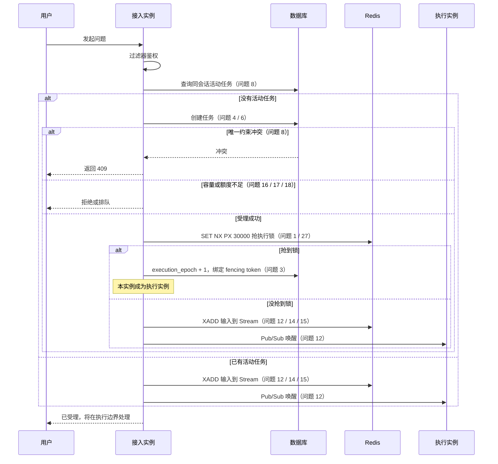
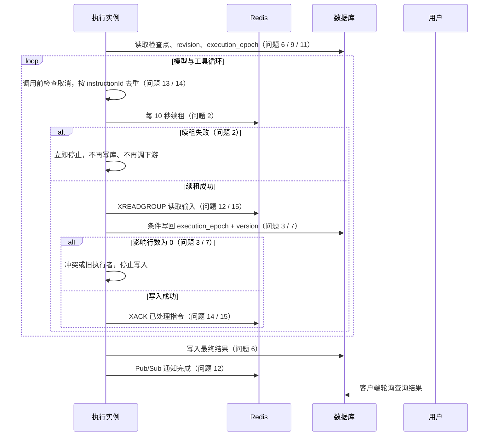
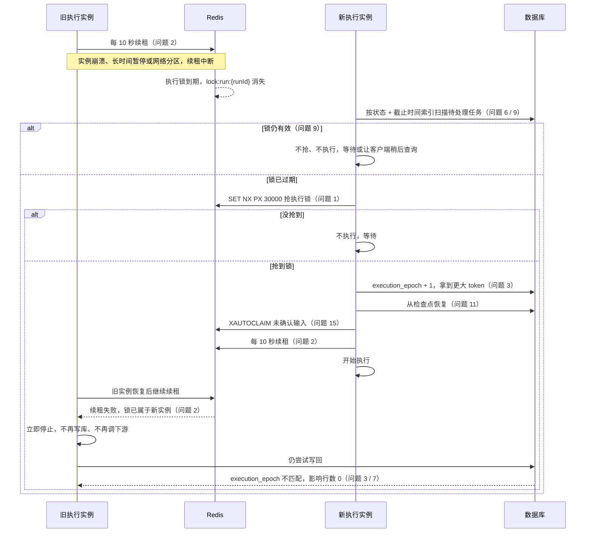
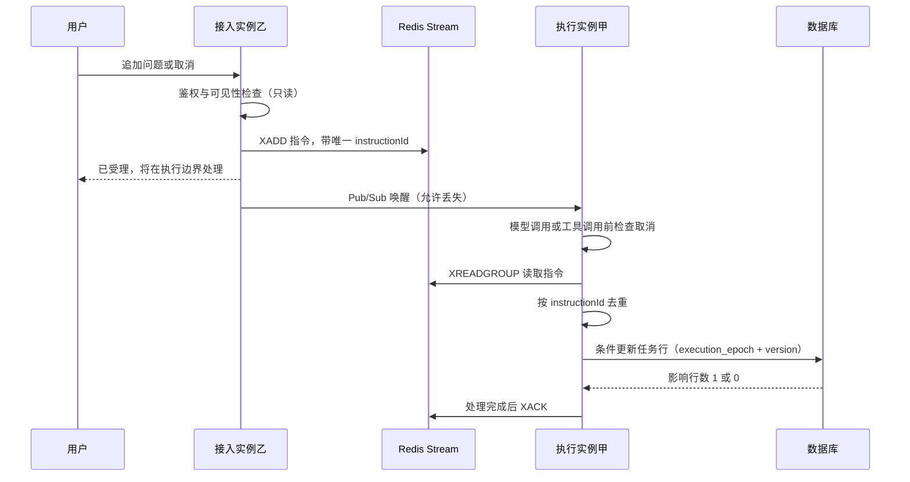
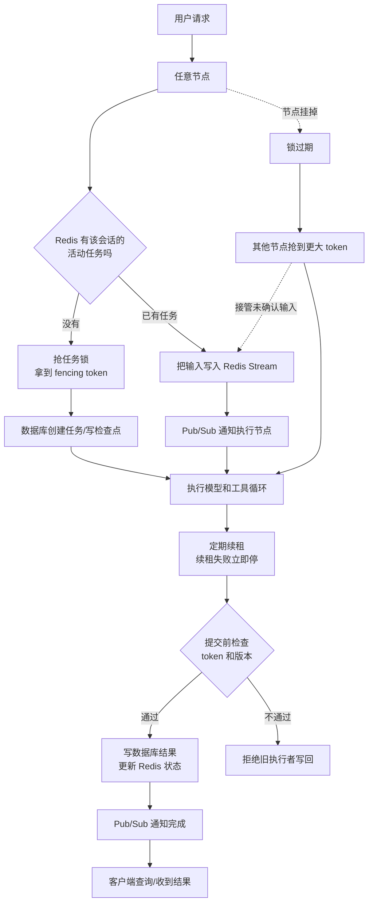

# 集群环境部署改造方案

## 用户发起问题的完整执行流程（集群）

本节按“用户发出一条问题”从头到尾拆解目标执行流程。图中标注“问题 N”的位置，是集群环境下可能出现故障的改造点；节点旁的分支是解决方式，编号与后文“问题与落地”表一一对应。

> 这是目标流程，不是当前代码现状。当前代码仍是单机 `synchronized` 和本机 `owned` 映射，图中的大部分改造点尚未落地；现状差距见 `docs/集群执行差距评估-20261102.md`。

### 角色与边界

| 角色 | 负责 | 不负责 |
|---|---|---|
| 接入实例 | 接收 HTTP、鉴权、把追加输入和取消写入 Redis Stream、返回受理结果 | 不跑模型循环，不写任务行 |
| 执行实例 | 抢执行锁、跑模型与工具、写任务行、续租、提交结果 | 不处理与自己无关的 HTTP 请求 |
| Redis | 执行锁、租约、输入 Stream、完成事件 Stream、Pub/Sub 唤醒、热状态 | 不作为最终事实的唯一副本 |
| 数据库 | 任务、检查点、版本号、执行代际号（`execution_epoch`）、最终结果、副作用账本、审计 | 不做每秒心跳，不做高频抢锁 |

核心分工：**接入实例只投递命令，执行实例独占任务行的写权。** 同一个任务在同一时刻只有一个写者，追加输入和取消不会与预算、检查点互相覆盖。

同一个进程可以同时承担两种角色；角色是按任务划分的，不是按机器划分的。同一个任务同一时刻只有一个执行实例。

### 图 1：请求受理与执行权



> 图 1 中抢到锁的实例，在图 2 中就是执行实例；两张图按阶段拆分，不是两个不同的进程。

### 图 2：执行循环与结果写回



> 续租节点按默认的原生 Redis + Lua 写法；若改用 Redisson `RLock`，续租由看门狗自动完成，但锁丢失后的写回仍必须由 `execution_epoch` 条件更新拦截。

### 图 3：故障与接管路径



### 图 4：追加问题与取消的跨实例路径



关键点：乙只写 Stream，不写任务行；鉴权所需的读取可以有，但改变任务状态的写入只能由甲做。因此追加输入和取消不会与甲正在写的预算、检查点互相覆盖。

### 问题点与解决分支

| 阶段 | 可能出现的集群问题 | 现象 | 解决分支 | 对应条目 |
|---|---|---|---|---|
| 请求入口 | 请求落在非执行实例 | 用户以为请求会在执行实例上处理 | 接入实例只鉴权、写队列、返回受理结果；执行权以 Redis 锁为准 | 1 / 12 |
| 同会话受理 | 两个请求同时创建任务 | 同一会话出现两个活动任务 | 数据库对活动任务建 `(tenant, user, session)` 唯一约束（部分唯一索引）；冲突返回 409；或先抢会话锁 | 8 |
| 任务持久化 | 状态、截止时间、代际号都藏在任务数据包（`payload`）里 | 恢复扫描只能全表读取并反序列化 | 提升为结构化列并建立“状态 + 截止时间”索引；`payload` 只用于详情兼容 | 6 |
| 数据访问 | 数据库语句绑定单机语法 | 迁移到 PostgreSQL 后语句不能直接运行 | 使用 PostgreSQL 方言，补齐独立迁移脚本 | 4 / 5 |
| 容量判断 | 只统计本机并发和额度 | 扩容后总并发、分钟额度、子任务数翻倍 | 全局原子计数并带租约；分钟额度原子扣减；按根任务统计活动子任务；预占后未执行要释放 | 16 / 17 / 18 |
| 抢执行锁 | 两个实例同时判定自己可以执行 | 双跑模型、重复产生外部副作用 | `SET NX PX 30000` 抢锁；抢不到只写输入；Redis 不可用时拒绝执行 | 1 / 27 |
| 执行权续租 | 抢到锁的实例崩溃或长时间暂停 | 任务停在运行中，没人继续 | 30 秒租约 + 每 10 秒续租；续租失败立即停止；锁过期允许其他实例接管 | 2 |
| 申请执行代际号 | 旧实例恢复后继续写回 | 旧结果覆盖新结果 | 抢锁后数据库 `execution_epoch + 1`；所有写回带 `execution_epoch` 条件 | 3 |
| 执行中追加或取消 | 请求落到乙实例，执行实例甲收不到 | 输入延迟、取消不及时，甚至丢失 | 乙写 Redis Stream；Pub/Sub 只唤醒；唤醒丢失由轮询兜底；取消走高优先级消息 | 12 / 13 |
| 指令消费 | 消息重复投递或实例崩溃 | 同一指令执行两次，或指令永久丢失 | 唯一 `instructionId` 去重；consumer group + `XACK`；未确认消息用 `XAUTOCLAIM` 接管 | 14 / 15 |
| 写任务行 | 执行实例与接入实例同时改同一行 | 后写覆盖先写，丢更新 | 只有执行实例写任务行；写入带 `execution_epoch + version` 条件，影响行数为 0 即冲突 | 3 / 7 |
| 恢复扫描 | 每个实例全量扫描并尝试启动任务 | 同一任务被多个实例重复接管 | 先按任务抢锁，抢到才领取；只扫描“状态 + 截止时间”索引命中的任务 | 9 |
| 后台任务 | 每个实例都执行清理和通知重试 | 同一批记录被处理多次 | 改为单例调度，或使用“跳过已锁定行”的批量领取；每批带幂等键 | 10 |
| 副作用恢复 | 启动时把所有“执行中”记录改成“未知” | 误改其他实例正在执行的外部写记录 | 记录节点、租约到期时间和心跳时间；只恢复租约已过期的记录；状态迁移带原节点条件 | 11 |
| 完成通知 | Pub/Sub 通知丢失 | 客户端收不到完成事件 | 完成状态写入数据库和 Stream；客户端轮询兜底 | 12 |
| 启动 | 多个实例同时判断表为空并插入种子数据 | 种子重复，唯一键冲突阻断启动 | 种子写入改为冲突时跳过；审计记录带节点编号；唯一键冲突不阻断启动 | 22 |
| 运行前置 | 未就绪实例接收流量；发布时硬切断执行 | 请求失败，正在执行的任务被切断 | 存活检查和就绪检查；优雅停机：停止接收流量、停止续租、写完检查点再退出 | 23 / 24 |
| 依赖故障 | Redis、数据库或配置中心不可用 | 无锁执行或静默回退 | Redis 不可用时拒绝执行；数据库不可用时停止受理新任务；配置中心不可用时明确失败或保持最后已知配置 | 27 |
| 配置与密钥 | 配置分散、刷新影响在途任务、密钥明文 | 行为不一致，密钥泄露 | 配置中心统一管理；任务受理时固定配置快照；密钥走环境变量或密钥管理，日志与证据脱敏 | 19 / 20 / 21 |
| 部署与演练 | 没有容器清单和故障演练 | 无法稳定扩容，无法证明不会重复执行 | 容器镜像、部署清单、资源限制和反亲和；两实例故障演练与指标 | 25 / 26 |
| 文档 | Redis 方案与技术方案冲突 | 两套实施依据不能同时存在 | 统一职责：数据库保存最终事实；Redis 只保存锁、租约、Stream 和唤醒 | 28 |

### 流程必须满足的不变量

1. **同一任务同一时刻只有一个执行者**：以 Redis 执行锁为准，数据库 `execution_epoch` 是最终代际。
2. **接入实例不写任务行**：只写输入 Stream 并返回受理结果；任务行只由当前执行实例写。
3. **所有任务行写入都带条件**：条件为 `execution_epoch + version`，影响行数为 0 即冲突，停止并重读，禁止无版本整段覆盖。
4. **输入与取消进 Redis Stream**：Pub/Sub 只负责唤醒；处理完成才 `XACK`；未确认消息由 `XAUTOCLAIM` 接管。
5. **同一会话同一时刻只有一个活动任务**：由数据库唯一约束或会话级锁保证，冲突返回 409。
6. **依赖故障有明确边界**：Redis 不可用拒绝执行；数据库不可用停止受理；不允许无锁运行或静默回退。

## 结论速览

当前结论：单机异常恢复能力已经具备，运行库已改为共享 PostgreSQL；多实例执行权、消息流和全局容量控制尚未具备。一次用户请求从入口到完成的完整时序见上一节；下表把集群问题拆成 8 类 28 项，逐项说明问题、方案覆盖情况、一句话结论和落地步骤，不能把本文当作已完成实现。

覆盖状态口径：

- **已落地**：代码已具备，并有对应验证。
- **部分覆盖**：方案里有描述，但代码尚未落地；或相关文档之间存在冲突。
- **未覆盖**：方案和代码都缺失。
- **已覆盖**：方案和代码都已具备。

问题分类：

- 执行权与旧写回：第 1～3 项。
- 数据与并发：第 4～8 项。
- 后台恢复：第 9～11 项。
- 输入与通知：第 12～15 项。
- 容量与限流：第 16～18 项。
- 配置与密钥：第 19～21 项。
- 启动与部署：第 22～25 项。
- 运维与文档：第 26～28 项。

### 术语对照

| 中文表述 | 代码或产品名称 | 含义 |
|---|---|---|
| 执行权 | 任务执行归属 | 同一时刻哪个实例有权运行某个任务。 |
| 接管 | takeover | 原执行实例失效后，另一个实例取得执行权并从检查点继续。 |
| 执行代际号 | execution_epoch、fencing token | 每次接管后递增的编号；旧编号的写回会被拒绝。 |
| 任务版本号 | version | 每次修改任务时递增，用来防止后写覆盖先写。 |
| 条件更新 | conditional update | 只有版本号或执行代际号匹配时才允许写入。 |
| 原子操作 | atomic operation | 不可分割的一次操作，不会出现两个请求同时读到旧值再各自写回。 |
| 幂等 | idempotent | 同一操作重复执行多次，结果与执行一次相同。 |
| 检查点 | checkpoint | 任务执行过程中保存的可恢复状态。 |
| 任务数据包 | payload | 任务表里保存的整段任务数据。 |
| 本机执行任务表 | owned | 当前实例内存中记录“本机正在执行哪些任务”的映射表。 |
| 进程内互斥锁 | synchronized | 只在单个进程内有效的锁，不能保护多个实例。 |
| 执行节点 | owner、last_owner、nodeId | 当前或最后运行任务的实例标识。 |
| 租约到期时间 | lease_until | 执行权或副作用记录的有效期。 |
| 心跳时间 | heartbeat_at | 执行者最后一次证明自己仍然存活的时间。 |
| 消息流 | Redis Stream | 可靠保存输入、取消和完成事件，支持确认和故障接管。 |
| 发布订阅 | Redis Pub/Sub | 只负责唤醒执行节点，不保存消息。 |
| 关系型数据库 | PostgreSQL | 保存任务、检查点、预算、审批和副作用等最终事实。 |
| 内存键值数据库 | Redis | 保存执行锁、租约、消息流和唤醒通知，不作为最终事实。 |
| 配置中心 | Nacos | 集中管理多个实例的配置。 |
| 容器编排平台 | Kubernetes | 运行、扩缩容和滚动发布应用实例。 |

### 问题与落地

| 序号 | 集群环境可能出现的问题 | 技术方案是否覆盖 | 一句话结论 | 解决思路与落地方式 |
|---|---|---|---|---|
| 1 | 【执行权】两个实例同时判定同一个任务该由自己执行 | 部分覆盖（方案有，代码未落地） | 本机执行任务表只能说明本进程在跑什么，不能说明集群里谁有执行权 | **定位**：任务创建、指令处理和恢复扫描都只看本机内存中的执行任务表。<br>**改造**：① 为每个实例分配稳定节点编号；② 执行前用带过期时间的原子命令抢任务锁；③ 抢到锁后再向数据库申请执行代际号；④ 未抢到锁的实例只能等待，或把输入转入队列。<br>**验收**：两个实例同时收到同一任务，只有一个进入执行中，另一个不会启动模型循环。 |
| 2 | 【执行权】实例抢到执行权后崩溃，任务停在执行中 | 部分覆盖（方案有，代码未落地） | 执行权必须有有效期和续租，不能一次抢到就永久有效 | **定位**：执行线程崩溃后，其他实例无法判断它是否还活着。<br>**改造**：① 任务锁设置 30 秒有效期；② 执行中每 10 秒续租一次；③ 续租失败立即停止模型调用和工具调用；④ 锁过期后允许其他实例接管。<br>**验收**：强制终止执行实例，另一实例在锁过期后接管，任务从最近检查点继续。 |
| 3 | 【执行权】锁过期后旧实例恢复，继续提交旧结果 | 部分覆盖（方案有，代码未落地） | 锁只能减少同时执行，最终防线是执行代际号 | **定位**：旧实例可能只是暂停，恢复后仍会写回结果、检查点和预算。<br>**改造**：① 每次接管把数据库执行代际号加一；② 所有写回都带“执行代际号 + 任务版本号”条件；③ 条件不满足时影响行数为零，立即停止；④ 停止后不得再调用模型或下游。<br>**验收**：旧实例写回被拒绝，最终结果只来自当前执行者。 |
| 4 | 【数据】多个实例无法共享单机数据库文件 | 已落地（运行库改为 PostgreSQL；迁移脚本待补） | 单机数据库文件和固定账号不能作为集群事实库 | **定位**：此前数据库连接固定使用本机文件、固定账号和单机专用参数，多个实例无法共享同一份事实。<br>**改造**：① 运行库改用共享 PostgreSQL，默认地址 `jdbc:postgresql://127.0.0.1:5432/supervisor`；② 地址、账号、密码和连接池由 `SUPERVISOR_DATABASE_URL`、`SUPERVISOR_DATABASE_USERNAME`、`SUPERVISOR_DATABASE_PASSWORD`、`SUPERVISOR_DATABASE_POOL_SIZE` 提供；③ 启动时按 `databaseId` 执行 PostgreSQL 建表语句，迁移脚本尚未独立；④ 单机 H2 只保留给本地回归测试。<br>**验收**：已在临时 PostgreSQL 17 实例上完成启动建表、创建任务、读取运行详情、偏好写入与更新、提示词登记，结果均从共享库读回。两个实例的并发共享仍需按执行权方案验收。 |
| 5 | 【数据】数据库语句绑定单机数据库语法，迁移后不能直接运行 | 已落地（PostgreSQL 语句已接入；迁移脚本待补） | 合并写入、大文本字段和自增主键都要按目标数据库改写 | **定位**：任务、治理和审批等数据访问语句原本使用 H2 专有写法。<br>**改造**：① 所有合并写入（任务、窗口、会话、偏好、向量、提示词、发布、Agent、告警）改为 `ON CONFLICT ... DO UPDATE`；② 大文本字段改为 `TEXT`；③ 自增主键改为 `BIGINT GENERATED BY DEFAULT AS IDENTITY`，浮点改为 `DOUBLE PRECISION`；④ MyBatis 通过 `databaseId="postgres"` 选择 PostgreSQL 语句，H2 语句保留给回归测试；独立迁移脚本尚未补齐。<br>**验收**：PostgreSQL 启动与读写冒烟通过；全量 362 项回归测试在 H2 上通过。目标库完整回归需在独立迁移脚本补齐后复跑。 |
| 6 | 【数据】任务状态藏在整段数据包里，无法按状态和截止时间查询 | 部分覆盖（技术方案有结构化表，代码未落地） | 恢复扫描不能每次都读取全表再解析整段数据包 | **定位**：任务状态、截止时间、执行代际号和父子关系都在整段数据包内。<br>**改造**：① 任务表增加状态、截止时间、版本号、执行代际号、最后执行节点、心跳时间、父任务编号和根任务编号；② 建立“状态 + 截止时间”索引和租户会话索引；③ 数据包保留用于兼容，但判断执行权和状态迁移改用结构化字段。<br>**验收**：恢复扫描只按索引读取待处理任务，不再全表反序列化。 |
| 7 | 【数据】两个实例同时修改同一任务，后写覆盖先写 | 未覆盖 | 进程内互斥锁保护不了跨实例，整段数据包覆盖写会丢更新 | **定位**：任务保存、检查点写入和预算预留都是先读后整段覆盖写，只在单进程内加锁。<br>**改造**：① 任务表增加版本号；② 所有写入改成带版本号的条件更新；③ 分钟额度改成数据库原子更新或行锁；④ 禁止无版本整段覆盖任务数据包。<br>**验收**：两个实例同时修改同一任务，只有一个成功，另一个收到冲突并重读，不丢更新。 |
| 8 | 【数据】同一会话被两个请求同时创建任务 | 未覆盖 | 先查询再插入在并发下会创建两个活动任务 | **定位**：创建任务前查询同会话是否已有活动任务，查询和插入不在同一个约束下。<br>**改造**：① 增加“租户 + 用户 + 会话”的活动任务唯一约束；② 或先抢会话级分布式锁；③ 冲突统一返回冲突状态码。<br>**验收**：同一会话并发提交两次，只创建一个活动任务。 |
| 9 | 【恢复】每个实例都全量扫描并启动任务 | 部分覆盖（方案有接管描述，代码未落地） | 多副本会重复扫描、重复启动、重复执行 | **定位**：每个实例启动独立恢复线程，扫描全部任务并尝试启动。<br>**改造**：① 恢复时先按任务抢锁；② 抢到锁才领取任务；③ 只扫描索引命中的待处理任务；④ 未抢到锁的实例直接跳过。<br>**验收**：两个实例同时恢复，同一任务只被一个实例接管。 |
| 10 | 【恢复】每个实例都执行清理和通知重试 | 部分覆盖（方案有单例调度描述，代码未落地） | 清理、通知重试和副作用核对都会随副本数重复执行 | **定位**：清理、通知重试和副作用核对都在每个实例各自启动线程。<br>**改造**：① 改为单例调度；② 或使用“跳过已锁定行”的批量领取；③ 每批处理带幂等键；④ 处理完成后再标记完成。<br>**验收**：两个实例运行同一批清理任务，每条记录只被处理一次。 |
| 11 | 【恢复】副作用账本启动时把所有“执行中”记录改成“未知” | 部分覆盖（方案有租约恢复描述，代码未落地） | 节点重启不能修改其他节点正在执行的外部写记录 | **定位**：服务启动时无条件把所有执行中记录改成未知。<br>**改造**：① 副作用记录增加执行节点、租约到期时间和心跳时间；② 启动时只恢复租约已过期的记录；③ 状态迁移带原执行节点条件；④ 旧节点不能覆盖新节点。<br>**验收**：甲实例重启时，乙实例正在执行的外部写保持执行中，不被误改。 |
| 12 | 【输入】请求落在甲实例，任务在乙实例，新输入不能及时送达 | 部分覆盖（方案有消息流，代码未落地） | 只写数据库并轮询，跨实例送达时间不可控 | **定位**：新输入写入数据库队列，执行实例在模型或工具边界主动读取。<br>**改造**：① 为每个任务建立消息流；② 消费者组按任务消费；③ 发布订阅只负责唤醒；④ 唤醒丢失时由轮询兜底。<br>**验收**：甲实例提交补充指令，乙实例在秒级内收到并进入下一轮。 |
| 13 | 【输入】取消、切换和补充指令跨实例延迟 | 部分覆盖（方案有消息流，代码未落地） | 不同指令需要不同优先级和处理边界 | **定位**：取消和切换依赖执行实例自己检查状态。<br>**改造**：① 取消和切换进入高优先级消息；② 执行实例在每次模型调用前和工具调用前检查；③ 按指令编号去重；④ 处理结果写回指令状态。<br>**验收**：页面在乙实例执行期间发起取消，任务在下一个检查点停止，不继续调用模型。 |
| 14 | 【输入】消息重复投递导致同一指令执行两次 | 未覆盖 | 至少一次投递必须配合幂等消费 | **定位**：消息流可能重复投递，执行实例没有统一去重。<br>**改造**：① 指令使用唯一编号；② 消费前检查指令状态；③ 状态迁移使用条件更新；④ 已处理指令直接确认，不重复执行。<br>**验收**：同一指令重复投递三次，任务只应用一次。 |
| 15 | 【输入】实例崩溃后未确认消息丢失 | 部分覆盖（方案有消费组，代码未落地） | 消息必须先确认处理完成，再确认消费 | **定位**：执行实例读取消息后没有可靠确认和超时接管。<br>**改造**：① 使用消费者组；② 处理并写入检查点后再确认消费；③ 未确认消息留在待处理列表；④ 超时后由其他实例认领。<br>**验收**：执行实例在消费后崩溃，另一实例接管未确认消息，指令不丢失。 |
| 16 | 【容量】全局并发上限按单实例计算，扩容后总并发翻倍 | 未覆盖 | 本机执行任务表只能代表本实例的并发 | **定位**：并发判断只统计本机正在执行的任务。<br>**改造**：① 使用全局原子计数；② 任务开始前预占，结束或失败后释放；③ 计数超限直接拒绝；④ 计数带租约，防止实例崩溃后不释放。<br>**验收**：两个实例各收到并发请求，全局同时执行数不超过配置上限。 |
| 17 | 【容量】每分钟调用额度读改写不是原子操作，并发下超发 | 未覆盖 | 先读额度再写回会在并发下丢失扣减 | **定位**：分钟窗口额度先查询、再计算、再覆盖写。<br>**改造**：① 改成数据库原子更新并返回剩余额度；② 或使用行锁；③ 或使用原子脚本；④ 超限返回限流状态码和重试等待时间。<br>**验收**：并发请求下扣减总额准确，不超过每分钟额度。 |
| 18 | 【容量】子任务并发上限只按本实例计算 | 未覆盖 | 子任务上限必须按根任务跨实例统计 | **定位**：子任务活动数量只统计本实例。<br>**改造**：① 按根任务编号维护活动子任务计数；② 创建子任务前原子预占；③ 子任务结束或失败后释放；④ 计数超限拒绝创建。<br>**验收**：两个实例同时创建子任务，根任务下的活动子任务数不超过上限。 |
| 19 | 【配置】多实例配置分散，无法统一修改 | 未覆盖 | 本地配置文件不能管理多实例配置 | **定位**：配置写在各实例本地文件和环境变量中，启动时固定。<br>**改造**：① 接入配置中心；② 使用集群配置档案；③ 约定命名空间、分组和配置编号；④ 配置中心不可用时明确启动失败，不静默回退。<br>**验收**：修改配置中心后，新启动或新受理任务读取新值，配置来源可查。 |
| 20 | 【配置】配置刷新改变在途任务行为 | 未覆盖 | 在途任务必须使用受理时的配置快照 | **定位**：服务对象构造时固定策略，刷新后可能影响正在执行的任务。<br>**改造**：① 任务受理时固定一份策略快照并写入检查点；② 新任务读取最新配置；③ 在途任务继续使用快照；④ 不重建正在执行的服务对象。<br>**验收**：修改配置后，旧任务行为不变，新任务使用新配置。 |
| 21 | 【配置】密钥和令牌进入配置中心明文 | 未覆盖 | 配置中心不能保存明文模型密钥、认证令牌和数据库密码 | **定位**：配置项可能被直接写入配置文件或配置中心。<br>**改造**：① 使用密钥管理或环境变量注入；② 配置中心只保存非敏感项；③ 查询配置只返回“已配置”，不返回值；④ 日志和证据脱敏。<br>**验收**：配置接口、日志和证据中都不出现密钥和令牌原文。 |
| 22 | 【启动】注册表和提示词种子并发插入冲突 | 未覆盖 | 多实例同时判断为空会同时插入种子数据 | **定位**：服务启动时检查表为空并写入种子。<br>**改造**：① 种子写入改成冲突时跳过；② 审计记录带节点编号；③ 唯一键冲突不阻断启动；④ 启动验签允许重复但可区分。<br>**验收**：三个实例同时启动，种子只保留一份，所有实例正常启动。 |
| 23 | 【部署】没有健康检查和就绪检查 | 未覆盖 | 滚动发布可能把流量打到未就绪实例 | **定位**：当前只有端口监听，没有存活和就绪判断。<br>**改造**：① 增加存活检查；② 增加就绪检查；③ 就绪检查包含数据库、内存键值数据库和配置中心；④ 依赖不可用时返回未就绪。<br>**验收**：依赖断开时实例不再接收新流量，恢复后重新就绪。 |
| 24 | 【部署】没有优雅停机，发布时切断执行 | 未覆盖 | 停机必须先停止接收新请求，再写完检查点退出 | **定位**：进程收到停止信号后直接退出，正在执行的任务被硬切断。<br>**改造**：① 开启优雅停机；② 停止接收新请求；③ 停止续租并写完当前检查点；④ 等待在途请求结束后退出。<br>**验收**：滚动发布期间任务不丢失，未完成任务由其他实例接管。 |
| 25 | 【部署】没有容器和集群部署清单 | 未覆盖 | 当前只能手工启动程序，无法稳定扩容和发布 | **定位**：仓库没有容器镜像、部署清单和资源限制。<br>**改造**：① 提供容器镜像；② 使用非特权用户和只读根文件系统；③ 提供部署、服务、入口、中断预算、反亲和和资源限制；④ 数据库、内存键值数据库和配置中心单独高可用部署。<br>**验收**：按清单可以启动两个以上实例，扩缩容和滚动发布可重复执行。 |
| 26 | 【运维】缺少集群故障演练和观测指标 | 未覆盖 | 单实例测试不能证明多实例不会重复执行 | **定位**：现有测试都是单实例或单进程恢复测试。<br>**改造**：① 增加两实例集成测试；② 演练强制终止实例、内存键值数据库主从切换、配置中心断开连接和数据库故障；③ 记录锁等待、续租失败、旧代际拒绝和接管次数；④ 日志关联任务编号、节点编号和执行代际号。<br>**验收**：每类故障都有演练记录，能从指标和日志判断是否发生重复执行。 |
| 27 | 【运维】外部依赖故障没有统一降级边界 | 未覆盖 | 数据库、内存键值数据库和配置中心故障时的行为必须事先定死 | **定位**：外部依赖故障时可能继续无锁执行或静默使用旧配置。<br>**改造**：① 数据库不可用时停止受理新任务；② 内存键值数据库不可用时拒绝执行，不允许无锁运行；③ 配置中心不可用时明确失败或保持最后已知配置；④ 建立备份和恢复演练。<br>**验收**：逐项断开依赖，系统行为与约定一致，不出现无锁执行和静默回退。 |
| 28 | 【文档】内存键值数据库方案与技术方案冲突 | 部分覆盖（文档冲突） | 两套实施依据不能同时存在 | **定位**：集群方案使用内存键值数据库管锁和队列，技术方案写不采用内存键值数据库。<br>**改造**：① 定案数据库保存最终事实；② 内存键值数据库只保存锁、租约、消息流和唤醒；③ 执行代际号来自数据库；④ 同步修改技术方案。<br>**验收**：两份文档对组件职责、执行权和恢复流程表述一致。 |

配套现状差距与实施顺序见 `docs/集群执行差距评估-20261102.md`；配置中心只负责配置，执行锁、执行代际号、可靠输入队列和数据库版本条件更新仍按本文方案补齐。

## 结论

不用把集群协调全部压到数据库，也不能全部交给 Redis。直接采用下面这套混合方案：

1. **Redis 管“谁在跑”和“叫醒谁”**：会话热状态、任务执行锁、心跳、跨节点通知、输入队列。
2. **数据库管“不能丢”**：任务、检查点、会话历史、幂等键、最终结果、审计。
3. **执行节点存在 Redis 锁里**：`lock:run:{runId}` 的 value 是 `节点编号:token`，谁持有这把锁，谁就是当前执行节点。`run:{runId}` Hash 里的 `owner` 只用于查询，锁过期后可能过时；数据库只存 `execution_epoch`、`last_owner` 做审计和写回校验。
4. **每个任务同一时刻只允许一个执行者**：执行前抢 Redis 锁，抢到才跑，跑的时候续租。所谓租约就是“带过期时间和续租的 Redis 锁”，不是另一套机制。
5. **旧执行者的写回必须作废**：每次抢锁后，从数据库把 `execution_epoch` 加一，拿到递增的 fencing token；写状态和提交结果都要带 token，旧 token 直接拒绝。token 不能用 Redis `INCR`，Redis 主从切换可能把计数回退。
6. **新实例接管**：启动扫描或用户请求发现锁过期 → 抢 Redis 锁 → 数据库 `execution_epoch + 1` 拿 token → 把 token 绑到锁上 → 从数据库检查点恢复、接管 Stream 未确认输入 → 续租继续跑。旧节点下次续租失败，写回因代际不匹配被拒绝。
7. **广播只负责通知，不负责传数据**：Redis Pub/Sub 只喊“有新输入/任务完成，去读状态”；真正不能丢的输入和事件放 Redis Stream，支持确认、重放和挂掉后接管。
8. **数据库不做高频锁**：只在创建任务、写检查点、提交结果时做短事务和带版本条件的更新，不把事务包在模型调用外面。
9. **锁实现默认原生 Redis + Lua，也可换 Redisson**：两者都只是互斥工具，正确性都靠数据库 `execution_epoch`；本文默认原生是为了避开 Reactor 线程绑定，团队偏好成熟框架时可换 Redisson。

一句话：**Redis 负责快和通知，数据库负责不丢和最终算数，fencing token 负责让旧执行者写不进去。**

## 锁实现选型（结论先行）

**默认用原生 Redis 命令 + Lua；如果团队更看重成熟实现，可以用 Redisson `RLock`，但不能把 Redisson 当成强一致保证。**

默认选原生的原因：

1. **执行链是 Reactor，线程会切换。** Redisson 的 `RLock` 持有者和解锁绑定线程，跨线程续租、解锁容易出问题；原生锁的 value 是 `节点编号:nonce`，谁拿到 token 谁就能续租，不依赖线程。
2. **本来就要用数据库 `execution_epoch` 做 fencing token。** Redisson 只能省掉续租代码，省不掉数据库条件更新这一层核心正确性。
3. **故障时要能立刻停。** 自己写 10 秒续租，续租失败马上取消执行；Redisson 的 watchdog 自动续租，业务侧不容易及时感知锁已经丢了。
4. **依赖少、行为可审计。** 只加 `spring-boot-starter-data-redis`，抢锁一条命令，续租、绑定 token、释放各一个小 Lua 脚本。

具体做法：

```text
1. SET lock:run:{runId} 节点编号:nonce NX PX 30000
2. 抢到后，数据库 execution_epoch + 1 拿 token
3. Lua 比较锁还是自己的 nonce，再改成 节点编号:token
4. 每 10 秒 Lua 比较 value 后续期
5. 释放时 Lua 比较 value 再 DEL
```

关键点：

- token 必须来自数据库 `execution_epoch`，不能用 Redis `INCR`，否则 Redis 主从切换可能把计数回退。
- 锁过期后仍可能出现两个节点短暂同时跑，所以 **锁只负责减少并发，fencing token 才是最后防线**。
- Redis Cluster 下 `lock:run:{runId}`、`run:{runId}`、`stream:run:{runId}:inputs` 都用 `{runId}` 做 hash tag。

如果改用 Redisson：

- 用普通 `RLock` 做互斥，锁的持有、续租、解锁固定在同一个线程；Reactor 业务线程不要直接跨线程 `unlock()`，否则会抛 `IllegalMonitorStateException`。
- Redisson 锁的内部 value 不是自定义的 `节点:token`，所以执行节点和 token 放在 `run:{runId}` Hash 里，数据库 `execution_epoch` 仍是最终代际。
- `RFencedLock` 可以直接返回 fencing token，可以作为备选；但它的 token 也在 Redis 里，仍受异步复制和主从切换影响，不能替代数据库持久代际。
- 不要用 Redisson RedLock 冒充强一致。RedLock 解决的是“多个 Redis 主节点上的锁”，不解决旧持有者暂停后继续写的问题。

所以 Redisson 可以换，但换的是“锁生命周期由谁实现”，不是“正确性由谁保证”。正确性仍然由数据库 `execution_epoch` 和条件更新保证。

## 术语：fencing token 是什么

**fencing token 可以直译成“围栏令牌”或“隔离令牌”。**

`fencing` 原意是围栏、隔离。分布式系统里指：把旧节点“圈出去”，让它即使还活着，也不能再写共享资源。做法是每次新节点接管时发一个单调递增的编号，资源端记住见过的最大编号，旧编号的写入直接拒绝。这个编号就是 fencing token。

为什么叫 token：它跟着每次执行权一起发放，像一张通行证；但它不是身份认证 token，也不是 JWT，本质是**执行代际号**。谁的数字更大，谁就是更新的执行者。

在本项目里：

- 数据库 `execution_epoch` 就是 token 的来源。
- 每次抢到锁后执行 `execution_epoch + 1`，把这个值写进 Redis 锁的 value：`节点编号:token`。
- 写数据库时带上 token：`WHERE execution_epoch = :token`。
- 旧节点拿着旧 token 写，条件不匹配，影响行数是 0，写不进去。

为什么不用 UUID、时间戳或 Redis `INCR`：

- UUID 不能比较新旧。
- 时间戳受时钟回拨和机器时间不一致影响。
- Redis `INCR` 在主从切换后可能回退，旧 token 会被重复使用。
- 数据库自增是持久化的、单调的，适合做代际号。

一句话：**锁可能过期、可能误判，fencing token 是最后一道“旧执行者禁止写”的闸门。**

## 业界参考

这些做法大多是业界常见机制，但整套组合不是某一个标准模板：

| 做法 | 业界情况 | 参考 |
|---|---|---|
| `SET NX PX` 抢锁、Lua 比较后释放/续租 | Redis 官方推荐的分布式锁写法 | [Redis Distributed Locks](https://redis.io/docs/latest/develop/clients/patterns/distributed-locks/) |
| fencing token | 分布式锁的经典正确性手段；Chubby 里叫 sequencer | [Kleppmann: How to do distributed locking](https://martin.kleppmann.com/2016/02/08/how-to-do-distributed-locking.html)、[Chubby OSDI 2006](https://research.google.com/archive/chubby-osdi06.pdf) |
| Redis Stream 消费组、`XACK`、`XCLAIM`/`XAUTOCLAIM` | Redis 官方支持的至少一次消费和故障接管 | [Redis Streams](https://redis.io/docs/latest/develop/data-types/streams/) |
| Pub/Sub 只做唤醒 | Redis 官方说明 Pub/Sub 是至多一次、不持久化 | [Redis Pub/Sub](https://redis.io/docs/latest/develop/interact/pubsub/) |
| Redisson `RLock`、watchdog、`RFencedLock` | Java 生态常用实现，成熟度高 | [Redisson Locks](https://github.com/redisson/redisson/blob/master/docs/data-and-services/locks-and-synchronizers.md)、[RFencedLock Javadoc](https://javadoc.io/doc/org.redisson/redisson/latest/org/redisson/api/RFencedLock.html) |
| 数据库 `WHERE version = ?` / `WHERE epoch = ?` 条件更新 | 标准乐观并发控制 | [PostgreSQL UPDATE](https://www.postgresql.org/docs/current/sql-update.html) |
| Redis Cluster hash tag | Redis 官方用于让相关 key 落在同一槽 | [Redis Cluster spec](https://redis.io/docs/latest/operate/oss_and_stack/reference/cluster-spec/#hash-tags) |

需要说清楚两点：

- **“Redis 热状态 + 数据库持久化 + fencing”是常见架构组合，不是某一个 RFC 或论文里的标准模板。** 数据库 `execution_epoch` 是本项目对 fencing 的具体实现，原则是“token 必须来自单调、持久、跨故障不回退的来源”。
- **Redis 锁本身不是强一致保证。** Redis 官方文档也建议在正确性敏感场景使用 fencing token；Redlock 有争议，不能替代资源端的代际校验。

## 流程图

本节是缩略图；包含问题点、失败分支和接管时序的完整流程见文首“用户发起问题的完整执行流程（集群）”。



## 各组件职责

| 组件 | 放什么 | 不放什么 |
|---|---|---|
| Redis | 当前任务号、任务状态、执行锁、心跳、输入 Stream、事件 Stream、Pub/Sub 通知 | 不作为关键事实的唯一副本 |
| 数据库 | 任务、会话历史、检查点、幂等键、最终结果、副作用账本、审计 | 不做每秒心跳和高频抢锁 |
| 本机内存 | 缓存、等待信号、连接对象 | 不作为权威状态 |

## 执行节点存在哪里

分三层，职责不同：

| 位置 | 存什么 | 作用 |
|---|---|---|
| Redis 锁 `lock:run:{runId}` | value 为 `节点编号:fencing token` | 当前谁有执行权，以它为准 |
| Redis Hash `run:{runId}` | `owner`、`token`、`heartbeatAt`、`state`、`revision` | 方便查询当前执行节点和状态 |
| 数据库任务记录 | `execution_epoch`、`last_owner`、`heartbeat_at` | 审计、恢复和写回校验，不作为实时抢锁依据 |

节点编号不是机器 IP。建议用“实例 UUID + 启动批次”，例如 `node-7f3a-20261030-1`；它在一次进程生命周期内稳定，跨发布变了也没关系。不要用 IP 当节点编号，IP 会随扩缩容和发布变化。

发布后旧实例停止续租，锁自然过期，新实例用自己的编号和更大的 token 接管。`run:{runId}` 里的 `owner` 和数据库里的 `last_owner` 只用于展示和审计，不能用来路由请求，也不能用来判断节点是否在线。

跨节点通信不要按节点 IP 发消息。按会话或任务维度发到 Pub/Sub 或 Stream，例如 `session:{tenant:user:sessionId}`、`stream:run:{runId}:inputs`；谁持有锁谁消费。这样节点 IP 变了、实例换了，都不影响会话。

滚动发布时，旧实例收到停止信号后应停止续租、写完当前检查点再退出；如果没来得及退出，锁过期后由新实例接管，旧实例的写回会被 fencing token 拒绝。

## 关键规则

### 1. 抢 Redis 锁

```text
1. SET lock:run:{runId} {owner}:{nonce} NX PX 30000
2. 抢到后，从数据库申请递增 token
3. 用 Lua 把锁的 value 从 {owner}:{nonce} 改成 {owner}:{token}
```

- 抢到才执行；先抢锁再申请 token，避免没抢到锁的节点把代际推进，误踢正在跑的节点。
- token 必须来自数据库的 `execution_epoch` 自增，不要用 Redis `INCR`：Redis 主从切换可能把计数回退，旧 token 会被重复使用。
- 每 10 秒左右续租一次，续租失败立刻停止，不能继续跑。
- 释放锁要先用 Lua 比较 value，不能直接 `DEL`。

### 2. 防止旧执行者写回

提交结果或写检查点时带 token，数据库更新必须同时匹配 `execution_epoch` 和 `version`：

```sql
UPDATE supervisor_tasks
SET ...
WHERE run_id = :runId
  AND execution_epoch = :token
  AND version = :expectedVersion
```

旧节点卡住后锁过期，新节点拿到更大的 token 接管；旧节点恢复后拿旧 token 写，影响行数为 0，直接被拒绝。

### 3. 新实例怎么接管

新实例不靠旧节点 IP，也不靠旧节点主动通知，只靠两件事：**Redis 锁过期、数据库里有检查点**。

1. **发现待接管任务**：启动时扫描数据库里 `RUNNING` 的任务，看对应 Redis 锁是否不存在或 `PTTL <= 0`；或者用户请求落到新实例时，按 `sessionId` 找到 `currentRunId` 后尝试接管。
2. **先看锁**：锁还有效就不抢，说明别的节点正在跑；等待、转发或让客户端稍后查询。
3. **抢锁**：`SET lock:run:{runId} {owner}:{nonce} NX PX 30000`。抢不到就退出，不要执行。
4. **申请 token**：抢到锁后，在数据库里做一次原子自增：
   ```sql
   UPDATE supervisor_tasks
   SET execution_epoch = execution_epoch + 1,
       last_owner = :node,
       heartbeat_at = :now
   WHERE run_id = :runId
     AND state = 'RUNNING'
   RETURNING execution_epoch
   ```
   返回的 `execution_epoch` 就是新的 fencing token。影响行数为 0 说明任务已经结束或被别的节点接管，释放锁并退出。
5. **绑定 token**：用 Lua 比较锁的 value 还是 `{owner}:{nonce}`，再改成 `{owner}:{token}`。改失败说明锁已经丢了，立刻退出。
6. **恢复状态**：从数据库读任务、检查点、revision、待处理输入和邮箱；用 `XAUTOCLAIM` 接管 Redis Stream 里超过一定时间没确认的输入。所有输入按 `instructionId` 去重。
7. **处理半截操作**：
   - 正在跑的模型调用：结果丢弃，从上一个检查点重跑，模型调用没有外部副作用。
   - 只读工具：可以安全重试。
   - 外部写工具：先查副作用账本，状态是 `RUNNING` 或 `UNKNOWN` 就查下游，不能直接重放。
8. **开始续租**：每 10 秒左右续一次，续租失败立刻停止执行，不能再写数据库、不能再调外部写接口。
9. **发布接管事件**：更新 Redis 状态，发 Pub/Sub 或 Stream 事件，让查询请求和旧节点知道执行权已经换了。

旧节点如果还活着，它的下一次续租会失败，因为锁 value 已经变成新节点的 token。它继续写数据库时，`execution_epoch` 不匹配，更新影响行数为 0，写不进去。

### 4. 广播和可靠消息分开

- **Pub/Sub**：只发“去读状态”的通知，丢了不影响正确性。
- **Redis Stream**：放用户输入、取消指令、完成事件。消费者用 consumer group，处理完 `XACK`；节点挂了，新节点用 `XCLAIM` 接管未确认消息。

### 5. 同一会话只允许一个活动任务

- Redis 用 `session:{tenant:user:sessionId}` 存当前 `runId` 和 revision。
- 数据库对 `(tenant_id, user_id, session_id)` 的当前任务做唯一约束。
- 新请求发现已有活动任务，就排队或返回 409，不能并行开两个。

### 6. 锁的具体实现

选型理由见前文“锁实现选型”。这里只写具体脚本。依赖只加 `spring-boot-starter-data-redis`，默认用 Lettuce，不引 Redisson。

**抢锁**用一条命令，value 先放随机 nonce，防止误删别人的锁：

```java
String key = "lock:run:{" + runId + "}";
String ownerValue = nodeId + ":" + nonce;
Boolean locked = redis.opsForValue()
        .setIfAbsent(key, ownerValue, Duration.ofSeconds(30));
```

**绑定 fencing token**：数据库 `execution_epoch` 自增拿到 token 后，只有锁还是自己的 nonce 才改成 `节点:token`：

```lua
if redis.call('GET', KEYS[1]) ~= ARGV[1] then
    return 0
end
redis.call('SET', KEYS[1], ARGV[2], 'PX', ARGV[3])
return 1
```

**续租**每 10 秒一次，只续自己的锁：

```lua
if redis.call('GET', KEYS[1]) ~= ARGV[1] then
    return 0
end
return redis.call('PEXPIRE', KEYS[1], ARGV[2])
```

**释放**先比较再删：

```lua
if redis.call('GET', KEYS[1]) == ARGV[1] then
    return redis.call('DEL', KEYS[1])
end
return 0
```

续租放在节点级 `ScheduledExecutorService` 里，按 `runId` 管理任务，不跟 Reactor 业务线程绑定。返回 0 或 Redis 异常时，立刻取消这次执行，不再写数据库、不再调外部写接口；数据库写回本来还会被 `execution_epoch` 拦一次。

Redis Cluster 下，`lock:run:{runId}`、`run:{runId}`、`stream:run:{runId}:inputs` 都用 `{runId}` 做 hash tag，保证同一任务的相关 key 在同一个槽。

## 改造步骤

1. 引入 Redis 集群，key 统一用 `{tenant:user:sessionId}`、`{runId}` 做 hash tag。
2. 把当前任务号、状态、revision 放进 Redis Hash，数据库保留持久副本。
3. 用 Spring Data Redis + Lettuce 原生实现，或改用 Redisson `RLock`，完成抢锁、续租、释放和数据库 fencing token。
4. 用 Redis Stream 做输入队列和事件队列，Pub/Sub 只做唤醒。
5. 数据库换成 PostgreSQL，任务表加 `version`、`execution_epoch`，写回带条件。
6. 去掉 `TaskService.owned` 的权威地位，只保留本机缓存；执行权以 Redis 锁和数据库版本为准。
7. 修掉 `SideEffectRepository` 启动时把所有 `RUNNING` 改成 `UNKNOWN` 的行为，只恢复锁过期的记录。
8. 做故障演练：杀节点、停 Redis 主节点、断网、重复提交、锁过期后旧节点恢复。

## 边界

- 执行语义是“至少一次 + 幂等”，不是“恰好一次”。
- Redis 主从切换时可能短暂重复执行或丢热状态，数据库和幂等键负责兜底。
- 关键外部写操作必须有业务幂等键，不能只靠锁。
- fencing token 只能约束愿意校验 token 的资源；外部下游不认 token 时，必须用业务幂等键和副作用账本兜底。
