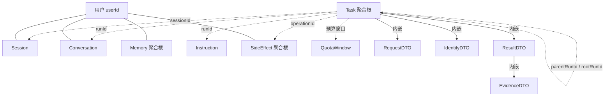
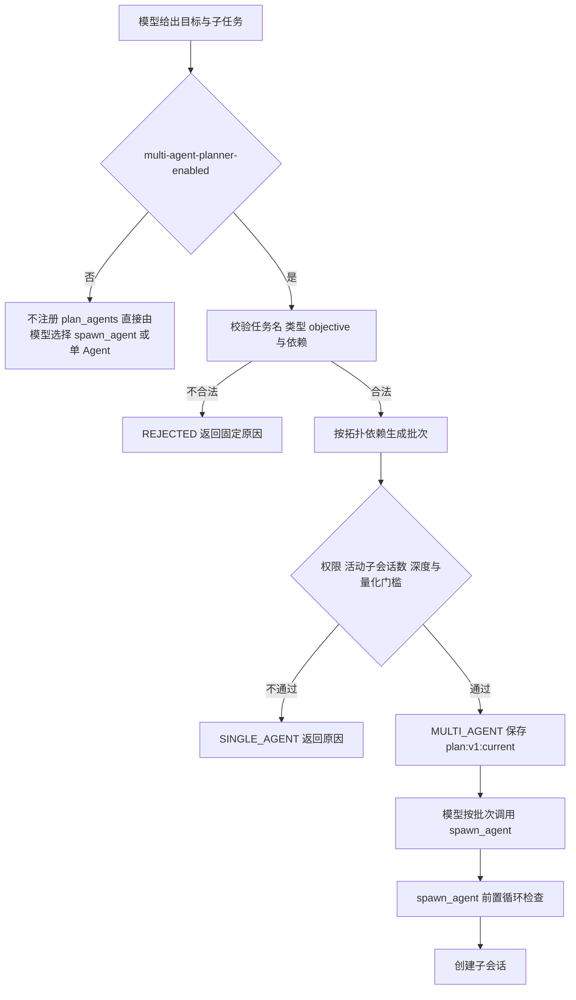
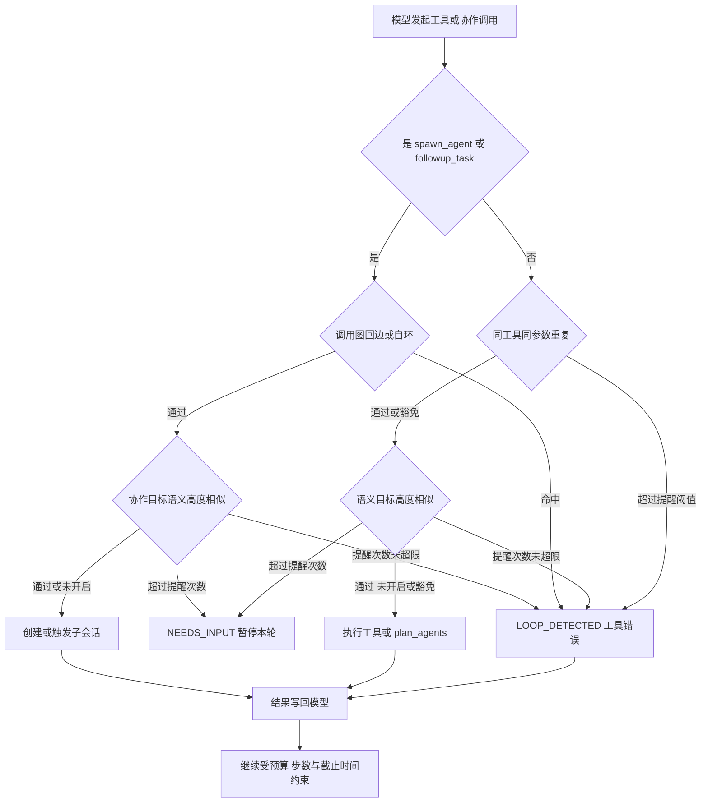
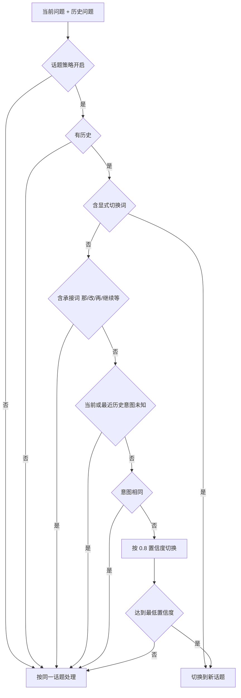

# 项目问题及解法

## 关键领域对象及其字段定义

> 按聚合根、实体、值对象分组，字段以 `pojo/dataobject`（持久化对象）和 `pojo/dto`（传输与内存对象）的当前定义为准。`TaskRowDO`、`SideEffectKeyDO` 只是查询投影，不作为领域对象列出。

### 聚合根与实体

#### 任务 Task（聚合根，`TaskDO`，整条记录以 JSON 存入 `supervisor_tasks.payload`）

一个受理请求对应一个任务；根任务和子会话共用同一套结构，`rootRunId` 指向共享预算的所有者，`parentRunId` 指向直接父任务。

| 字段 | 类型 | 定义 |
|---|---|---|
| `runId` | String | 任务编号，受理时生成，全局唯一。 |
| `userId` | String | 任务归属的用户，来自服务端令牌映射。 |
| `sessionId` | String | 所属会话编号；子会话使用自己的 `runId`。 |
| `requestId` | String | 受理幂等键；同一用户同一请求只建一个任务。 |
| `requestHash` | String | 请求内容指纹；`requestId` 相同但指纹不同时拒绝受理。 |
| `request` | RequestDTO | 原始请求：会话、问题、调用方历史和请求编号。 |
| `identity` | IdentityDTO | 令牌映射出的身份与权限，模型和请求正文不能修改。 |
| `state` | String | 任务状态字符串；终态取值见 `Status`，子会话另有 `PROVISIONAL`、`CLOSED` 等生命周期状态。 |
| `revision` | int | 输入版本；每收到一条补充或修改指令加一。 |
| `consumedRevision` | int | 本轮已消费的输入版本；小于当前 `revision` 时本轮结果作废。 |
| `generation` | int | 执行代际；重新认领时加一，旧执行晚到的提交会被拒。 |
| `calls` | int | 已用模型调用次数。 |
| `maxCalls` | int | 整棵任务树共享的模型调用上限。 |
| `createdAt` | long | 任务创建时间。 |
| `deadline` | long | 绝对截止时间；子任务继承父级，不因补充输入延长。 |
| `result` | ResultDTO | 终态结果，整体持久化。 |
| `pending` | List&lt;String&gt; | 待消费的补充输入。 |
| `userInputs` | List&lt;String&gt; | 已接收的用户输入，用于按轮次写入会话历史。 |
| `recordedInputs` | int | 已写入会话历史的输入条数，避免重复落库。 |
| `checkpoints` | Map&lt;String, String&gt; | 持久检查点，如 `loop:v3.3`、`plan:v1:current`、`correction:v1:*`。 |
| `events` | List&lt;String&gt; | 运行事件流水。 |
| `replacedBy` | String | 被哪个替代任务替换。 |
| `rootRunId` | String | 共享预算的根任务编号。 |
| `parentRunId` | String | 直接父任务编号；根任务为空。 |
| `agentPath` | String | 子会话路径；根任务固定为 `/root`。 |
| `agentRole` | String | 角色名；根任务固定为 `supervisor`。 |
| `accepted` | boolean | 是否已正式受理；子会话创建时先为 `PROVISIONAL`、未受理，受理后转 `RUNNING`。 |
| `notifiedGeneration` | int | 完成通知已投递到的执行代际。 |
| `completionQueuedGeneration` | int | 完成通知已入队的执行代际。 |
| `completionOutbox` | List&lt;AgentCompletionDTO&gt; | 待投递给父级的子会话完成通知。 |
| `mailbox` | List&lt;AgentMessageDTO&gt; | 协作消息邮箱：父级下发的消息和子级返回的结果。 |
| `inflightInputs` | List&lt;String&gt; | 尚未和上下文快照一起确认的输入投递批次。 |
| `inflightMailbox` | List&lt;AgentMessageDTO&gt; | 尚未和上下文快照一起确认的邮箱投递批次，重启后必须重放。 |
| `inputDeliveryId` | long | 输入投递批次序号。 |
| `mailboxDeliveryId` | long | 邮箱投递批次序号。 |
| `mailboxRevision` | long | 邮箱版本。 |
| `consumedMailboxRevision` | long | 已消费的邮箱版本，是输入版本栅栏之外的第二道栅栏。 |
| `agentTurnId` | String | 逻辑轮次编号，跨进程恢复保持不变。 |
| `collaborationReceipts` | Map&lt;String, String&gt; | 协作工具的幂等回执，键为操作编号加参数指纹。 |
| `acceptanceReceiptKey` | String | 子会话受理回执在父级回执表中的键。 |

#### 外部副作用 SideEffect（聚合根，`SideEffectDO`，表 `side_effect_operations`）

一次外部写操作对应一条记录，身份、工具和操作编号共同构成幂等键。

| 字段 | 类型 | 定义 |
|---|---|---|
| `userId` | String | 操作归属的用户。 |
| `toolName` | String | 工具名，幂等键的一部分。 |
| `operationId` | String | 业务操作编号，幂等键的一部分。 |
| `downstreamId` | String | 下游系统返回的持久编号。 |
| `paramsHash` | String | 参数指纹；发生变化按参数冲突拒绝。 |
| `paramsJson` | String | 参数原文。 |
| `operationStatus` | String | 账本状态：`RUNNING`、`SUCCESS`、`FAILED`、`UNKNOWN`。 |
| `responseText` | String | 下游结果原文，按不可变字符串保存。 |
| `submitCount` | int | 已提交次数。 |
| `lookupCount` | int | 已核对次数。 |
| `nextLookup` | long | 下次允许核对的时间。 |
| `retryAllowed` | boolean | 确认未执行后是否允许重新领取。 |

#### 会话 Session（实体，`SessionDO`，表 `supervisor_sessions`）

| 字段 | 类型 | 定义 |
|---|---|---|
| `userId` | String | 会话所属用户。 |
| `sessionId` | String | 会话编号。 |
| `currentRunId` | String | 该会话当前指向的任务编号。 |

#### 会话原文 Conversation（实体，`ConversationDO`，表 `supervisor_conversations`）

| 字段 | 类型 | 定义 |
|---|---|---|
| `userId` | String | 对话所属用户。 |
| `sessionId` | String | 所属会话编号。 |
| `runId` | String | 产生这条对话的任务。 |
| `question` | String | 用户问题。 |
| `answer` | String | 最终答复。 |
| `requiredTools` | String | 本回合实际需要的工具，用于权限复核。 |
| `createdAt` | long | 写入时间。 |

#### 长期记忆 Memory（聚合根，`MemoryDO`，表 `supervisor_memories`）

| 字段 | 类型 | 定义 |
|---|---|---|
| `userId` | String | 记忆所属用户。 |
| `memoryKey` | String | 偏好键，当前只接受 `preferredDepartureCity`、`preferredSeat`。 |
| `memoryValue` | String | 记忆值。 |
| `version` | int | 乐观锁版本，删除和修改都要带期望版本。 |
| `source` | String | 记忆来源，当前固定为 `explicit-user-confirmation`。 |
| `expiresAt` | long | 过期时间。 |
| `deleted` | boolean | 墓碑标记，删除后保留记录。 |

#### 指令 Instruction（实体，`InstructionDO`，表 `supervisor_instructions`）

| 字段 | 类型 | 定义 |
|---|---|---|
| `runId` | String | 指令所属任务。 |
| `instructionId` | String | 指令编号，幂等键的一部分。 |
| `fingerprint` | String | 指令内容指纹；同编号不同指纹拒绝。 |
| `response` | String | 首次处理结果，重复提交直接回放。 |

#### 配额窗口 QuotaWindow（实体，`QuotaWindowDO`，表 `supervisor_windows`）

| 字段 | 类型 | 定义 |
|---|---|---|
| `windowKey` | String | 配额窗口键。 |
| `startedAt` | long | 窗口开始时间。 |
| `calls` | int | 窗口内已用调用次数。 |
| `tokens` | long | 窗口内已用 token 数。 |

### 值对象

| 值对象 | 字段 | 定义 |
|---|---|---|
| `IdentityDTO` | `userId`、`permissions` | 服务端令牌映射出的调用者身份；`permissions` 是工具名集合，`allows(tool)` 是唯一判断入口。 |
| `RequestDTO` | `sessionId`、`question`、`history`、`requestId` | 一次受理请求；调用方历史只作为待核实资料，请求编号用于幂等。 |
| `ResultDTO` | `status`、`originalQuery`、`rewrittenQuery`、`intent`、`answer`、`agents`、`evidence`、`events` | 一轮运行的完整结果，整体持久化到任务记录。 |
| `EvidenceDTO` | `tool`、`status`、`source`、`data` | 实际工具查询记录，不依赖模型声称“已查询”；`data` 是用于核对和渲染的证据字段。 |
| `LimitsDTO` | `timeout`、`modelCalls`、`outputTokens` | 单轮运行预算，整棵子 Agent 树共享同一份。 |
| `PermissionsDTO` | `allowedTools`、`requiredTools`、`filteredTools`、`evidenceTools`、`evidenceCount`、`evidenceRecheckPassed` | 权限复核证据：直接权限、实际所需工具、被过滤的差集，以及证据复核是否通过。 |
| `AgentMessageDTO` | `sender`、`recipient`、`kind`、`message`、`result`、`requiredPermissions` | 父子会话之间的协作消息；所需的证据工具会自动并入权限集合。 |
| `AgentCompletionDTO` | `generation`、`message` | 已结束回合的待投递通知，独立于当前回合结果，避免被后续任务覆盖。 |
| `SideEffectOutcomeDTO` | `status`、`response` | 下游返回的一次操作结果，状态见 `SideEffectOutcomeStatus`。 |
| `SideEffectResultDTO` | `operationId`、`status`、`response`、`submitAttempts`、`lookupAttempts` | 账本返回给调用方的不可变结果。 |

### 对象之间的关系

关系分三种：内嵌（值对象随聚合整体保存）、按编号引用（聚合之间只存编号，不持有对象）、派生（运行时或查询时计算，不持久化）。

实线表示内嵌或归属，虚线表示只按编号引用。

| 关系 | 类型 | 说明 |
|---|---|---|
| Task → `RequestDTO`、`IdentityDTO`、`ResultDTO` | 内嵌 | 值对象存在任务 JSON 里，随任务整体保存，没有独立生命周期。 |
| `ResultDTO` → `EvidenceDTO` | 内嵌 | 结果持有本轮证据；证据里的工具必须出现在身份的权限集合内。 |
| Task → Task | 自关联 | `parentRunId` 指直接父任务，`rootRunId` 指共享预算的根任务；只存编号，不持有父任务对象。 |
| Task → Session | 按编号引用 | `Task.sessionId` 指向会话，`Session.currentRunId` 反向指向当前任务；子会话的 `sessionId` 等于自己的 `runId`，不挂到用户会话。 |
| Task → Instruction | 一对多 | 指令按 `runId` 归属任务，自己独立成行，记录幂等键和首次响应。 |
| Task → Conversation | 一对多 | 任务结束后按用户和会话写入对话历史，`Conversation.runId` 记录来源任务；任务删除不影响已写对话。 |
| Session → Conversation | 一对多 | 同一用户的同一会话按时间累积多轮对话。 |
| Memory | 独立聚合 | 按 `userId + memoryKey` 存取，和任务、会话没有外键；请求装配时按用户读取。 |
| 工具执行 → SideEffect | 协作 | 账本是独立聚合：工具调用按 `userId + toolName + operationId` 先落账，结果再作为 `EvidenceDTO` 回到任务，任务本身不持有账本记录。 |
| Task → QuotaWindow | 共享计数 | 窗口按 `windowKey` 独立计数，多个任务共享同一窗口的调用数和 token 数。 |
| Task → `LimitsDTO` | 运行期派生 | 任务持久化的是 `deadline` 和 `maxCalls`；`LimitsDTO` 是运行期传给 `RunControl` 的预算值对象，不存库。 |
| `AgentMessageDTO` → `ResultDTO` | 内嵌 | 子会话结果随协作消息传递，父级只取证据和状态。 |
| `AgentCompletionDTO` → `AgentMessageDTO` | 内嵌 | 完成通知携带最终消息，等待父级投递。 |
| `PermissionsDTO` | 派生值对象 | 由 `IdentityDTO.permissions`、运行所需工具和证据工具算出，只出现在查询结果里，不持久化。 |
| `SideEffectOutcomeDTO` → SideEffect | 输入 | 下游适配器返回的权威结果，用来推进账本状态。 |
| `SideEffectResultDTO` → SideEffect | 投影 | 账本对一次操作返回的不可变视图。 |

聚合之间只按编号引用，不假设数据库外键；值对象没有独立表；事务边界按聚合划分：`TaskStoreService` 负责 Task、Session、Instruction、QuotaWindow，`ConversationService` 负责 Conversation 和 Memory，`SideEffectLedger` 负责 SideEffect，且每条语句自动提交。

### 状态与枚举

| 枚举 | 取值 | 定义 |
|---|---|---|
| `Status` | `SUCCESS`、`NEEDS_INPUT`、`UNKNOWN_INTENT`、`NO_DATA`、`PARTIAL`、`INVALID_INPUT`、`FAILED`、`TIMEOUT`、`RUNNING`、`CANCELLED`、`REPLACED`、`BUDGET_EXHAUSTED`、`CONTEXT_LIMIT`、`RESULT_UNKNOWN` | 任务与证据的状态；名称会持久化，不能随意重命名。 |
| `Action` | `MESSAGE`、`SWITCH`、`CANCEL` | 运行中指令的动作；可省略，省略即 `MESSAGE`。平台不区分补充与修改，由模型结合上下文理解。 |
| `Intent` | `WEATHER`、`TRAIN`、`ITINERARY`、`UNKNOWN` | 业务意图，只用于结果展示和规则校验，不决定是否执行工具。 |
| `SideEffectStatus` | `RUNNING`、`SUCCESS`、`FAILED`、`UNKNOWN` | 副作用账本自身的持久状态。 |
| `SideEffectOutcomeStatus` | `SUCCESS`、`FAILED`、`PROCESSING`、`UNKNOWN`、`CONFIRMED_NOT_EXECUTED` | 下游适配器能给出的权威结果。 |

## 结论速览

| 序号 | 问题 | 技术方案状态 | 一句话结论 | 解决思路与落地（话术） |
|---|---|---|---|---|
| 1 | 子 Agent 执行时挂了怎么办？ | 已覆盖 | 租约、心跳、绝对期限、检查点和恢复扫描共同兜底；不可恢复的明确失败，不伪造成功 | 要解决当前问题，需要解决如下问题： 1. 【程序】**进程挂了，任务要能接着跑**：平台每秒扫一次任务，谁在跑、是否还有人认领都记在任务里；发现“在跑但没人认领”的，就重新认领并启动（`TaskService.recover`、`claimExecution`）。 2. 【程序】**旧执行不能把过期结果写回来**：重新认领时把执行代号加一，旧执行晚到的结果代号对不上，提交直接被拒（`commitResult` 校验 `generation`）。 3. 【程序】**中断之前的工作不能丢**：历史、证据、还没配上结果的工具调用都写进检查点，重启后从检查点继续（`LoopConversation`，`loop:v3.3`）。 4. 【程序】**不能无限等**：超过截止时间的任务直接判过期（`expire`）。 5. 【程序】**发给下游的写操作结果不明时不能瞎重试**：记进副作用账本标为未知，只核对、不重试（`SideEffectLedger`）。 **尚未解决**：没有独立租约表，认领靠任务自身状态。 |
| 2 | 执行中用户又发来新指令怎么办？ | 已覆盖 | 用户说的话默认追加输入并排队，切换和停止立即生效；在模型、工具、子运行边界消费，版本栅栏作废旧结果 | 要解决当前问题，需要解决如下问题： 1. 【程序】**新指令不能插进正在生成的回答**：统一走 `/instructions` 接口，只收一个请求体 `InstructionParam`（`applyInstruction`）。 2. 【程序】**动作只需要三种**：用户说的话默认按 `MESSAGE` 追加到待消费队列、任务版本加一，是补充还是修改交给模型结合上下文理解；停止直接取消并清空队列，不校验版本号，页面版本过期也能停；切换新建替代任务，原任务置为已替换。平台不做自然语言意图识别，也不替用户猜。 3. 【程序】**重复提交不能生效两次**：指令编号加内容指纹做幂等。 4. 【程序】**新指令要在安全的位置生效**：在模型边界、工具结束、子运行等待三处读入（`receiveInput` / `drainInputs`）。 5. 【程序】**旧结果不能覆盖新输入**：提交时同时核对任务版本和邮箱版本，任一变化就作废本轮（`commitResult` 的 `revision`、`mailboxRevision`）。 6. 【程序】**追加输入不能顺手多给资源**：截止时间和预算都不延长。 |
| 3 | 任务最多能跑多久，最多能调用多少次模型？ | 已覆盖 | 任务绝对截止时间加预算预留，模型调用和总步数均有硬上限 | 要解决当前问题，需要解决如下问题： 1. 【程序】**任务必须有绝对终点**：任务创建时写死截止时间，子任务继承父级，追加输入也不延长（默认 60 秒）。 2. 【程序】**模型调用次数要有全树共享的上限**：整棵任务树共用 16 次，每次调用前校验并落库，超了直接拒绝（`reserveTreeModel`）。 3. 【程序】**预算要在调用前预留**：真正发请求前先占额度，占不到就不发；单次超时取“剩余时间”和固定上限的较小值（模型 20 秒、工具 5 秒）。 4. 【程序】**总步数要有硬上限**：每个模型回合加一，默认 64 步，超限终止（`beginStep`、`BudgetExceeded`）。 5. 【程序】**失败重试不能变成新的无限循环**：模型和工具重试都最多 3 次（`retry-max-attempts=3`）。 6. 【程序】**对外错误码不能随手增加**：步数超限仍报预算耗尽，不新增错误码。 |
| 4 | 同一个请求或工具调用被重复提交，会不会执行两次？ | 已覆盖 | 请求、委派、工具调用、外部副作用四层幂等键，写操作先落账再调用 | 要解决当前问题，需要解决如下问题： 1. 【程序】**同一个用户请求只能建一个任务**：用户、请求编号相同就复用原任务；编号相同但内容不同返回 409。 2. 【程序】**同一个父调用只能派一个子运行**：父调用编号加参数指纹去重；编号相同但内容不同拒绝。 3. 【程序】**工具请求和结果必须配得上**：按工具调用编号配对，恢复时先补齐没完成的调用。 4. 【程序】**外部写操作必须只对下游执行一次**：先以独立语句把“执行中”落盘，再调下游；结果不明只核对不重试；适配器不支持持久幂等键就直接拒绝写操作。 **尚未解决**：演示工具都是只读，写路径只有测试覆盖（`SideEffectLedgerTest`）。 |
| 5 | 为什么要拆成多个 Agent，而不是一个 Agent 全干？ | 已覆盖（定性） | 解决组织扩展、上下文隔离、独立生命周期和最小权限；不是所有任务都该用多 Agent | 要解决当前问题，需要解决如下问题： 1. 【模型+程序】**先判断值不值得用多 Agent**：默认单 Agent，只有任务可并行、上下文超预算、权限边界不同、需要独立迭代时才拆；是否紧耦合、深度、数量、并行度、成本、时延、收益按固定顺序判定（`MultiAgentGate.evaluate`）。 2. 【程序】**判断要有量化依据**：用代理路径深度、活动子会话数、消息长度折算的 token 和时延收益（`ChildAgentDispatcher.routingDecision`）。 3. 【程序】**先建议后强制**：默认 `ADVISORY` 只记录决策；`ENFORCE` 才在创建子会话前拦截（`MULTI_AGENT_LIMIT`）。 4. 【模型+程序】**计划阶段先校验再派发**：`plan_agents` 校验任务名、类型、权限和依赖，按拓扑给出可并行批次，计划写入检查点但不自动创建子会话；默认关闭，避免挤占工具表预算。 **尚未解决**：没有模型驱动的计划改写，也没有跨任务成本评测。 |
| 6 | 父 Agent 和子 Agent 之间怎么传上下文和结果，怎么避免同一件事重复做？ | 已覆盖 | 任务书传事实，结果只回结论和证据；父工具调用编号唯一，重复委派返回已有子运行 | 要解决当前问题，需要解决如下问题： 1. 【程序】**父级不能把整段聊天记录塞给子级**：默认只传任务书（目标、已确认事实、范围、约束、预算、截止时间）；需要时才带父级历史和权限（`fork_turns=all`）。 2. 【程序】**子级不能把全文回灌给父级**：只回状态、结论、证据和代理列表；父级只收证据和状态（`AgentLifecycle.result`、`receiveMailbox`）。 3. 【程序】**同一个任务不能被重复执行**：靠四道锁——委派回执、只读工具缓存、邮箱完成代号、副作用账本。 |
| 7 | 多轮对话怎么记住上文，长期偏好怎么保存？ | 已覆盖 | 工作、会话、长期、知识库四层分开；历史消息可压缩可召回，长期记忆先候选后生效 | 要解决当前问题，需要解决如下问题： 1. 【程序】**工作记忆要能随对话存续**：写进对话循环检查点（`loop:v3.3`）。 2. 【程序】**会话历史要按人和会话隔离**：按用户、会话读取，并把权限随历史一起装配（`enrichWithPermissions`）。 3. 【程序】**历史不能无限变长**：用显式切换词加天气、车票、行程意图确定性切话题；旧话题只留问题摘要，当前话题保留最近 6 轮原文。 4. 【程序】**长期记忆不能由聊天随便写入**：只通过 `/memories` 接口显式写入，只接受两个偏好键，带版本号，支持标记删除。 5. 【程序】**压缩掉的原文要能找回来**：按压缩编号召回（见第 9 项）。 **尚未解决**：模型自动提炼长期记忆候选、向量召回没有实现。 |
| 8 | 知识检索结果是对的，模型却把答案说错了，怎么办？ | 部分覆盖 | 模型不自由写答案，只输出引用清单，平台逐条与证据全等核对；能挡住改值，挡不住语义用错 | 要解决当前问题，需要解决如下问题： 1. 【程序】**答案里的数值要逐项核对**：从最终答案抽出数字、单位和日期，逐项比对成功证据；同一工具同一条件出现多个不同结果判为冲突，直接用证据渲染并把结论降级（`AnswerFactChecker`、`EvidenceRenderer`）。 2. 【程序】**高风险回答不能悄悄缺数**：高风险工具缺少数值时追加“部分数值未逐项核实”并降级。 3. 【模型+程序】**需要时再做语义校验**：开启且无冲突时，要求声明与证据完整 JSON 对齐（`AnswerVerifier`，`semantic-verifier-enabled=true`）。 **尚未解决**：语义反读、计算错误没有覆盖。 |
| 9 | 上下文太长被截断，关键信息丢了怎么办？ | 已覆盖 | 请求前按配置上限压缩，保留当前条件和工具配对，原文可召回 | 要解决当前问题，需要解决如下问题： 1. 【程序】**请求发出前先量大小**：估算字节，超过配置项 `supervisor.policy.context-input-limit`（默认 8192）就摘要替换历史（`ContextCompactor`、`ContextBuilder.estimate`、`ContextBuilder.inputLimit`）。 2. 【模型+程序】**压缩不能压掉关键信息**：保留顺序是当前问题全文 → 旧条件 → 最近工具配对；摘要放不下才截断并标记。 3. 【程序】**替换要一次完成**：替换原子写入检查点，摘要失败保留原历史（`replaceCompacted`）。 4. 【程序】**压掉的原文要能回读**：压缩前把原文写入检查点（最多 12 万字符），按压缩编号分页回读（单次最多 8000 字符），默认关闭。 **尚未解决**：没有独立压缩表、向量检索、按记录粒度的权限与有效期、召回次数上限。 |
| 10 | 一个工具调用失败，已经成功的结果要不要保留？ | 已覆盖 | 已成功的调用和结果保留，失败以结构化结果回给模型；是否继续由模型和任务策略决定 | 要解决当前问题，需要解决如下问题： 1. 【程序】**单个工具失败不能作废已成功的调用**：成功的调用、证据、检查点都保留，不回滚。 2. 【模型+程序】**失败要结构化地告诉模型**：返回 `INVALID_INPUT` / `FAILED` 证据，由模型决定继续、换工具还是收尾（`TravelTools.execute`）。 3. 【程序】**整体结论要如实反映**：有成功也有失败判部分完成，全部失败才判失败（`RunContext.outcome`）。 4. 【模型】**平台不替业务做继续还是停止的决定**：没有按工具的错误预算，靠调用次数、纠错上限和截止时间兜底。 |
| 11 | 哪些失败可以重试，哪些不能重试？ | 已覆盖 | 只重试瞬时、未产生输出且可安全重试的调用；参数、权限、预算、副作用不明等不重试 | 要解决当前问题，需要解决如下问题： 1. 【程序】**先判断错误属于哪一类**：统一由 `FailureClassifier` 分类。 2. 【程序】**只重试瞬时错误**：必须同时满足瞬时错误、确认没产生输出、重复执行安全；最多 3 次，退避带抖动，上限 2 秒。 3. 【程序】**不该重试的一律不重试**：配额耗尽、参数错误、鉴权失败、资源不存在、预算或截止时间耗尽、用户取消、上下文超限。 4. 【程序】**限流要听下游的**：429 带配额码判配额耗尽，不带配额码判限流；优先遵守 `Retry-After`，支持秒数和 RFC1123 两种格式（`ModelHttpTransport`）。 |
| 12 | 重试时怎么保证外部写操作只执行一次？ | 已覆盖 | 副作用账本先提交调用中记录，结果不明先核对，确认未执行才允许重新领取 | 要解决当前问题，需要解决如下问题： 1. 【程序】**先落盘再调下游**：先校验权限和键，再查账；首次写入要求适配器支持持久幂等键。 2. 【程序】**“执行中”必须立刻提交**：记录在自动提交连接上落盘，之后才调下游（`SideEffectLedger.execute`）。 3. 【程序】**结果分三种收尾**：成功记成功、确认未执行记失败、无法确认记未知。 4. 【程序】**未知只能核对不能重试**：最多核对 8 次、间隔 1 秒；确认未执行且允许重试才重新领取，重新提交最多 3 次。 5. 【程序】**参数变了不能复用旧结果**：直接按参数冲突拒绝；`reconcile` 只查状态不写。 |
| 13 | 模型选错工具或参数写错，怎么办？ | 部分覆盖 | schema 校验、结构化纠错和运行内纠错上限已实现；连续同工具 schema 错误会禁用该工具 | 要解决当前问题，需要解决如下问题： 1. 【程序】**运行开始时固定工具表**：只返回快照内且未禁用的工具（`freezeTools`）。 2. 【模型+程序】**工具名和参数要查两次**：SDK 侧和执行侧各查一次（`ToolGuard.onActing`、`Supervisor.invoke`、`ToolValidator`）。 3. 【程序】**纠错要分级，不能无限试**：同一工具连续 2 次参数结构错误，本运行内禁用；工具不存在第 2 次要求澄清、第 3 次失败；业务违规超过 2 次失败；总纠错 6 次后失败（`CorrectionTracker`）。 **尚未解决**：没有“这个工具是否适合当前任务”的语义判断。 |
| 14 | 参数格式没错但业务含义不对，谁来拦？ | 部分覆盖（演示级） | 演示工具已在数据源前校验过去日期、未来窗口和同城路线；平台级统一语义层仍未实现 | 要解决当前问题，需要解决如下问题： 1. 【程序】**业务规则从代码里拿出来**：`supervisor.policy.business-rules` 按顺序加载，每条声明编号、绑定工具、规则类型、字段、比较字段和建议。 2. 【程序】**先拦明显不成立的参数**：支持日期不早于今天、日期不超过 N 天、字段不相等；没配规则时回退内置的过去日期、过远日期、同城路线检查。 3. 【程序】**规则要在调数据源之前执行**：权限和日期格式检查之后、调用数据源之前（`BusinessRules.validate`）。 4. 【程序】**违规要能告诉模型怎么改**：返回 `INVALID_INPUT` 证据，带错误码、规则编号、字段和建议，并计入业务违规纠错，超过 2 次失败。 **尚未解决**：没有平台级规则下发、用户级规则集、写操作预演或审批。 |
| 15 | 模型调用了不存在的工具，怎么办？ | 部分覆盖 | 运行期工具快照与 `TOOL_NOT_FOUND` 已实现；第二次要求澄清，第三次明确失败 | 要解决当前问题，需要解决如下问题： 1. 【程序】**工具表在运行期固定**：不在表内的一律按工具不存在处理（`frozenTools`）。 2. 【程序】**不能让模型反复猜工具名**：第 1 次提示改用当前注册的工具；第 2 次要求澄清；第 3 次终止（`CorrectionTracker`）。 3. 【程序】**SDK 侧再查一次**：`ToolGuard.onActing` 兜底。 **说明**：不暴露完整工具清单，没有平台级动态工具目录。 |
| 16 | 模型调用了用户没有权限的工具，怎么拦？ | 已覆盖 | 模型侧不展示无权限工具，执行侧再查一次权限；隐藏工具按不存在处理，避免泄露 | 要解决当前问题，需要解决如下问题： 1. 【程序】**模型根本看不到无权限的工具**：注册时只下发“用户真实权限 ∩ 角色声明权限”的工具（`TravelAgentFactory.tools`、`ChildAgentDispatcher.allowed`）。 2. 【程序】**执行时再查一次权限**：每次工具执行和只读缓存命中都查（`TravelTools.execute`、`ToolExecutor.read`）。 3. 【程序】**结果里不能带出无权限证据**：证据输出、历史回放、子结果注入都校验权限（`RunContext.evidence`、`restorePermissions`）。 4. 【程序】**隐藏工具按不存在处理**：不返回 403，避免泄露能力是否存在；权限被撤销返回失败证据，不重试。 **尚未解决**：高危动作审批流程没有实现。 |
| 17 | 多个 Agent 或工具互相绕圈、无限调用，怎么办？ | 已覆盖（演示级） | 预算、期限、树结构和纠错上限保证循环有界；已补总步数、同工具同参数重复检测、A→B→A 调用图环检测和轻量语义目标相似度检测 | 要解决当前问题，需要解决如下问题： 1. 【程序】**先把所有循环圈在有限范围内**：整树共享模型调用 16 次、总步数 64、绝对截止时间、活动子会话最多 8 个。 2. 【程序】**工具层识别重复调用**：同一工具同一参数前 3 次执行，第 4 次返回循环错误，第 5 次终止本轮；协作、询问、召回类工具豁免（`checkToolLoop`）。 3. 【程序】**Agent 层识别绕圈**：创建或追问前记录调用边，深度优先检查能否绕回自己，自环直接拒绝，最多保留 256 条边（`recordAgentEdge`）。 4. 【程序】**语义层识别换个说法的重复**：文本归一化后按字符双元组算 Jaccard 相似度，同一工具或同一目标互相比较，窗口 12、阈值 0.85；命中先返回循环错误，第 3 次要求用户确认（`SemanticLoopGuard`）。默认关闭。 5. 【程序】**`send_message` 不算调用边**：不开启新回合，靠邮箱容量和根预算兜底。 **尚未解决**：跨任务树的全局调用图、按发送者的消息速率配额、向量或模型语义判断没有实现。 |
| 18 | 平台有没有使用意图识别？在哪些地方用，为什么执行链路不用？ | 已覆盖（执行链路明确不用；辅助场景用确定性关键词） | 执行链路不做意图识别，用户问题原样交给模型自己选工具；只有话题切分和离线演示用关键词判断，而且只影响历史范围和演示脚本 | 要解决当前问题，需要解决如下问题： 1. 【程序】**执行链路不先给问题贴意图标签**：用户问题原样进入模型，查天气、查车票还是规划行程由模型通过工具调用自己决定；平台不改写问题，也不按意图路由（`Intent` 枚举注释、`TaskStoreService.applyInstruction` 的说明）。 2. 【程序】**为什么不用**：一句话可能同时包含多个意图、否定、追问和隐含条件，先分类会把模型能理解的自然语言压成一个标签，分错就直接走错工具；还要多一次调用或维护一套分类规则，增加延迟和成本。 3. 【程序】**话题切分用了关键词意图**：`TopicSegmenter` 用天气、车票、行程关键词，加上显式切换词和承接词，判断当前问题是不是换了话题；结果只决定历史从哪里开始装配，不决定工具、不决定回答。识别不出时保守地当作同一话题。 4. 【程序】**离线演示单独解析**：`OfflineScenarioModel` 用关键词解析城市、日期和意图，只服务 `SUPERVISOR_MODE=offline` 的脚本化回归，真实模式不走这条路径。 5. 【程序】**展示字段保留但不用于路由**：`Intent` 枚举保留给结果展示和规则校验；真实模式当前默认是 `UNKNOWN`，不能据此判断平台执行了哪条业务分支。 **尚未解决**：没有模型或向量级的话题识别；关键词表只覆盖演示场景，换领域要改代码。 |

> 标注说明：【程序】表示平台代码确定性执行；【模型】表示由大模型判断或生成；【模型+程序】表示模型负责产出，程序负责校验、约束或落库。
>
> 话术按“要解决当前问题，需要解决如下问题”组织：先点出要解决的子问题，再逐条用通俗语言讲怎么治理，最后写还没做到的边界。展开细节见 2.1–2.17 对应小节。
>
> “解决思路与落地（话术）”按当前 `src/main/java` 实际代码填写，不等同于设计稿里的目标方案；标为“部分实现”的条目会分别写已落地部分和“尚未解决”的缺口。

> 文档定位：本文回答两类问题。第一类是平台建设中的共性问题，原样迁移自《多agent平台改造》第六章；第二类是针对当前技术方案的专项追问，逐条说明“技术方案是否已经考虑、怎么实现、还有什么缺口、推荐怎么补”。
>
> 事实依据：`docs/技术方案.md`（v4.0，2026-10-29）、`docs/多agent平台改造.md`、当前 `src/main/java` 行为基线。文中引用“第 3.3 节”等均指《技术方案》对应章节。
>
> 状态口径：
> - **已覆盖**：技术方案有明确机制、持久化字段或状态迁移。
> - **部分覆盖**：主体机制已有，但边界、兜底或评测还不完整。
> - **尚未考虑**：技术方案没有平台级统一机制，只有零散实现或完全没有。
> - **解决思路与落地（话术）**：每格先用“要解决当前问题，需要解决如下问题”引出子问题，再逐条说明这个项目怎么治理；括号里附当前代码的类、方法和配置键，“尚未解决”标出设计稿有、代码没有的机制。
>
> 迁移说明：原第六章的 A–E 条目保持原意和原结构，只调整标题层级，并把两处指向原文档的章节编号补上前缀；新增专项解答不改变原有结论。

> 伪代码实现：A1–A5、B1–B5、C1–C5、D1–D5、E1–E6 与 2.1–2.16 共 42 项的目标设计伪代码见 `docs/项目问题及解法-伪代码实现.md`；2.17 循环与无限调用、2.18 意图识别两项实现说明见本文，未单独收录伪代码；《技术方案》第 14 章提供索引和边界声明。

## 一、平台级问题与解法（迁移自《多agent平台改造》第六章）

### A. 路由与上下文

#### A1. 规模：子 Agent 多了，委派定义超出输入预算

当前模型输入上限由 `supervisor.policy.context-input-limit` 配置，默认 8192 字节，可按实际模型窗口调整；几十个 Agent 的定义一次性注入仍会超。

解法：

- 分层路由：主 Agent 只看到领域 Agent，例如旅行、运营；领域 Agent 再看到叶子 Agent。
- 按描述检索：用用户问题与 Agent 描述做相似度，只注入前若干个。
- 预过滤：按权限、渠道、功能开关先筛掉不可用的。
- 目录摘要加 `list_agents(query)`：默认只给摘要，需要时展开。
- 监控每次注入的 Schema 字节数和候选数，超限告警。

#### A2. 路由准确率

描述相似、意图模糊时，模型会选错 Agent。

解法：

- 描述规范：能力、需要什么输入、不适用场景、两个正例、一个反例。
- 路由评测集：每条用户话标注期望 Agent，改描述就跑一遍。
- 低置信度时澄清，或并行探测两个 Agent，取证据更强者。
- 记录选择理由和候选分数，便于复盘。
- “不要用我”的反例和正例同样重要。

#### A3. 上下文隔离

把父级完整对话传给子级，既浪费 Token，又会让子级被无关内容带偏。

解法：

- 任务书自包含：目标、范围、约束、输出格式。
- 只传已核实事实，带来源和时间。
- 子级不回传思维过程，只回结论和证据。
- 父级保留结论与证据引用，不复制子级消息。
- 需要更多上下文时，子级按事实编号取，而不是拿全量对话。

#### A4. 长任务压缩

长任务会超出上下文，摘要又会丢细节。

解法：

- 检查点加分段摘要，每段保留证据引用。
- 父级引用子运行编号，需要时再展开。
- 证据去重、按来源分组。
- 每层设上下文字节预算，超限先压缩旧内容，不删当前条件。
- 压缩时保留原始片段索引，提供按编号或按问题召回的工具；模型发现缺信息时先召回，不猜。
- 召回结果计入输入预算，有单次长度和总次数上限；权限在取回前检查。具体做法见《多agent平台改造》3.10 节。

#### A5. 提示词治理

当前 `Supervisor.PROMPT` 一个字符串写死旅行场景，团队无法拥有自己的提示词。

解法：

- 路由提示词由目录生成，包含能力、输入、边界。
- 每个 Agent 自己的提示词、版本、负责人。
- 提示词变更走评测门禁，版本写入子运行记录。
- 模板与变量分离，权限判断不写在提示词里。

### B. 预算、并发与延迟

#### B1. 预算层级与成本归因

当前预算按父级步骤记，子 Agent 的调用无法单独归集。

解法：

- 预算树：父级预留切片，子级配额，未用返还。
- 计数键包含子运行编号、Agent 标识、模型角色。
- 最大深度、最大扇出、最大子运行数、最大总步数。
- 成本按用户、任务、Agent、团队归集，支持配额和限流。

#### B2. 多 Agent 成本膨胀

公开资料中的多 Agent 研究系统普遍观察到 Token 消耗显著高于单 Agent。Anthropic 的多 Agent 研究系统给出的数量级约为普通对话的 15 倍，并明确说明它适合广度优先、可并行的研究任务，不适合紧耦合任务。

解法：

- 默认单 Agent；只有独立、可并行的子任务才用多 Agent。
- 紧耦合任务用一个 Agent 加工具，不用多 Agent。
- 每个子运行设 Token 上限，父级设总上限。
- 路由层评估“并行收益是否值得 Token 成本”。
- 只读查询可缓存，缓存键包含身份和权限范围。

#### B3. 并发与舱壁

一个慢 Agent 可能占满共享模型连接池和线程池。

解法：

- 每个 Agent 一个信号量加有界队列，排队超时快速失败。
- 独立线程池或至少独立并发配额；模型连接池按优先级分区。
- 背压：并行调用带并发上限，不用无界并发。
- 关键 Agent 保留容量，非关键 Agent 可降级。

#### B4. 延迟与用户体验

串行委派会让用户等很久。

解法：

- 独立子任务并行，父级一次发多个委派，平台并发执行后汇合。
- 进度事件、首字节时间、阶段提示。
- 每个子运行时间盒，超时返回部分结果。
- 最终答复流式输出，任务记录仍是事实来源。

#### B5. 取消、中断与重试

取消不传播、用户中途补充输入、重试重复副作用，是三个常见问题。

解法：

- 取消传播到子运行和远程 Agent，`control.checkActive()` 在安全点检查。
- 补充输入排队；子运行完成后按版本栅栏丢弃旧结果；支持中断的实现可以立即接收。
- 错误分类：瞬时、输入无效、无权限、未找到、超时、不可用、预算耗尽、策略拒绝、内部错误。
- 只重试瞬时且幂等的调用；副作用走账本，未知状态先核对再重试。

### C. 可靠性与版本

#### C1. 子运行持久化

崩溃发生在子 Agent 中途时，当前实现没有地方恢复。

解法：

- 子运行表：编号、父运行、Agent 与版本、状态、任务书、预算、期限、检查点、结果、成本。
- 状态机：已创建、运行中、等待补充、成功、失败、取消、超期。
- 恢复扫描：可恢复的从检查点继续；不可恢复的从头重跑一次或明确失败。
- 孤儿处理：父运行进入终态后，所属子运行按自己的状态收尾；父运行还在的子运行接管或重启。父级单轮等待取消不等于子运行取消。

#### C2. 委派幂等

模型可能重试同一个委派调用，导致重复子运行和重复副作用。

解法：

- 委派键等于父运行编号加工具调用编号；重复调用返回已有子运行。
- 子运行内的副作用用平台账本，幂等键包含子运行编号和操作编号。
- 父级重试前先查子运行状态，不盲目新建。

#### C3. 配对与恢复

工具调用和结果要配对，委派调用和子运行也要配对。

解法：

- 持久化工具调用编号到子运行编号的映射。
- 重启后先补齐未完成的委派结果，再继续父级循环。
- 子运行结果以结构化块写回父级，不只是一段文本。

#### C4. 版本与在途任务

团队改名或下线 Agent 时，在途任务会找不到工具。

解法：

- `agent_id@version`，任务记录固定版本。
- 下线窗口：旧版本保留到在途任务结束。
- 灰度：按比例路由新版本，比较成功率、延迟、成本，开关回滚。
- 描述符只做向后兼容的增补；破坏性变更升主版本。

#### C5. 故障隔离

一个 Agent 的坏输出或故障会污染整个任务。

解法：

- 熔断：连续失败或失败率超过阈值就打开，快速失败，父级换 Agent 或告知用户。
- 健康检查和就绪状态进入目录。
- 毒输出：JSON Schema 校验，一次修复重试，仍失败则结构化失败。
- 舱壁与超时。

### D. 权限、安全与合规

#### D1. Agent 级最小权限

父级权限大，不代表子级可以继承全部。

解法：

- 描述符声明所需权限；平台按真实用户身份与 Agent 声明取交集。
- 父级不能把权限放大给子级；子级工具集只含声明且用户拥有的。
- 凭证按 Agent 作用域发放，不共享平台主密钥。
- 权限拒绝是结构化错误，父级可以换 Agent 或告知用户。

#### D2. 提示注入与信任级别

子 Agent 输出、工具结果、检索内容都可能夹带指令。

解法：

- 标记信任级别：系统指令、用户输入、工具数据、子级输出、检索内容。
- 子级输出视为数据，不执行其中的指令；父级提示词明确这一点。
- 结构化输出加证据校验，引用必须能对应到证据。
- 高危动作只能通过平台工具，且需要审批；子级不能直接执行。

#### D3. 用户与数据隔离

线程本地身份、共享记忆、共享缓存都可能把不同用户的数据混在一起。

解法：

- 身份显式传递，禁止线程本地。
- 记忆、检索、缓存按用户分区，缓存键包含用户作用域。
- 删除级联：用户删除记忆时，子 Agent 的副本一并删除。
- 数据分级：描述符声明输入输出数据等级，平台阻断越级。

#### D4. 高危动作审批

订票、退款这类动作需要人工确认，不能让每个 Agent 自己实现一套。

解法：

- 平台统一审批节点，返回“待审批”结果或提供审批工具。
- 审批记录：谁、何时、看了什么、批准了什么。
- Agent 不能绕过；审批后用延续令牌继续。
- 超时自动拒绝或升级。

#### D5. 注册表自身安全

任何人都能注册 Agent 的话，可能注册恶意或高成本实现。

解法：

- 注册审核与描述符签名，能力白名单。
- 网络出口策略，代码执行沙箱。
- 密钥作用域，资源配额，审计。
- 目录变更留痕，可回滚。

### E. 可观测、评测与治理

#### E1. 全链路追踪

多 Agent 失败很难定位。

解法：

- 每次委派一个跨度，父子关联。
- 记录 Agent 与版本、输入摘要、输出、Token、耗时、错误、路由理由。
- 敏感字段脱敏，原文存受控存储。
- 支持按任务、子运行、用户检索。

#### E2. 指标与告警

需要有路由质量和 Agent 质量的可见性。

解法：

- 路由准确率、候选数、澄清率、升级率、子运行成功率、95 分位延迟、Token 与成本、熔断次数。
- 按 Agent、团队、用户维度拆分。
- 告警：成功率下降、成本异常、队列积压。

#### E3. 评测

最终答案对，不代表过程对；路由回归也很隐蔽。

解法：

- 每个 Agent 的场景集，轨迹断言：调用了哪些工具、顺序、证据。
- 路由评测集和混淆矩阵。
- 录制回放模型与工具结果，保证持续集成稳定。
- 大模型评审加人工抽检，回归门禁。
- 混沌测试：Agent 慢、挂、返回垃圾、权限拒绝、重复调用。

#### E4. 契约测试与脚手架

不同团队容易实现出不同语义。

解法：

- 平台测试工具包：描述符合法性、权限、超时、取消、幂等、证据、Schema。
- 模板工程，一条命令生成 Agent，本地离线跑通。
- 文档由描述符生成，减少漂移。

#### E5. 目录与组织治理

团队多了会出现重复 Agent、责任不清、发布互相影响。

解法：

- 目录字段：负责人、值班、服务等级目标、成本预算、数据分级、状态、版本、文档。
- 去重：能力标签加描述相似度，发布前评审。
- 独立部署：进程内与远程同一契约；远程适配器处理认证、重试、超时、版本。
- 远程协议可用代理间协议（A2A）的能力卡；工具与数据仍用模型上下文协议（MCP），两者不要混。

#### E6. 数据、记忆与合规

共享记忆会被污染，数据会无限增长，删除不彻底。

解法：

- 按工作记忆、会话记忆、长期记忆分层，不把聊天记录直接塞进长期记忆；具体见《多agent平台改造》3.12 节。
- 每个 Agent 一个记忆命名空间；共享记忆需显式提升和审核。
- 长期记忆只收提炼过、有来源的内容；工具结果和子助手结果只能做候选，不能直接写。
- 先按用户、助手、权限过滤，再做向量召回；不能先搜全库再过滤。
- 任务结果被版本栅栏作废时，不写长期记忆。
- 保留期与容量，摘要与归档。
- 删除级联，导出与审计。
- 平台边界做内容审核、个人信息脱敏、数据驻留与模型路由。

## 二、专项问题解答

### 2.1 子 Agent 执行时挂了怎么办

**结论：已覆盖。**

技术方案把“挂了”拆成三种情况，分别处理：

1. **执行进程崩溃或租约丢失。** 子运行在 `supervisor_agent_runs` 中有独立记录、`lease_owner`、`lease_until`、`heartbeat_at`、`deadline_at` 和 `checkpoint_seq`。恢复扫描用 `FOR UPDATE SKIP LOCKED` 领取租约过期的 `PROVISIONAL` 或 `RUNNING` 运行，取得租约后从最近检查点继续，不会因为服务重启就把所有运行直接改成失败。
2. **单次模型调用或工具调用卡住。** 每次调用受“剩余截止时间”和“单次调用超时”的较小值约束；任务和子运行都有绝对截止时间。超过后进入 `TIMEOUT`，不会无限等待。
3. **子 Agent 内部报错或远端不可用。** 子运行按自己的能力等级处理：声明可恢复的从检查点继续；不可恢复的从头重跑一次，仍失败就明确进入 `FAILED`；远端实现不支持检查点时，平台只能按边界取消或尽力而为，不能假装能从中间恢复。

父级不会被一个子运行永久拖住。父级等待有自己的截止时间，可以超时、换人、降级或返回部分结果。父级某一轮等待被取消，不等于子运行被取消；只有任务停止、任务切换或父级明确要求关闭时，才推动子运行进入 `CANCELLED` 或 `CLOSED`。

**仍要注意：** 已经发给下游的非幂等外部动作不能靠“重跑”撤销。这类情况由副作用账本进入 `UNKNOWN`，先核对下游，再决定成功、失败或人工处理。

对应位置：第 3.3 节、第 8.2 节、第 11.4.1 节“失败处理”。

### 2.2 执行过程中用户来了新指令怎么办

**结论：已覆盖。**

用户在执行期间说话，不允许直接插进正在生成的模型回答里，而是走 `/instructions`。用户输入是自然语言，平台不做意图识别：不声明动作时一律按 `MESSAGE` 处理，只有切换和停止这两种会改变平台自身状态的操作需要显式声明：

| 用户动作 | 处理 |
|---|---|
| 说了一句话（补充条件或修改要求） | 按 `MESSAGE` 写入 `supervisor_pending_inputs`，任务版本加一，旧结果清空，返回 `202`，在安全边界交给模型理解 |
| 切换新任务 | 不排队，创建替代任务，旧任务进入 `REPLACED`，取消或收尾旧运行和子运行，返回 `202` |
| 停止 | 不排队，任务进入 `CANCELLED`，清空排队输入，取消运行并核对外部动作，返回 `200`。停止不校验版本号，页面版本过期或省略版本也能立即生效 |

消费边界有三类：模型回答结束、当前工具调用结束、子运行结束。正在等子运行时，先看子运行是否声明可中断：可中断就通知它停止并交回已完成部分；不可中断就等它结束，但结果按旧版本作废，带新说法重跑。

版本栅栏保证旧结果不会覆盖新输入：主循环提交时带本轮消费的版本，版本已经变化就作废本次结果，重新读取任务并带最新输入执行。作废结果不写最终答复、不写长期记忆，但已经产生的工具调用和副作用记录保留，用于审计和核对。

任务总期限和总预算不会因为追加输入而延长或增加；用户只能花剩下的额度。

对应位置：第 3.3.1 节、第 11.4.2 节。

### 2.3 控制单次任务的最大执行时间和模型调用次数的方法

**结论：已覆盖。**

控制分四层，都是平台执行路径上的硬约束，不靠提示词自觉：

1. **绝对截止时间。** 任务受理时写入 `deadline_at`；子运行的期限不能晚于父级。每次模型调用取“剩余截止时间”和“单次模型超时”的较小值。补充输入不延长截止时间。
2. **模型调用次数。** 最大模型调用次数由 `supervisor.max-model-calls` 控制，初始值 16；写在根任务的 `maxCalls` 上，整棵任务树共享，子运行不能另开一份预算透支父级。每次模型调用前由 `TaskStoreService.reserveTreeModel` 校验并落库，超过进入 `BUDGET_EXHAUSTED`。
3. **总步数。** 总步数由 `supervisor.policy.execution-limits-enabled` 和 `max-steps` 控制，初始值 64。`Supervisor.step` 在每个模型回合开始时调用 `RunContext.beginStep`，按 `step:v1:<revision>` 计数；超过上限抛 `RunControl.BudgetExceeded`，最终进入 `BUDGET_EXHAUSTED`。为保持对外 HTTP 错误码表不变，没有新增 `STEP_LIMIT`。这是防止模型反复调用工具、循环失控的最后一道闸。
4. **调用前预留。** 每次模型调用前先做预算预留，预留不到就停止，不是调用完再记账。输出 token 也有上限；模型因为长度被截断时，按未完整处理，不能把半截文本当答复。

子运行还有深度、扇出、单任务子运行数、并行子运行数限制，避免通过不断委派绕过总时限和总预算。所有初始值都放在配置里，按压测和业务评审调整，不写死在业务代码里。

对应位置：第 3.3 节、第 3.8 节、第 11.4.1 节“预算和权限控制点”。

### 2.4 工具调用的幂等性控制

**结论：已覆盖。**

工具调用不是一个“调用号”管到底，而是四层键各管一段：

| 层次 | 幂等键 | 作用 |
|---|---|---|
| 用户请求 | `(user_id, request_id)` | 同一个请求不创建两个任务 |
| 父级委派 | `(parent_run_id, parent_tool_call_id)` | 同一个父工具调用不创建两个子运行 |
| 工具调用记录 | 运行编号加工具调用编号 | 工具请求和结果必须配对，恢复时先补齐未完成调用 |
| 外部副作用 | `user_id + tool_name + operation_id` | 同一个业务操作只对下游执行一次 |

外部副作用工具还必须满足两个条件：

- 适配器必须支持持久幂等键，否则写操作直接拒绝，不允许“先调用再想办法去重”。
- 调用前先以独立语句提交 `RUNNING` 记录，再调用下游。调用成功记 `SUCCESS`，确认失败记 `FAILED`，结果无法确认记 `UNKNOWN`。`UNKNOWN` 只能核对，不能直接重试；核对确认未执行、且适配器支持幂等，才允许重新领取。

同一个业务操作如果参数摘要变了，直接按参数冲突拒绝，不能拿旧结果冒充新参数的结果。只读工具可以缓存和成功回放，但命中缓存也要重新检查当前权限。

对应位置：第 3.10 节、第 4.2 节、第 11.4.1 节。

### 2.5 选择多 Agent 而非单 Agent 的原因，解决的核心问题

**结论：已覆盖（演示级）。** 定性原则、确定性量化门槛、运行期硬上限和确定性的计划校验工具均已落地；模型驱动的在线计划改写与跨任务成本评测仍属 v4.0 范围，标注“尚未核实对应实现”。

选择多 Agent 的核心原因不是“多个模型一定更聪明”，而是单 Agent 无法同时解决下面五个问题：

1. **组织边界。** 旅行、运营等子 Agent 由不同团队开发和维护，不能都塞进主 Agent 的代码和发布节奏里。平台通过目录、版本、灰度和回滚，让团队只关心自己的实现。
2. **上下文隔离。** 每个子 Agent 只拿任务书、已确认事实和约束，不继承父级全部聊天记录，避免无关内容带偏，也避免上下文被撑爆。
3. **生命周期隔离。** 子运行可以独立受理、独立取消、独立超时、独立恢复，父级某一次等待失败不等于整个任务失败。
4. **权限最小化。** 子 Agent 的工具集是“用户真实权限”和“Agent 声明权限”的交集，父级不能把权限放大给子级，高危动作还要走平台审批。
5. **并行和故障隔离。** 互相独立的子任务可以并行，一个子 Agent 慢或坏，不会拖垮全部；平台可以换人、降级或返回部分结果。

但技术方案明确不把多 Agent 当默认答案：

- 紧耦合、需要频繁共享中间状态的任务，用一个 Agent 加工具更合适。
- 只有独立、可并行的广度优先任务才值得多 Agent；公开资料中多 Agent 研究的 token 消耗显著高于单 Agent，Anthropic 的研究系统给出的数量级约为普通对话的 15 倍。
- 平台默认单 Agent，路由层要评估“并行收益是否值得 token 成本”。

**本轮落点：** `RoutingInput`、`RoutingDecision`、`MultiAgentGate` 组成确定性决策函数，输入任务是否紧耦合、子任务数、并行度、深度、单/多 Agent 预计 token、时延收益和是否时延敏感；拒绝原因包括 `TASK_COUPLED`、`PARALLELISM_TOO_LOW`、`AGENT_LIMIT_EXCEEDED`、`DEPTH_LIMIT_EXCEEDED`、`COST_EXCEEDS_BENEFIT`、`LATENCY_GAIN_TOO_LOW`。`MultiAgentPolicy.Mode` 的 `OFF` 保持原有 spawn 行为，`ADVISORY` 只记录决策事件，`ENFORCE` 执行深度和活动子会话数硬上限，超限返回内部 `MULTI_AGENT_LIMIT`，不创建子会话。默认配置为 `ADVISORY`。

计划层新增 `MultiAgentPlanner` 和 `plan_agents` 工具。模型显式给出目标与子任务后，计划器依次校验任务名、Agent 类型、目标文本、依赖引用和依赖环，按拓扑顺序拆成可并行批次，再检查当前身份是否有对应工具权限、活动子会话数和深度是否超限，最后调用同一个 `MultiAgentGate` 复算 token 与时延收益。输出 `MULTI_AGENT`、`SINGLE_AGENT` 或 `REJECTED`，并把计划写入检查点 `plan:v1:current` 供恢复和审计。计划器只规划、不派发，不读取模型隐藏状态，也不额外调用模型。`multi-agent-planner-enabled` 默认 `false`，避免一个额外工具定义挤占根模型调用预算。

**仍未覆盖：** 没有模型驱动的计划改写器或在线重规划；跨任务成本—收益评测集与平台级配额属于 v4.0 阶段 A，尚未核实对应实现。

计划校验流程：

对应位置：《多agent平台改造》第 4.1、4.7 节；《技术方案》第 11.4.1 节、平台级问题 B2；实现见 `MultiAgentGate`、`MultiAgentPlanner`、`ChildAgentDispatcher`。

### 2.6 多 Agent 协作中上下文和任务结果的传递方式，避免重复执行的机制

**结论：已覆盖。**

**上下文传递**不复制父级聊天记录，而是传一份自包含的任务书：

- 目标、范围、约束、期望输出；
- 已确认事实，带来源和时间；
- 必要槽位和用户当前条件；
- 父级已经核实过的结论，不传父级推断；
- 只有显式 `fork_turns=all` 才继承父级历史，默认继承范围有字节上限。

**结果回传**只回四类东西：结论、证据、产物编号、子运行编号。子 Agent 不回内部全部消息和思维过程；父级需要细节时，按证据编号或子运行编号再取，不把子上下文整段搬回父级。子结果要按输出契约校验，缺字段、证据格式不对或结论和证据对不上，按 `CONTRACT_VIOLATION` 失败，不能当事实使用。

**避免重复执行**靠四道锁：

1. 父工具调用编号唯一，同一个委派请求不会创建两个子运行。
2. 子运行结果写回父消息箱时带子运行编号，父级按编号去重。
3. 工具请求和结果成对持久化，恢复时先补齐未完成调用，不重新发一遍。
4. 外部副作用走账本，业务操作号唯一；结果不明先核对，确认未执行才允许重试。

对应位置：第 3.3、3.4、4.1、11.4.1 节。

### 2.7 多轮对话和长期记忆的管理方式，历史对话的处理策略

**结论：已覆盖（演示级）。** 四层记忆主体机制和确定性自动话题切分均已落地；平台级向量召回、候选审核与跨任务记忆治理仍属 v4.0 范围。

技术方案把记忆分成四层，不把聊天记录直接塞进长期记忆：

| 层 | 存什么 | 什么时候用 |
|---|---|---|
| 工作记忆 | 当前运行的目标、条件、计划、待办、工具配对、检查点 | 本次运行每一步；崩溃后从检查点恢复 |
| 会话记忆 | `supervisor_messages`、压缩记录 | 同一会话后续问题；按会话保留期 |
| 长期记忆 | 用户偏好、画像、事实、承诺、流程经验 | 下次任务；先候选，校验或确认后才生效 |
| 业务知识库 | 文档、制度、价格、流程 | 需要业务资料时；按知识源版本和权限检索 |

历史对话的处理顺序是：先读工作记忆和检查点，再读会话摘要和最近消息，再读长期记忆，最后读业务知识库。上下文预算建议长期记忆不超过百分之十、会话摘要不超过百分之十、最近对话百分之三十到四十、知识库不超过百分之十五，剩余留给当前问题和输出。裁剪时先保留当前条件、任务目标和未完成步骤。

长期记忆的写入规则：

- 模型只能提候选，不能直接写库；平台校验类型、范围、敏感级别、来源、置信度和重复。
- 每次任务最多提炼零到三条；普通聊天只进工作记忆和会话记忆。
- 敏感或长期有效的记忆先请用户确认；工具结果、子助手结果和作废结果不能直接写成长期记忆。
- 同键记忆覆盖旧版本，旧版本置为 `SUPERSEDED`；删除是标记删除，正文和向量异步清理。
- 向量生成失败不影响记忆主体，精确键仍可用，向量任务异步重试。

**本轮落点：** `service/TopicSegmenter` 用确定性规则识别显式切换词（`换个问题`、`另外问`、`新问题`、`重新开始`、`不聊这个`、`说点别的`）和天气 / 车票 / 行程三类意图变化；带 `那`、`改`、`再`、`继续`、`还是`、`然后`、`呢` 等承接词时不切换。`ConversationService.enrichWithPermissions` 只改变历史装配范围：旧话题归档为一条仅含用户问题的摘要，当前话题仍按“最近 6 轮原文 + 更早问题摘要”装配，`requiredPermissions` 只取当前话题可见轮次。不删除 `supervisor_conversations` 行，不改变显式 `sessionId` 边界，不新增表字段。

**仍未覆盖：** 话题切分是确定性信号，不做向量或模型语义识别；平台级记忆候选审核、向量召回和删除级联属于 v4.0 范围，尚未核实对应实现。

对应位置：第 6 节、第 3.5、3.6 节、第 11.4.4 节；实现见 `service/TopicSegmenter`、`ConversationService`。

### 2.8 知识库召回正确但模型回答错误的处理方法

**结论：演示级已补齐确定性事实校验与冲突降级；语义级忠实度仍未覆盖。**

已经有的机制：

- 检索返回片段必须带文档编号、版本、来源位置、生效时间和引用编号；片段当数据，不当指令。
- 最终答复里的每个事实都要有证据，或明确标注为不确定；证据要按当前用户和运行重新检查权限。
- 证据不足或证据越权时，改成失败、待核对或请用户补充，不能输出为事实。
- 输出契约校验会拦截缺字段、格式错误和结论与证据对不上的情况。
- 评测里有 `supervisor.evidence` 提示词，用“无证据事实拦截率、误杀率”衡量；关键业务保留人工抽检。

**现有代码还有一层旅行适配：** `AnswerVerifier` 会再跑一个“答案”阶段，要求模型只输出 `claims`，每条声明必须和某条成功证据的工具名、完整 JSON 值精确对上；不一致时最多纠错一次，仍不一致就用证据渲染兜底。这能挡住“编造数值、改条件、引用不存在的结果”，但它校验的是“答案里的值是否等于证据值”，不是“答案是否真正理解了召回原文”，而且它绑定旅行场景，不是平台通用能力。

**没有覆盖的部分：**

技术方案 v4.0 明确要取消“必经第二个答案模型”的强制链路，改为主模型原文返回、业务证据作为结构化附件，旅行事实校验只作为独立工具能力保留。因此目标方案没有在线逐句的语义忠实度判定。v3.5 之前的证据校验主要检查“有没有引用、引用是否越权、格式是否对”，不能可靠发现“引用是真的，但模型读反了、算错了、把条件说错了”。v3.5 新增确定性数值/日期比对和冲突降级，能挡住改值和条件冲突，仍不能判断语义反读或计算错误；不能因为代码里有旅行版校验器，就认为平台已经有通用语义级事实校验。

**本轮落点：** 新增 `AnswerFactChecker`、`EvidenceRenderer`，并修改 `RunContext.evidenceKey` 与 `Supervisor.finish`：

1. 默认执行确定性校验：提取答案中的“数字 + 单位”（℃、元、分钟、张）和显式 `yyyy-MM-dd` 日期，与成功证据逐项比对。
2. 同一工具同一条件出现多个不同结果时判定 `FACT_CONFLICT`，用 `EvidenceRenderer` 渲染证据并把状态从 `SUCCESS` 降为 `PARTIAL`。
3. 高风险工具的无证据数值保留原答案并追加“部分数值未逐项核实”，状态降为 `PARTIAL`。
4. `AnswerVerifier` 降为高风险可选校验器：只有 `semantic-verifier-enabled=true` 且属于高风险、无冲突时才调用；普通任务不增加第二次模型调用。
5. 证据键保留条件字段并追加完整数据指纹：相同条件相同结果仍去重，不同结果保留为冲突证据；同条件成功结果会移除旧的 `NO_DATA` / `INVALID_INPUT`。

**仍未覆盖：** 确定性比对只能检查数值和日期是否与证据一致，不能判断“引用真实但理解反了、算错了、条件说错了”这类语义错误；NLI/语义模型校验和按业务类型的错误率评测尚未实现并标注“尚未核实对应实现”。

推荐补法，按成本从低到高：

1. **确定性规则优先。** 价格、日期、人数、退改规则等结构化字段，用代码比对工具结果和最终答案，不交给模型判断。
2. **高风险答案做轻量校验。** 把答案拆成若干事实声明，逐条检查是否能被引用片段支持；可以用小模型或自然语言推理模型，只对高风险业务和低置信度答案启用，避免所有请求都多一次模型调用。
3. **冲突时降级表达。** 证据冲突或校验不通过时，明确说“资料之间存在冲突/无法确认”，并给出出处，不硬给结论。
4. **离线评测兜底。** 把“召回正确但回答错误”做成独立评测集，按业务类型统计事实错误率，发布前跑回归。

对应位置：第 5 节、第 11.4.1 节第 19 条、第 13 节。

### 2.9 上下文过长导致关键内容被截断的解决方法

**结论：已覆盖（演示级），含确定性摘要忠实度评测与告警。**

不是等模型报错才处理，而是在每次模型请求前估算输入：

- 输入达到模型窗口的百分之七十，先压缩旧历史，目标压到百分之五十左右。
- 未压缩消息数超过上限，压缩最早一段，保留最近若干轮。
- 单个工具结果超过字节上限，截断并标记，完整内容写入可召回记录。
- 子运行结果超过父级可接收的摘要上限，只保留结论、证据和子运行编号，细节按需取。
- 已经发生一次超窗错误，强制压缩后重试一次；仍超限进入 `CONTEXT_LIMIT`。

压缩时必须保留：当前用户问题、当前任务条件、未完成工具调用、最近一轮工具结果和工具配对。摘要成功后原子替换历史；摘要失败保留原历史，不能出现“摘要写了一半、原文已删”的中间状态。

被压掉的原文在替换历史前由 `ContextRecall.store` 写入 `RunControl.checkpoint`，键为 `context-recall:v1:<压缩编号>`，单次最多保存 120,000 字符，超过时截断并写入“记录超过存储上限”标记。模型发现缺信息时调用 `recall_context`，按 `compression_id` 读取，用 `offset` 和 `limit` 分页，单次最多 8,000 字符；返回内容带“原始记录、字符区间、总长度”头。召回工具只在 `summary.recallEnabled` 开启时注册，默认关闭，因为额外工具定义会占用初始工具表预算，可能让默认多 Agent 流程多触发一次压缩模型调用。

**本轮落点：** `ContextCompactor.replacement` 明确当前问题、旧条件和工具配对的保留优先级：当前问题只用最小摘要预留，优先全文保留；旧条件和最近工具配对按完整摘要预留，放不下就放弃；摘要最后放，只有完整摘要确实放不下时才截断并标记 `summaryTruncated`。新增 `SummaryFaithfulness` 从压缩前真实用户消息提取日期、城市/路线、座席、金额、分钟、天数等 token，计算保留率与压缩率；替换成功后写“摘要忠实度”事件，低于阈值且开关开启时写“摘要忠实度告警：缺少 …”，不改任务状态。默认阈值为 1.0，告警开启。

**仍要注意：** token 级保留率只能发现关键条件缺失，不能证明摘要在语义上忠实。压缩原文目前存在检查点里，没有独立的 `supervisor_compression_records` 表、索引文本、向量检索、按记录粒度的用户 / 权限 / 有效期校验，也没有总召回次数上限；NLI/语义模型评测仍未实现。默认流程不启用召回工具，需要精确回读压缩原文时再打开 `context-recall-enabled`。

对应位置：第 3.6 节、第 11.4.4 节、第 11.4.1 节；实现见 `ContextCompactor`、`SummaryFaithfulness`。

### 2.10 工具调用中单个工具失败的处理，是否保留已成功结果

**结论：已覆盖。**

单个工具失败不会自动让整个任务失败，也不会回滚已经成功的工具调用：

- 工具失败以结构化结果回给模型，模型可以修正参数、换工具、换子 Agent、问用户或收尾。
- 已成功的工具请求和结果已经写入消息和检查点，后续步骤可以继续使用；检查点保存的是可恢复事实，不是模型私有思维。
- 如果任务最终只能完成一部分，运行状态进入 `PARTIAL`，保留已完成部分和证据，不伪装成全部成功。
- 写操作和外部副作用不能“回滚已成功的部分”。已经执行的退款、下单、发消息必须通过副作用账本核对；失败的工具调用单独记录，不覆盖之前的成功记录。
- 如果失败导致证据不足，最终答复要明确说明未完成部分，不能编造。

**边界：** 技术方案没有统一规定“单个工具失败几次后必须终止任务”，目前主要由模型判断，加上最大步数和模型调用次数兜底。推荐增加按工具的错误预算，例如同一工具连续失败两次就强制换工具或返回部分结果，避免模型在同一个失败工具上反复消耗预算。

对应位置：第 11.4.1 节“失败处理”、第 8.2 节。

### 2.11 可重试/不可重试的失败场景区分

**结论：已覆盖（演示级），429、配额、供应商错误码与 `Retry-After` 已统一分类。**

技术方案的分类如下：

| 错误类型 | 是否重试 | 处理 |
|---|---|---|
| 连接失败、瞬时超时、可重试的 5xx | 是 | 指数退避加抖动，受剩余截止时间和预算约束 |
| 参数不合法、无权限、未找到、策略拒绝 | 否 | 结构化错误回给模型或父级，换工具、换人或问用户 |
| 预算耗尽、上下文超限、取消、超时 | 否 | 进入对应终态，保留已完成部分 |
| 外部副作用结果不明 | 不直接重试 | 先查副作用账本和下游，确认未执行才允许重试 |
| 模型返回空、截断、工具调用编号重复 | 最多一次纠错 | 仍失败进入 `FAILED`，不提交半截结果 |

判断原则不是看异常类型名字，而是看三件事：**有没有产生外部副作用、是否明确未执行、重试是否还在截止时间和预算内。** 已经输出过内容的模型调用不重试，避免重复文本和重复工具请求。

**本轮落点：** 新增 `FailureClass`、`FailureClassifier`，模型调用层和工具执行层共用同一张分类表：

- 429 且错误码为 `insufficient_quota`、`quota_exceeded`、`billing_hard_limit_reached` → `QUOTA_EXHAUSTED`，不重试。
- 429 且为 `rate_limit`、`rate_limit_exceeded` 或无错误码 → `RATE_LIMITED`，可重试，优先使用 `Retry-After`。
- 408、500、502、503、504、连接失败、瞬时超时 → `RETRYABLE` / `TIMEOUT`，指数退避并受截止时间与预算约束。
- 401/403 → `AUTH`；400/422 → `INPUT_INVALID`；404 → `NOT_FOUND`，均不自动重试。
- `RunControl.BudgetExceeded`、`Cancelled`、`ContextLimit`、`DeadlineExceeded` 分别映射到 `BUDGET`、`CANCELLED`、`CONTEXT_LIMIT`、`TIMEOUT`，不重试。

`ToolExecutor.retryable`、`retryDelay` 保留原签名并委托分类器；`ToolExecutor.attempt` 与 `RunContext.budgeted` 的尝试上限读取 `FailurePolicy`，默认仍为 3 次尝试、最多 2 次重试。`ModelHttpTransport` 解析 `Retry-After` 的秒数和 RFC1123 日期，不记录原始响应体。

**仍未覆盖：** 分类表覆盖当前 Chat Completions 传输层和演示工具；平台级供应商插件、按错误类型的独立熔断与跨服务重试预算属于 v4.0 范围，尚未核实对应实现。

对应位置：第 11.4.1 节“失败处理”、关键逻辑第 11 条；实现见 `FailureClassifier`、`ToolExecutor`、`ModelHttpTransport`。

### 2.12 重试时避免重复执行外部副作用的方法

**结论：已覆盖。**

核心是“先落账，再调用”，不是“调用失败再补账”：

1. 以独立语句提交 `RUNNING` 记录。这条记录必须在下游调用之前提交，不能和业务事务一起回滚。
2. 调用下游时带持久幂等键，同一个业务操作号只执行一次。
3. 下游确认成功记 `SUCCESS`，确认未执行记 `FAILED`，无法确认记 `UNKNOWN`。
4. `UNKNOWN` 不直接重试，先调用下游核对接口；只有核对确认“未执行”、适配器支持幂等、且当前调用有权限，才允许重新领取。
5. 同一个操作号如果参数摘要变了，直接拒绝，不能拿旧结果当新参数的结果。
6. 父级重试委派前先查子运行状态，不盲目新建；子运行内部再走同一套账本。

**边界：** 下游既不支持幂等、也不支持查询时，平台无法安全重试，只能人工核对。技术方案对写适配器要求“必须支持持久幂等键”，这是在准入阶段就把这类下游挡在外面；存量系统接入时需要补适配器或走人工对账。

对应位置：第 3.10 节、关键逻辑第 5 条、`SideEffectLedger` 实现。

### 2.13 模型选错工具、参数生成错误的解决方法

**结论：演示级已补齐纠错次数上限与运行期工具快照；跨任务工具选择评测仍未覆盖。**

已经有的机制：

- 模型只能看到当前身份有权限、当前 Agent 声明过的工具，工具描述写清能力、输入、边界和示例。
- `ToolValidator` 按工具参数模式校验；参数不合法时，把结构化错误作为工具结果回给模型，让模型修正。
- `ToolGuard` 会记录 `TOOL_NOT_FOUND` 和 `INVALID_SCHEMA` 纠错事件。
- 模型返回空内容、截断、工具调用编号重复或缺失时，不提交半截结果；最多做一次明确纠错。
- 路由评测集和轨迹测试可以检查“该调用的工具有没有调用、顺序对不对”。

**不够的部分：**

v3.5 之前没有为“选错工具/参数错误”设置独立的纠错次数上限，主要靠最大步数和最大模型调用次数兜底；模型可能在同一个错误上反复尝试，直到预算耗尽。v3.5 已补运行内纠错上限和工具禁用，但仍没有在工具执行前做“这个工具是否真的适合当前任务”的语义校验，工具选择正确性主要依赖提示词、目录描述和评测。

**本轮落点：** 新增 `CorrectionType`、`CorrectionDecision`、`CorrectionTracker` 与 `CorrectionExhausted`：

- 计数键 `correction:v1:<type>:<tool>`、`correction:v1:streak:<tool>`、`correction:v1:total`、`correction:v1:disabled` 写入 `RunControl.checkpoint`，重启后恢复。
- 默认阈值：同一工具连续 2 次 schema 错误后在本运行禁用；业务违规 2 次；总纠错 6 次。
- 工具成功调用重置该工具的连续计数；权限拒绝只记事件，不占用可修正预算。
- `RunContext` 在运行开始时固定完整工具表与工具名快照；`Supervisor.registry` 只返回快照内且未禁用的工具，不再每步重建全量目录。
- 纠错耗尽在 `Supervisor.run` 内转成 `ResultDTO` 的 `FAILED` 或 `NEEDS_INPUT`，不冒泡成 HTTP 错误码；工具层和协作层不把 `CorrectionExhausted` 吞成普通失败证据。

**仍未覆盖：** “工具是否适合当前任务”的语义判断仍依赖提示词和模型；路由评测集、候选工具重排序和高风险写工具 dry-run/审批属于 v4.0 范围，尚未核实对应实现。

对应位置：第 4.2 节、第 3.10 节、关键逻辑第 10 条；实现见 `CorrectionTracker`、`Supervisor`、`ToolGuard`。

### 2.14 参数格式正确但业务含义错误的处理

**结论：演示级已补齐可声明规则的业务语义校验；平台级统一语义层仍未实现。**

这类错误和 schema 错误不同：字段类型、必填项、长度都对，但业务上不成立，例如：

- 日期是过去的时间；
- 出发城市和到达城市相同；
- 乘客人数超过产品规则；
- 订单状态不允许退款；
- 引用的行程不属于当前用户。

技术方案目前只覆盖了参数模式校验、权限校验、证据校验和下游拒绝，没有平台级的“业务语义校验层”，也没有统一的业务错误码。现有做法是：工具内部自己检查，检查不通过就返回结构化错误；下游拒绝也会作为工具失败回给模型。但这依赖每个团队自觉，容易出现同一类错误在不同工具里返回不同格式。

**本轮落点：** `BusinessRule` 和 `BusinessRules` 已把规则从工具代码里拆出来，改为 `supervisor.policy.business-rules` 顺序声明。每条规则声明 `id`、绑定的工具集合、规则类型、主字段、比较字段和建议文案；未声明列表时回退内置三条，空列表也回退默认值。当前支持三类确定性规则：

- `DATE_NOT_BEFORE_TODAY`：日期早于 `context.today`。
- `DATE_NOT_AFTER_DAYS`：日期超过 `today + businessMaxFutureDays`（默认 30 天）。
- `FIELD_NOT_EQUAL`：两个字段值相同，例如 `query_trains` 的出发地与目的地。

`TravelTools.execute` 在权限检查、日期格式检查之后、调用数据源之前执行校验。规则按声明顺序匹配，命中第一条即返回；违规时不执行数据源，返回 `Status.INVALID_INPUT` 证据，`data` 追加 `errorCode=BUSINESS_RULE_VIOLATION`、`ruleId`、`field`、`suggestion`，并记录纠错事件。`matches` 收窄为非空判断，同城规则只由 `BusinessRules` 判定，避免被通用参数错误提前吞掉。schema 错误仍返回 `INVALID_SCHEMA`，不与业务语义错误混用。配置装配时会拒绝空白标识、未知规则类型和缺少比较字段的规则。

**仍未覆盖：** 平台级 `business_rules_json`、`precondition_validator_ref`、按工具版本远程下发规则、用户级规则集、写操作 dry-run/预检和审批属于 v4.0 阶段 A，标注“尚未核实对应实现”；当前规则只覆盖三类确定性判断，不是通用业务规则引擎，也不支持跨记录查询或调用下游做前置校验。

对应位置：第 4.2 节、第 3.10 节；实现见 `BusinessRules`、`TravelTools`。

### 2.15 调用不存在工具的系统兜底方案

**结论：演示级已补齐运行期工具快照与次数上限；平台级工具目录仍属 v4.0 范围。**

当前行为：

- 模型请求里的工具名不在当前注册表中时，`Supervisor.invoke` 返回 `TOOL_NOT_FOUND` 的工具结果，并记录纠错事件，让模型重新选择。
- `ToolGuard` 也会在 AgentScope 的 `onActing` 阶段检查工具名和 schema，把错误作为工具结果反馈，不抛到用户面前。
- 模型只能在最大步数和最大模型调用次数内重试；超过后按 `FAILED` 或 `BUDGET_EXHAUSTED` 收尾，不会无限循环。

**不够的部分：**

v3.5 之前，技术方案第 11.12 节的错误码表没有 `TOOL_NOT_FOUND`，也没有规定“连续多次调用不存在工具”后的统一收尾方式；实现主要靠最大步数兜底。v3.5 将其定义为工具级内部错误码，并补上快照、阈值和明确终态，但不进入用户可见的 HTTP 错误码表。

**本轮落点：**

1. `TOOL_NOT_FOUND` 定义为工具级内部错误码，写入工具结果、事件和检查点，不进入用户可见的 HTTP 错误码表。
2. 同一运行内第二次调用不存在的工具时，返回“工具不可用；请重新读取工具目录或向用户澄清”；第三次抛 `CorrectionExhausted(FAILED, "当前请求所需能力暂时不可用，请补充需求或稍后重试。")`，不暴露内部工具清单。
3. 工具表在 `Supervisor.run` 开始时固定，`registry` 只返回快照内的工具；快照外工具按不存在处理，不临时到全局目录查找。
4. 工具名和纠错次数写入检查点和事件，便于后续路由与提示词评测；当前没有独立评测集，标注为演示级记录。

对应位置：第 3.10 节、第 11.12 节；实现见 `Supervisor.invoke`、`CorrectionTracker`、`ToolGuard`。

### 2.16 无权限工具调用的拦截机制

**结论：已覆盖。**

拦截分三层，任何一层都不能单独作为授权依据：

1. **注册层。** 按当前身份过滤工具，模型看到的工具描述里根本没有无权限的工具。子运行的工具集是“用户真实权限”和“Agent 声明权限”的交集，父级不能放大权限给子级。
2. **执行层。** 工具真正执行前再检查一次权限、参数、截止时间、预算和副作用类型；权限在运行期间被撤销时，执行层会拒绝，不能因为模型之前看到过就放行。
3. **证据层。** 工具结果、子运行结果和历史回放，在返回给用户或作为证据使用前重新检查当前权限；权限变化后旧证据失效。

行为约定：

- 模型看不到的工具，按“不存在”处理，返回 `TOOL_NOT_FOUND`，不告诉模型“存在但你没权限”，避免泄露其他团队或用户的工具信息。
- 工具存在、模型也看得到，但执行时权限被撤销，返回结构化的 `DENIED` 或 `FORBIDDEN`，不重试，由父级换工具、换人或告知用户。
- 高危动作即使有权限，也要走平台审批；审批通过后仍要重新检查权限、参数、预算和副作用账本。
- 凭证按 Agent 和工具作用域发放，平台主密钥不进入模型上下文、工具参数和日志。

对应位置：关键逻辑第 5 条、第 11.4.1 节、第 11.13 节、平台级问题 D1。

### 2.17 多个 Agent 之间或工具之间出现循环、无限调用怎么处理

**结论：本项目已经做到“循环有界、不会无限跑”，并补了同工具同参数重复检测、A→B→A 调用图回边检测和轻量语义目标相似度检测；语义检测默认关闭，开启后也只提醒或要求确认，不直接判失败。** 本项目里工具由模型逐轮选择，工具之间不直接互调；Agent 之间通过 `spawn_agent`、`followup_task`、`send_message` 协作。因此要分三处看：模型—工具循环、工具内部重试、Agent 之间互相触发。

控制顺序：

#### 一、全局硬上限（所有角色共享）

| 机制 | 本项目实现 | 作用 |
|---|---|---|
| 绝对截止时间 | `TaskStoreService.newTask` 写 `deadline = createdAt + supervisor.timeout`（默认 60 秒）；`prepareChild` 直接 `child.deadline = parent.deadline` | 所有循环最多活到父任务截止时间，追加输入和子任务都不能续期 |
| 全树模型调用预算 | `supervisor.max-model-calls`（默认 16）写入 `root.maxCalls`；`TaskStoreService.reserveTreeModel` 在每次模型调用前检查 `root.calls` 并落库 | 不管哪个子 Agent 调模型，都从同一个根预算扣，超过抛 `RunControl.BudgetExceeded` |
| 总步数 | `supervisor.policy.execution-limits-enabled` 和 `max-steps`（默认 64）；`Supervisor.step` 每个模型回合调用 `RunContext.beginStep`，按 `step:v1:<revision>` 计数 | 防止在同一预算内反复“模型—工具—模型”，超过抛 `RunControl.BudgetExceeded`，最终为 `BUDGET_EXHAUSTED` |
| 调用前预留 | `RunContext.budgeted` 调 `control.reserveModelStep`，单次模型超时取“剩余时间”和 20 秒的较小值；`ToolExecutor` 单次工具超时取“剩余时间”和 5 秒的较小值 | 不是调用完再记账，避免先花超再停 |
| 有限重试 | `retry-max-attempts=3`；`FailureClassifier` 只放行瞬时错误；模型一旦已经输出内容就不再重试 | 重试本身也有次数上限 |
| 有界并发 | `supervisor.max-concurrent-requests=8`；模型工作池 8 线程、64 队列；工具池 8 线程、32 队列；`AgentLifecycle.MAX_ACTIVE_CHILDREN=8` | 防止循环把线程和连接池占满 |
| 取消和等待 | `RunControl.Cancelled` 使 `checkActive()` 抛错；`wait_agent` 用 `Mono.delay(10ms)` 轮询，`timeout_ms` 最大 3,600,000，同时受任务 `deadline` 约束 | 等待不会忙等，也不会超过任务期限 |

#### 二、模型—工具循环

- 工具名或 schema 错误进入 `CorrectionTracker`：同一工具连续 2 次 `INVALID_SCHEMA` 后禁用该工具；`TOOL_NOT_FOUND` 第 2 次要澄清、第 3 次 `FAIL`；业务违规超过 2 次转 `FAIL`；总纠错 6 次后转 `FAIL`。超过后 `CorrectionExhausted` 在 `Supervisor.run` 内转成 `FAILED` 或 `NEEDS_INPUT`。
- 工具表在 `Supervisor.run` 开始时由 `context.freezeTools` 固定，`registry` 只返回快照内未禁用的工具，模型不能通过反复发现新工具绕开上限。
- 相同只读查询用 `ToolExecutor.read` 的 `read:tool:<fingerprint>` 检查点回放，`RunContext.share` 合并并发相同调用；工具成功结果不会重复打数据源。
- 模型每发起一轮工具调用，处理完还会再请求一次模型，因此工具循环必然消耗 `root.maxCalls`；默认 16 次模型调用就是工具循环的硬顶。模型返回缺失或重复的工具调用编号时，`Supervisor.validateReply` 直接拒绝这一轮，不提交半截结果。
- **同工具同参数重复检测：** `Supervisor.invoke` 在 schema 校验之后、真正执行之前调用 `RunContext.checkToolLoop`。它把工具名和规范化参数指纹写入当前任务检查点的 `loop:v1:tool-calls`，最多保留 128 组；默认前 3 次继续执行，第 4 次返回 `LOOP_DETECTED` 工具错误，让模型改变查询条件或直接回答，第 5 次抛 `CorrectionExhausted(FAILED)` 终止本轮。参数不同会分别计数；`spawn_agent`、`followup_task`、`send_message`、`interrupt_agent`、`list_agents`、`wait_agent`、`request_user_input`、`recall_context`、`plan_agents` 不参与重复计数，由各自的预算、邮箱和调用图管理。
- **语义目标相似度检测：** 开启 `semantic-loop-detection-enabled` 后，`Supervisor.invoke` 在精确重复检测之后调用 `RunContext.checkSemanticToolLoop`。`SemanticLoopGuard` 把参数 JSON 做 NFKC 归一化、转小写、去掉标点和空白，再切成字符双元组，用 Jaccard 相似度与同一工具的近期目标比较。记录写入根任务共享检查点 `loop:v1:semantic-goals`，窗口默认 12、阈值默认 0.85、最多提醒 2 次。达到阈值但未超过提醒次数时返回 `LOOP_DETECTED` 工具错误；继续相似则抛 `CorrectionExhausted(NEEDS_INPUT)`，把决定交还用户。检测不调用模型，不增加根预算消耗。
- **边界：** 精确检测只识别“工具名和规范化参数完全相同”的重复；语义检测按字符双元组比较，能发现参数微调和换措辞，但不是向量或模型语义理解，短文本直接跳过，数字和日期仍参与比较。精确计数按任务会话保存；语义历史由根任务共享，因此父子会话看到同一段近期目标。工具之间没有直接调用链；如果未来工具内部调用下游，仍受单次 5 秒超时和 3 次尝试约束。

#### 三、Agent 之间互相触发

- 层级用树而不是任意图：`AgentLifecycle.childPath` 只允许 `[a-z0-9_]+` 且不能叫 `root`；`AgentLifecycle.resolve` 和 `TaskStoreService.agentTarget` 都限制在同一个 `rootRunId` 内。
- 同一路径不能重复创建：`TaskStoreService.prepareChild` 发现同根下 `agentPath` 已存在且未 `CLOSED`，直接报“任务名已存在”，所以不能用同名 Agent 反复生成环。
- 活动子会话上限：`AgentLifecycle.MAX_ACTIVE_CHILDREN=8`，`TaskService.hasChildCapacity` 和 `LocalAgentControl.spawnAgent` 都检查；子任务还继承父任务 `deadline` 和 `maxCalls`。
- 数量和深度策略：`ChildAgentDispatcher.routingDecision` 用 `agentPath` 深度、活动子会话数、消息长度估算 token 和时延；`MultiAgentGate` 输出 `DEPTH_LIMIT_EXCEEDED`、`AGENT_LIMIT_EXCEEDED` 等原因。默认 `multi-agent-mode: ADVISORY` 只写事件不拦；`ENFORCE` 才在 `spawn_agent` 前抛 `MULTI_AGENT_LIMIT`，按 `max-depth=2`、`max-agents=4` 拦截。
- 消息触发：`send_message` / `followup_task` 用 `(callerRunId, operationId)` 加参数指纹做回执去重，同一次工具调用不会重复投递；邮箱上限 512；每次触发新回合都会走 `Supervisor.run` 并从根预算扣模型调用。`followup_task` 不能发给根 Agent，`interrupt_agent` 不能中断根或自己。
- `wait_agent` 不取消子会话，超时返回后模型可以继续决策；它本身受 1 小时上限和任务 `deadline` 双重约束。
- **调用图回边检测：** `ChildAgentDispatcher` 在 `spawn_agent` 创建新会话前、`followup_task` 开启目标新回合前调用 `guardAgentEdge`。开启 `agent-cycle-detection-enabled` 后，`RunControl.recordAgentEdge` 把 `(caller, callee)` 写入根任务的共享检查点 `loop:v1:agent-edges`，父、子会话和重启恢复看到同一张图。`AgentCallGraph.record` 先用深度优先搜索检查 callee 能否到达 caller，自环直接判定成环；命中时返回 `true`，派发器写 `LOOP_DETECTED` 事件并抛出工具错误，不创建也不触发目标会话。图最多保留 256 条边，超过后拒绝新边，避免检查点无限增长。
- **协作目标语义检测：** `ChildAgentDispatcher` 在 `spawn_agent` 和 `followup_task` 前调用 `RunContext.checkSemanticAgentGoal`。它按 `scope=agent`、`crossKey=true` 比较所有 callee 的近期任务描述，因此“换个 Agent 名字继续做同一件事”也会命中。前 2 次命中写 `LOOP_DETECTED` 事件并拒绝本次派发，第 3 次抛 `CorrectionExhausted(NEEDS_INPUT)`；`ChildAgentDispatcher.invoke` 会原样重新抛出该异常，交给 `Supervisor.run` 收尾。检测不创建子会话，也不消耗模型调用。
- `send_message` 只投递消息、不开启新回合，因此不进入调用图和语义检测；模型反复发给自身或高频往返时，仍由邮箱 512 条容量、每次新回合的根预算和任务 `deadline` 兜底。
- **边界：** 调用图检测的是 Agent 路径级的显式调用边；语义检测补上了“换名字、换措辞”的同类目标，但仍是字符双元组相似度，不是向量检索或模型判断。没有跨任务树的全局调用图或按发送者的消息速率配额。

#### 四、已落地与未落地

已经落地：

1. `ChildAgentDispatcher` 在 `spawn_agent`、`followup_task` 前记录 `(caller, callee)`，`AgentCallGraph` 用 DFS 检查回边，最多 256 条边。
2. `LOOP_DETECTED` 只进入工具结果、事件和检查点，不新增 `Status` 枚举值，也不进入对外 HTTP 错误码表。
3. `max-steps` 已由 `ExecutionPolicy` 落地，默认 64，超过后复用 `BUDGET_EXHAUSTED`，没有新增 `STEP_LIMIT`。
4. 同工具同参数重复调用已由 `ToolCallLoopGuard` 和 `loop:v1:tool-calls` 检查点计数。
5. 语义目标相似度已由 `SemanticLoopGuard` 覆盖工具参数和协作任务，检查点 `loop:v1:semantic-goals`，默认关闭。
6. 语义检测的 WARN 只进入工具结果和事件，ASK 复用 `NEEDS_INPUT`；没有新增 `Status` 枚举值或对外 HTTP 错误码。

仍未落地：

1. 语义判断仍是字符双元组 Jaccard，不做向量检索、模型判定或多语言词形还原；窗口外的旧目标和跨任务树历史不参与比较。
2. `MultiAgentGate` 默认仍是 `ADVISORY`，深度和数量上限只在 `ENFORCE` 模式硬拦截。
3. 按发送者的消息速率配额、跨任务树的全局调用图属于后续平台范围，尚未核实对应实现。

对应位置：`Supervisor.java` 的 `step` / `invoke`、`CorrectionTracker.java`、`ToolExecutor.java`、`ChildAgentDispatcher.java`、`MultiAgentGate.java`、`service/TaskService.java` 的 `cycle` / `recover`、`service/TaskStoreService.java` 的 `reserveTreeModel` / `sendAgent`、`AgentLifecycle.java`、`application.yml`。

### 2.18 平台有没有使用意图识别，怎么用的，为什么执行链路不用

**结论：执行链路不用意图识别。** 用户问题不经过平台分类、改写或路由，原样进入模型，由模型通过工具调用自己决定查天气、查车票还是规划行程。平台只在两个辅助位置使用确定性的关键词判断：会话历史的话题切分，以及离线演示脚本。两者都不影响真实模式下模型选择哪个工具。

#### 一、位置总览

| 位置 | 判断方式 | 影响什么 | 不影响什么 |
|---|---|---|---|
| 执行链路（真实模式） | 不做意图判断 | 模型自己看问题和工具描述选工具 | — |
| 话题切分 `TopicSegmenter` | 关键词、显式切换词、承接词 | 历史从哪里开始装配，旧话题是否只保留问题摘要 | 工具选择、回答内容、任务状态 |
| 离线演示 `OfflineScenarioModel` | 关键词解析城市、日期、意图 | 离线脚本走哪条固定分支，供回归测试使用 | 真实模式请求 |
| 结果字段 `Intent` | 枚举值 | 结果展示和规则校验 | 不参与工具路由 |

#### 二、执行链路为什么不用

1. **自然语言一句话可能不止一个意图。** 例如“明天杭州天气怎么样，顺便看看去上海的高铁”同时包含天气和车票；再比如“那后天呢”“不要查天气了，帮我订票”，都要结合上一句、否定和指代才能理解。先压成一个标签就会丢信息。
2. **选工具本来就是模型的工作。** 真实模式下，模型同时看到用户问题、工具描述和当前上下文，自己决定调哪个工具、传什么参数。平台如果先分类再路由，等于在模型前面加了一个更弱的判断器；它分错以后，后面的模型没有机会纠正。
3. **分错的代价不对称。** 模型判断错，可以在工具循环里改调另一个工具；平台前置分类错，可能直接把请求送到错误的工具集或子 Agent，用户看到的是“答非所问”，而且很难从结果里发现是第一层分类错了。
4. **多一次判断就多一次成本和延迟。** 无论用模型分类还是维护关键词规则，都要额外调用或额外维护一套分类体系；当前演示只有天气、车票、行程几类，工具描述本身已经足够让模型判断。
5. **本项目已经把意图前置阶段删掉。** 早期设计过“问题改写 + 意图前置”，v3.5 改为模型—工具循环：模型直接看用户问题和工具描述，自己决定调用顺序。删除的原因就是上面几条：前置分类会增加错误层，而它带来的收益在只有几个工具时很小。
6. **不做意图识别不等于不做校验。** 权限检查、工具 schema 校验、业务规则、事实核对仍然在模型输出之后执行，管的是“模型做出的调用能不能执行”，不是“模型必须按平台猜的意图执行”。

#### 三、话题切分怎么用

`TopicSegmenter.segment` 按固定顺序判断：

意图只按关键词归为 `WEATHER`、`TRAIN`、`ITINERARY`、`UNKNOWN` 四类：天气类词、车票类词、行程类词；显式切换词是“换个问题、另外问、新问题、重新开始、不聊这个、说点别的”；承接词是“那、改、再、继续、还是、然后、呢”。

判断结果只影响 `ConversationService.enrichWithPermissions` 装配历史的范围：

- 同一话题：保留最近 6 轮完整问答，更早的只留用户问题摘要。
- 切换话题：旧话题整体归档，只留用户问题；当前问题从新话题起点开始装配。
- 识别不出来：保守地当作同一话题，不主动切断历史。

为什么这里可以用关键词：它只影响“给模型看多少历史”，判断错了最多是多带或少带几轮上下文，不会让工具跑错；同时确定性的判断不需要额外模型调用，回归测试结果稳定。代价是换一种说法、跨领域或靠上下文才能理解的切换识别不出来。

#### 四、离线演示怎么用

离线模式 `SUPERVISOR_MODE=offline` 下，`OfflineScenarioModel.parse` 用关键词解析意图：出现“行程、玩”或同时出现天气和车票词时算 `ITINERARY`，只出现天气词算 `WEATHER`，只出现车票词算 `TRAIN`，都不出现算 `UNKNOWN`；同时解析城市、出发地、目的地、日期和天数。它只用于没有模型凭据时的脚本化回归和演示，真实模式不经过这条路径。

#### 五、真实模式的 `Intent` 字段是什么

`RunContext` 里的 `decision.intent` 初始化为 `UNKNOWN`，真实模式没有代码根据问题或模型输出改写它；接口返回的 `intent` 因此通常是 `UNKNOWN`。`Intent` 枚举的注释也写明“只用于结果展示和规则校验，不参与是否执行工具的决策”。所以不能把接口里的 `intent` 当成平台做过意图分类的证据。

#### 六、什么情况下才值得引入意图识别

只有在以下目标明确时才有必要：

- 工具表太大，需要先筛掉无关工具以节省上下文预算；
- 需要按业务域做成本核算、审计或限流；
- 需要把请求路由到不同权限边界的团队或服务。

即使引入，也应作为“建议或预过滤”，低置信度时回退到完整工具表，最终仍由模型决定调用哪个工具，不能把前置分类当成唯一路由依据。当前演示只有三个查询工具，工具描述本身很短，引入前置分类收益小于它带来的错误和复杂度。

#### 七、边界

- 话题切分没有向量或模型级语义识别，同义词、跨领域表达和依赖上下文的切换可能识别不出来；
- 关键词表按旅行演示场景硬编码，换领域要改代码；
- 置信度是固定值，不是统计校准后的概率；
- 真实模式的 `intent` 字段目前不承载实际分类结果，只保留枚举结构。

对应位置：`pojo/dto/Intent.java`、`service/TopicSegmenter.java`、`service/ConversationService.java` 的 `enrichWithPermissions`、`service/TaskStoreService.java` 的 `applyInstruction` 说明、`OfflineScenarioModel.java` 的 `parse` / `resolve`、`RunContext.java` 的 `decision` 字段、`application.yml` 的 `supervisor.policy.topic-*`。

## 三、建议补齐顺序

| 优先级 | 缺口 | 为什么先补 | 建议动作 |
|---|---|---|---|
| 高 | 业务语义校验（2.14） | 格式正确但业务不成立，最容易造成错误下单、错误退款 | 工具声明业务前置条件；统一 `BUSINESS_RULE_VIOLATION`；写操作先预检 |
| 高 | 在线事实校验（2.8） | 召回正确但回答错误，直接影响用户信任 | 高风险业务保留可选 `AnswerVerifier`；增加声明级证据核对和冲突降级 |
| 中 | 纠错次数上限（2.13、2.15） | 模型可能在同一错误上耗尽预算 | 增加每个运行的工具纠错预算；连续失败强制换工具或澄清 |
| 中 | 多 Agent 量化门槛（2.5） | 多 Agent 成本高，不能凭感觉使用 | 在路由评测中比较并行收益、token 和时延，形成配置门槛 |
| 中 | 429 与供应商错误码映射（2.11） | 限流处理不统一会导致重试风暴 | 建统一错误分类表，识别 `Retry-After`，限制重试频率 |
| 低 | 摘要忠实度评测（2.9） | 压缩可能丢关键条件，但当前只有压缩率指标 | 在评测集增加摘要事实保留率，关键条件丢失单独告警 |
| 低 | 自动话题切分（2.7、2.18） | 只影响记忆检索范围，不影响主链路正确性 | 先保持显式 `sessionId`，关键词表按领域补齐，后续再评估模型或向量级话题识别 |

补齐顺序不是固定排期，按业务风险调整；涉及资金、订单、证件、支付的动作，优先级高于纯查询类能力。

**2026-10-29 实施状态：** 上表七项均已完成演示级实现并有独立测试，默认配置按安全阈值开启（语义校验与多 Agent `ENFORCE` 除外）。平台级差距仍包括：按工具版本远程下发规则与写操作 dry-run/审批、NLI/语义级事实校验、在线多 Agent 规划器与跨任务成本评测、独立压缩记录表与向量检索、向量/模型话题识别、平台级记忆候选审核。上述平台能力本轮未实施，相关文档均标注“尚未核实对应实现”。

**2026-11-01 补充：** 2.17 讨论多个 Agent 或工具之间的循环与无限调用。已补总步数上限、同工具同参数重复检测和共享调用图回边检测：`max-steps=64` 在每个模型回合计数；`loop:v1:tool-calls` 对相同工具和参数指纹在第 4 次返回 `LOOP_DETECTED`、第 5 次终止本轮；`loop:v1:agent-edges` 在根任务检查点记录 `(caller, callee)`，用 DFS 拦截 `A→B→A` 和自环，最多 256 条边。同批还补充了配置声明的业务规则、压缩原文检查点存储与 `recall_context` 召回工具；召回默认关闭，避免额外工具定义挤占默认多 Agent 流程的预算。

**2026-11-01 第二批补充：** 新增 `support.SemanticLoopGuard` 和 `semantic-loop-*` 配置。语义检测不调用模型，按 NFKC 归一化后的字符双元组 Jaccard 相似度比较近期目标，记录写入根任务共享检查点 `loop:v1:semantic-goals`；默认窗口 12、阈值 0.85、允许 2 次 `LOOP_DETECTED`，之后转 `NEEDS_INPUT` 要求用户确认。新增确定性的 `MultiAgentPlanner` 和 `plan_agents` 工具：校验计划结构、依赖环、权限、活动子会话数和深度，按依赖拆批并复用 `MultiAgentGate` 估算 token 与时延，计划写入 `plan:v1:current`，只规划不派发。两项都由默认 `false` 的显式开关控制，避免额外工具定义挤占根模型调用预算。跨任务树全局调用图、按发送者消息速率配额、向量或模型语义判断仍未实现。

**2026-11-02 补充：** 新增 2.18 意图识别专项。结论是执行链路不做意图识别：用户问题原样交给模型，由模型通过工具调用选择工具；平台不改写、不按意图路由。只有 `TopicSegmenter` 用关键词判断话题是否切换（只影响历史装配范围），以及离线演示 `OfflineScenarioModel` 用关键词解析演示脚本。真实模式接口返回的 `intent` 目前默认是 `UNKNOWN`，不能作为平台分类的证据。同日运行库已迁移到 PostgreSQL，本地回归测试仍使用 H2。

