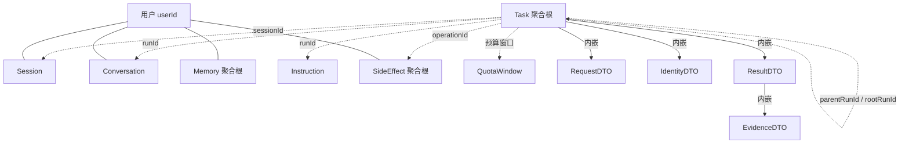

# 项目问题及解法

## 关键领域对象及其字段定义

> 按聚合根、实体、值对象分组，字段以 `pojo/dataobject`（持久化对象）和 `pojo/dto`（传输与内存对象）的当前定义为准。`TaskRowDO`、`SideEffectKeyDO` 只是查询投影，不作为领域对象列出。

### 聚合根与实体

#### 任务 Task（聚合根，`TaskDO`，整条记录以 JSON 存入 `supervisor_tasks.payload`）

一个受理请求对应一个任务；根任务和子会话共用同一套结构，`rootRunId` 指向共享预算的所有者，`parentRunId` 指向直接父任务。

| 字段 | 类型 | 定义 |
|---|---|---|
| `runId` | String | 任务编号，受理时生成，全局唯一。 |
| `userId` | String | 任务归属的用户，来自服务端令牌映射。 |
| `sessionId` | String | 所属会话编号；子会话使用自己的 `runId`。 |
| `requestId` | String | 受理幂等键；同一用户同一请求只建一个任务。 |
| `requestHash` | String | 请求内容指纹；`requestId` 相同但指纹不同时拒绝受理。 |
| `request` | RequestDTO | 原始请求：会话、问题、调用方历史和请求编号。 |
| `identity` | IdentityDTO | 令牌映射出的身份与权限，模型和请求正文不能修改。 |
| `state` | String | 任务状态字符串；终态取值见 `Status`，子会话另有 `PROVISIONAL`、`CLOSED` 等生命周期状态。 |
| `revision` | int | 输入版本；每收到一条补充或修改指令加一。 |
| `consumedRevision` | int | 本轮已消费的输入版本；小于当前 `revision` 时本轮结果作废。 |
| `generation` | int | 执行代际；重新认领时加一，旧执行晚到的提交会被拒。 |
| `calls` | int | 已用模型调用次数。 |
| `maxCalls` | int | 整棵任务树共享的模型调用上限。 |
| `createdAt` | long | 任务创建时间。 |
| `deadline` | long | 绝对截止时间；子任务继承父级，不因补充输入延长。 |
| `result` | ResultDTO | 终态结果，整体持久化。 |
| `pending` | List&lt;String&gt; | 待消费的补充输入。 |
| `userInputs` | List&lt;String&gt; | 已接收的用户输入，用于按轮次写入会话历史。 |
| `recordedInputs` | int | 已写入会话历史的输入条数，避免重复落库。 |
| `checkpoints` | Map&lt;String, String&gt; | 持久检查点，如 `loop:v3.3`、`plan:v1:current`、`correction:v1:*`。 |
| `events` | List&lt;String&gt; | 运行事件流水。 |
| `replacedBy` | String | 被哪个替代任务替换。 |
| `rootRunId` | String | 共享预算的根任务编号。 |
| `parentRunId` | String | 直接父任务编号；根任务为空。 |
| `agentPath` | String | 子会话路径；根任务固定为 `/root`。 |
| `agentRole` | String | 角色名；根任务固定为 `supervisor`。 |
| `accepted` | boolean | 是否已正式受理；子会话创建时先为 `PROVISIONAL`、未受理，受理后转 `RUNNING`。 |
| `notifiedGeneration` | int | 完成通知已投递到的执行代际。 |
| `completionQueuedGeneration` | int | 完成通知已入队的执行代际。 |
| `completionOutbox` | List&lt;AgentCompletionDTO&gt; | 待投递给父级的子会话完成通知。 |
| `mailbox` | List&lt;AgentMessageDTO&gt; | 协作消息邮箱：父级下发的消息和子级返回的结果。 |
| `inflightInputs` | List&lt;String&gt; | 尚未和上下文快照一起确认的输入投递批次。 |
| `inflightMailbox` | List&lt;AgentMessageDTO&gt; | 尚未和上下文快照一起确认的邮箱投递批次，重启后必须重放。 |
| `inputDeliveryId` | long | 输入投递批次序号。 |
| `mailboxDeliveryId` | long | 邮箱投递批次序号。 |
| `mailboxRevision` | long | 邮箱版本。 |
| `consumedMailboxRevision` | long | 已消费的邮箱版本，是输入版本栅栏之外的第二道栅栏。 |
| `agentTurnId` | String | 逻辑轮次编号，跨进程恢复保持不变。 |
| `collaborationReceipts` | Map&lt;String, String&gt; | 协作工具的幂等回执，键为操作编号加参数指纹。 |
| `acceptanceReceiptKey` | String | 子会话受理回执在父级回执表中的键。 |

#### 外部副作用 SideEffect（聚合根，`SideEffectDO`，表 `side_effect_operations`）

一次外部写操作对应一条记录，身份、工具和操作编号共同构成幂等键。

| 字段 | 类型 | 定义 |
|---|---|---|
| `userId` | String | 操作归属的用户。 |
| `toolName` | String | 工具名，幂等键的一部分。 |
| `operationId` | String | 业务操作编号，幂等键的一部分。 |
| `downstreamId` | String | 下游系统返回的持久编号。 |
| `paramsHash` | String | 参数指纹；发生变化按参数冲突拒绝。 |
| `paramsJson` | String | 参数原文。 |
| `operationStatus` | String | 账本状态：`RUNNING`、`SUCCESS`、`FAILED`、`UNKNOWN`。 |
| `responseText` | String | 下游结果原文，按不可变字符串保存。 |
| `submitCount` | int | 已提交次数。 |
| `lookupCount` | int | 已核对次数。 |
| `nextLookup` | long | 下次允许核对的时间。 |
| `retryAllowed` | boolean | 确认未执行后是否允许重新领取。 |

#### 会话 Session（实体，`SessionDO`，表 `supervisor_sessions`）

| 字段 | 类型 | 定义 |
|---|---|---|
| `userId` | String | 会话所属用户。 |
| `sessionId` | String | 会话编号。 |
| `currentRunId` | String | 该会话当前指向的任务编号。 |

#### 会话原文 Conversation（实体，`ConversationDO`，表 `supervisor_conversations`）

| 字段 | 类型 | 定义 |
|---|---|---|
| `userId` | String | 对话所属用户。 |
| `sessionId` | String | 所属会话编号。 |
| `runId` | String | 产生这条对话的任务。 |
| `question` | String | 用户问题。 |
| `answer` | String | 最终答复。 |
| `requiredTools` | String | 本回合实际需要的工具，用于权限复核。 |
| `createdAt` | long | 写入时间。 |

#### 长期记忆 Memory（聚合根，`MemoryDO`，表 `supervisor_memories`）

| 字段 | 类型 | 定义 |
|---|---|---|
| `userId` | String | 记忆所属用户。 |
| `memoryKey` | String | 偏好键，当前只接受 `preferredDepartureCity`、`preferredSeat`、`replyLanguage`。 |
| `memoryValue` | String | 记忆值。 |
| `version` | int | 乐观锁版本，删除和修改都要带期望版本。 |
| `source` | String | 记忆来源；管理接口写入为 `explicit-user-confirmation`，对话工具写入为 `conversation-agent:<runId>`。 |
| `expiresAt` | long | 过期时间。 |
| `deleted` | boolean | 墓碑标记，删除后保留记录。 |

#### 指令 Instruction（实体，`InstructionDO`，表 `supervisor_instructions`）

| 字段 | 类型 | 定义 |
|---|---|---|
| `runId` | String | 指令所属任务。 |
| `instructionId` | String | 指令编号，幂等键的一部分。 |
| `fingerprint` | String | 指令内容指纹；同编号不同指纹拒绝。 |
| `response` | String | 首次处理结果，重复提交直接回放。 |

#### 配额窗口 QuotaWindow（实体，`QuotaWindowDO`，表 `supervisor_windows`）

| 字段 | 类型 | 定义 |
|---|---|---|
| `windowKey` | String | 配额窗口键。 |
| `startedAt` | long | 窗口开始时间。 |
| `calls` | int | 窗口内已用调用次数。 |
| `tokens` | long | 窗口内已用 token 数。 |

### 值对象

| 值对象 | 字段 | 定义 |
|---|---|---|
| `IdentityDTO` | `userId`、`permissions` | 服务端令牌映射出的调用者身份；`permissions` 是工具名集合，`allows(tool)` 是唯一判断入口。 |
| `RequestDTO` | `sessionId`、`question`、`history`、`requestId` | 一次受理请求；调用方历史只作为待核实资料，请求编号用于幂等。 |
| `ResultDTO` | `status`、`originalQuery`、`rewrittenQuery`、`intent`、`answer`、`agents`、`evidence`、`events` | 一轮运行的完整结果，整体持久化到任务记录。 |
| `EvidenceDTO` | `tool`、`status`、`source`、`data` | 实际工具查询记录，不依赖模型声称“已查询”；`data` 是用于核对和渲染的证据字段。 |
| `LimitsDTO` | `timeout`、`modelCalls`、`outputTokens` | 单轮运行预算，整棵子 Agent 树共享同一份。 |
| `PermissionsDTO` | `allowedTools`、`requiredTools`、`filteredTools`、`evidenceTools`、`evidenceCount`、`evidenceRecheckPassed` | 权限复核证据：直接权限、实际所需工具、被过滤的差集，以及证据复核是否通过。 |
| `AgentMessageDTO` | `sender`、`recipient`、`kind`、`message`、`result`、`requiredPermissions` | 父子会话之间的协作消息；所需的证据工具会自动并入权限集合。 |
| `AgentCompletionDTO` | `generation`、`message` | 已结束回合的待投递通知，独立于当前回合结果，避免被后续任务覆盖。 |
| `SideEffectOutcomeDTO` | `status`、`response` | 下游返回的一次操作结果，状态见 `SideEffectOutcomeStatus`。 |
| `SideEffectResultDTO` | `operationId`、`status`、`response`、`submitAttempts`、`lookupAttempts` | 账本返回给调用方的不可变结果。 |

### 对象之间的关系

关系分三种：内嵌（值对象随聚合整体保存）、按编号引用（聚合之间只存编号，不持有对象）、派生（运行时或查询时计算，不持久化）。

实线表示内嵌或归属，虚线表示只按编号引用。

| 关系 | 类型 | 说明 |
|---|---|---|
| Task → `RequestDTO`、`IdentityDTO`、`ResultDTO` | 内嵌 | 值对象存在任务 JSON 里，随任务整体保存，没有独立生命周期。 |
| `ResultDTO` → `EvidenceDTO` | 内嵌 | 结果持有本轮证据；证据里的工具必须出现在身份的权限集合内。 |
| Task → Task | 自关联 | `parentRunId` 指直接父任务，`rootRunId` 指共享预算的根任务；只存编号，不持有父任务对象。 |
| Task → Session | 按编号引用 | `Task.sessionId` 指向会话，`Session.currentRunId` 反向指向当前任务；子会话的 `sessionId` 等于自己的 `runId`，不挂到用户会话。 |
| Task → Instruction | 一对多 | 指令按 `runId` 归属任务，自己独立成行，记录幂等键和首次响应。 |
| Task → Conversation | 一对多 | 任务结束后按用户和会话写入对话历史，`Conversation.runId` 记录来源任务；任务删除不影响已写对话。 |
| Session → Conversation | 一对多 | 同一用户的同一会话按时间累积多轮对话。 |
| Memory | 独立聚合 | 按 `userId + memoryKey` 存取，和任务、会话没有外键；请求装配时按用户读取。 |
| 工具执行 → SideEffect | 协作 | 账本是独立聚合：工具调用按 `userId + toolName + operationId` 先落账，结果再作为 `EvidenceDTO` 回到任务，任务本身不持有账本记录。 |
| Task → QuotaWindow | 共享计数 | 窗口按 `windowKey` 独立计数，多个任务共享同一窗口的调用数和 token 数。 |
| Task → `LimitsDTO` | 运行期派生 | 任务持久化的是 `deadline` 和 `maxCalls`；`LimitsDTO` 是运行期传给 `RunControl` 的预算值对象，不存库。 |
| `AgentMessageDTO` → `ResultDTO` | 内嵌 | 子会话结果随协作消息传递，父级只取证据和状态。 |
| `AgentCompletionDTO` → `AgentMessageDTO` | 内嵌 | 完成通知携带最终消息，等待父级投递。 |
| `PermissionsDTO` | 派生值对象 | 由 `IdentityDTO.permissions`、运行所需工具和证据工具算出，只出现在查询结果里，不持久化。 |
| `SideEffectOutcomeDTO` → SideEffect | 输入 | 下游适配器返回的权威结果，用来推进账本状态。 |
| `SideEffectResultDTO` → SideEffect | 投影 | 账本对一次操作返回的不可变视图。 |

聚合之间只按编号引用，不假设数据库外键；值对象没有独立表；事务边界按聚合划分：`TaskStoreService` 负责 Task、Session、Instruction、QuotaWindow，`ConversationService` 负责 Conversation 和 Memory，`SideEffectLedger` 负责 SideEffect，且每条语句自动提交。

### 状态与枚举

| 枚举 | 取值 | 定义 |
|---|---|---|
| `Status` | `SUCCESS`、`NEEDS_INPUT`、`UNKNOWN_INTENT`、`NO_DATA`、`PARTIAL`、`INVALID_INPUT`、`FAILED`、`TIMEOUT`、`RUNNING`、`CANCELLED`、`REPLACED`、`BUDGET_EXHAUSTED`、`CONTEXT_LIMIT`、`RESULT_UNKNOWN` | 任务与证据的状态；名称会持久化，不能随意重命名。 |
| `Action` | `MESSAGE`、`SWITCH`、`CANCEL` | 运行中指令的动作；可省略，省略即 `MESSAGE`。平台不区分补充与修改，由模型结合上下文理解。 |
| `Intent` | `WEATHER`、`TRAIN`、`ITINERARY`、`UNKNOWN` | 业务意图，只用于结果展示；真实执行路径通常为 `UNKNOWN`，不决定是否执行工具。 |
| `SideEffectStatus` | `RUNNING`、`SUCCESS`、`FAILED`、`UNKNOWN` | 副作用账本自身的持久状态。 |
| `SideEffectOutcomeStatus` | `SUCCESS`、`FAILED`、`PROCESSING`、`UNKNOWN`、`CONFIRMED_NOT_EXECUTED` | 下游适配器能给出的权威结果。 |

## 结论速览

> 说明：第 1 题是记忆与上下文总览，按内容优先级置顶。

> 阅读约定：正文先用中文说明业务行为和边界，类名、表名、配置键只放在每节末尾的“实现对照”里，便于核对，不影响阅读。状态标签只描述当前代码；“目标设计”单独标注，不当作已经实现。文中出现的默认值都可以由配置覆盖，不是写死在业务逻辑里的承诺。

| 序号 | 问题 | 当前实现状态 | 一句话结论 | 口述要点 |
|---|---|---|---|---|
| 1 | 记忆和上下文怎么存、记忆怎么分层、上下文超长怎么办？ | 部分覆盖（演示级；按缓存层架构） | 业务数据和长期记忆以数据库为事实源，知识库原文在文件或对象存储；缓存是加速层，进程内存是工作副本。 | 先分五件事： 1. **记忆怎么存**：工作记忆随任务检查点进数据库；会话记忆进已完成问答表；长期记忆正文和候选进数据库，检索索引在演示里是本地向量表；知识库原文在文件或对象存储，内存只放解析结果。 2. **上下文怎么存**：内存保存当前消息，任务检查点保存恢复快照，数据库保存最终记录；缓存只放热点副本。 3. **怎么分层**：工作、会话、长期、知识库四种作用域，写入路径、保留期和权限边界各自独立。 4. **什么时候写**：用户消息先进入工作记忆；任务正常收尾写会话记忆；长期偏好由对话中的记忆工具或管理接口写入；知识库只由资料导入。 5. **超长怎么办**：请求前按配置上限估算，超过就压缩；当前问题优先，摘要成功原子替换；仍超限进入上下文超限；被压掉的原文默认不保存。 **边界**：缓存是架构假设；演示向量索引不是生产向量库；压缩原文召回默认关闭。 |
| 2 | 子 Agent 执行时挂了怎么办？ | 部分覆盖（单实例恢复） | 单实例内靠期限、检查点、恢复扫描和执行代号兜底；没有租约和心跳，多实例可能重复认领。 | 先分三种挂法：进程崩溃、单次调用卡住、子 Agent 报错。 1. **进程崩溃**：任务检查点保存历史、证据、工具配对；恢复扫描重新认领，执行代号挡住旧结果。 2. **调用卡住**：每次调用取剩余时间和单次超时的较小值，超过就超时。 3. **子 Agent 报错**：可恢复的从检查点继续，不可恢复的重跑一次，仍失败就明确失败。 **边界**：只有单实例恢复，没有租约和心跳；多实例可能重复认领；已发生的下游副作用不能靠重跑撤销。 |
| 3 | 执行中用户又发来新指令怎么办？ | 已覆盖 | 补充输入排队，切换和停止立即生效；程序保证不丢、不重、不乱序，语义由模型判断。 | 把输入通道和语义分开： 1. **只说一句话**：默认按补充输入排队，任务版本加一，旧结果作废，在安全边界交给模型。 2. **切换**：创建替代任务，旧任务标记为已替换，立即生效。 3. **停止**：立即取消，不校验版本。 4. **防丢防重**：指令编号加内容指纹做幂等；提交时核对版本，旧结果不能覆盖新输入。 **边界**：平台不判断是补充还是修改，语义由模型理解。 |
| 4 | 任务最多能跑多久，最多能调用多少次模型？ | 已覆盖 | 绝对截止时间加预算预留，模型调用和总步数都有硬上限；追加输入会重置步数计数，但不重置全树模型调用次数。 | 从四个方向圈住： 1. **时间**：受理时写绝对截止时间，子任务继承，追加输入不延长。 2. **模型调用**：整棵任务树共享一份上限，每次调用前预留并落库。 3. **步数**：每个输入版本有步数上限，追加输入会换计数桶；跨版本真正的硬顶是模型调用上限和截止时间。 4. **子任务**：深度、扇出、活动子会话数都有限制，不能靠不断委派绕过预算。 **边界**：默认值由配置控制；步数超限复用预算耗尽，不新增对外错误码。 |
| 5 | 同一个请求或工具调用被重复提交，会不会执行两次？ | 已覆盖（演示级） | 请求、委派、只读缓存和副作用账本四道去重；只覆盖相同编号或参数，换参数、换名字仍会重新执行。 | 四层各管一段： 1. **用户请求**：同一用户、同一请求编号只建一个任务；编号相同但内容不同直接拒绝。 2. **父子委派**：调用回合、工具调用编号、参数指纹相同就复用，不重复派生子运行。 3. **工具配对**：请求和结果成对保存，恢复时只补缺失结果。 4. **外部写操作**：先落账再调用，业务操作号加下游幂等键；结果不明只核对，确认未执行才允许重试。 **边界**：平台承诺可核对的至多一次，不承诺任意下游恰好一次；换参数、换名字仍可能重复执行。 |
| 6 | 为什么要拆成多个 Agent，而不是一个 Agent 全干？ | 已覆盖（定性） | 单 Agent 优先；程序只在派生子 Agent 时复算门槛，默认只记录不拦截，强制模式也只拦深度和数量。 | 多 Agent 是为分开五件事：组织边界、上下文、生命周期、权限和故障；不是“模型越多越聪明”。 1. **什么时候拆**：只有独立、可并行、收益大于成本的子任务才拆；紧耦合任务用一个 Agent 加工具。 2. **程序怎么拦**：派生子 Agent 后复算深度、数量、并行度、成本和时延门槛；默认只记录，强制模式只硬拦深度和数量。 3. **计划工具**：只校验计划、不派发，默认关闭。 **边界**：子级默认继承父级完整历史；没有在线重规划，也没有跨任务成本评测。 |
| 7 | 父 Agent 和子 Agent 之间怎么传上下文和结果，怎么避免同一件事重复做？ | 部分覆盖 | 子级默认继承父级完整历史；结果按编号回传、按编号去重，没有结构化任务书。 | 先分清“传什么”和“怎么防重”： 1. **上下文**：默认把父级完整历史和权限快照传给子级；显式关闭继承才隔离。没有平台生成的结构化任务书。 2. **结果**：完整结果进父级邮箱，模型通知只带状态、证据和答案；细节按编号再取。 3. **防重**：父调用编号、子结果编号、工具请求结果配对、副作用账本四道锁。 **边界**：只认精确编号和参数，换名字、换说法、换参数仍可能重复；子结果没有统一输出契约校验。 |
| 8 | 多轮对话怎么记住上文，长期偏好怎么保存？ | 部分覆盖（演示级；低风险偏好可由对话写入） | 四层分开；低风险偏好可由模型按用户原话写入，任意事实的自动提炼仍未实现。 | 记忆分四层，存储介质见第 1 题；这里讲怎么用： 1. **每轮装配**：先工作记忆，再会话摘要和最近问答，再长期记忆，最后知识库。 2. **话题切分**：显式切换词加天气、车票、行程关键词；旧话题只留问题摘要，当前话题保留最近若干轮。 3. **长期偏好**：用户明确表达时，模型调用记忆工具写入白名单键，并要求引用当前用户原话；其他记忆走管理接口或候选审核；聊天不会自动提炼任意事实。 4. **检索**：演示用本地哈希向量，生产目标是专用向量数据库。 **边界**：只支持出发城市、座席、回复语言三个白名单键；话题切分是关键词规则；生产向量库、自动提炼和删除级联未实现；原文召回默认关闭。 |
| 9 | 知识检索结果是对的，模型却把答案说错了，怎么办？ | 部分覆盖 | 先分清证据没到、没采用、读错算错、证据不足四类；提示主要改善采用，程序只兜住数值和日期的一部分。 | 先分四类根因：证据没进上下文、进了没采用、用了但读错算错、证据本身不足或冲突。 1. **提示能做什么**：改善“采用”，不能保证“理解正确”。 2. **程序能做什么**：默认核对数值和日期是否有证据；高风险回答缺出处时降级；严格模式要求结构化声明与证据一致。 3. **证据不足**：明确说冲突或无法确认，不逼模型选边。 **边界**：语义反读、计算错误、条件错误仍未覆盖；严格校验会覆盖前面的降级状态；没有忠实度评测。 |
| 10 | 上下文太长被截断，关键信息丢了怎么办？ | 部分覆盖（演示级） | 超过配置上限才压缩；当前问题优先，仍放不下就截断；被压掉的原文默认不保存。 | 分三件事：预算超了、压缩丢条件、压缩后找不回。 1. **触发**：请求前按配置的上下文上限估算，超过才压缩；没有百分比阈值。 2. **保留**：当前问题优先，其次任务条件、未完成工具调用、最近工具结果；仍放不下就截断并标记。 3. **存储**：压缩后的历史进任务检查点；摘要失败保留原历史，替换是原子的。 4. **找回**：原文召回默认关闭；开启后只存在检查点里，按压缩编号分页读取。 **边界**：默认不保存被压掉的原文，压缩后细节可能丢失；摘要忠实度只做词元级保留率，不是语义判断。 |
| 11 | 一个工具调用失败，已经成功的结果要不要保留？ | 已覆盖（演示级） | 普通查询失败保留已成功结果并判部分完成；超时、预算、取消、上下文超限和纠错耗尽会直接结束本轮。 | 普通失败不回滚已成功结果： 1. **查询失败**：以结构化错误回给模型，模型可以改参数、换工具、换子 Agent、问用户或收尾。 2. **成功结果**：已经写入消息和检查点，后续继续可用。 3. **部分完成**：有成功也有失败，判部分完成，保留证据，不伪装全部成功。 4. **写操作**：不能回滚，走副作用账本核对。 5. **直接终止**：同城路线、纠错耗尽、超时、预算耗尽、取消、上下文超限会结束本轮。 **边界**：没有“任意工具失败几次就换工具”的通用规则，普通失败仍靠模型判断和总预算兜底。 |
| 12 | 哪些失败可以重试，哪些不能重试？ | 已覆盖（演示级） | 只重试瞬时且未超次数的只读调用；参数、权限、预算和副作用不明不重试，写工具不接入。 | 只看三件事：有没有副作用、是否明确未执行、是否还在期限和预算内。 1. **可重试**：连接失败、瞬时超时、可重试的 5xx、普通限流；只用于只读工具。 2. **不可重试**：参数错误、权限、未找到、预算、取消、上下文超限、账户配额不足。 3. **副作用不明**：不直接重试，先核对账本和下游。 4. **模型调用**：已经输出内容后不再重试。 **边界**：写工具不接入普通重试；账户配额 429 当前归为“未知”，标签不准确但不会重试。 |
| 13 | 重试时怎么保证外部写操作只执行一次？ | 已覆盖（演示级） | 先落账再调用，结果不明只核对；平台承诺可核对的至多一次，不承诺下游恰好一次。 | 先落账，再调用： 1. **落账**：调用下游前，以独立语句提交“执行中”记录，不能和业务事务一起回滚。 2. **调用**：带持久幂等键；账本限制提交次数，不限制下游实际执行次数。 3. **收尾**：成功、失败、确认未执行、无法确认四种结果分别记账。 4. **结果不明**：只核对，不重新提交；确认未执行且适配器支持幂等，才允许重新领取。 **边界**：下游既不支持幂等也不支持查询时，只能人工核对；平台承诺可核对的至多一次。 |
| 14 | 模型选错工具或参数写错，怎么办？ | 部分覆盖 | 工具名和参数结构有确定性格挡与纠错上限；工具能力是否匹配任务没有运行期判断。 | 工具名和参数结构有确定性格挡： 1. **工具名**：运行期固定工具快照，表外工具按不存在处理。 2. **参数**：按参数模式校验，错误以结构化结果回给模型修正。 3. **纠错**：同一工具连续参数错误达到阈值后禁用；业务违规和总纠错也有上限；计数写入检查点。 4. **回复校验**：空内容、截断、重复或缺失的工具调用编号直接判本轮无效。 **边界**：工具存在、参数合法但能力不匹配时，没有运行期判断；没有候选工具重排序或动态目录。 |
| 15 | 参数格式没错但业务含义不对，谁来拦？ | 部分覆盖（演示级） | 查询工具在调数据源前执行可声明规则；规则只覆盖日期和字段不相等，写工具不走这套规则。 | 参数格式对但业务不成立，要靠业务规则拦： 1. **规则从配置加载**：每条声明规则编号、绑定工具、类型、字段和建议文案。 2. **当前支持三类**：日期不能早于今天、日期不能超过未来窗口、两个字段不能相等。 3. **执行位置**：权限和格式检查之后、调数据源之前；违规返回参数不合法证据，带规则编号和建议。 4. **覆盖范围**：只绑定天气和车票查询；订票不走这套规则。 **边界**：不是通用规则引擎，不支持跨记录查询、远程下发或用户级规则；写操作没有通用预演。 |
| 16 | 模型调用了不存在的工具，怎么办？ | 部分覆盖 | 运行期工具快照拒绝表外工具；同一工具名第二次要求澄清、第三次失败，换名重新计数。 | 表外工具按不存在处理： 1. **第一次**：返回工具不存在，让模型重选。 2. **第二次**：返回“工具不可用，请澄清”，但不会强制暂停。 3. **第三次**：纠错耗尽，按失败收尾，不暴露内部工具清单。 4. **计数**：按工具名分开，换名会重新计数；总纠错和模型调用次数仍是硬顶。 **边界**：没有平台级动态工具目录；澄清不强制暂停；换名可以绕过单工具计数。 |
| 17 | 模型调用了用户没有权限的工具，怎么拦？ | 部分覆盖 | 只做工具名级权限；业务工具按权限下发，执行和证据回放再查；没有参数级或资源级授权。 | 分三层拦： 1. **注册层**：业务工具按用户权限和 Agent 声明权限的交集下发，模型看不到无权限工具；元工具不受这套过滤。 2. **执行层**：真正执行前再查权限、参数、期限、预算和副作用类型；运行中撤权也会被拒。 3. **证据层**：结果、子结果和历史回放返回前重新查权限，旧证据会失效。 **边界**：只有工具名级权限，没有参数级、资源级或数据范围级授权；只有订票接入审批；没有按 Agent 和工具作用域发放凭证。 |
| 18 | 多个 Agent 或工具互相绕圈、无限调用，怎么办？ | 已覆盖（演示级；语义检测默认关闭） | 期限、预算、树结构和纠错上限保证循环有界；精确重复和调用环检测已开启，语义检测默认关闭。 | 把循环分三层圈住： 1. **全局硬上限**：绝对截止时间、全树模型调用、单版本步数、调用前预留、有限重试、有界并发。 2. **模型—工具循环**：工具快照、纠错上限、只读结果复用、同工具同参数重复检测；语义相似检测默认关闭。 3. **Agent 之间**：树形层级、同名子会话拒绝、活动子会话上限、调用图回边检测默认开启、协作目标语义检测默认关闭。 **边界**：语义检测是字符相似度，不是模型判断；没有跨任务树全局调用图和按发送者的消息速率配额；默认建议模式只记录不拦截。 |
| 19 | 平台有没有使用意图识别？在哪些地方用，为什么执行链路不用？ | 已覆盖（执行链路明确不用；辅助场景用确定性关键词） | 执行链路不做意图识别；只有话题切分和离线演示用关键词，且不影响工具选择。 | 执行链路不做意图识别： 1. **为什么不用**：一句话可能多意图、有否定和指代；先分类会多一层错误；工具选择本来就是模型的工作；多一次判断多一次成本和延迟。 2. **话题切分**：用显式切换词、承接词和天气/车票/行程关键词，只影响历史装配范围，不影响工具选择。 3. **离线演示**：关键词解析只服务没有模型凭据时的脚本化回归。 4. **结果字段**：真实模式通常是未知，不参与路由。 **边界**：没有向量或模型级话题识别；关键词按演示场景硬编码；置信度是固定值。 |
> 标注说明：表格的“口述要点”先用中文讲业务行为，再列当前实现和边界；实现名称只用于核对，不代表目标设计已经实现。
>
> 速览按“结论—当前实现—边界”组织，本文只保留结论速览，不再展开逐题长答。第 1 题按“项目已有独立缓存层”的架构口径回答，缓存组件按 Redis 或等价缓存描述，数据库仍是事实源；其余题按当前代码行为说明。

> 记忆写入约定：普通聊天不需要前端判断调用哪个记忆接口。低风险偏好由模型在对话中调用记忆工具写入，并引用用户原话；任务正常收尾自动写会话记忆；长期记忆的管理接口和候选审核继续保留；知识库只由资料导入。当前白名单只覆盖出发城市、座席和回复语言，任意事实的自动提炼仍未实现。

> 文档定位：本文是当前项目的结论速览，按问题给出状态、一句话结论和口述要点，不展开实现细节。
>
> 事实依据：`docs/技术方案.md`（v4.0，2026-10-29）、`docs/多agent平台改造.md`、当前 `src/main/java` 行为基线。
>
> 状态口径：
> - **已覆盖**：当前代码有明确机制、持久化字段或测试，能回答该问题。
> - **部分覆盖**：主体机制已有，但边界、兜底或评测还不完整。
> - **尚未考虑**：没有平台级统一机制，只有零散实现或完全没有。
> - **口述要点**：先用中文讲业务行为，再列当前实现和边界。

